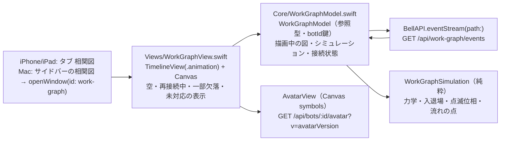

# 相関図（work graph）の描画

[全体図](overview.md) / [機能索引](function-index.md)。データの契約と動きの仕様は [work-graph module](../work-graph/README.md) と [behavior-spec](../work-graph/behavior-spec.md) が正本で、ここではApple側の部品と状態の持ち主だけを書く。数値（力・時間・大きさ・色）は仕様から写し、ここへ複製しない。以下のファイル名は`ios/BellBot/BellBot/`からの相対名。

## 部品

| 部品 | 持つもの | 持たないもの |
| --- | --- | --- |
| `WorkGraphModel` | 描画中のnodes/edges（botId・edge id鍵）、epoch/version、各nodeの位置・速度・入退場の開始時刻、熱α、接続状態（接続中・再接続中・degraded・未対応）、再接続の待ち時間 | 永続状態（無い）。HTTPの再試行の判断以外の通信 |
| `WorkGraphSimulation` | 1フレームの力計算と積分、入退場の補間、点滅の不透明度、流れの点の位置 | 状態の保持（引数で受けて返す） |
| `WorkGraphView` | 1つのTimelineViewと1つのCanvas。描画順は辺→node→label。アクセシビリティ要素の一覧 | 位置の計算（モデルが持つ） |

## 流れ

| 段階 | 処理 |
| --- | --- |
| 開く | 画面が見えてactiveの間だけ`GET /api/work-graph/events`を開く。最初の`snapshot`で描画中の図を置き換える（2回目以降の接続ではbotId/edge idで差分を取り、両方にあるnodeは位置を保つ） |
| 変更 | `change`はepochが一致し`version == 前回 + 1`の時だけ順に適用。それ以外（欠番・新epoch・解釈失敗）は接続を閉じて取り直す |
| 入退場 | member-enterは画面外の決まった角度から飛び込み、member-leaveは中心から外へ飛び去る。leave開始後のnodeは力を出さない |
| 辺 | edge-startで線が依頼元から伸び、その後に点が依頼元から依頼先へ流れる。edge-endで薄れて消える |
| 熱 | 変更を適用した時と大きさが変わった時にα=1。毎フレーム減衰し、下限で漂い続ける |
| 切断 | 通信の失敗・終了、または35秒無通信。最後の図を残し、点滅と流れを止め、彩度を落として`再接続中…`を出す。直ちに、その後1,2,4,8,15,15…秒（±20%）で再接続し、開いている間は諦めない |
| degraded | 空でない間は図を出したまま`一部の情報を取得できていません`を出す |
| 未対応 | 旧サーバーで404の時は`このサーバーでは相関図をまだ使えません`を出し、再接続しない（画面を開き直すと再確認） |
| 読めない応答 | 図を残して`相関図の応答を読めませんでした。再接続しています…`を出し、同じ待ち時間で再接続を続ける |
| 背景 | iOSで背景へ回る、Macで窓を閉じる時は接続を閉じる。戻ったら接続し、snapshotとの差分を描く |

## 仕様との違い（Owner指示、2026-11-08）

- 画面いっぱいに使う：重心・境界・間隔は実際に描ける範囲（上下の安全域とタブを除く）で決め、力の大きさはその短辺mから決める。反発 `0.00009·m³·min(1, 6/n)`、ばねの長さ `0.38·m`、中心への引力 `0.004·m/W`（横）・`0.004·m/H`（縦）で長い辺の向きほど弱い。衝突距離は `S×2.2`。
- 人数が増えたら小さくする：`S = max(36, min(仕様の12人超の縮小, √(W·H/n)·0.3))`。
- ラベルはアイコン・名前・他のラベルに重ねない。線の上の空いた所（中央から順に5か所）を新しい依頼から取り、空きが無ければ出さない（全文は長押し・ポインタ）。10本超では始まって5秒以内の依頼だけ。
- 応答を読めない時は`相関図の応答を読めませんでした。再接続しています…`を出したまま再接続を続け、読めるsnapshotで消える（止めるには保護の名前と自力の出口が要る、トロニー裁定）。欠番・新epochは仕様どおり取り直す。
- 共通の仕様（behavior-spec.md）を同じ値へ揃えるかは、Web・Windowsと合わせるため持ち主（ブラック）へ渡す。

## 配置

- iPhone/iPad: 予定・ゴール・相関図・設定の順のタブ（`AppStore.selectedTab`）。全画面。
- Mac: サイドバーの`相関図`ボタンが`WindowGroup("相関図", id: "work-graph")`を開く。最小480×360pt、大きさ変更可。

## 試験

- `BellBotTests/WorkGraphModelTests.swift`: 変更の適用順・欠番での取り直し・snapshot差分で位置を保つ・leaveの猶予なし（サーバー側の責任）・力学1ステップの不変条件（境界・衝突）。
- 描画の画面写真は`test/helpers/work-graph-server.mjs`（契約どおりのsnapshotとchangeを流すfixture）で撮る。
