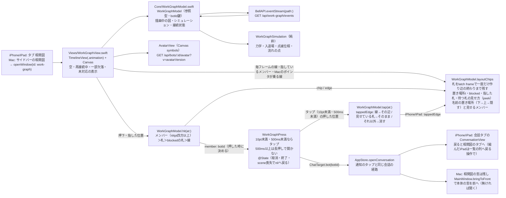

# 相関図（work graph）の描画

[全体図](overview.md) / [機能索引](function-index.md)。データの契約と動きの仕様は [work-graph module](../work-graph/README.md) と [behavior-spec](../work-graph/behavior-spec.md) が正本で、ここではApple側の部品と状態の持ち主だけを書く。数値（力・時間・大きさ・色）は仕様から写し、ここへ複製しない。以下のファイル名は`ios/BellBot/BellBot/`からの相対名。

## 部品

| 部品 | 持つもの | 持たないもの |
| --- | --- | --- |
| `WorkGraphModel` | 描画中のnodes/edges（botId・edge id鍵）、epoch/version、各nodeの位置・速度・入退場の開始時刻、熱α、接続状態（接続中・再接続中・degraded・未対応）、再接続の待ち時間。各edgeの札（`Line.chip`：置いたt・現れた時刻・nullへ戻った時刻・最後の文）と、最後のフレームの札の層（`chips`）と線（タップ判定用）、iPhone/iPadで線をタップして札を見せている辺（`tappedEdge`） | 永続状態（無い）。HTTPの再試行の判断以外の通信 |
| `WorkGraphSimulation` | 1フレームの力計算と積分、入退場の補間、点滅の不透明度、流れの点の位置 | 状態の保持（引数で受けて返す） |
| `WorkGraphView` | 1つのTimelineViewと1つのCanvas。描画順は辺→blockedの札→node（名前を含む）→重ならない札→指している札。札の文の測定（`chipSize`）と描画。アクセシビリティ要素の一覧。押下中の`WorkGraphPress`（`@State`。押している間だけtrueの`@GestureState`が戻る時に消す）とMacのポインタ位置（hover） | 位置・札の置き場所の計算（モデルが持つ）。会話を開く画面遷移（`AppStore.openConversation`が持つ） |
| `WorkGraphPress` | 押した位置・時刻・押した時のbotId・10pt以上動いたか・今の指の位置（iPhone/iPadの札を出す位置）。タップの判定（`isTap`：10pt未満・500ms未満。メンバーも線も同じ） | 図の状態（押した後の変化を見ない） |

## 流れ

| 段階 | 処理 |
| --- | --- |
| 開く | 画面が見えてactiveの間だけ`GET /api/work-graph/events`を開く。最初の`snapshot`で描画中の図を置き換える（2回目以降の接続ではbotId/edge idで差分を取り、両方にあるnodeは位置を保つ） |
| 変更 | `change`はepochが一致し`version == 前回 + 1`の時だけ順に適用。それ以外（欠番・新epoch・解釈失敗）は接続を閉じて取り直す |
| 入退場 | member-enterは画面外の決まった角度から飛び込み、member-leaveは中心から外へ飛び去る。leave開始後のnodeは力を出さない |
| 辺 | edge-startで線が依頼元から伸び、その後に点が依頼元から依頼先へ流れる。edge-endで薄れて消える |
| 熱 | 変更を適用した時と大きさが変わった時にα=1。毎フレーム減衰し、下限で漂い続ける |
| 切断 | 通信の失敗・終了、または35秒無通信。最後の図を残し、点滅と流れを止め、彩度を落として`再接続中…`を出す。直ちに、その後1,2,4,8,15,15…秒（±20%）で再接続し、開いている間は諦めない |
| degraded | 空でない間は図を出したまま`一部の情報を取得できていません`を出す |
| 未対応 | 旧サーバーで404の時は`このサーバーでは相関図をまだ使えません`を出し、60秒に1回だけ確かめ直す（速い再試行はしない）。本体が入れ替わって次のsnapshotが届いたら描き始める。止まるのは取消と認証失敗（出口はログイン）だけ |
| 読めない応答 | 図を残して`相関図の応答を読めませんでした。再接続しています…`を出し、同じ待ち時間で再接続を続ける |
| 背景 | iOSで背景へ回る、Macで窓を閉じる時は接続を閉じる。戻ったら接続し、snapshotとの差分を描く |
| メンバーのタップ | behavior-spec.md「Tap or click on a member」。押した時に`member(at:)`でbotIdを決める（描画と同じ`frames`の位置、アイコンと名前の各四角を44pt四方まで広げる）。タップ判定の順は`hit(at:)`の メンバー＞重ならない札＞blockedの札＞線 で、メンバーの範囲で始まった押下は上に札があってもメンバーへ行く。10pt未満の移動・500ms未満で離したら、そのbotIdで`AppStore.openConversation(.bot(botId))`。500ms以上は長押しで開かない（別の長押しジェスチャは持たない）。退場中のnodeも押せ、離すまでに消えても開く。削除済みBotは会話側の通常の扱い。押下の記録は`@State<WorkGraphPress?>`で持つ（ジェスチャのコールバックから`@GestureState`を読まない）。新しい押下かどうかは位置でなく、記録がnilかどうか（`WorkGraphModel.updatePress`が、nilなら押した位置でbotIdを決める）。取り消された押下はonEndedに来ないが、押している間だけtrueの`@GestureState`（`pressing`、`.updating`でtrueにする）が取消でも終了でもfalseへ戻り、`onChange(of: pressing)`が記録を消すので古い押下は次へ残らない（同じ位置に別のメンバーがいればそちらを開く）。離す時はonEndedが記録を読んで使い、すぐ消す。最初の標本が結合されて既に10pt以上動いていても、動いた扱い。見えなくなる・scenePhaseが変わる時はMacのポインタ（hover）と押下の記録を消す。時刻は描画と同じ`WorkGraphModel.now`（`Date`）で測る（`DragGesture.Value.time`もDateだが、押下と離しで同じ時計を使うため使わない）。iPhone/iPadは会話タブへ移り、その会話から戻ると相関図のタブへ帰る（iPhoneは`chatPath`が空になった時、縮んだiPadは`NavigationSplitView`が一覧の列へ戻った時に`AppStore.returnFromConversation`）。タブを離れた相関図は接続を閉じ、戻ると再接続して差分を描く。Macは相関図の窓を残し、本体の窓を前へ出す（閉じていれば`openWindow(id: "main")`で開く。前へ出せなかった時は相関図の窓に理由を出す）。ポインタを重ねるだけでは開かない |
| 札 | behavior-spec.md「Edges」。`layoutChips`が毎フレーム、始まった順（サーバーの`startedAt`、同時なら線のID順、`labelOrder`）に処理する。latch frame（`label`があり、両端の入場700ms・動きを減らす設定で200msが終わった最初のフレーム。退場中・もういない端は終わった扱い）で札を一度だけ作る。配置slotを得た札は、最初に置いた時から辺の終わり（線と一緒に300ms）まで表示を続ける。混んだ図（開いた依頼が10本超）でも線が120pt未満でも、配置済み札が3秒で消えたり、指した時だけ現れたりしない。空きslotを待つ札は配置済みとは別で、下記のhover/tap中だけ一時表示する。文が変われば折り返しだけ変わる。`label`がnullへ戻れば300msで消える。置き場所は`t = 0.5, 0.45, 0.55, 0.4, 0.6, 0.35, 0.65, 0.3, 0.7`の最初の空き。障害物は、アイコンの四角・描いている名前の文字の四角（`nameText`。不透明度0の名前と隠れた名前は除く）・先に置いた札（blockedも含む）で、どれも4pt広げて判定する。退場中（Leave、600ms）のメンバーのアイコンも名前も障害物ではない（札は無視する）。空くまでは描かず、最初に出る時は200msで現れる。今のtが空いていれば動かさず、ふさがれば最初の空きへ、どこも空かなければ今のtのままblocked（線のすぐ上・メンバーと名前と重ならない札の下に描く。空けば戻る）。描いた札は隠さない。指す位置はMacがポインタ、iPhone/iPadは押している指（タップと長押し）。指した札は一番上に描く。空きが無く待つ札（描いていない札）は、Macでは線へポインタを重ねている間、iPhone/iPadでは線をタップしてから次の別のタップまで、`t = 0.5`に一番上（`chips.above`）へ描き、そうでなくなれば待つ状態へ戻る（置き場所は取らず、ほかの札の障害物にもならない）。開いた線だけが対象で、`peek`で渡す辺が`endedAt`済み・`label`がnullなら出さない。タップ（`isTap`）は押した位置の`hit(at:)`で決める：線ならその辺へ見せる札を移す（別の線なら移る）／見せている札そのものは動かさない／メンバー・空いた所・ほかの札は消す。メンバーのタップは従来どおり会話を開く。描いている札（`t`あり）には線のタップで何も足さない（指した時の最前面は従来どおり） |
| 名前 | behavior-spec.md「Edges」末尾。`frames(_:at:)`が毎コマ（Webと同じく固定せず）決める。下の名前の文字の四角が、他のメンバーのアイコンを4pt広げた四角（退場中のメンバーは除く。入場中は描いた大きさ）に重なるなら、顔の上（アイコンの上端から6pt離す）へ移る。上も重なるなら隠す（`nameHidden`。不透明度0と同じく`nameText`がnilで、札の障害物にならない）。隠れた名前を見せるのは、Macのポインタを重ねたメンバー・iPhone/iPadで指を置いている（長押しを含む）メンバーだけで、`layoutChips(reveal:)`へ`hit(at:)`が返したメンバーを渡す。見せる間は下の位置に描き、障害物にもなる。名前の欄の位置（隠れた名前は下のまま）が押せる範囲で、隠れた名前の欄の押下もメンバーへ行く（`hit(at:)`の順は変えない） |

## 仕様との違い（Owner指示、2026-11-08）

- 配置・大きさはbehavior-spec.mdの改訂（描画範囲Dで正規化した力、各軸の広がりに合わせた重力、`S×2.2`の衝突、人数による縮小）と同じ式で、`WorkGraphModel.step`に写している。数値は仕様と[layout-sim.mjs](../work-graph/layout-sim.mjs)が正本。
- 線とアイコンを重ねない（Owner）：衝突の後に、つながっていない線から`S/2+10pt`より近いアイコンを線に垂直に押し出し（不足分の35%/フレーム）、線の両端を各7.5%逆へ動かす。
- 演出（Owner）：線は依頼元の会話の窓の色（`AvatarTone`、アバター画像からの代表色）を濃くした電線（淡い被覆7pt＋導線2.5pt）。中を同じ色相の明るい筋（破線16/30pt）が90pt/sで依頼元から依頼先へ走る。光はぼかさず太さの違う2本で描く。依頼の文は封筒の印・依頼元の色の左帯と縁・線を指す尖りの付いた白い札。札は最大180pt幅で、文は切らずに折り返し、行の高さ16ptで行数ぶん伸びる（behavior-spec.md、Owner裁定 2026-11-09）。封筒は1行目の高さに置く。
- 描画は1秒30回（TimelineViewのminimumInterval）。毎表示フレームと毎フレームのぼかしで、Mac 115の相関図がCPUを94%使った。
- 札の表示と置き場所は仕様（「Edges」）どおりで、上の「札」の行に書いた。札の形（線の上に浮かせ、下の尖りで線を指す）だけがApple独自で、置き場所の判定は尖りを含む範囲で行う。`label`がnull（要約がまだ無い）の線は札を出さない（読み上げは`<依頼元>から<依頼先>へ依頼`）。
- 応答を読めない時は`相関図の応答を読めませんでした。再接続しています…`を出したまま再接続を続け、読めるsnapshotで消える（止めるには保護の名前と自力の出口が要る、トロニー裁定）。欠番・新epochは仕様どおり取り直す。

## 配置

- iPhone/iPad: 予定・ゴール・相関図・設定の順のタブ（`AppStore.selectedTab`）。全画面。
- Mac: サイドバーの`相関図`ボタンが`WindowGroup("相関図", id: "work-graph")`を開く。最小480×360pt、大きさ変更可。本体の窓は`WindowGroup(id: "main")`で、載せた窓のsessionを`MainWindow.sessionID`に覚える。
- アクセシビリティ: 各メンバーの要素は描いたアイコンの位置に置き、ボタンの役割・ヒント`チャットを開く`・実行で同じ経路を開く。

## 試験

- `BellBotTests/WorkGraphModelTests.swift`: 変更の適用順・欠番での取り直し・snapshot差分で位置を保つ・leaveの猶予なし（サーバー側の責任）・力学1ステップの不変条件（境界・衝突）・札の文の折り返し（行の高さ16pt）・札を置く順（`startedAt`の古い順）。
- 同ファイル（札）: latch frameは`label`と両端の入場の終わりを待つ（動きを減らす設定は200ms、退場中の端は終わった扱い）・混んだ図（11本）でも短い線（120pt未満）でも3秒後・60秒後も出続け、辺の終わりに300msで消える・空きが無い札は期限なく待ち、空いたコマで200msで現れる・文の変更は測り直しだけ、nullへ戻ると300msで消える・空いている間はtを保ち、ふさがれた時だけ最初の空きへ移る・描いている名前とアイコンには重ならない・不透明度0の名前は障害物にならず、見えたらふさがれて移る・退場中のメンバーのアイコンも名前も障害物でない・空きが無ければ今のtのままblocked、空けば戻る・タップの順（メンバー＞札＞blockedの札＞線、上に札があってもメンバー）。
- 同ファイル（名前）: 下が他のアイコンに重なる名前は顔の上へ移る・上下とも重なる名前は隠れて障害物にならず、その欄の押下はメンバーへ行く・指している間だけ見えて札がよけ、ほかのメンバーを指しても見えない。
- 同ファイル: タップ範囲の44pt四方・10pt/500msの境目・線/札/空いた所で開かない・押した時のbotIdを退場後も保つ・取り消された押下の後の同じ位置の新しい押下は新しいメンバーを開く・最初の標本が10pt以上動いていれば動いた扱い・400〜500msの押下はタップで500ms以上は開かない・相関図から開いた会話で戻ると相関図のタブへ帰る（縮んだiPadの`returnFromConversation`を含む）。
- 同ファイル（待つ札）: 待つ札の線をタップすると`t = 0.5`で最前面に出て置き場所は取らず、空いた所のタップで待つ状態へ戻る・別の線のタップで見せる札が移る（見せている札そのもののタップは動かさない）・メンバーのタップは線に奪われず見せている札を消す・終わった辺は押せず見せない・Macは線にポインタが乗る間だけ見せる・`isTap`の10pt/500msの境目。
- `BellBotUITests/WorkGraphTapUITests.swift`（iPhone）: fixtureの相関図でハルを押すとハルの会話が開き、戻ると相関図のタブへ帰る。fixtureのURLは`TEST_RUNNER_BELLTEAM_WORK_GRAPH_FIXTURE_URL`。
- 描画の画面写真は`test/helpers/work-graph-server.mjs`（契約どおりのsnapshotとchangeを流すfixture。長い依頼の文2本と`label`がnullの線を含む）で撮る。
