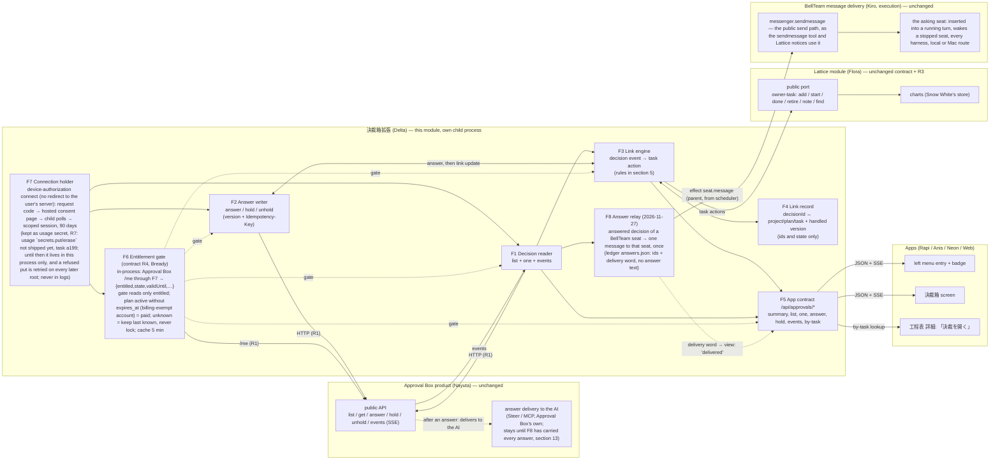
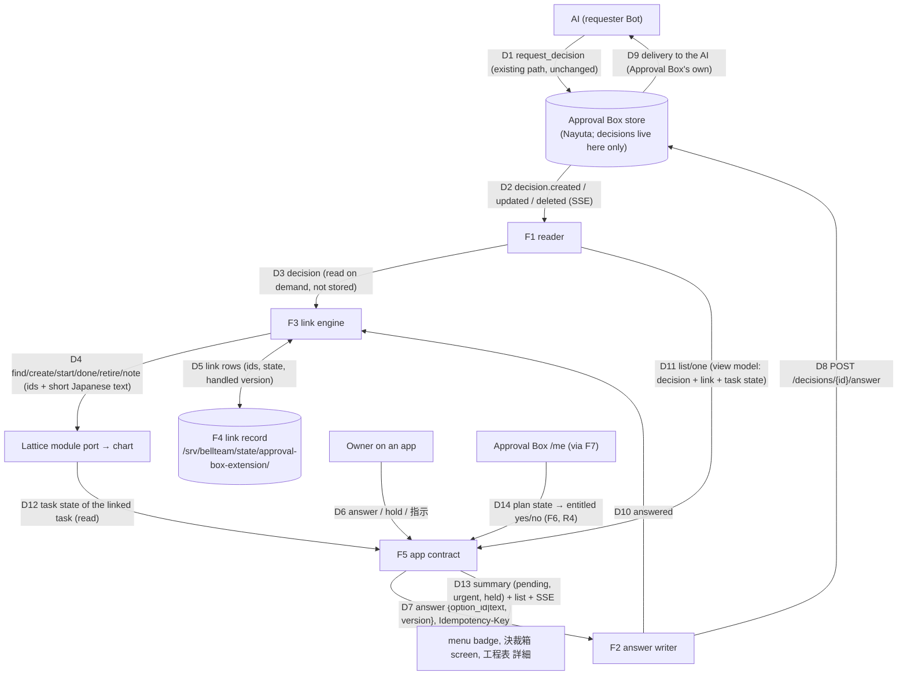
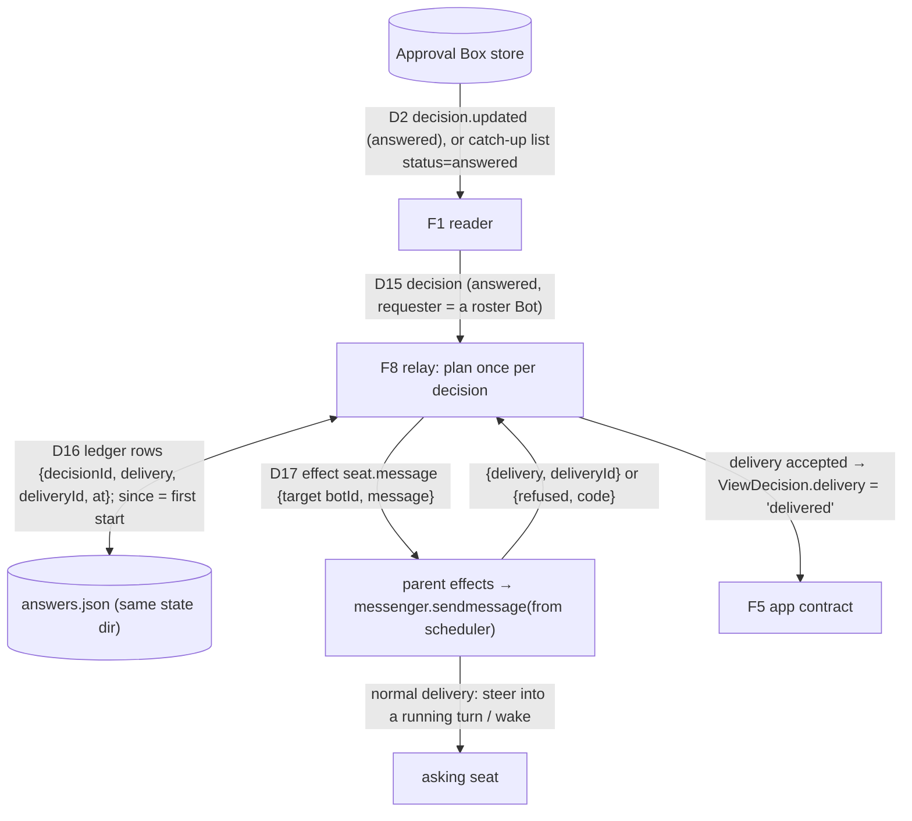
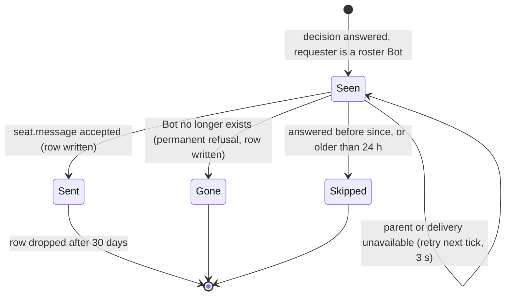

# BellTeam 決裁箱拡張 (approval-box-extension)

> **2026-11-24: the client path is [client-v0.5.md](client-v0.5.md)** (BellTeam's 決裁箱 is the Approval Box client: `/v1` now, `/pc/v1` with the Approval Box app). Section 3 and the app contract's content routes describe the body path that new client builds no longer use; link rules L1-L10, the link record and the screens stay.

> **2026-11-26: the one port from BellTeam to Approval Box (hosted connector, one pairing, one decision interface, the Owner's sitting) is drawn in [seats-on-hosted-daemon.md](seats-on-hosted-daemon.md).**

Owner of this module: Delta (bot-ae42e3e9). Chart row: `bellteam-dev-added/a154-approval-ext-design`. Status: design accepted by the Owner 2026-11-15; first implementation PR = this folder + `src/approval-box-extension/` pure core (origin, ViewDecision, entitlement, link rules, connect state). Child process, mount, usage secret effects and screens are later PRs of their owners. Screens: [screen-spec.md](screen-spec.md). Contract: [contract/approvals-contract.md](contract/approvals-contract.md). Plan: `/srv/bellteam/bots/bot-7b140b27/docs/approval-box-extension-plan-20261115.md`.

This folder is canonical (same shape as `modules/lattice/`). Diagrams and code ship in one diff. The pictures are rendered from `mockups/approval-box-screens.html` (frames `entry`, `main`, `answer`, `chain`, `origin`, `phone`, `edge`; open it with the frame name as the hash). Connections to other modules are drawn in both modules' docs (Approval Box and Lattice rows, `module.json`).

## 1. What it is, in one paragraph

An optional, paid BellTeam extension that turns Approval Box into a first-class BellTeam screen and connects it to the chart. A decision an AI files in Approval Box becomes **one chart task** (lane: `approval-box`, 決裁箱; the extension is its worker, because the Owner does no chart work himself: Owner ruling 2026-11-16, 「担当者のいない工程はダメ。オーナーの工程もオーナーは作業しませんから、決裁箱の工程にしなければならない。」); answering the decision marks that task **done**; if the answer does not settle the next step and the AI files a new decision, that decision becomes a new task **inserted into the chain** (an ordinary chart revision). Approval Box stays the owner of decisions (its server, API, iPhone/Android/Web apps, connector). Lattice stays the owner of tasks. The extension owns only the link between them and the BellTeam screens. Existing Approval Box clients keep working unchanged.

Owner words that fix the requirement (plan, 2026-11-15): 「決裁に出したことがそのまま工程に組み込まれる」「工程表には決裁箱って工程が一個作られていいし、決裁箱に回答したら、その工程は済みになる。…次工程のために解決しない決裁箱のだったら、決裁箱が工程に差し込まれる。それは普通の工程の改定」.

## 2. Boundary (same shape as Lattice / Flora)

| Owner of | Who | The extension's relation |
| --- | --- | --- |
| Decisions: server `approval-box.kitepon.dev`, public API, push, connector | Nayuta (bot-4366a50b); Apple apps Red Shoes | reads and answers through the **public API only**, one credential; never reads its config, DB or internal modules; never copies decisions into BellTeam storage |
| Tasks and charts | Snow White (Lattice product); BellTeam's Lattice module: Flora (bot-7e777fe5) | writes and reads tasks only through the Lattice module's **public port**; never touches `LATTICE_CHARTS_ROOT` |
| Billing and licence | Bready (bot-823b56e9); licence server Pepper; usage Mika | asks "is this extension entitled?"; never stores money or entitlements |
| Native screens | Rapi (Apple), Anis (Windows), Neon (Linux); Web: see open R6 | draws nothing itself; owns the design and the app contract they draw from |
| **This module** | Delta | decision-to-task link rules, link record, app contract `/api/approvals/*`, screen design, entitlement gate |

Rules inherited from the Owner: the diagrams are the contract; no raw ids, codes or paths on screen; never silently port another product's UI (the screens are BellTeam's own, built from the Lattice design language); a function is built by the product that owns its facts and served through a contracted interface.

## 3. Function diagram

Connections that must also appear in the other products' diagrams (same diff as the code): Approval Box `docs/architecture` (a new reader: the extension, via the public API row of R1, including `/me` for the entitlement); Lattice module `docs/architecture/modules/lattice/` (a new caller of the owner-task facade, R3, and the apps' `by-task` lookup); usage/billing docs (state that the extension entitlement is Approval Box's own subscription and is not in the BellTeam subscription verdict, R4); the Apple/Windows/Linux/Web module docs (new screen and entry).

## 4. Data-flow diagram

What is stored where (the answer to "does the extension copy decisions": no):

| Data | Home | Extension copy |
| --- | --- | --- |
| Title, context, options, answer, status, delivery, history | Approval Box | none persisted. Read on demand; the app view model lives in memory for the length of a request or a stream |
| Task rows, edges, who waits | Lattice (charts) | none. Task state is read through the port when a screen needs it |
| decisionId ↔ project/plan/task, link state, last handled `version`, per-chain bookkeeping | extension (F4) | the **only** thing it owns: ids and state, no decision text |
| Scoped Approval Box session (from the connect flow, expires in 90 days) | where it is kept is R7 (Mika); never in the link record, never printed; read by F7 | held in memory; never printed, never in the link record |
| Entitlement | Approval Box's own subscription (`/me`), contract R4 by Bready | none stored; the last result is kept in memory (5 min) |

## 5. Link rules (the chart side of the Owner's requirement)

Trigger source: F1's event stream (`decision.created | updated | deleted`) plus one catch-up read at start and every reconnect (a list of pending, held and recently answered decisions), so a missed event heals itself. Every rule is idempotent: the task id is derived from the decision id (`dec-<lowercased decision id>`), so a replay finds the same task (`existing: true`).

| # | When (Approval Box says) | Chart action (through the Lattice port, actor = the Owner seat, lane `approval-box`; lane `owner` is no longer used for new tasks) | Link record |
| --- | --- | --- | --- |
| L1 | a decision is `pending`, has no link, and is BellTeam's (its requester is a BellTeam Bot, R2; or L8 applies) | `facade.link` first (R3: so the Lattice hand-over cannot hand the card over between add and link), then find the target chart and plan (rule T below); add ONE task, lane `approval-box`, title = the decision title (Japanese, as the Owner reads it), design memo = what is decided and which decision (short), not the whole context; connect it as a predecessor of the task that waits for it (rule W below) | `linked` |
| L2 | `answered` (answer `option_id` or `text`) | `start` unless in progress, then `done` with evidence = the Owner's answer label and time (Japanese). The waiting task becomes startable; the Lattice module's existing notices wake its lane | `answered` |
| L3 | `cancelled` by the AI | `retire` with reason = the AI's cancel reason, or its Japanese gist | `closed` |
| L4 | `amended` (version moves, status still pending) | `note` on the task: 「内容が直されました（直した項目）」. The title is not rewritten (Lattice has no rename; the screen reads the live title from Approval Box) | `linked` (version updated) |
| L5 | `held` / unheld | no chart change. The task stays; the screen shows 保留 from Approval Box. (A held decision is not a stop: it waits on the Owner's choice to return it) | `linked` |
| L6 | a task is `done` or `retired` on the chart while the decision is still pending (someone closed it by hand) | do NOT cancel the decision (the AI owns it); show the mismatch on the card: 「工程はすでに済みです」, and offer nothing destructive | `diverged` (shown, self-heals when the decision ends) |
| L7 | a new decision from the **same session** (same `session_label`) arrives while the chain's previous decision task is `done` and its successors are not finished | insert instead of append: add the new task **after** the previous decision task and **before** the successors (the successors now wait for it). This is Lattice's ordinary revision, nothing special | `linked` |
| L8 | a decision whose `session_label` already names a task (`Lattice <project> <plan>/<task>`, the convention the Lattice module hand-over uses today) | do not create a task; attach the decision to that existing `approval-box`-lane task (a card in any other lane, `owner` included, is not attached) and drive it with L2/L3 | `linked (attached)` |

| L9 | a decision from **outside BellTeam** (requester not a BellTeam Bot, or unknown) | **no chart action at all** (no task, no note, no link row). It is still read, listed, counted, answered and held exactly like any other. Shown with the 外部から badge and 「工程表とはつながっていません」 (neutral, not an error) | none |
| L10 | an external decision whose `session_label` names a BellTeam chart task (L8's form) | treated as L8: attach, drive with L2/L3; shown as a normal linked decision (still with 外部から if its requester is not a BellTeam Bot) | `linked (attached)` |

**Owner's binding rule (2026-11-15, 「ベルチーム以外の決裁来るはずだ。…非表示にするようなことはするな」)**: Approval Box is a system of its own, so the Owner's list holds decisions from other teams' Bots, terminal seats, Mac-side agents and other products. The extension **never hides one**: visibility does not depend on the link, the requester, or the origin. Origin only changes how a card is drawn (face and name for a BellTeam member; a tool tile and the session name for anyone else) and whether a chart task exists. The only control over the list is the 出どころ filter (すべて / BellTeam / 外部), default すべて, and while it narrows the list a line always says how many are hidden and offers すべてを見る. The menu badge and the summary count **all** pending decisions regardless of the filter.

Rule T (target chart, BellTeam decisions only): L8 names it. Otherwise the chart whose creator is the requester Bot (`facade.charts()` row `createdBy`), otherwise the coordinator chart (today `bellteam`, Trony). Plan: one plan per chart, `approval-box` (created once by the module through the port), phase `decisions`.
L7 mechanics with the confined door (R3): `todo add --plan approval-box --task dec-<new> --lane approval-box --after dec-<previous>`, then `todo predecessor add --plan <waiter plan> --task <waiter> --after approval-box/dec-<new>` (one end is a `dec-*` task, which the door allows), then optionally `todo predecessor remove` with the old `--after approval-box/dec-<previous>` for the same waiter. Edges are read from `facade.chart` (`edges`), split at the first `/`.
Rule W (who waits): L8 names the waiting task; the successors of the previous decision task in L7 are known from the chart. A decision with no known waiter still becomes a task (the Owner must see it on the chart); it simply has no successor edge.

Relation to the Lattice module's existing Owner-wait hand-over (L18/L19, Flora; its lane is `approval-box` after a189): with the extension entitled, a card that has a link row is **skipped** by the hand-over (the hourly reminder was removed, Lattice a211) (the extension already drives it); without the extension everything stays as today. The hand-over's "creator Bot files one plain-Japanese request" stays the way decisions get filed; only the manual "record the answer on the chart" step disappears. This needs one lookup from Flora (R3).

The extension never files, edits or cancels a decision (the AI side keeps those; the API gives apps only answer/hold/unhold). It never retries an answer that has an unknown outcome; it re-reads the decision instead (Idempotency-Key makes a resend harmless).

## 6. State it owns

`/srv/bellteam/state/approval-box-extension/` (server uid, same family as `lattice-module/`; BellTeam state dir, not a Bot project). One file `links.json`, written atomically (temp + rename) before the effect it records, so a crash replays the effect. Row: `{decisionId, projectId, plan, taskId, state: linked|answered|closed|diverged, attached: bool, sessionLabelRef, handledVersion, updatedAt}`. No titles, no contexts, no answers. A decision gone from Approval Box (deleted) and a closed task: row removed after 30 days (`shortcut: fixed age, when the Owner wants an audit trail, keep in the chart evidence instead`).

Link record state machine (self-exits are the retries):

```mermaid
stateDiagram-v2
  [*] --> New: pending decision seen, no row
  New --> Linked: L1/L8 task created or attached (idempotent)
  New --> New: Lattice port unavailable (retry next tick; the decision still shows on the screen)
  Linked --> Answered: answered → start + done
  Linked --> Closed: cancelled → retire
  Linked --> Diverged: task ended while decision pending (L6)
  Diverged --> Answered: decision answered
  Diverged --> Closed: decision cancelled
  Answered --> [*]: row removed after 30 days
  Closed --> [*]: row removed after 30 days
  Answered --> Answered: done failed → retry next tick (decision stays answered)
```

## 7. Entry points the extension uses (public only)

| Need | Entry | Status |
| --- | --- | --- |
| List pending/held, one decision, answer, hold, unhold, event stream | Approval Box `docs/api.md` `/v1` decisions + `/events` (v0.22) | exists, but its auth is the Apple/Google **login session** of the user, not a BellTeam-held credential → **R1** |
| One credential for BellTeam to hold | `connection export` (`approval-box.connection.v1`) and `connector /v1` are scoped to one connection (a requester), Nayuta: a cross-connection read was declined as a privilege choice | not enough alone → **R1** |
| Chart read/write | Lattice module seat tool and the app contract `/api/lattice/*` (read) | read exists; owner-actor write of one task and the lookup → **R3** |
| Entitlement | Approval Box `GET /me` through the credential F7 holds (`plan` trial/active/expired, `expires_at`, `store`, `billing`; api.md v0.37); mapping and cache rules are Bready's contract [entitlement-read-r4-20261115.md](/srv/bellteam/bots/bot-823b56e9/docs/entitlement-read-r4-20261115.md) | `/me` joins the Owner-credential allowlist with R1 (design only, not on main yet) |

## 8. Requests to other owners (each one result expected; none started before the Owner accepts the design)

| # | To | Request | Why it is theirs |
| --- | --- | --- | --- |
| R1 | Nayuta | **CHANGED 2026-11-15 by the Owner (「BellTeamを決裁箱のクライアントとして追加するだけ」; he rejected grant-and-paste): instead of the `kot_` credential, a registered client `bellteam`: the user signs in and consents once on a hosted Approval Box page and the extension receives a SCOPED session with the same allowlist. **Trony 2026-11-15: no redirect to the user's server** (BellTeam is self-hosted, mostly on a LAN address with no public host, so a redirect URI allowlist cannot serve customers; `bellteam.kitepon.dev` is one test target only), so the flow is device-authorization style: the child asks Approval Box for a request code, the app opens the hosted consent page with the code already in the URL (no paste, no typing), the Owner signs in and consents, and the child polls Approval Box until the session is granted, denied or the request expires. **ON MAIN (924d4f6) AND DEPLOYED (API v0.38), contract `/srv/bellteam/bots/bot-4366a50b/repos/approval-box/docs/bellteam-client.md`**: start `POST /connector/v1/pairing {device_name, client:"bellteam"}` (no auth) → `{pairing_id, code, qr_url, poll_secret, expires_at (15 min)}`; open `qr_url` in the user's browser; the user signs in and consents on the Web `/pair` page; the child long-polls `GET /connector/v1/pairing/{id}` with `X-Poll-Secret` (~25 s) → `waiting\|claimed\|delivered\|rejected\|expired`; `claimed` carries `{session, expires_at}` once; the session is a Bearer on `/v1` with the allowlist above; **sliding 90 days** (use renews it; unused for 90 days → 401); the user removes it in Approval Box's connection list (`kind:"client"`) → 401 and `/events` closes within 25 s. Not done on Nayuta's side: connector npm release (`requester_bot_id`), native apps approving. the session expires after 90 days (401 → 決裁箱につなぐ again); `source.requester_bot_id` stays; start/redeem calls come in Nayuta's ONE message when they are on main, nothing merged yet. The text below is the earlier `kot_` form; the allowlist and requester facts still hold.** Earlier: **PROPOSED by Nayuta, ACCEPTED by Delta 2026-11-15** (`docs/owner-credential.md`, api.md v0.38, branch `feat/owner-credential-20261115`, not on main yet): a new bearer class on `/v1`, `Authorization: Bearer kot_…`, granted by the signed-in Owner, valid until revoked, sees every decision of the account (BellTeam and non-BellTeam alike), rejected on `/connector/v1` and `/mcp`. Allowlist: `GET /v1/decisions`, `GET /v1/decisions/{id}`, `POST …/answer`, `POST …/hold`, `…/unhold`, `GET …/attachments/{aid}`, `GET /v1/events` (SSE), `GET /v1/me`. Requester: existing `source.requester` (name) + `source.client` + `session_label`, and the new optional `source.requester_bot_id` (display only). (superseded: no pasting; F7 runs the connect flow and holds the session) | decisions and credentials are Approval Box's facts |
| R2 | Nayuta | **ANSWERED by R1**: `source.requester_bot_id` is additive and optional; `session_label` stays server-built (`requester / work_label`). Delta classifies the origin from it (contract file, "How origin.kind is decided"); before the connector release that sends the id, an exact roster-name match of `source.requester` is used for BellTeam decisions (`basis:"name"`) | convention used by L8 and by the Lattice hand-over today |
| R3 | Flora | **AGREED by Delta 2026-11-15, as CORRECTED by Flora** (the Owner seat id is a named protection, README L17 of the Lattice module: `LATTICE_SEAT_ID=owner` is reachable only from the unblock route): one confined door `facade.ownerTask({projectId, args, input?})`, actor = the literal `owner` set by the child (the extension passes no `from`). Allowed only: `plan create` with plan_key `approval-box` and tasks `dec-*` in lane `approval-box`; `todo add --plan approval-box --task dec-* --lane approval-box` (+ `--after/--before/--phase/--title/--design-memo/--reason`); `todo start|done|retire|note|retract` on `approval-box/dec-*` or on a task registered with `link` (L8); `todo predecessor add|remove --plan P --task T --after <plan>/<task>` when one end is such a task (same chart only; never `--from-project`; Lattice 0.104.0 canonical verb, the old `dependency connect|disconnect` is only an alias that Flora drops later). Else `LATTICE_OWNER_TASK_REFUSED` (403, nothing runs). `facade.link({projectId, plan, taskId})` → `{schema:'bellteam.lattice-link.v1', …, linked:true}` marks the card decision-driven (her hand-over skips it) and registers a non-`dec-*` task for the writes above; idempotent, no unlink; called **before** `todo add` (L1) and on attach (L8); refuses an existing card whose lane is not `approval-box`. Reads: `facade.chart(projectId)` → `cards` and `edges [{from, to, waiting}]` (ids `<plan>/<task>`; another chart: `<project>:<plan>/<task>`; finished leaf cards stay with `archived:true`), `facade.charts()` → `projectId, name, createdBy, coordinator`. A write waits at most 50 s in the facade queue, so an answer never waits on it (rule in section 9). Card-detail hook `GET /api/approvals/by-task?project&plan&task` (200 `{decisionId,status,title}`, any failure → no block). How my child reaches the facade is R5 with Molly | the chart is Lattice's; the module is the only door |
| R4 | Bready | **AGREED by Delta 2026-11-15** (Bready's proposal, `/me` fields from Nayuta, api.md v0.37): the entitlement is Approval Box's own subscription (Apple IAP, scope = the Approval Box account), not a BellTeam billing call. One in-process function in F6 reads `/me` through F7's credential and returns `{product, entitled, state: paid|trial|expired|revoked|none|unknown, validUntil, store, checkedAt}` (this row's older wording about trial is superseded by decision (d)); the gate reads only `entitled`; **Owner decision (d), 2026-11-15: the extension is usable exactly when Approval Box is usable for that account, so trial and billing-off are entitled** (state `trial` / `paid`); only expired, revoked and none are not; unknown = keep last known, never lock; cache 5 min (negative 1 min). An existing Approval Box subscriber is entitled with no second charge; a BellTeam-only user subscribes in Approval Box's app (the not-entitled view says so; no purchase code in BellTeam; the menu entry stays visible so the view can explain) | billing facts are Bready's |
| R7 | Mika | **AGREED by Delta 2026-11-15** (Mika's ruling `/srv/bellteam/bots/bot-203444ca/docs/abx-session-secret-r7-20261115.md`, origin/main b4995ff5): the session is a usage secret, scope `{terminalId:'approval-box-extension', purpose:'approval-box.session'}`. usage gains system-only `secrets.put {scope,value}` (private 0600 record, revision n+1 if present, nothing on any projection or event) and `secrets.erase {scope}` (revokes the handle, deletes value and record, retry-safe); reads use `credentials.current(scope)` + `withResolved`. Three body effects on the module channel, composed by Molly from `usageAssembly.credentials`: `session.put {value}` right after the grant, `session.get` → `{value}`\|null at child start and on 401, `session.erase` on 「つなぎを外す」 and on a 401 a fresh get does not cure; failures reach the child as fixed codes with no value. The value lives in the child's memory only. I store a small JSON string as the value (`{token, expiresAt}`, plus a refresh token if Nayuta offers one) so the screen can say 「◯月◯日まで」; the port does not change. Unlink calls Approval Box's revoke first if it offers one (best effort), then erases; the local erase never waits on the remote. Named protection: secret exposure; self-exit: 401 or unavailable → erase → 決裁箱につなぐ | secrets are the usage module's |
| R5 | Trony / Molly | module packaging: own child process, payload, catalog row, `module.json` (draft in this folder), ownership row in the first PR | module exchange is Molly's |
| R6 | Trony | who builds the Web screen: Flora-style (module owner) or Admi's Web shell | decided by the coordinator |

Nothing here edits Approval Box, Lattice, billing, or an app. R1 (Nayuta, including `/me` on the Owner-credential allowlist) is the only one that blocks code; R3 and R4 are agreed and wait for Flora's facade change; R6 (Web screen) is Admi's, asked by Trony. The design stands without them.

## 9. Failure handling (what each failure shows and how it leaves)

The views are in [screen-spec.md](screen-spec.md#failure-views). Contract level: a failed read keeps the last view dimmed and retries with backoff 1,2,4…30 s forever while open; a failed answer changes nothing and offers the same button again (Idempotency-Key reused); an unknown delivery is shown as such (「届いたか不明」) and never converted to success; a Lattice outage never blocks an answer (the answer goes first, the task follows on the next tick); an Approval Box outage never changes a task; an `unknown` entitlement never locks the screen (R4). None of these is a guard that stops the system: every one exits by the next tick or by an action on the same screen.

## 10. Not in v1 (named so nobody assumes them)

Filing, amending or cancelling decisions from the app (the API gives the apps only answer/hold/unhold, and the AI owns the rest); **uploading** attachments (Approval Box has attachments now, api.md v0.23+, but the Owner credential does not allow upload by design; reading the AI's request images and the answer attachments **is** in v1, read only); desktop push notifications (iPhone/Android keep Approval Box's own push; BellTeam apps update live while open and by the menu badge); more than one Owner account; changing the title of an existing task when a decision is amended (Lattice has no rename; a note is added); statistics beyond today's 2/5 ring.

## 11. Verification plan (minimal, by the diagrams, at implementation)

F1/F2 against a recorded Approval Box fixture (list, answer 200/409/402/503, events replay); F3 rules L1–L8 as a pure table test over (decision event, link row, chart state) → (port action, new row); crash points between "write row" and "port call"; one real round trip on the Owner's own chart once R1–R4 exist; screens by real screenshots from Rapi/Anis/Neon accepted against the mockups.

## 12. The child (step 2, R5 with Molly)

Parent side (process, effects, mount, update): [runtime/approval-box-extension-child.md](../runtime/approval-box-extension-child.md) (Molly). This page owns the child:

| File | Role |
| --- | --- |
| `src/approval-box-extension-protocol.mjs` | protocol v1: roots `summary / list / get / answer / hold / unhold / attachment / byTask / connection / connect / cancelConnect / disconnect / refresh`; effects `lattice.ownerTask / lattice.link / lattice.chart / lattice.charts / members.list / session.get / session.put / session.erase`; validators; wire errors |
| `src/approval-box-extension-ipc.mjs`, `-dispatcher.mjs`, `-entry.mjs` | channel, generation control and entry, the lattice child's shape; reads run beside the one write at a time; `refresh` is a write (it is the engine) |
| `src/approval-box-extension/core.mjs` | F1-F7: gate (connected + entitled, in-process), Approval Box calls, events held by the child (`/v1/events`, ring of 200, backoff 1-30 s forever), the connect poll, the engine tick, `links.json` (temp + rename) |
| `src/approval-box-extension/answer-relay.mjs` | F8 (section 13): the pure plan (who, whether, which message) and the ledger shape; the effect `seat.message` is in the protocol |
| `src/approval-box-extension/client.mjs` | the child's own HTTPS to approval-box.kitepon.dev (pairing, long poll, `/v1/*`, SSE parse); the session is never logged |
| `src/approval-box-extension/http-api.mjs` | the body-resident handler for `/api/approvals/*` (Owner only, JSON writes only, Idempotency-Key on answers, SSE framing); errors become the contract's bodies |
| `origin-view.mjs`, `entitlement.mjs`, `connect-state.mjs`, `link-plan.mjs` | the pure parts (step 1) |

Rules that the tests pin: `connection {}` never makes a network call (it is the exchange ready probe); an answer goes to Approval Box first and the task follows on the next tick; an external decision never causes a Lattice write; the first decision task rides in `plan create` (a plan may not be empty) and its `todo add` is skipped; free text that starts with `--` is stripped before it reaches the owner-task allowlist; every failed effect keeps the decision id for the next tick (nothing is given up).
Shortcuts named in the code: a Lattice duplicate is recognised by the code's name (`EXIST|ALREADY|UNCHANGED`); attachments travel base64 over the channel (Approval Box caps a file at 20 MiB); the plan-create input shape is Lattice's `plan_create_input.v5` and must be confirmed once against a real chart at the integration test.

## 13. Answer relay F8 (task abx-answers-as-member-messages, Owner 2026-11-27)

Owner words: 「他のメンバーからのメッセージが挿入されるのと同じように見えればいいと思います。」「ずっとSteerしていると思っていた。」「実装しろよ。それで解決するかもしれない。」 Cause that started it: Rapi's K-32S78Q (Owner answer 19:46 JST, seat on the Mac route) was saved but Approval Box could not confirm delivery to the seat, and the app asked him to paste a resume text. Approval Box's own delivery runs through hooks inside the seat's machine; BellTeam sees none of it. F8 carries the answer through the one path BellTeam does see.

Boundary: Approval Box stays standalone and calls no Aiterm. F1 already reads every decision change through the public API. F8 hands the answer to BellTeam's normal message delivery through the public send path `messenger.sendmessage` (the path of the `sendmessage` tool and of Lattice's notices, `from: 'scheduler'`). Nothing is added to execution (Kiro): the port exists and is used the same way by `lattice/nudge.mjs` and `lattice/owner-decisions.mjs`.

Data (D15-D17, drawn in the data-flow diagram below):

Rules (R-prefixed so the tests can name them):

| # | Rule |
| --- | --- |
| A1 | A decision relays when it is `answered`, its requester resolves to a roster Bot (`origin.kind = bellteam`, by `requester_bot_id`, else the exact name), and the ledger has no row for its id. Every origin that the link engine reads counts: /v1 and the hosted daemon alike; whoever answered (phone, Web, BellTeam app) does not matter. |
| A2 | Only answers made at or after the ledger's `since` (the moment the ledger file was first written) and not older than 24 hours relay. An old answer is never replayed by a restart or a first install. |
| A3 | The message names the Owner, the request title and id, the chosen option label and the free text, how many attachments the answer carries (`get_attachment`), and says that a copy by Approval Box's own delivery may already have arrived and is then ignored. Free text is the Owner's words, quoted and capped; it is the data, not an instruction from BellTeam. |
| A4 | A row is written only after the parent reports an accepted delivery word (`running`, `steered`, `queued`, `delivered`, `answered`) or a permanent refusal (`SENDER_NOT_FOUND`, `BOT_NOT_FOUND`, `MESSAGE_REQUIRED`: the Bot is gone). Any other failure keeps the id for the next tick, as every failed effect does; a lost reply can send a second copy, which A3 tells the seat to ignore. |
| A5 | The ledger holds ids and delivery words only, no answer text. Rows are dropped after 30 days. |
| A6 | While a row says accepted, the view shows `delivery: 'delivered'` unless Approval Box already says `fetched` or `delivered`; the app then never asks him to paste a resume text for this answer. |
| A7 | The engine tick is 3 s when no app is open (it was 30 s), so an answer made on the phone reaches the seat in seconds: SSE event → next tick → message. |

Approval Box's hook delivery (Stop/SessionStart-armed, "Stop hook feedback") is Nayuta's and stays until F8 has carried every answer for a week without a miss; it is the only path that wakes a seat whose BellTeam delivery is unavailable. Removing it is Nayuta's change, asked after that week.

