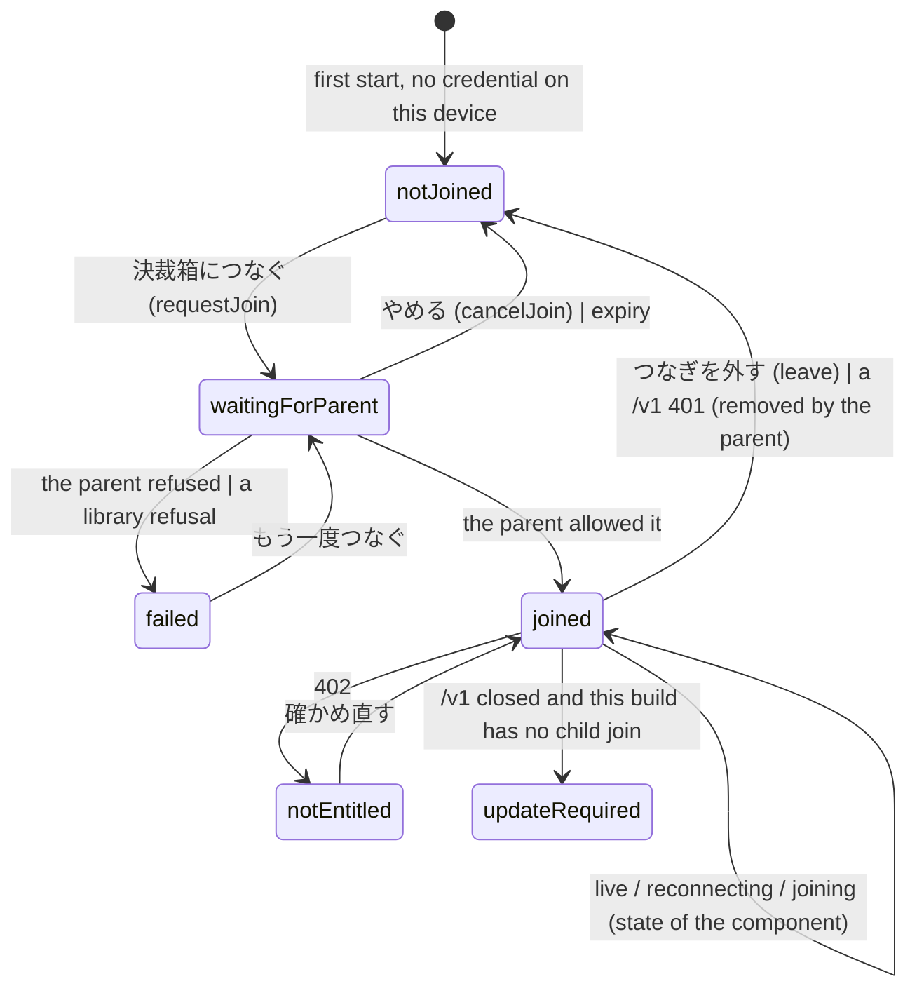
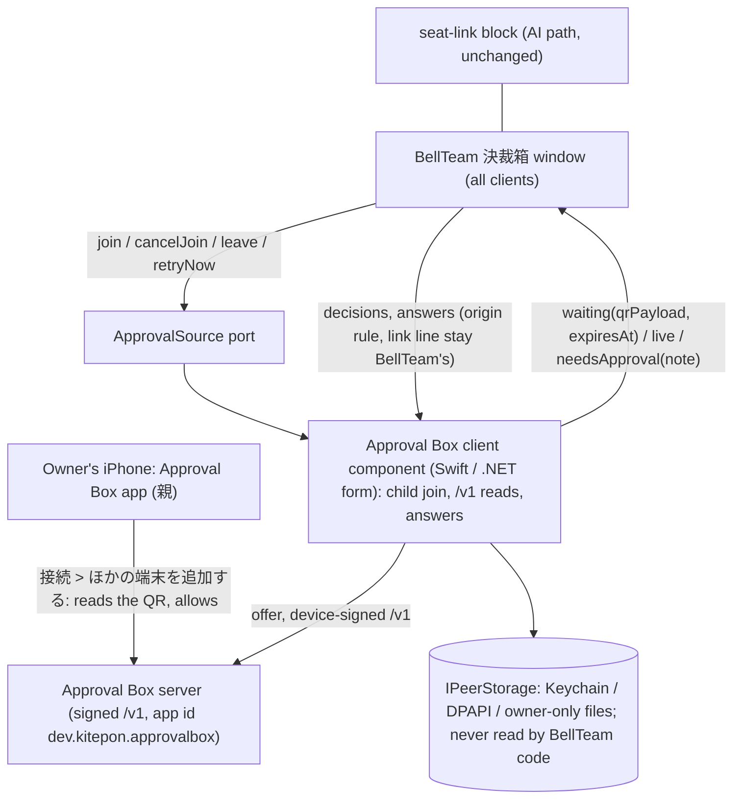

# BellTeam's 決裁箱 window joins the Owner's Approval Box as a child device (abx-child-join-contract, Delta 2026-11-24)

Owner 2026-11-24 18:2x JST: 「BellTeamもお前のプロダクトと全く同じ構成にしろ。基本的には子として接続するようにしろ。」 and, between the two options Nayuta put to him, 「明らかにAだ。」 Option A:

- BellTeam's client apps join the Owner's Approval Box entry as **child devices** through their 決裁箱 window, like his iPad and Mac. They are never a parent: no starting a join for other devices, no adding others, no purchase.
- **BellTeam shows the QR; his iPhone reads it** in the Approval Box app (接続 → 「ほかの端末を追加する」) and allows it.
- This **replaces the current 決裁箱 sign-in and its `lbq1` handoff** ([client-v0.5.md](client-v0.5.md) section 7 rows "Not signed in", "Signing in", "401"). It does not remove the sign-in itself: the Owner's rule is that every device signs in by itself with Apple or Google, children included. The child's offer carries its own identity token and the parent refuses another account (`other_account`), so the child signs in once on this device with the same account as his iPhone, exactly like his iPad and Mac. That sign-in is the component's and the library's, shown as the first-screen approval view shows it; this page writes no sign-in rule of its own.
- Stopped-seat cards stay on the AI path that is live (Z197): [seat-approval-card.md](seat-approval-card.md) and its pairing view are unchanged.
- Shipping waits for Nayuta's word that Approval Box is complete (the held rows stay held: `abx-client-package-*`, `abx-client-consume`, `a490h2`).

The child join itself is built by Nayuta inside the embedded Approval Box part (app id `dev.kitepon.approvalbox`, signed `/v1`). This page is the BellTeam side: what the clients draw, the one screen, the port, and who builds what.

## What the component gives (Nayuta, 2026-11-24: client-component.md 0.5 section 9, approval-box-apps #152, 7f85877)

Names are the Swift form's; Kotlin and .NET use the same names in their own case.

| Member | Meaning |
| --- | --- |
| `joinState` (observable) | `notJoined`, `waitingForParent(qrLink, expiresAt)`, `joined`, `failed(code)` |
| `requestJoin()` | `notJoined` or `failed` → `waitingForParent`. The library's makeRequest with no hand-over; it signs in first (Apple or Google, on this device, the same account as the parent) if the child form has no kept sign-in |
| `cancelJoin()` | `waitingForParent` → `notJoined` |
| `leave()` | `joined` → `notJoined`. It removes the child from the account on the server (the library's `keys/leave` deletes this device's keyhole, so the device disappears wherever the parent's apps list devices) and clears the child form's kept sign-in and key locally. The host's own BellTeam login is untouched |
| after `joined` | the existing `start()`, `state` and `decisions` work as before, on signed requests |

A parent's refusal, an expiry and any library refusal end the request: `failed(code)` with the library's own code for a refusal or library failure; `notJoined` for an expiry and for `cancelJoin` (the old peer notes `offer_failed` / `offer_expired` belong to the peer admission, not to this). The screen may offer `requestJoin()` again from either. 402 stays `notEntitled`; a `/v1` 401 on a joined child means the credential is gone and reads as `signedOut` of `state` (the not-joined screen). The QR is the library's join link for app id `dev.kitepon.approvalbox`, which his iPhone camera reads or Approval Box → 接続 → 「ほかの端末を追加する」. No 「この端末を親にする」 button exists, since a BellTeam host is never a parent.

Releases (all on login-billing 0.22.4, each with a sha256; Nayuta tells Tronie the result): Swift `client-v0.5.0` (Red Shoes, the first published Swift form), Kotlin `client-kotlin-v0.5.0` and .NET `client-dotnet-v0.5.0` (Indivilia; BellTeam consumes Swift and .NET).

Still open for Nayuta: what a child that the parent removed while it is `joined` reads (expected: `signedOut` at the next signed read, then `notJoined`); whether `requestJoin` takes the provider the person chose, and whether the browser step is observable (the first screen needs to tell "signing in" from "not joined"). Strings: the library owns no guidance texts (Owner 2026-11-24; login-billing contract 11.12 is a guideline). BellTeam owns every string on this page and writes it by the guideline: the QR text is the guideline's, word for word; the `other_account` sentence above is BellTeam's, in its own screen style, carrying the guideline's meaning only.

## The port

`ApprovalSource` ([client-v0.5.md](client-v0.5.md) 5.1) swaps `signIn / signOut` for `join / cancelJoin / leave` (= `requestJoin`, `cancelJoin`, `leave`); everything else is unchanged. The screen's states come from `joinState` (`notJoined`, `waitingForParent`, `joined`, `failed`) and, once joined, from the component's `state` (`joining`, `live`, `reconnecting`, `notEntitled`, `updateRequired`).

## The one screen (the same on every client)

Where: the 決裁箱 window itself. When the client is not joined it is the first thing the window shows (the model is the first-screen approval view: title, QR with its label, how long it is good for, the guidance, やめる). Once `live`, the window is the normal 決裁箱 and the connection block sits in the same place as today (Apple: the end of the 決裁箱 list; Web: the dialog toolbar; desktop and Android: the same 設定 block), with two lines in order: this device's join state, then 「AIの許可待ちを決裁箱へ送る」 ([seat-approval-card.md](seat-approval-card.md)). Web has no 決裁箱 view (the browser holds no keys): 「この画面は、アプリで使えます」 stays.

| State | Shown (Japanese, plain, no ids or codes) | Action |
| --- | --- | --- |
| `notJoined` (first start, after 「やめる」, after an expiry, after `leave`) | title 「決裁箱につなぎます」; 「この端末を、あなたの決裁箱に子の端末として追加します。」; then the sign-in exactly as the first-screen approval view draws it (the same words and buttons: `LocalFormText.FirstSignIn`, `SignInText.Apple`, `SignInText.Google`; Core in Anis's block, Apple in Rapi's `LocalAccount`) | the Apple or Google button (`requestJoin`) |
| `notJoined` while the browser sign-in runs (the host has called `requestJoin`) | the first screen's line (`SignInText.Waiting`) | 「やめる」 (`cancelJoin`) |
| `waitingForParent` | title 「決裁箱の承認を待っています」; the QR from `qrLink` (label 「決裁箱につなぐQRコード」); a spinner and 「H:mm まで有効」; beside the QR, the guideline's QR text word for word, the Owner's own and the one the first screen uses (`LocalFormText.Qr` / `LocalAccount.qrGuidance`): 「親となる端末（課金操作をするカメラのあるスマートフォンがお勧め）のカメラでQRコードを読んでください。」 It fits here too: the parent is his iPhone, the device that holds the Approval Box purchase. Never replaced by a text of our own | 「やめる」 (`cancelJoin`) |
| `failed(code)` with `other_account` (this device and the parent are signed in to different accounts) | 「この端末と親の端末で、サインインしているアカウントが違います。親の端末と同じアカウント（AppleかGoogle）でこの端末にサインインして、もう一度QRコードを出してください。」 (no server, no ID) | 「もう一度つなぐ」 |
| `failed(code)` (any other parent's refusal or library refusal) | 「つなげませんでした。もう一度つないでください。」 (the library's code never shown) | 「もう一度つなぐ」 |
| `joined`, `state` `joining` | the last view dimmed or 「つないでいます…」 | none |
| `joined`, `state` `live` | the normal 決裁箱; the block line 「決裁箱につながっています」 | 「つなぎを外す」 (two steps: 外す / やめる; `leave`) |
| `joined`, a `/v1` 401 (the parent removed this device) | 「決裁箱で、この端末のつなぎが外されました。」 then the `notJoined` screen | 「もう一度つなぐ」 |
| `notEntitled` | 「Approval Boxの契約が必要です。契約はApproval Boxのアプリで行います。」 (no price, no purchase button) | 「確かめ直す」 |
| `reconnecting` | the last view dimmed, one line 「つなぎ直しています」 | 「今すぐ試す」 |
| `updateRequired` | 「この版では、決裁箱をまだ使えません。アプリを更新してください。」 | 「今すぐ試す」 |

The child never shows 「ほかの端末を追加する」, a purchase or a plan. 「つなぎを外す」 removes this device from his Approval Box account (it disappears from his 接続 list too) and never touches BellTeam's own sign-in; a parent can also remove this device there at any time.

Every state leaves by the action on the screen, the offer's own expiry (5 minutes) or the next start; none waits for an operator.

## Function and data flow

Data: the child credential lives only in the component's storage (and the server's keyhole, removed by `leave`). BellTeam holds no pass and no account for the 決裁箱 window (the child's own sign-in belongs to the library and the component); the login-billing library is no longer asked for a 決裁箱 sign-in on this window (it stays for BellTeam's own account and for Approval Box's own apps).

## Who builds what

| Who | Builds |
| --- | --- |
| Nayuta (with Red Shoes for Swift, Indivilia for .NET) | the child join in the component and its releases (`client-v0.5.0` Swift, `client-kotlin-v0.5.0`, `client-dotnet-v0.5.0`, sha256 each), the parent side 「ほかの端末を追加する」 (app id `dev.kitepon.approvalbox`) |
| Rapi, Anis, Neon | the port change (`join / cancelJoin / leave`), the one screen from the states above, the retirement of the 決裁箱 sign-in on this window (`ApprovalBoxAccount`, the `lbq1` handoff, `PassProvider` for the component), the QR from the component's payload with the first-screen QR component; one shared wording block in Core (Anis) and Apple (Rapi), the strings of the table; tests: each state of the table and the never-a-parent rule |
| Mint | confirm the BellTeam 決裁箱 window no longer uses `lbq1`/`lbq2` (nothing is removed from the library; Approval Box's apps keep them) |
| Delta | this page; the screen-spec and client-v0.5 pointers; the check of each client's screen against the table |
| Molly, Kiro | nothing (the seat-link and seat cards are unchanged) |

Shipping order: nothing ships until Nayuta says Approval Box is complete; the clients build on her release behind the held rows.
