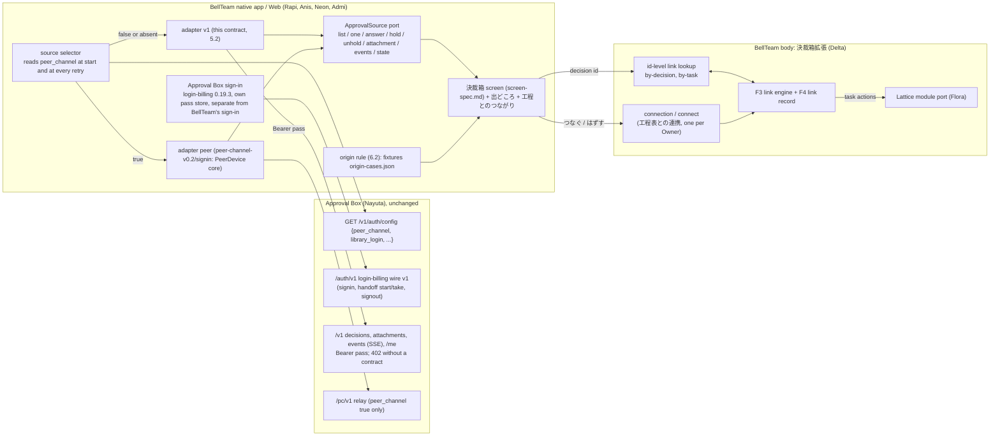
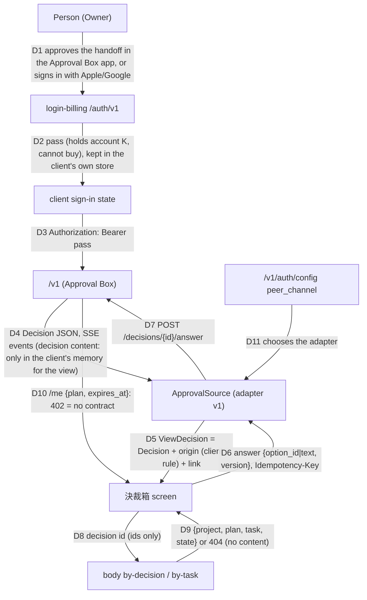

# 決裁箱拡張 (approval-box-extension): client contract v0.5 (BellTeam's 決裁箱 is the Approval Box client)

Owner of this module: Delta (bot-ae42e3e9). Chart row: `bellteam-dev-added/abx-client-v1-contract-20261124`. Status: contract and diagrams (docs only). The client code is built by Rapi (Apple), Anis (Windows), Neon (Linux, Android) and Admi (Web), each in the PR that carries their diagrams.

Extends [README.md](README.md) (v0.1: link rules L1-L10, link record, screens). **Where this document and [peer-channel-v0.2.md](peer-channel-v0.2.md), [peer-channel-signin.md](peer-channel-signin.md) or [peer-channel-feed.md](peer-channel-feed.md) disagree about how a client reaches Approval Box, this document wins.** Those three stay canonical for what they still describe: the peer adapter (section 5.2), the link engine feed (section 7) and the daemon.

## 1. The ruling

Tronie, 2026-11-24 04:4x and 05:0x JST (A chosen over B, after Nayuta asked): BellTeam's 決裁箱 screen is the Approval Box client with a different look. It signs in and reads and answers decisions **exactly as the Approval Box app does, at all times**: over `/auth/v1` and `/v1` with the login-billing pass now, and over `/pc/v1` when the Approval Box app moves (Nayuta's `GET /v1/auth/config` field `peer_channel`; earliest 2026-12-12, PC_OFFER on). The client component is taken through Nayuta's published interface, never copied, so the move is one change (section 5.3).

Why it exists: on 2026-11-24 the Owner's iPhone showed 0 decisions and 「再接続中」 because the Apple app read only over `/pc/v1` (merged 2026-11-23) while production has `peer_channel=false`. Three clients had a device-only view ahead of the server; the contract below puts one switch, owned by Approval Box, in front of both paths.

## 2. What changes

| Part | Before | After | Who |
| --- | --- | --- | --- |
| How a client reads and answers | v0.1: through the body's `/api/approvals/*` (F5); v0.2: only over `/pc/v1` | One `ApprovalSource` port (5.1) with two adapters: `v1` (now) and `peer` (when `peer_channel` is true). Each client talks to Approval Box itself; the body is not on the path | Rapi, Anis, Neon, Admi |
| Sign-in | v0.1: the body's connect (F7); v0.3: second login library instance, web sign-in only | login-billing 0.19.3 against `https://approval-box.kitepon.dev/auth/v1`; the pass goes in `Authorization: Bearer` on every product route (section 4) | Rapi, Anis, Neon, Admi |
| Body routes `/api/approvals` list, one, answer, hold, unhold, attachments, events, summary (F1/F2/F5) | served | still served, **not used by new client builds**; removed by task a490h2 only after every client reports the new path and old builds are gone (section 9) | Delta |
| Body routes `by-decision`, `by-task`, `connection`, `connect` | served | **unchanged** (section 6) | Delta |
| F6 entitlement gate | body gates `/api/approvals/*` | Approval Box gates (402 on every route but `GET /me`); the body gate stays for the body routes above only | Delta |
| Link engine feed | F1 stream with the F7 session, plus the hosted daemon union (feed v0.4) | **unchanged** until the app moves; then the daemon only (feed v0.4 section 6) | Delta, Molly |
| Hosted daemon, `/pc/v1` pairing | needed for the Owner's view | needed only for the link engine feed after the move; **no longer needed for any screen** | Molly, Nayuta |
| Web view | dropped (browser holds no device keys) | **not built** (Admi 2026-11-24: there is no `web/` and no Web screen since #2239; the gateway answers `GET /` with 410 and its ended notice, which already says to use the apps). A Web 決裁箱 would be a new task against this contract once Nayuta allows BellTeam's web origin (Q2) | Admi |

## 3. Function diagram

Connections to draw in the other modules in the code PRs: the Approval Box product docs (BellTeam clients as `/auth/v1` and `/v1` users, same as its own apps) and each app module's own diagrams (Apple `modules/apple/approvals.md`, Windows, Linux, Android, Web).

## 4. Data-flow diagram

What is stored where: decision content lives only in Approval Box (until its own move) and in the client's memory for the length of the view. The body stores nothing new: the link record keeps ids and state (README section 4). The pass lives in each client's own secure store, never in BellTeam's account, never logged. **The body never sees the pass or any decision content on this path.**

## 5. Client path

### 5.1 The port (one per client)

`ApprovalSource` is the only thing the screen talks to. It has these members and no others: `state` (below), `decisions` (open list + recent answered/cancelled), `decision(id)`, `answer(id, optionId|text, version)`, `hold(id)`, `unhold(id)`, `attachment(decisionId, attachmentId)`, `events` (change notifications, resumable), `start / stop`, `retryNow`, and, for the peer adapter, `requestApproval / cancelApproval` (NeedsApproval to Waiting, with the code and QR the screen draws). **Sign-in and sign-out belong to the host** (the pass is login-billing's; Nayuta's component only follows it: `start()` after sign-in, `stop()` on sign-out; SignedOut and SigningIn are host screens, 2026-11-24 review of client-component.md draft 0.1). The screen never names `/v1` or `/pc/v1`. The states are the signin.md machine; the `v1` adapter uses this subset, the `peer` adapter all of it:

| State | `v1` adapter | `peer` adapter |
| --- | --- | --- |
| SignedOut / SigningIn | yes | yes |
| Joining | no (list read) | yes |
| NotEntitled | `/v1` 402 or `/me` plan `expired` | device join `no_entitlement` |
| NeedsApproval, Waiting | **never** | yes |
| Live | list read and events open | device session running |
| Reconnecting | network or 5xx; last view dimmed | relay unreachable |

### 5.2 Adapter `v1` (pinned to Approval Box `docs/api.md` v0.49; the contract is Nayuta's, this table is a map, not a copy of its fields)

Base `https://approval-box.kitepon.dev/v1`. Every call carries `Authorization: Bearer <pass>`. A renewed pass in the response header `Login-Billing-Pass` replaces the stored one (library rule). Unknown fields are ignored; unknown enum values draw as 「その他」.

| Call | Use |
| --- | --- |
| `GET /auth/config` (no Bearer) | `peer_channel` selects the adapter (5.3); `library_login` is informational |
| `GET /me` | `plan` (`active` or `expired`), `expires_at`; the Owner's account is exempt (answers active) |
| `GET /decisions?status=pending,held&limit=50&cursor=` and `?status=answered,cancelled` | the two lists in Approval Box's order; follow `next_cursor` |
| `GET /decisions/{id}` | one decision (also after a `decision.updated` event) |
| `POST /decisions/{id}/answer` `{option_id?, text?, version}` + `Idempotency-Key: <uuid>` | answer; `409 conflict` carries the current decision in `error.decision`: replace the screen, never retry with the old version |
| `POST /decisions/{id}/hold`, `…/unhold` + `Idempotency-Key` | hold and return |
| `GET /decisions/{id}/attachments`, `GET …/attachments/{attachment_id}` | read request and answer attachments. **BellTeam does not upload or delete** (no `attachment_ids` on answer, no `POST` or `DELETE` on attachments): not in the screen design; adding it is a later change of this contract |
| `GET /events` (SSE) | `decision.created|updated|deleted`, `setup.updated`; `Last-Event-ID` resumes; reconnect 1 s doubling to 60 s, no cap (a list re-read on every reconnect heals a missed event). Not used when the app is in the background: no push |
| not used | `/devices` (push), `/connections`, `/tokens`, `/onboarding`, `/auth/apple`, `/auth/google` (replaced by the library sign-in) |

Rendering rules that come with the adapter (unchanged from screen-spec.md): attachments carry the sandbox rule of the old contract (images are decoded by the platform, nothing from a sender runs, no inline HTML), `context` is plain text, links open in the system browser.

### 5.3 The switch and the component

- **Switch.** At start, at every Reconnecting retry, and after every sign-in, the client reads `GET /v1/auth/config`. `peer_channel: true` → `peer` adapter; `false` or absent → `v1` adapter. If the read fails, keep the adapter in use, and use `v1` if none. This is the same rule the Approval Box app follows (Nayuta, 2026-11-24). No BellTeam flag, no per-app environment switch, no "device part on/off" file: the existing `BELLTEAM_APPROVAL_BOX_DEVICE` switch on Linux and the file switch on Android are **retired** by the PR that adopts this contract.
- **Component.** The sign-in is the pinned library (`login-billing` 0.19.3; the project's own feed per Mint N13). The `v1` and `peer` code is Nayuta's client component: BellTeam takes it through an interface Nayuta publishes (Swift package, Kotlin artifact, .NET package: question Q3, his task `approval-box/abx-client-component`). **Until it exists, a client implements the `v1` adapter behind the port above, no more than the table in 5.2, so replacing it is deleting that adapter and importing the package.** No client copies the peer code of another product.
- **After the move.** The flip is Nayuta's server setting. A client that has the `peer` adapter shows the signin.md flow (Joining, NeedsApproval, Waiting). A client that does not yet have it keeps the `v1` adapter and must show 「この版では、決裁箱をまだ使えません。アプリを更新してください。」 when `/v1` answers `410` with code `gone` (Nayuta, Q4: the same code the old login routes use, written into api.md with the close); never an endless spinner, and 「今すぐ試す」 and the next launch stay available.

## 6. BellTeam-side routes and the view model

### 6.1 Routes (the body, same-origin Owner session; contract file [contract/approvals-contract.md](contract/approvals-contract.md))

| Route | Now | Note |
| --- | --- | --- |
| `GET /api/approvals/by-decision?id=` | **stays as is** | `{project, plan, task, state, attached}` or 404. Ids and state only, no Approval Box call. The badge and the 工程とのつながり block on a decision. Any failure draws nothing |
| `GET /api/approvals/by-task?project=&plan=&task=` | **stays as is** | `{decisionId, status, title}` or 404, for 「決裁を開く」 on a 工程表 card. The title comes from the body here; the decision itself opens from the client's own source (a decision the source does not hold shows nothing to open) |
| `GET /api/approvals/connection`, `POST/DELETE /api/approvals/connect`, `DELETE /api/approvals/connection` | **stay as is** | the 工程表との連携 menu entry only: one BellTeam-to-Approval-Box connection per Owner, which the link engine needs (it turns decisions into chart tasks and reads the Approval Box contract through `GET /me`). It is **not** the screen's sign-in and shows no per-list gate. The client's own pass is separate |
| `GET /api/approvals`, `…/summary`, `…/:id`, `…/answer`, `…/hold`, `…/unhold`, `…/attachments/:aid`, `…/events` | served until a490h2 | new client builds do not call them. Old builds in the field keep working until a490h2 |

### 6.2 View model and the origin rule (client side)

`ViewDecision` is `Decision` (Approval Box, pinned) plus `origin`, `requester` and `link`. The client computes `origin` itself, by the four rules of `contract/approvals-contract.md` ("How `origin.kind` is decided"), against the BellTeam member list it already holds; cases are fixed in [contract/fixtures/origin-cases.json](contract/fixtures/origin-cases.json) and every client's test reads that file. Visibility never depends on `origin.kind` (Owner 2026-11-15: nothing is hidden). The summary counts (pending, urgent, held, answered today, by origin) are computed from the lists the client already holds. `link` comes from `by-decision` per decision (30 s retry on 404, as the Apple resolver does).

## 7. Screen states (what each client draws; all Japanese, plain, no ids, codes or paths)

Same screens as screen-spec.md; the state line and the one action:

| Situation | Screen | Action |
| --- | --- | --- |
| Not signed in to Approval Box | 「決裁箱を使うには、Approval Boxにサインインします。BellTeamのサインインとは別です。」 | 「Approval Boxにサインイン」 |
| Signing in | 「サインインしています…」 (handoff: the QR and 「Approval Boxのアプリで、設定の『ほかの端末をログインさせる』から読み取ってください。」) | 「やめる」 |
| **`/v1` 402, or `/me` plan `expired`** | 「Approval Boxの契約が必要です。契約はApproval Boxのアプリで行います。」 No price, no purchase button, no receipt in BellTeam | 「確かめ直す」 (re-reads `/me`; the next launch also does) |
| **`/v1` 401, or the pass is refused or ended** | 「Approval Boxのサインインが終わりました。もう一度サインインしてください。」 The pass is dropped and the sign-in screen opens | 「Approval Boxにサインイン」 |
| Network, 5xx, 429 | the last view dimmed, one line 「つなぎ直しています」, no raw status | 「今すぐ試す」; backoff 1, 2, 4 … 60 s, no cap |
| `peer_channel` true, client has the peer adapter | the signin.md screens (Joining, NeedsApproval, Waiting) | as in signin.md |
| `peer_channel` true, client has no peer adapter, or `/v1` says content closed | 「この版では、決裁箱をまだ使えません。アプリを更新してください。」 | 「今すぐ試す」 |
| Live | the screens of screen-spec.md, unchanged | |
| 409 on answer | the screen is replaced with the current decision and one line 「内容が直されました。もう一度確かめてください。」; the Owner's typed text is kept | the same buttons |

Every state leaves by the action on the same screen or by the next launch; none waits for an operator. A separate 「Approval Boxからサインアウト」 sits in the screen's menu and never touches BellTeam's sign-in. The 工程表との連携 entry (6.1) is a small menu item with the state (つながっています / つながっていません / 期限切れ) and 「つなぐ」/「はずす」; it never gates the list.

## 8. What each client team needs (handed over with this document)

| Team | Do | Do not |
| --- | --- | --- |
| Rapi (iPhone, Mac) | Put `ApprovalBoxLink` behind the `ApprovalSource` port; add the `v1` adapter (5.2); selector (5.3); keep the peer adapter (`PeerDevice`) inactive until `peer_channel` is true; states of section 7; `origin-cases.json`; keep `ApprovalLinkResolver` | read `/api/approvals` list or answer routes; copy Approval Box app code |
| Anis (Windows) | Same port and `v1` adapter in C#; the C# pc/1 core stays behind the selector and must not start while `peer_channel` is false; retire the device flag | start the core by a local flag |
| Neon (Linux, Android) | Same; Linux arm64 and Android arm64 need no libdatachannel while the `v1` adapter is the one in use (the peer engine is needed only after the move); retire `BELLTEAM_APPROVAL_BOX_DEVICE` and the Android file switch | build a device-only list |
| Admi (Web) | Nothing now: the Web view is not built and the ended notice covers the 'use the app' line. The body's `/api/approvals` list, answer, hold, unhold, attachments, events and summary routes have no Web caller, so a490h2 needs nothing from Web | |
| Nayuta | Answers to Q1-Q4; the interface of the client component | |

## 9. Order and the retargeted removal (a490h2)

1. Each client reports its build on this contract (states of section 7 shown against production with `peer_channel=false`, a decision answered). Rapi first (the Owner's phone is the failing one).
2. The Owner's devices run the new builds. Until then he answers in the Approval Box app, which works.
3. a490h2 (removal of the body's content routes) no longer waits for 2026-12-12 and the device report; it waits for **every client to report the new path and the old builds to be below the support floor**. Its reminder schedules were removed; its predecessors are the clients' report tasks.
4. When `peer_channel` turns true, the clients move with the Approval Box app by the selector; no BellTeam release is tied to the date, provided each client carries the `peer` adapter or the component (5.3).

## 10. Failure handling

A failed answer changes nothing and offers the same button again; an unknown delivery shows as unknown (`delivery: unknown`). A 409 replaces the screen with the current decision. A Lattice outage never blocks an answer (the answer goes first, the link follows on the next tick). The pass is never written to a log. Nothing here ends in a stop without a way out (section 7).

## 11. Open questions

| # | To | Question | Status |
| --- | --- | --- | --- |
| Q1 | Nayuta | Does the Approval Box app choose its path from `peer_channel` as in 5.3? | **Answered 2026-11-24:** it reads once per sign-in (only with a library pass, at launch or first refresh); `false` -> stays on `/v1` until sign-out; `true` -> builds the peer device; `pass_changed` leaves it unchecked so the next refresh asks again; it does not re-read on every retry. BellTeam's selector (start, every retry, after sign-in) is a superset and stays. **Lesson (11-22): when the flag turns true the Approval Box app hides `/v1` requests at once, so PC_OFFER goes on only when every BellTeam client carries the peer path** |
| Q2 | Nayuta | BellTeam's web origin; Apple/Google sign-in inside BellTeam | **Answered 2026-11-24:** the web origin is **not allowed** now (cookie pass only for `https://approval-box.kitepon.dev`, no CORS); if the Web view is built Admi tells Nayuta the origin and he adds it after Mint checks it as a login change. Native Sign in with Apple for `dev.kitepon.bellbot` is refused (production `APPLE_AUDIENCES` is `dev.kitepon.approvalbox` only). Use **Apple web sign-in through the library** (Services ID `dev.kitepon.approvalbox.web`, return scheme `approvalbox-websignin`, allowed): it lands on the same account K as the Approval Box app, no server change. Allowed returns: a loopback address, `approvalbox-websignin`, and `https://approval-box.kitepon.dev/app/websignin`; **the last opens the Approval Box app, BellTeam never uses it** |
| Q3 | Nayuta | Form of the client component | **Agreed 2026-11-24:** Swift package (SPM tag), Kotlin/JVM artifact, .NET package (NuGet) for Windows and Linux; one object matching the `ApprovalSource` port with the `peer_channel` selector inside it; the host injects the base URL, the pass store and a history directory. Approval Box has no C# client today, so the .NET package is new work. Nayuta drafts the interface against the port and sends it to me for review before anyone extracts it (his task `approval-box/abx-client-component`) |
| Q4 | Nayuta | The answer of a closed `/v1` content route | **Answered 2026-11-24:** `410` with code `gone`; written into api.md with the close |
| Q5 | Tronie, Nayuta | One date for closing `/v1` content | **Agreed by Nayuta 2026-11-24:** one date, precondition: the Approval Box apps and every BellTeam client carry the peer path (component or adapter) and PC_OFFER is on before it. His t37 keeps 2026-12-12 until Tronie rules, then he re-links it to the ruling. Tronie rules | waiting for Tronie |
