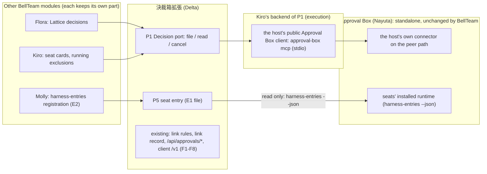
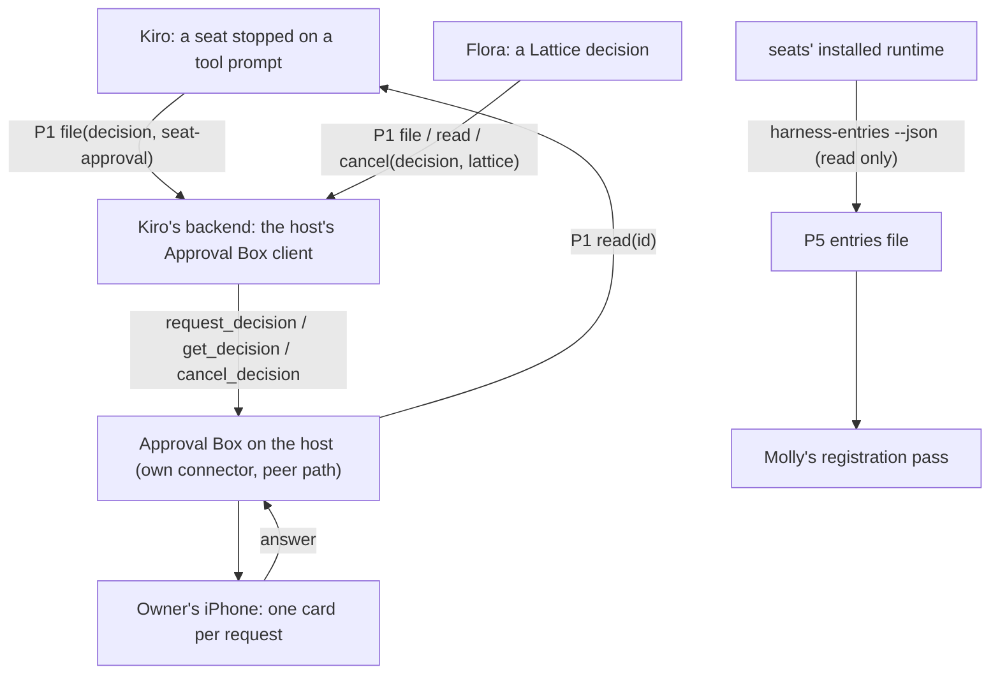

# The decision port of the 決裁箱拡張 module (decision-port; Delta, 2026-11-28)

Owner of this page: Delta (決裁箱拡張). History: this page was `seats-on-hosted-daemon.md` (2026-11-26/27: one hosted connector, one pairing, one QR). **Ruling, Owner through Tronie, 2026-11-28: Approval Box stays standalone (Owner rule products.standalone). BellTeam's body is not a receiver between the hosts' Approval Box and the peer path.** Each host's own Approval Box connector enters the peer path itself (Nayuta: `approval-box@next`, `setup --rebind`; his product, his hosts' settings). The body keeps no connector, no pairing, no QR and no door. Removed in one release (chart `bellteam-dev-added/abx-remove-hosted-path-delta`): the hosted connector daemon and its seat socket (`src/approval-box-daemon.mjs`, `src/approval-box-seats-socket.mjs`), the body end of the host door (`src/approval-box-door-route.mjs`, the route `/api/seat-mcp/approval-box/local`), the Bot tools `approval_box_daemon_status` and `approval_box_seat_link_show` (P8), the pairing (P3) with its routes `/api/approvals/seat-link`, the daemon feed of the link engine (effects `daemon.decisions.list` / `daemon.decisions.read`), and the pinned connector in the image (`distribution/approval-box`). The host doors on the hosts (`src/terminals/approval-door*.mjs`, Krust) go in the same release. Checked before the door was removed (2026-11-28, Elegg, read only): no host (container seats, rabbit, Mac, fox) has `~/.approval-box/hosted.json`, so no host's Approval Box filed through the door, and the daemon was never paired in production.

Other pages stay canonical for their own boxes: [seat-approval-card.md](seat-approval-card.md) (the card Kiro files), [child-join.md](child-join.md) (the 決裁箱 window as a child device, unrelated to this port), [client-v0.5.md](client-v0.5.md) (the apps' path to Approval Box).

## 1. The ports (who calls what)

| Port | Published by | Caller | Operations | Notes |
| --- | --- | --- | --- | --- |
| **P1 Decision port** (typed, in the body; reached as `approvals.decisions`, the same facade object that carries `ownerTask` / `link`) | this module (the interface); the backend is Kiro's (execution): the host's own public Approval Box client (`approval-box mcp` stdio: `request_decision` / `get_decision` / `cancel_decision`), a plain Approval Box client with no pairing of BellTeam's own | Kiro (seat tool-approval cards, running exclusions: `file`, `read`, `cancel`); Flora (`read` and `cancel`, and the legacy Lattice `file`); this module's F9 withdrawal of its first Owner-lane version's requests (README section 5b), through the parent effect `decisions.cancel` | see the contract below | no caller holds a credential, a secret card or a token; the body owns no connector |
| **P4 Supervision port** | Molly (body, runtime) | this module | the body starts, stops and watches the module's child process and builds the module's parent-side object: the effects the child may ask for (`lattice.*`, `members.list`, `session.*`, `seat.message`), the facade and the P1 object | the module.json hosting contract |
| **P5 Seat entry contract** (`bellteam.harness-entries.v1`, E1) | this module | Molly's harness-entries (E2 item `approval-box`) | the MCP and hook entry the seats need, naming the runtime the seat installed | a **file** at `/srv/bellteam/state/approval-box-entries/harness-entries.json`, written atomically by the parent-side code (`src/approval-box-entries.mjs`), content = what the seats' installed runtime prints for `harness-entries --json` (read only), refreshed at start and every minute, rewritten only when it changes; an unreadable answer keeps the last file |
| **P7 Credential custody** | Mika (usage, `secrets`) | this module | the module's Approval Box client session (F7, `session.get/put/erase`) | unchanged |

### P1 contract

| Operation | Contract |
| --- | --- |
| `file(decision, origin)` | `decision` = title, context, options, requester, `session_label` (the caller sets it: seat `Seat <botId> <digest16> <firstSeen>`, exclusions the stored item label). **Idempotent per `session_label`**: a request with the same label is adopted, never filed twice (a lost answer must never file twice); returns `{decisionId, existing}`. `origin` (`seat-approval`, `running-exclusions`, `lattice`) only adds to the requester, never replaces `session_label` |
| `read(id)` | `{status: pending | held | answered | cancelled, answer: {optionId, text}}`; reading an answered request marks it fetched (otherwise its delivery stays "waiting"). A free-text answer is the caller's to treat (seat cards treat it as deny) |
| `cancel(id, reason)` | returns `{status: 'cancelled'}`; `reason` is free Japanese text shown to the Owner; cancelling an answered or cancelled request is `REFUSED`, not success |
| Errors | a typed `kind` on every error: `UNAVAILABLE` (no Approval Box client on the host, not set up, 401, network, 5xx: ends the caller's tick), `REFUSED` (a 4xx: skip that one request), `GONE` (`read` of an id Approval Box does not know or purged: the caller drops its record). Callers map the kind to their own codes |
| Time | each call returns within about 5 s or fails `UNAVAILABLE` (running exclusions and Lattice's nudge call it every 60 s on a shared chain) |

`capabilities()` and `connection()` of the first drawing are gone: nothing in the body called them (the idle-sessions check reads the seat runtime's version itself).

## 2. Function diagram

Every arrow into this module lands on P1 or P5. The module reaches Approval Box only through its published public client and its `harness-entries --json`. No other module reads or writes this module's files or state.

## 3. Data flow

Data ownership: decision content lives only in Approval Box; callers keep ids (Kiro's record of botId, digest, first-seen, id) and nothing of the connection. The body keeps no key, no pairing and no connector state.

## 4. Failure handling and protections

| Case | What happens | Who leaves it |
| --- | --- | --- |
| The host has no set-up Approval Box client, or it answers 401 | P1 answers `UNAVAILABLE`; the caller keeps its fallback (Kiro's in-app entry) and tries again at its next tick | the host's Approval Box is set up (Nayuta's product, his hosts' settings) |
| A request is refused (4xx) | `REFUSED`: that one request is skipped | the caller |
| An id the product no longer knows | `GONE`: the caller drops its record, or re-files with the same label | the caller |

Protected: decision content and any credential (never copied by a caller). No other guard is added; every state leaves by the caller's next tick.

## 5. Where each of the seven old connections ended up

| Old connection | Owner | Now |
| --- | --- | --- |
| approval-box-extension: client `/v1` (read, answer) + connector pairing | Delta | client `/v1` stays (F1-F8); the connector pairing is gone |
| execution: seat cards and running exclusions | Kiro | P1 `file / read / cancel`, backend = the host's public Approval Box client (Kiro's change) |
| execution: `version --json` capabilities (`src/idle-sessions.mjs`) | Kiro | unchanged, reads the seat runtime itself |
| lattice: decisions | Flora | P1 `file / read / cancel` through `src/lattice-decisions.mjs` |
| integration: the in-body daemon service and the door route | Molly | removed (daemon, door route, the `approval_box_daemon_status` tool, the pinned connector in the image) |
| runtime: `harness-entries (approval-box)` | Molly | unchanged, fed by P5 |
| usage: `connection export --json` | Mika | nothing calls it |
