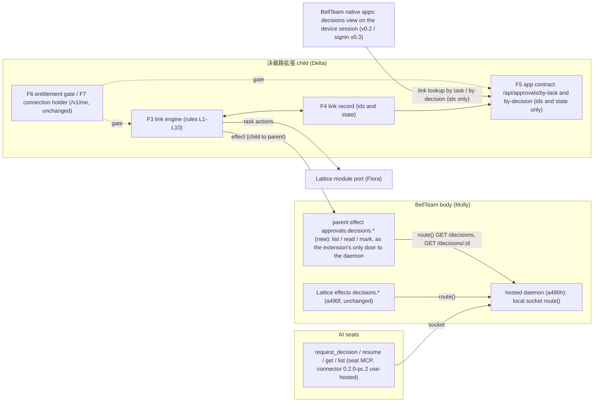
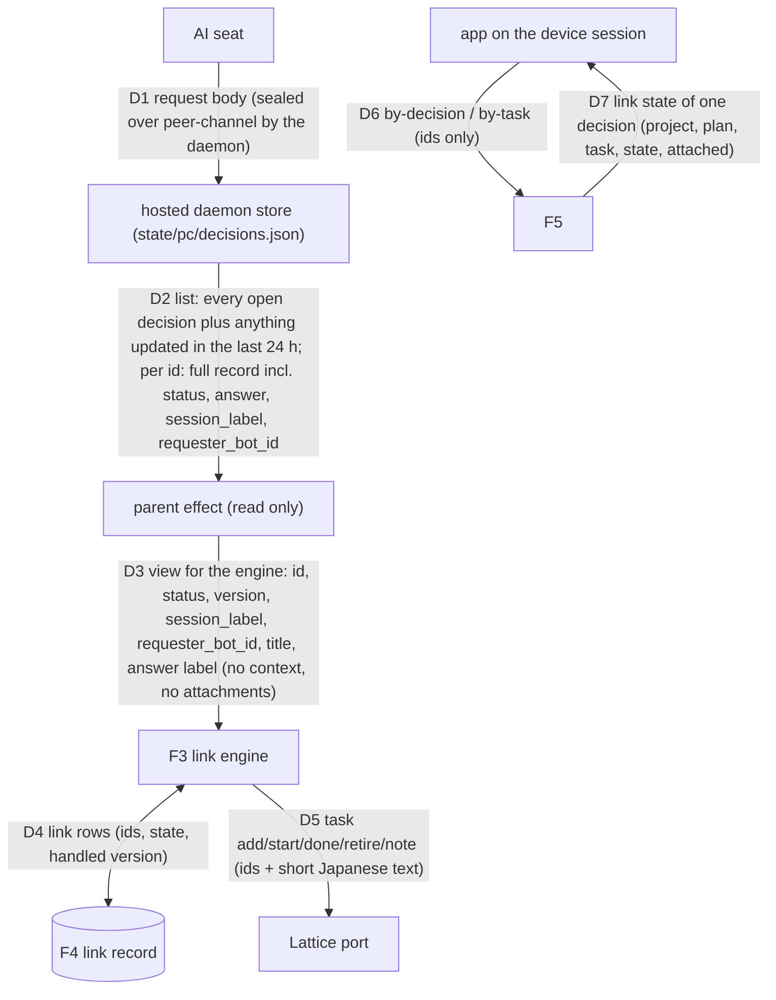

# 決裁箱拡張: link-engine feed from the hosted daemon (design v0.4, a490g)

Owner of this module: Delta (bot-ae42e3e9). Extends [peer-channel-v0.2.md](peer-channel-v0.2.md) section 4a. Design only; no code before it is adopted and the diagrams ship with the code.

## 1. What changed since v0.2 section 4a

v0.2 assumed the hosted daemon sees only decisions the Lattice effects filed, so every other decision would reach the link engine through app reports (D7b). Two facts replace that:

1. **a514n (Nayuta, done 2026-11-22): connector 0.2.0-pc.2.** `use-hosted --socket <path>`: the seats' request tools (`request_decision`, resume, get, list) call the body's hosted daemon instead of a seat connector of their own. After Molly's a514m switch, the daemon's store holds every seat's decisions; `source.requester_bot_id` tells them apart.
2. **Decisions from outside BellTeam need no chart action** (README L9). They are shown by the apps (devices hold everything, v0.2 section 3) and never become tasks.

So the link engine (F3) can run entirely on the server, fed by the daemon, and **D7b (app reports) is dropped**: no app-to-server report route, no new BellTeam route that carries decision facts from a device. Q5 of v0.2 is closed by removing it.

## 2. Function diagram

## 3. Data flow

Rules that stay: one task per decision (`dec-<id>`), L1-L10 as in v0.1, rows written before the effect, idempotent replays, no decision text kept by BellTeam beyond what the chart task already carries (title and answer label, as today). External decisions never appear on this path at all (the daemon never filed them).

## 4. How the engine reads (no push from the daemon)

- Tick (the extension's existing catch-up cadence): `GET /decisions` through the parent effect; every item runs the same rules as a v0.1 event. Rows in `linked` state whose id is missing from the list are read one by one (`GET /decisions/:id`) so an answer older than the daemon's 24 h list window is still found (Q1 below).
- `status` `answered` -> L2; `cancelled` -> L3; version moved while pending -> L4; `held` -> L5.
- Which decisions belong to BellTeam: all of them, because the daemon only holds what BellTeam's seats and the body filed (the `requester_bot_id` selects the chart by rule T).
- Transition until the `/v1` close: decisions filed on the old path still reach F3 through the existing `/v1` events (F1), by decision id; the daemon feed adds the new ones. Keyed by decision id, one row per decision; a decision is never handled from two sources with different versions (the higher `version` wins).

## 5. What the apps do and do not need from the server

| App need | Source |
| --- | --- |
| Decisions, answers, attachments | the device session only (v0.2) |
| 「工程表とのつながり」 panel and the badge | `GET /api/approvals/by-decision?id=<decisionId>` -> 200 `{project, plan, task, state: linked\|answered\|closed\|diverged, attached}` or 404; `by-task` loses `title` at the `/v1` close and returns `{decisionId, status}` |
| The connect screen (server connection for `/v1/me` entitlement) | unchanged while `/v1/me` stays (Nayuta 2026-11-22). Whether the pairing start `POST /connector/v1/pairing {client:"bellteam"}` survives the close is Q2 |

## 6. Removals (only in the PR that flips the feed, after the apps report decisions over peer-channel)

F1 reader and F2 answer writer of v0.1 (server `/v1` decisions, events, answer): removed. `/api/approvals/` list, one, answer, hold, attachments, events, summary: removed (content). Kept: `by-task`, `by-decision`, `connection`, `connect` (F6/F7, subject to Q2). No removal before Rapi, Anis and Neon report decisions shown and answered over peer-channel.

## 7. Questions

| # | To | Question |
| --- | --- | --- |
| Q1 | Nayuta | How long does the daemon keep an answered decision in `decisions.json` (the 24 h list window is the list only; `prune()` exists)? The engine reads linked ids one by one, so it needs the per-id read to outlive the list window by at least the longest outage we accept (proposal: 7 days). |
| Q2 | Nayuta, Bready | Does `POST /connector/v1/pairing {client:"bellteam"}` and the `/v1/me` session it yields survive the `/connector/v1` close? If not, what replaces the connect screen's source for entitlement? |
| Q3 | Molly | The new parent effect `approvals.decisions.list/read` (read only, ids and the engine view of D3) beside the existing Lattice effects: same module-exchange pattern as `session.get/put/erase`. Any objection to a second reader of the daemon socket? |

## 8. Order

1. This design adopted (docs only).
2. Molly's a514m switch on main and deployed, so seats file into the daemon.
3. Code PR 1 (additive): parent effect, child feed beside F1, `by-decision`, tests, diagrams.
4. Apps report decisions over peer-channel (Rapi, Anis, Neon).
5. Code PR 2: remove F1/F2/F5 content routes in the same diff as the flipped feed.
6. Nayuta sets the `/v1` close after the last report.
