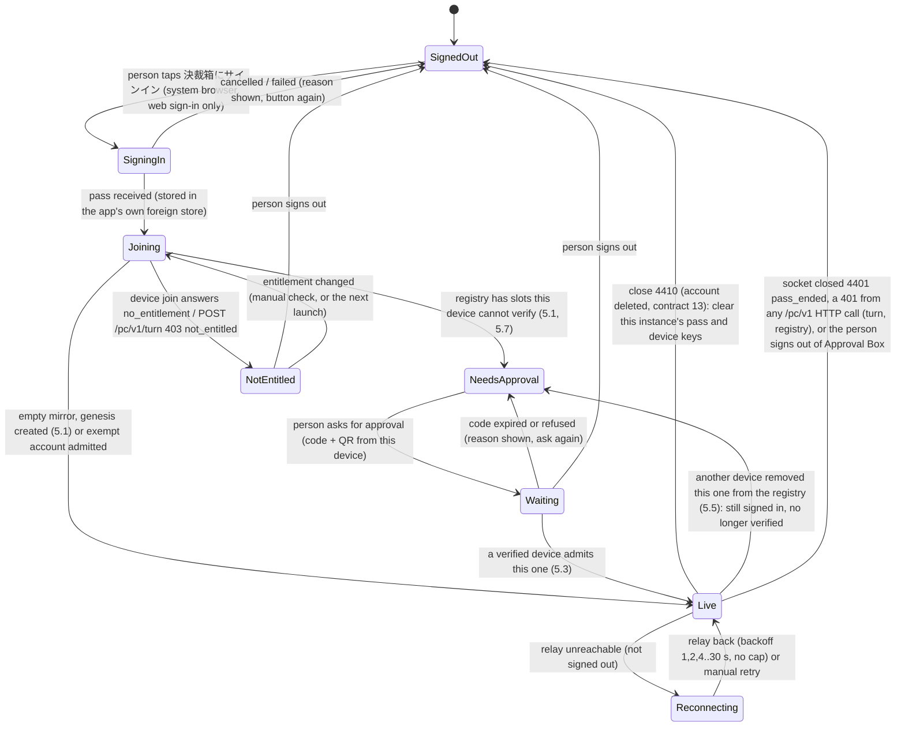
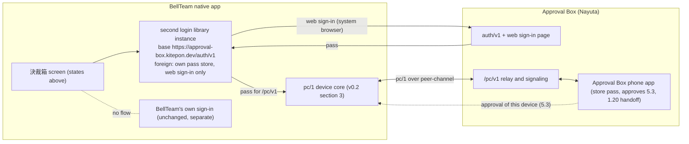

# 決裁箱 screen: Approval Box sign-in and device approval (design v0.3, a490i)

> **2026-11-24: read with [client-v0.5.md](client-v0.5.md).** This state machine is the one the `ApprovalSource` port exposes for both adapters; Joining, NeedsApproval and Waiting belong to the peer adapter and appear only when `peer_channel` is true. With `peer_channel` false the client signs in with the login-billing pass and reads `/v1` (the Live, NotEntitled, SignedOut and Reconnecting rows apply; 402 and 401 copy: client-v0.5.md section 7).

Owner of this module: Delta (bot-ae42e3e9). Extends [peer-channel-v0.2.md](peer-channel-v0.2.md) (device endpoint) and [screen-spec.md](screen-spec.md) (the screens). Design only; same on every platform (Apple, Windows, Linux, Android). Source of the rule: Mint's ruling relayed by Tronie 2026-11-22 (login-billing library-contract 1.24, section 3 last subsection) and Nayuta's rulings in v0.2 section 1.

## 1. What the person must do, and why

To see and answer decisions in a BellTeam app, the person signs in to **Approval Box** (a second sign-in, web only) and the app is admitted as a device of the person's Approval Box account. This is a **different sign-in from BellTeam's own** and never merges with it.

Facts that bind the design (Mint 1.24, via Tronie):

1. No shared deployment or keys with BellTeam's login.
2. Each app holds a SECOND, separate library instance with base origin `https://approval-box.kitepon.dev/auth/v1`. It is "foreign": its own pass store and records, web sign-in only, no native sheet, no purchase and no receipt.
3. The two products' account identities (K) are never mixed in a server, a record or a log line. **BellTeam's server never sees the Approval Box pass, the Approval Box account id or K.** (The id-level report of v0.2 section 4a carries decision ids, status, session_label and an answer label only, over the BellTeam session.)
4. The app's contract with Approval Box comes like any signed device: approval from the phone that holds the Approval Box store pass (the 1.20 handoff / the 16-character typed code of 5.3), or automatically for an exempt account. The first device of a person finds an empty mirror and creates genesis (5.1).
5. Signing out of one leaves the other.
6. Build order by platform: Windows and Linux can build on login-billing 0.17.2 now; Apple by the part's API; Android only after login-billing 0.18.0. Returns of the web sign-in (Nayuta 2026-11-22; production lists exactly three: loopback, the session scheme `approvalbox-websignin`, and the link `https://approval-box.kitepon.dev/app/websignin`, which is for Approval Box's own apps only, BellTeam's ids are not added): **Windows/Linux = system browser + loopback; Apple = ASWebAuthenticationSession with callbackURLScheme `approvalbox-websignin`; Android (after 0.18.0) = Auth Tab with the same scheme.** No server change. If a library part can only take a verified link, tell Nayuta before building (new path, Mint's ruling).
7. The phone-app returns are a product-to-product connection with Nayuta (section 4).

## 2. State diagram (one machine, all platforms)

Every state leaves by an action on the same screen or by the next launch; none waits for an operator. A device that finds slots it cannot verify never makes a genesis alone. `4401 pass_ended` is signed out, not a network drop; the server sends it on expiry but also when the person stops this device from the Approval Box phone app, signs out elsewhere, uses stop-all-others, or the pass is replaced, so the copy never claims an expiry. A 401 from any `/pc/v1` HTTP call is treated the same (a socket may not be open when the pass ends). `4403` is for connectors only; a device never receives it.

## 3. Screen per state (what the person sees; Japanese copy is the design contract)

| State | Screen (inside the 決裁箱 view; the rest of the app is unchanged) | Primary action |
| --- | --- | --- |
| SignedOut | 「決裁箱を使うには、Approval Boxにサインインします。BellTeamのサインインとは別です。」 | 「Approval Boxにサインイン」 |
| SigningIn | 「ブラウザでサインインしています…」 | 「やめる」 |
| Joining | 「この端末を決裁箱につないでいます…」 | none (leaves by itself) |
| NeedsApproval | 「この端末は、まだ承認されていません。Approval Boxを入れた手持ちの端末で承認してください。」 | 「承認をお願いする」 |
| Waiting | The one-time code (16 characters, grouped) and a QR from this device, 「Approval Boxのアプリで、この番号を入れるか、QRを読み取ってください。」, the time it stays valid, 「もう一度」 after expiry. An iPhone-only person with both apps on one phone types the code (no scanning of its own screen) | 「やめる」 |
| NotEntitled | 「Approval Boxの購読が必要です。購読はApproval Boxのアプリで行います。」 No price, no purchase button, no receipt in BellTeam | 「確かめ直す」 |
| Live | The decisions screens of screen-spec.md, unchanged | |
| Reconnecting | The last view dimmed, the reason in one line, 「つなぎ直しています」 | 「今すぐ試す」 |
| Signed out by pass end (4401 or a 401) | Same as SignedOut with one line 「Approval Boxのサインインが終わりました。もう一度サインインしてください。」 | 「Approval Boxにサインイン」 |
| Account deleted (4410) | Same as SignedOut with one line 「Approval Boxのアカウントは削除されました」; this instance's pass and device keys are cleared | 「Approval Boxにサインイン」 |
| Removed from the registry (5.5) | The NeedsApproval screen with one line 「この端末は、ほかの端末から外されました。」 (still signed in) | 「承認をお願いする」 |

Rules for every screen: no raw ids, codes or paths except the approval code the person must type; the Approval Box account name may be shown on the 決裁箱 header only; a separate 「Approval Boxからサインアウト」 sits in the screen's menu and never touches BellTeam's sign-in. There is **no device-removal screen** here (SEC-086 stays not applicable).

## 4. Connections (drawn in both products' diagrams in the code PR)

Product-to-product rows with Nayuta: the app opens Approval Box's web sign-in and receives the return through the part's return mechanism (Windows/Linux: system browser and loopback; Apple: ASWebAuthenticationSession with scheme `approvalbox-websignin`; Android after 0.18.0: Auth Tab with the same scheme); the app's device approval by the phone app. Both are drawn in Approval Box's `docs/architecture` and in the app module docs.

## 5. Data and secrets

| Data | Where | Never |
| --- | --- | --- |
| Approval Box pass | the foreign store of the second library instance, per platform (Keychain, DPAPI, keystore) | on a BellTeam server, in a BellTeam record or log, in the BellTeam sign-in store |
| Device keys | v0.2 key store | exported |
| Approval code (typed) | on screen for its lifetime only | in a log, a chart, a diagnostic |
| Approval Box account name | memory, shown on the 決裁箱 header | sent to BellTeam |

## 6. Decisions left to others

- Nayuta and Mint: any change to the three returns or the close codes. The hosted connector daemon (a490h) has no 4401/4403 handling after its channel is up; this state machine is for the apps, the daemon side is a question for Nayuta (runtime/approval-box-daemon.md).
- Rapi, Anis, Neon: draw these states with the BellTeam design language; pictures are due with the first build. If a real choice only the Owner can make appears, one line to Tronie.
