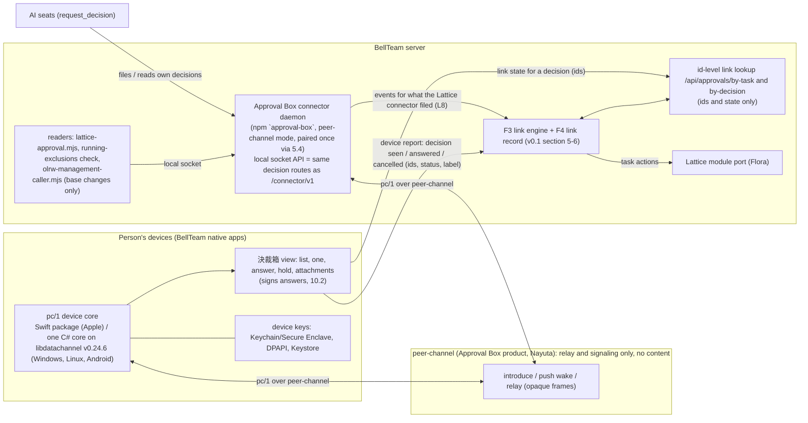
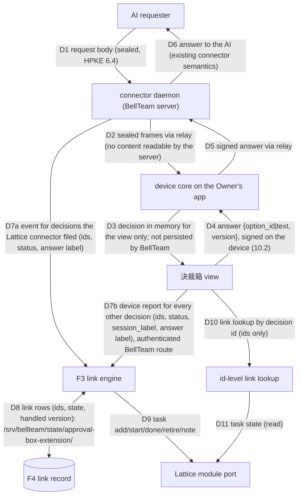

# 決裁箱拡張 (approval-box-extension): peer-channel design v0.2

Owner of this module: Delta (bot-ae42e3e9). Chart rows: `bellteam-dev-added/a490e-abx-device-design` (this document), `a490*` (answers). Status: DESIGN ONLY. No code before this is accepted and the diagrams below are in the same diff as the code.

Extends [README.md](README.md) (v0.1). Where this document and v0.1 disagree about how Approval Box is reached, this document wins; link rules L1-L10, the link record and the screens stay as they are.

## 1. Why this exists

- Owner ruling 2026-11-21: Approval Box keeps no content on its server. Request bodies, answers and attachments flow only between the AI's PC (connector) and the person's devices over peer-channel (kitepon/peer-channel).
- Owner decision 2026-11-21 (Approval Box card "BellTeamの決裁箱画面を、決裁箱の保管なし化のあとも残しますか"): **keep BellTeam's view, on native apps only.** The Web view is dropped: a browser cannot hold device keys (contract 5.8).
- Nayuta's rulings 2026-11-22 (contract draft 0.5.6, peer-channel main e95b332), recorded here because they bind the design:
  1. .NET WebRTC = libdatachannel through P/Invoke on its C API, pinned v0.24.6 (the engine node-datachannel 0.33.6 bundles). Not SIPSorcery. A C# HPKE library is named and pinned by Anis and accepted by Airi before the C# core seals anything; vectors pc1-hpke and pc1-envelope (including the 91-byte info) pass first.
  2. One C# pc/1 core, built by Anis, reused by Neon for Linux; Neon checks the libdatachannel Android build for the same core before any Kotlin face is built. No sidecar, no second port.
  3. Contract pin 0.5.6 at e95b332 for Swift and C#. **Superseded 2026-11-22 by Nayuta: 0.5.8 at main 2df08c1** (Airi's c8 review). It adds: SEC-086 (a device UI that removes or reports a device lost lists every active key whose added_by chain leads to it; BellTeam's view has no removal screen, so builds none); the server closes a device socket with 4401 pass_ended (signed out, not a network drop); `POST /pc/v1/turn` answers 403 not_entitled for an unentitled pass; C# libdatachannel follows contract 11's relay pick (first STUN plus the first two UDP TURN URLs by IPv4). A later change reaches the apps only through Nayuta, with the version named.
  4. The first device of a person's K needs no admitter (finds an empty mirror, creates genesis, 5.1). Every later device is admitted by an already verified device through 5.3. An iPhone-only person with both apps on one phone uses the typed 16-character code. A device that cannot verify existing slots never makes a genesis alone (5.1, 5.7).
  5. The `/v1` and content routes stay open until BellTeam's three apps report decisions shown over peer-channel and the four server-side readers have moved. No dark period. Close date is set by Nayuta when the last report arrives; earliest about 2026-12-12.

## 2. What changes, in one table

| v0.1 part | Today | After the move | Who |
| --- | --- | --- | --- |
| F1 reader, F2 answer writer (server child, `/v1`) | server child process | **removed.** A server process cannot be a device. Apps read and answer on their own device session. | apps |
| F5 app contract `/api/approvals/*` (list, one, answer, hold, SSE, summary) | server | **removed** (it carried content). Only the id-level link lookup stays (decisionId ↔ project/plan/task, link state; no title, no text). | this module |
| Apps' decisions view | draws from `/api/approvals/*` | draws from the device session (PeerChannel Swift package on Apple; the shared C# core on Windows, Linux, Android) and joins it with the id-level link lookup for the 工程表 badge and 「決裁を開く」 | Rapi, Anis, Neon |
| F6 entitlement gate, F7 connection holder | Approval Box `GET /v1/me` with the client session | **unchanged.** `/v1/me` carries no decision content and is not in the close list (Nayuta, adoption doc section 4). F7 now holds the session for `/me` only | Bready, this module |
| F3 link engine, F4 link record | server child, fed by `/v1/events` | stays on the server; the feed has two sources (section 4a) | this module |
| Lattice effects decisions.file / decisions.read, running-exclusions check, olrw management caller | connector `/connector/v1` with a connection token | same code, base changes to the local connector daemon (section 5) | Molly, Flora, this module |

## 3. Function diagram

## 4. Data-flow diagram

### 4a. Link engine feed (Nayuta, Q1: the daemon is per-connection)

The connector daemon sees only what it filed; only devices hold every decision of K. So F3 has two sources, both idempotent on the decision id:
- **D7a, the daemon**: decisions the Lattice effects filed (Owner-lane hand-over, L8 attach). They already name their task; answers drive L2/L3 as today.
- **D7b, the apps**: every decision an AI seat filed from its own connector (the common `request_decision` path) and every external decision (L9, no chart action). A device that shows a decision reports the id-level fact to the BellTeam route; a replay or a second device finds the same row. Chart sync therefore needs one app to be open after the answer; the answer itself never waits (v0.1 section 9). `shortcut: apps are the only sight of non-Lattice decisions, upgrade when a seat connector can be paired to the same K and read by the server`.

Stored where: titles, contexts, answers, attachments live only on the AI's PC (connector) and the person's devices. The extension keeps only F4 rows (ids and state), as in v0.1 section 4. **Task titles and answer labels written to the chart come through D7 and are chart content, exactly as today**; they are BellTeam's own data written by BellTeam's own server for the person's own chart, not Approval Box server content.

## 5. The four server-side readers (what moves, what breaks)

Today all four use `/connector/v1` with a connection token (they work unchanged until the close). After the close they break. Route after (Nayuta's ruling): BellTeam runs **one** Approval Box connector daemon, `approval-box` npm in peer-channel mode, paired to the person's K once through 5.4 (one step on the Owner's phone, put into his sitting by Nayuta). The readers call its local API, which answers the same decision routes as `/connector/v1` (LocalBox.route) over a local socket.

| Reader | Change | Owner |
| --- | --- | --- |
| `src/lattice-approval.mjs` (Lattice effects decisions.file / read / cancel; also running-exclusions with its own connection, a41) | `ORIGIN` and the bearer-over-HTTPS call become the local socket; the per-purpose scope and "one connection per owner" rule stay (Flora 2026-11-13). The connection token goes away with the pairing; the secret card (`lattice-approval-box`) is retired when the daemon is live | Flora / Molly with this module |
| running-exclusions check (~60 s) | same connector object as above; only the base changes | same |
| `src/olrw-management-caller.mjs` | base changes; the 10 s timeout, the 64 KiB body bound and the response shape stay (the 5 s timeout belongs to `lattice-approval.mjs`) | olrw module owner |
| `src/submitted-secret-approval.mjs` (fixed read of K-3JM9PS) | **breaks at the purge** (the server forgets old decisions). Keep the answer already read (the checked 48-byte answer and its hashes are already the pre-request spec) or re-file it through the daemon. Decision needed before the close, see Q4 | this module with the OLRW owner |

None of the four reads Approval Box content from the server except through the daemon; BellTeam's server never holds a device key.

## 6. Questions

| # | To | Question | Status |
| --- | --- | --- | --- |
| Q1 | Nayuta | Does the daemon see every decision of K? | **Answered 2026-11-22: only what it filed.** Design: section 4a |
| Q2 | Nayuta, Bready | What replaces `/me`? | **Answered 2026-11-22: nothing. `/v1/me` stays** (no content, not in the close list); only `/v1/me/export` loses its decisions after the purge. F6 and Bready's R4 are unchanged |
| Q3 | Molly | Hosting and supervision of the one connector daemon | **Answered 2026-11-22: yes; built in a490h, diagrams in [runtime/approval-box-daemon.md](../runtime/approval-box-daemon.md).** Module child under the existing supervisor (uid 1001, crash restarts the child only); state under `/srv/bellteam/state/approval-box-daemon/` (0700, no new mount; keys and the paired K never in a secret card or log); unix socket 0600 under the child's run dir; readers keep their current path to the parent and the parent forwards to the socket (per-purpose scope kept; final shape in the code PR, Q5). Image pins `approval-box` with its native libdatachannel prebuild. She needs from Nayuta: package pin + prebuild, launch contract, non-interactive 5.4 pairing and status, re-pair rule with a visible "not paired" state, network hosts/ports (UDP egress to be checked in the lab), a test K |
| Q4 | OLRW owner | For K-3JM9PS: keep the already-read answer or re-file through the daemon | open |
| Q5 | Flora, Molly | The authenticated BellTeam route for app reports (D7b) and its link to the Lattice facade | open, belongs to the code PR |

## 7. Failure handling

A device that cannot reach the relay shows the last view dimmed with the visible reason and a manual retry (no retry cap, Rapi's rule; backoff as in v0.1 section 9). A failed answer changes nothing and offers the same button again; an unknown delivery is shown as unknown. A device that finds slots it cannot verify never makes a genesis alone (Nayuta 4). A Lattice outage never blocks an answer (the answer goes first, the task follows on the next tick). No retry cap anywhere ends in a stop: each state leaves by the next tick or an action on the same screen.

## 8. Order and gates

1. Anis: C# HPKE library named and pinned, accepted by Airi; vectors pc1-hpke and pc1-envelope green; then the device core (dates in the chart: 11/25 vectors, 11/27 dev signaling, 11/29 real decisions if the server part is live by 11/28).
2. Rapi: Apple on the Swift package, contract 0.5.8; dev/TestFlight 12/03, store 12/07.
3. Neon: Android and Linux on the shared C# core; firm date by 11/23 evening.
4. This module: answers to Q3-Q5; then the reader base change (one PR per reader owner) and F3's new feed; the extension's server child F1/F2/F7/F5 are removed in the same PR that flips the feed, not before the apps report.
5. Nayuta sets the `/v1` close date after the last app and the four readers have reported.

Nothing here edits another product's code. Every connection above is to be drawn in both products' diagrams in the code PR (Approval Box docs/architecture, Lattice module docs, the app module docs).
