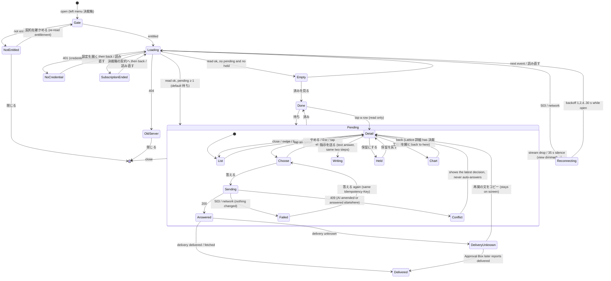
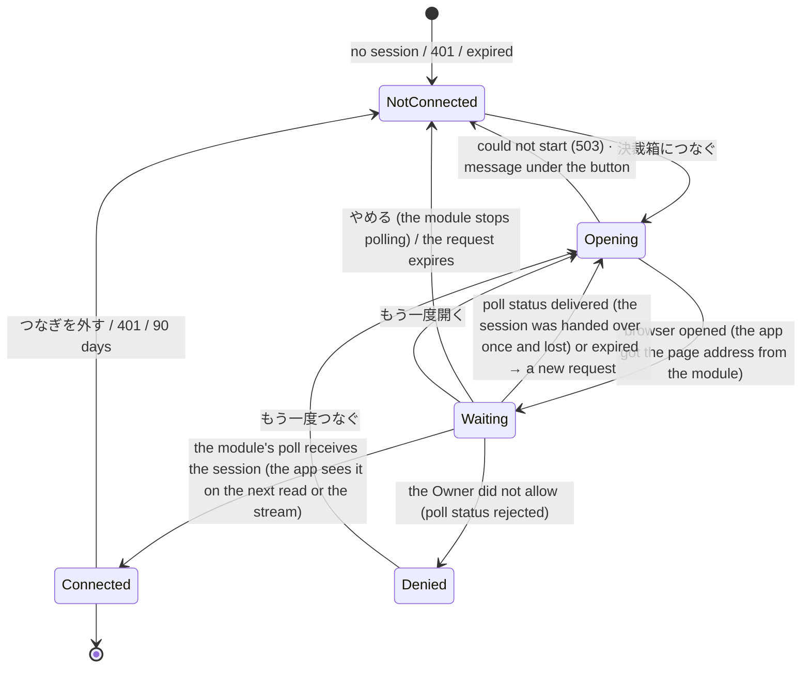

# 決裁箱 screens, user path and app contract

> **2026-11-24: sources and states follow [client-v0.5.md](client-v0.5.md) (sections 5 and 7).** The screens below are unchanged; what feeds them is the `ApprovalSource` port, not `/api/approvals/*`; the gate copy for 契約 (402) and the sign-in (401) is in client-v0.5.md section 7.

Shared by all native drawings: Apple first (SwiftUI, Rapi), Windows (Anis), Linux (Neon), Web (see README R6). Same rules as the Lattice screen spec: units `pt` = SwiftUI points = CSS px; times in JST; **Japanese, plain, no ids, codes, reasons or paths on screen**; every state has a way out the user can take, and every failure leaves on its own too. Data only from the app contract below.

Owner words (2026-11-15) that govern the look: 「今の各機能のデザインは素晴らしい。決裁箱モジュールだけダサイなんてことになるなよ。」 So this screen is built from the Lattice design language, not from Approval Box's own apps: BellTheme colors, the same state badges (glyph + text, never colour alone), card shapes and glow, the 詳細 / 待ちの流れ panel shape, summary ring and counters, mini avatars, the two-step in-place confirm (外す pattern), the settings rule "result appears where the button was". Pictures: frames `main`, `entry`, `answer`, `chain`, `origin`, `phone`, `edge` of `mockups/approval-box-screens.html`.

## Look (reused, not invented)

| Part | Taken from | Used for |
| --- | --- | --- |
| Colors: violet `#6147D4`, ink `#21293D`, muted `#787D91`, line `#E6E3F0`, canvas `#F8F8FB`, member accents (violet rose indigo sky mint amber), red `#E0533D` only for failures | `BellTheme` / Lattice mock tokens | everything |
| Card with accent outline + soft glow ("着手可") | Lattice card `ready` | a decision waiting for the Owner's answer (**回答待ち**) |
| Amber left ribbon + amber badge | Lattice amber (wait chip) | **急ぎ** (urgency high); never red (red = failure) |
| Dashed grey card | Lattice `pending` | **保留** (held) |
| Compact desaturated pill with seal check | Lattice `done` | **回答済み** rows in 済み |
| Struck-through grey dashed pill | Lattice `retired` | **取り下げ** (the AI withdrew it) |
| Segmented control with counts: ツリー / 担当 / 過去ログ N | Lattice | **待ち N / 保留 N / 済み N** |
| Summary ring + counters 作業中 / 待ち / 止まり | Lattice toolbar | ring = 今日の回答 done/total; counters 待ち / 急ぎ / 保留 |
| Right panel 待ちの流れ | Lattice | **工程とのつながり** (the linked task and its neighbours) |
| Two-step in-row confirm, button turns into 「…しています」, failure text right under the button | Lattice 止め一覧 外す; Apple settings §4.9 | answering |
| Mini avatar + name of who | Lattice owner rule | the requester Bot (face from the roster; unknown → 「?」 + 名簿にないメンバー) |
| Day groups 今日 / 昨日 / M月D日 | Lattice 過去ログ | 済み |
| Glyphs: Lattice set plus `inbox`, `bolt`, `pause`, `link`, `copy`, `send`, `pencil`, `lock` drawn in the same 1.7 stroke style | `lattice-chart-screen.html` symbols | all |

## Screens

| Screen | Content |
| --- | --- |
| **入口** | See [Entry](#entry-two-options-the-owner-decides). Shows 決裁箱 + pending count; calm when 0 |
| **決裁箱** (main) | Toolbar: title chip 決裁箱 + count badge, live pill, segmented 待ち / 保留 / 済み with counts, ring 今日の回答 `done/total` (decisions answered today over those filed or answered today), counters 待ち / 急ぎ / 保留, 読み直す. **Mac / iPad wide (≥ 1000 pt)**: three columns, list 500 | 詳細 520 | 工程とのつながり (the rest, ≥ 340). **iPhone / narrow**: list; tapping a card opens 詳細 as a sheet (large detent), 工程とのつながり is a block inside it. Windows / Linux / Web wide: same three columns; Web under 1024 px: list + sheet. |
| **一覧 (待ち)** | Order from Approval Box: 急ぎ first, nearer 期限, older first. Card: state badge(s) (回答待ち, 急ぎ), age, requester face + name; title (2 lines); one note line 「工程表「…」が、この回答を待っています」 (the linked task, from the link record) or nothing; chips 期限 今日 HH:MM / 推奨あり. 保留 is its own section under a divider, dashed grey, note 「保留中です。戻すまで工程は待ちます」 |
| **済み** | Newest first under day headings. Row: seal, title, 「あなたの答え：…」 + time, delivery badge **届きました** (green) / **届いたか不明** (amber) ; AI-withdrawn rows struck through with the AI's reason in the second line. Tap opens 詳細 (read only). Empty: まだ済んだ決裁はありません。 |
| **詳細** | Badges, close; title; requester + 受付 time + 期限; **背景** (plain text, links open the browser in one tap, as in Approval Box); **添付** when the AI attached images (`requestAttachments`): thumbnails, tap opens the image large, size and sha256 checked against the body; answered decisions list the answer attachments by name, read only (BellTeam cannot attach to an answer in v1); **AIの推奨** line; **答えを選ぶ**: one button per option, the recommended one filled violet with 推奨 (never pre-selected, never sent by Return alone); **選ばずに、指示を書いて返す** (a free-text answer = 差戻し, the API's `text`); 保留にする; 工程表で見る; **経過** (created / amended with 修正あり and the fields changed / held / answered). Answered decisions show the answer and the delivery badge instead of the buttons |
| **工程とのつながり** | The linked task and its previous / next task as small cards (Lattice mini cards), the decision's own task highlighted (accent), one sentence of what answering does: 「答えると、「◯◯」が済みになり、◯◯が「◯◯」へ進めます。答えで決まらない時は、新しい決裁が工程に差し込まれます。」 Button 工程表の工程を開く (opens the chart at that card, as 工程へ移動). Also in Lattice 詳細 of a decision task: a block 決裁 with the state badge and 決裁を開く (via `by-task`) |

## Decisions from outside BellTeam (Owner, 2026-11-15; binding)

Owner: 「ベルチーム以外の決裁来るはずだ。（元が決裁箱システムだから）それらを非表示にするようなことはするな。それらにも対応できるようにしておけ。表示の仕方は考慮が必要だと思う。」 Picture: `mockups/origin.png` (and the external card in `main.png`, `phone.png`).

Approval Box is a system of its own: the Owner's list also holds decisions from other teams' Bots, terminal seats, Mac-side agents and other products. They are **never hidden** and are **answerable exactly like any other**; they only have no chart task (or a link to a BellTeam chart when their session names one, README L10).

| Part | Decision |
| --- | --- |
| Origin on every card | **BellTeam member**: face + name (as before). **Anyone else**: a rounded-square tool tile (terminal glyph for Claude Code / Codex / Cursor, chat glyph for Claude.ai / ChatGPT, globe for other or unknown, grey, not a member colour so it can never be mistaken for a roster face) + 「<tool> · <session name>」, and a grey badge **外部から** beside the state badge. Unknown origin: globe tile + 「出どころ不明」, still shown |
| Link line | BellTeam decision: 「工程表「…」が、この回答を待っています」. External: 「工程表とはつながっていません」 in muted grey with a muted link glyph. Neutral, never red or amber: it is not a fault |
| Filter 出どころ | One row under the list heading: **すべて N / BellTeam N / 外部 N**, default **すべて**. It never hides by default. While a narrower one is chosen, a persistent amber line always says 「外部の決裁 N件を隠しています。」 with すべてを見る; the choice is kept only while the app is open. Counts in the chips are always the full counts for the current tab |
| Counting | The menu badge, the summary pending count, the toolbar counters and the ring count **all** decisions, whatever the filter or origin |
| Order | Unchanged: 急ぎ, nearer 期限, older first. Origin never changes the order |
| 詳細 | A block 「BellTeamの外から届いた決裁です」 with the tool tile, tool, how it connected (リモート接続 / コネクタ) and the session name. Everything else is the same: 背景, 推奨, options, 指示を書いて返す, 保留にする. No 工程表で見る |
| 工程とのつながり panel | A dashed neutral card 「つながっていません。この決裁は、BellTeamの外から届きました。工程は作りません。」 + 「答えは、出したAI（◯◯）へそのまま届きます。BellTeamの工程には何も起こりません。」 + the one condition under which it would link |
| Answer confirm | Linked: 「…答えると、◯◯が続きに進み、工程「◯◯」が済みになります。」 External: 「…答えると、<tool>に届きます。」 (no chart sentence) |
| After answering | 届きました / 届いたか不明 as before, naming the tool; for 届いたか不明 the sentence about the next担当 is dropped, only 再開の文をコピー remains |
| 済み | External rows are listed with the same seal row and the 外部から badge |
| Not applicable to external | task notes, 保留 note 「戻すまで工程は待ちます」 (replaced by 「保留中です」), the Lattice 決裁を開く block |

Unknown requester kind (R2 not yet available): treated as external for drawing and linking (README L9), shown with the globe tile; nothing is hidden because of it.

## Entry: two options the Owner decides

Pictures: `mockups/entry.png`. Both show the same count badge and the same destination; they differ only in place. Trony recommends A.

| | A. top of the left menu (Trony's recommendation) | B. bottom row (sixth tile) |
| --- | --- | --- |
| Mac / iPad | A pinned row under the search field, above メンバー: inbox tile, 「決裁箱」, 「あなたの回答を待っています」, count badge, an amber bolt when something is 急ぎ. With pending ≥ 1 it carries the accent outline and glow (the Lattice `ready` look); at 0 it loses the glow and the badge and reads 「待っている決裁はありません」 | A sixth tile 決裁箱 beside 予定 / ゴール / 相関図 / 工程表 / 設定, count badge on the tile, accent-tinted while pending ≥ 1. The tile row is already tight at 300 pt (six tiles of 50 pt) |
| iPhone | First row of メンバー (same pinned row). The tab bar stays five tabs | The tab bar cannot take a sixth tab (rule: no six tabs); it goes in as the third segment of the 相関図 tab switch (相関図 / 工程表 / 決裁箱), two levels deeper |
| Windows / Linux / Web | Pinned row at the top of the left roster column | Sixth item in the bottom navigation; on Web a button in the roster header next to 工程表 |
| Noticing a decision | Seen on every open of the app, before the members | Seen only when the eye reaches the bottom row |
| Fit | The one thing waiting on the Owner's hand sits first | Keeps the existing row of tools unchanged |

Either way: 決裁箱 is reachable on every platform from the left menu in one tap; the count is the pending count from Approval Box (`status=pending`), updated live from the stream and on foregrounding; the badge never shows ids or text of a decision.

## User path (state transitions)

Every button leads to exactly one next view. Re-reads: on open, 読み直す, on foregrounding, and from the stream while it holds; never on a timer while the stream is up.

| From | Action | Next |
| --- | --- | --- |
| 決裁箱 list | tap a card | 詳細; the card stays selected in the list (wide) |
| 詳細 | tap an option | the same place becomes a confirm: 「「◯◯」で答えますか？ 答えると、◯◯が続きに進み、工程「◯◯」が済みになります。」 with 答える (accent) / やめる |
| confirm | 答える | the button area becomes 「答えを送っています…」; on 200: badge 回答済み, message 「答えました。◯◯に届きました。」 (or the unknown variant), the 工程とのつながり panel shows the task now 済み and the next task 着手可 |
| confirm | やめる / Esc / tap elsewhere | back to the options |
| 詳細 | 選ばずに、指示を書いて返す + 指示を送る | the same two steps with the text in the confirm; sends `text` |
| 詳細 | 保留にする | the card moves to 保留 (dashed), the task stays; 保留を戻す undoes |
| 詳細 / つながり | 工程表で見る / 工程表の工程を開く | the 工程表 screen at that card's 詳細 (the chart owns the way back; the 決裁を開く block in Lattice 詳細 returns here) |
| 回答済み (unknown) | 再開の文をコピー | copies the decision's `resume_phrase`; the button reads 「コピーしました」 for 2 s |

## つなぐ (connecting BellTeam to Approval Box, Owner 2026-11-15)

The Owner decided BellTeam is added as an Approval Box client: nothing is pasted or typed. BellTeam is self-hosted (often on a LAN address with no public host), so there is **no redirect back to the user's server** (Trony). 決裁箱につなぐ asks the module for a request; the module obtains a request code from Approval Box and gives the app the hosted consent page address with the code already in it; the app opens it in the browser; the Owner signs in and allows BellTeam once; the module polls Approval Box in the background until the scoped session (90 days) is granted, denied or the request expires. The apps draw nothing of the sign-in. Approval Box's own page says what happened (「許可しました。BellTeamに戻ってください」); BellTeam has no landing page.

| State | Shown | Action |
| --- | --- | --- |
| NotConnected | view 4 | 決裁箱につなぐ |
| Waiting | the button area: 決裁箱の画面で、許可してください。終わると、ここが自動で読み込みます。 + a spinner | もう一度開く, やめる |
| Denied | 許可されませんでした。もう一度つなげます。 | もう一度つなぐ |
| Lapsed (the request ended while Waiting: `not_connected` / `expired` from the connection read) | 許可の待ち時間が過ぎました。もう一度つないでください。 (Web, Admi a177, confirmed by Delta) | 決裁箱につなぐ |
| Connected | the normal screen; 設定 shows 「決裁箱につながっています」 with つなぎを外す (two-step confirm). The Web has no 設定 page: there つなぎを外す sits in the 決裁箱 dialog toolbar, same two steps (外す / やめる). Apple (Rapi a182) puts it at the end of the 決裁箱 list, same two steps, so the settings page stays untouched. The session slides: use renews it for 90 days, so no date is shown; unused for 90 days it ends and view 4 reads 「決裁箱とのつなぎの期限が切れました」. The Owner can also remove it in Approval Box's own connection list: the next call is 401 and view 4 appears | つなぎを外す |
| browser | Approval Box's own consent page, then its own 「許可しました」 page (not BellTeam's) | none |

## Answer outcomes, in the words the Owner sees

| Result from Approval Box | Shown (Japanese, plain) | What happens next | Action |
| --- | --- | --- | --- |
| 200, delivery `delivered`/`fetched` | 答えました。◯◯に届きました。 (green) | chart task becomes 済み; next task 着手可 | none |
| 200, delivery `waiting` (a remote-MCP AI collects it when its chat resumes; not a fault) | 答えました。◯◯が会話に戻ると受け取ります。 (violet) | task 済み; the badge follows the delivery event | none |
| 200, delivery `unknown` | 答えは保存しました。ただ、◯◯に届いたかを確かめられませんでした。工程は済みになったので、次の担当にはこちらから知らせます。念のため、再開の文を◯◯の会話に貼ってください。 (amber) | task 済み (the Lattice module's startable notice reaches the next lane); no automatic resend | 再開の文をコピー |
| 409 `conflict` | 答える前に、◯◯が内容を直しました。もう一度、内容を確かめてください。 (violet banner, card shows 修正あり + the changed fields) | the screen is replaced by the decision in the error body; nothing is sent | none (the options are on screen) |
| 402 | 決裁箱の契約が切れています。 | answers and chart updates stop until renewed | 決裁箱の契約へ |
| 503 / network on 答える | いまは送れませんでした。答えは残っています。少し待って、もう一度押してください。 | nothing changed; same Idempotency-Key | 答える |
| Lattice unreachable after a 200 | **Not shown** (Apple review a182, 2026-11-16: the contract has no field and the apps cannot know; no one would use it). The answer is saved; the link engine retries on its next tick and the task becomes 済み by itself | the link engine retries on its next tick | none |

## Failure views

Pictures: `mockups/edge.png`. All leave on their own or by one action on the same screen.

| # | Condition | Shown | What happens next | Action |
| --- | --- | --- | --- | --- |
| 1 | not entitled (`state` none: connected, but the account has no plan). Trial and billing-off are entitled and open the normal screen (Owner decision (d), 2026-11-15) | 決裁箱の拡張は、まだ使えません。決裁箱を購読すると、決裁が工程表とつながります。いまお使いの決裁箱のアプリは、これまでどおり使えます。 The menu entry stays visible so this explains itself | nothing runs (no read, no link); no purchase code in BellTeam | 決裁箱で購読する (opens Approval Box's own purchase), 契約を確かめる (re-read), 閉じる |
| 2 | 402, or `state` expired / revoked | 決裁箱の契約が切れています。契約を更新すると、また決裁を読めます。更新するまでは、答えの送信と工程への反映を止めています。(a known end date shows as 「◯月◯日まででした」) | reads again after renewal | 決裁箱で購読する, 閉じる |
| 3 | 503 / stream drop / 35 s silence | last view dimmed + top pill 決裁箱に再接続しています… | backoff 1,2,4…30 s while open | 閉じる |
| 4 | no session, 401, or the 90-day session ended | 決裁箱につながっていません。つなぐと、自動で決裁を読み込みます。 (after an expiry: 決裁箱とのつなぎの期限が切れました。もう一度つないでください。) | reads when the connection works again | 決裁箱につなぐ (opens Approval Box's own consent page in the browser; see 「つなぐ」 below), 読み直す |
| 5 | 409 | the amended banner above | the latest decision is shown | none |
| 6 | answer failed | the 503 text above | next press | 答える |
| 7 | Lattice unreachable | **not shown** (no contract field; see the answer outcome of the same name) | link engine retries | none |
| 8 | no pending, no held | 決裁はありません。AIが判断を求めると、ここに並びます。 | the next event fills the list | 済みを見る |
| 9 | 404 (older server) | このサーバーではまだ決裁箱の拡張を使えません。サーバーが更新されると、自動で使えます。 | reads after the update | 閉じる |
| 10 | requester is a BellTeam Bot id not in the roster | face 「?」, name 名簿にないメンバー | appears once the member exists | none |
| 12 | entitlement `unknown` (Approval Box unreachable) | no view: the last known state is kept, a never-known state reads as entitled; the reconnect pill of view 3 shows | next read | none |
| 11 | task ended by hand while the decision is pending (L6) | note line: 工程はすでに済みです。この決裁は、まだ答えられます。 | clears when the decision ends | none |

## App contract `/api/approvals/*` (served by this module; apps never call Approval Box)

All answer `404` when the module is not installed (the app shows failure view 9), `403 not_entitled` when not entitled (view 1). Shapes (additive only; unknown fields are ignored):

| Call | Returns |
| --- | --- |
| `GET /api/approvals/summary` | `{schema:"bellteam.approvals-summary.v1", pending, urgent, held, answeredToday, filedToday, byOrigin:{bellteam, external}}` — all counts include every origin; for the menu badge, the ring and the 出どころ chips |
| `GET /api/approvals?status=pending,held` / `?status=answered,cancelled&cursor=` (+ optional `origin=bellteam|external`, absent = all) | `{items:[ViewDecision], nextCursor?}` |
| `GET /api/approvals/:id` | `ViewDecision` |
| `POST /api/approvals/:id/answer` `{optionId? text? version}` + `Idempotency-Key` | updated `ViewDecision`; errors map Approval Box's (`409 conflict` carries the latest `decision`) |
| `POST /api/approvals/:id/hold` / `unhold` | updated `ViewDecision` |
| `GET /api/approvals/events` (SSE) | `summary`, `decision.created|updated|deleted` (`{id, version}`) ; apps refetch what changed |
| `GET /api/approvals/by-task?project=<id>&plan=<key>&task=<id>` | `{decisionId, status, title}` (status pending|held|answered|cancelled) or 404; any failure → the caller shows no block. 「決裁を開く」 opens the 決裁箱 screen with that decision's 詳細 selected: Apple route `approvals/<decisionId>`; Web: a hash `#approvals/<decisionId>` on the screen Admi builds (R6 open). The id never appears on screen |

`ViewDecision` = Approval Box's decision fields the screen draws (title, context, options with `recommended`, urgency, deadline, status, answer, delivery, resumePhrase, `amended` + changed fields, `cancelReason`, history) **plus** `origin {kind: bellteam|external|unknown, client, tool, sessionLabel, via}` and `requester {botId?, name?}`, and `link {state: linked|answered|closed|diverged, chart {name}, task {title, state}, previous[{title,state}], next[{title,state}]}` read from the link record and the Lattice port at the moment of the call (not stored). Ids appear only in the API, never on screen; `chart.name` follows the Lattice chart-name rule.

## Per-platform placement

| Platform | Entry | Window |
| --- | --- | --- |
| iPhone | pinned first row of メンバー (A) / third segment of 相関図 tab (B) | pushed screen with back 「メンバー」; 詳細 as a large-detent sheet |
| iPad | pinned row (A) / sixth tile (B) | detail column; three columns when the width fits them (Apple: 500 + 520 + 340 = 1360 pt, Rapi a182; the 1000 pt above is the floor for the other apps), else the iPhone flow |
| Mac | pinned row (A) / sixth tile (B) | its own window 1360 × 860, one window only (like 工程表), `bringToFront` |
| Windows / Linux | pinned row / bottom navigation | own window, same three columns |
| Web | pinned row in the roster / header button | dialog (wide: three columns, < 1024 px: list + sheet), same as 工程表 |

## Motion

Reused from Lattice: card state change `spring(response 0.45, damping 0.82)`; new decision card scale 0.92 → 1 + fade 300 ms; answered: the card's seal check bounces and the row folds into 済み (200 ms); the glow of 回答待ち breathes (2.8 s); the 差し込み card in 工程表 enters like a new card. Reduce Motion: no breathing, no bounce, cross-fade only.

## Accessibility

Each card is one element: 「回答待ち、急ぎ、外部から、<title>、<requester or tool and session>、期限 <time>、工程「<task>」が待っています」 or 「工程表とはつながっていません」 with the actions 開く / 推奨で答える is NOT offered (an answer always goes through the confirm). Options read 「<label>、推奨」. Confirm moves focus to 答える; やめる returns focus to the option pressed. Colour never carries state: glyph + badge text always present. Count badge reads 「決裁箱、回答待ち3件」.
