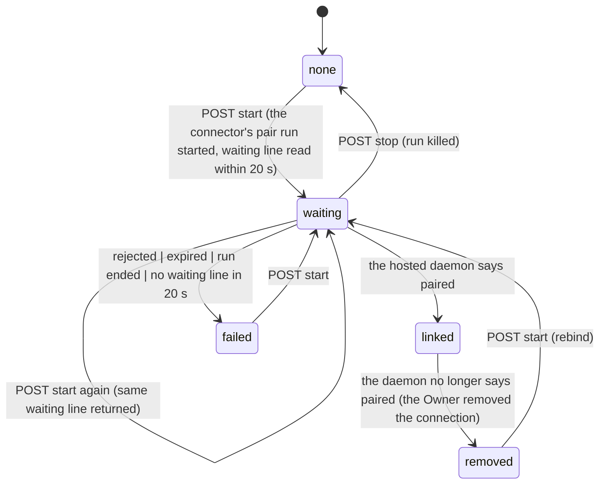
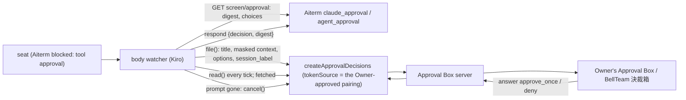

# A seat's tool-approval prompt as an Approval Box card (seat-approval-to-abx, Delta 2026-11-24)

Owner 2026-11-24: a seat stopped on a tool-approval prompt should send a card to him, and his answer approves that one prompt once or denies it. He added: only when the Owner has Approval Box connected; otherwise the same prompt is answered inside BellTeam.

Scope of this page: the card (how BellTeam files, reads and closes it through the connection that runs today). Kiro builds the seat side (watcher, state, the answer back to Aiterm); the in-app answer already exists (`GET/POST /api/bots/:id/screen/approval`, [screen-input.md](../execution/screen-input.md)). The held client package switch is not needed: the body files through its own connector connection (paired once by the Owner's QR scan); the apps only read the card.

## Connection (fourth version, 2026-11-26: the one port)

History, so nobody builds the wrong one: #2510 said "hosted daemon only" (it could not pair while PC_OFFER was off); #2531/#2532 said "connector token path with a token the Owner creates and pastes" (rejected: 「その仕組みは却下。決裁箱で子を追加するのと同じやり方じゃダメなんですか？」); #2538 said "a second pairing by `pair --json --v1` and a token source" (replaced by the Owner's ruling that BellTeam has exactly one port to Approval Box). This page replaces all three.

A seat card is an ordinary decision filed through the **one port** of the 決裁箱拡張 module ([seats-on-hosted-daemon.md](seats-on-hosted-daemon.md), P1): Kiro calls `approvals.decisions.file(decision, 'seat-approval')`, `read(id)` and `cancel(id, reason)`; no token, no secret card, no second pairing, no path to Approval Box. The module owns the hosted connector and its **one** pairing (one QR, the pairing view below). With `PC_OFFER` on, the hosted daemon files every decision over the peer channel, seat cards included, and the Owner's apps show them; `PC_OFFER` is turned on only after the seat cards are on P1 (Nayuta: the apps stop showing /v1 decisions then).

- Not linked (never paired, or the Owner removed the connection): `file` answers `UNAVAILABLE` and nothing is filed; the prompt stays answerable inside BellTeam. The pairing view offers 「つなぐ」 / 「もう一度つなぐ」.
- `file` is idempotent per `session_label` and returns `{decisionId, existing}`; `read` marks an answered card fetched; errors are `UNAVAILABLE` / `REFUSED` / `GONE` with the 5 s bound (the P1 contract).

Dedupe: the watcher's own record (botId, digest, firstSeen, decisionId) is the primary key, so a card is read and cancelled by id; P1 `file` adopts an earlier card with the same `session_label`, so a lost answer never files twice.

## The pairing view (the same on every client)

One view, **「決裁箱につなぐ」**, in the one place every client already has for the 決裁箱 connection: directly under 「決裁箱につながっています」 / つなぎを外す (Apple: the end of the 決裁箱 list; Web: the 決裁箱 dialog toolbar; Windows/Linux/Android: the same 設定 block). It is the **one pairing** of BellTeam with the Owner's Approval Box (the AIs' requests and the stopped-prompt cards both use it), a view of the Owner's session only. Each client draws the QR from `qrText` with the component it already uses for the device pairing (state `waiting`) and shows the two codes as two labelled values; no client talks to the daemon or to Approval Box for this.

| State (route `state`) | Shown (Japanese, plain) | Action |
| --- | --- | --- |
| `none` | 「BellTeamのAIが決裁箱に出す申請と、AIが許可待ちで止まった時の連絡が、決裁箱のアプリに届きます。つなぐのは1回だけです。」 | 「つなぐ」 |
| `waiting` | the QR code; two labelled values, 「コード」 (`code`, 8 characters, e.g. ABCD-EFGH) and 「確認コード」 (`typedSecret`, 16 characters), selectable text; 「このQRコードが別の画面に出ている時は、決裁箱のアプリで、接続 → 「AIをつなぐ」 → 「QRコードを読む」を開いて読み、許可してください。」 「QRコードを読めない時は、「AIをつなぐ」の「コードを確認」にコードを入れ、次の画面の16文字のコードの欄に確認コードを入れて、「つなぐ」を押してください。」 and the expiry time (JST) | 「やめる」 |
| `linked` | 「つながっています。AIの申請と、許可待ちの連絡が、決裁箱に届きます。」 | none |
| `removed` | 「決裁箱でつなぎが外されています。もう一度つないでください。」 | 「もう一度つなぐ」 |
| `failed` (reason `rejected`) | 「決裁箱のアプリで「心当たりがない」が押されました。」 | 「もう一度つなぐ」 |
| `failed` (reason `expired`) | 「許可の待ち時間が過ぎました。もう一度つないでください。」 | 「もう一度つなぐ」 |
| `failed` (other) / `unavailable` | 「いまはつなげません。少し待って、もう一度押してください。」 | 「もう一度つなぐ」 |

Never red or amber except `failed`; `none` and `linked` are neutral. The app needs **both** codes: without the 確認コード it claims the pairing but makes no key binding and the connection never works (Nayuta); the QR carries both. Whether the QR can be read depends on where it is shown (a phone cannot read its own screen), so both ways are always written.

Every state leaves by the Owner's tap, the run ending, or a bounded wait (the run is capped at the code's `expires_at`, 5 minutes; the 20 s bound is the same as the pair step's). None waits for an operator.

## Routes and owners

Body routes in the approval-box-extension module (same-origin Owner session like `/api/approvals`):

| Route | Answer |
| --- | --- |
| `GET /api/approvals/seat-link` | `{state, code?, typedSecret?, qrText?, expiresAt?, reason?}` (`code` 8 characters, `typedSecret` 16 characters; state and reason as in the table). The path keeps its name so no client re-routes; it is the one pairing |
| `POST /api/approvals/seat-link/start` | starts or returns the running pairing; same shape |
| `POST /api/approvals/seat-link/stop` | kills the run; same shape |

The module owns these three calls and nothing else; it keeps no pairing data. The pair run and the pairing state belong to the module's parent-side adapter (`src/approval-box-daemon.mjs`, `pairing`, P3 of [seats-on-hosted-daemon.md](seats-on-hosted-daemon.md)); the MCP tools `approval_box_pair` and `approval_box_pair_status` retire (Molly), the Owner pairs himself in this view.

| Who | Builds |
| --- | --- |
| Nayuta | the connector's `pair` (8-character code, 16-character typed secret, QR), the release/pin, `PC_OFFER` |
| Delta | this page and the screen-spec words; P1 (`approvals.decisions`), P3 (the pairing routes) and the pairing manager in the module's parent-side adapter |
| Kiro | the seat watcher: files, reads and cancels through P1 (`origin: seat-approval`); no card while P1 answers `UNAVAILABLE`; the in-app entry stays the fallback |
| Rapi, Anis, Neon | the pairing view per table from the three routes, with the two codes and the new words (chart rows after this page) |
| Molly | hosting of the module's parent-side object in the body (the door route calls it) |

## Card shape

| Field | Value |
| --- | --- |
| `title` | 「◯◯が、「<tool>」を1回だけ実行してよいか、決めてください」 (◯◯ = the Bot's name) |
| `context` | Bot name; harness; the exact tool and command, shown literally and cut at 2000 characters with 「（以下省略）」; the harness's reason text; the time the prompt appeared (JST). Run the body's secret masker over the command before filing: a command can hold a token, and the card is stored by Approval Box. |
| `options` | `approve_once` 「1回だけ許可する」 and `deny` 「許可しない」, in this order, none recommended, none preselected. The ids are the values `POST screen/approval` takes. |
| `requester` | the Bot's roster name (the client rule 2, `basis: "name"`; the body's file call sends no `requester_bot_id`) |
| `session_label` | `Seat <botId> <promptDigest first 16 hex> <firstSeen epoch seconds>`. Never `Lattice …`, so no chart link is attached. The first-seen seconds make a later identical command a new occurrence (without it `file()` would adopt the earlier answered card). |
| `urgency` | normal; no deadline |
| free-text answer | counts as `deny` (no text is sent to the seat); the card says nothing about it |

## States and who moves them

```mermaid
stateDiagram-v2
  [*] --> Watching: seat is up
  Watching --> Filed: approval_required seen, file() returned an id (record: botId, digest, firstSeen, decisionId)
  Watching --> InAppOnly: approval_required seen, link not linked or file() failed
  InAppOnly --> Watching: prompt gone
  Filed --> Applying: read() = answered with approve_once or deny
  Applying --> Done: POST screen/approval {decision, digest} = 200
  Applying --> Stale: 409 SCREEN_APPROVAL_CHANGED (dialog changed or gone)
  Filed --> Cancelled: prompt gone (answered in BellTeam, seat stopped, digest changed): cancel(reason)
  Stale --> Watching: nothing is sent; the new prompt, if any, gets its own card
  Cancelled --> Watching
  Done --> Watching
```

- One card per prompt occurrence. The watcher keeps the record (it survives a body restart: `file()` re-adopts by `session_label`, so a restart never files twice).
- The answer is applied only with the digest stored at filing. A changed or gone dialog never receives the Owner's old answer.
- Answered in BellTeam first: cancel the card with 「BellTeamの画面で答えられました」. Answered on the card first: the in-app prompt disappears by itself; a late tap there gets 409.
- `read()` marks the card fetched, so the Owner's app shows the delivery as delivered once the body has applied it (client-v0.5 screen-spec, Answer outcomes).
- `cancel()` on an already answered card answers 4xx (REFUSED): ignore it.
- Every state leaves by the next watch tick or by a prompt change; none waits for the Owner (a card left unanswered stays in the Owner's list until the prompt goes, then it is cancelled).

## Data flow

## What the 決裁箱 screens do with it (client rows follow, Kiro's contract first)

A BellTeam-origin card whose `session_label` does not name a chart task shows no chart line at all (neither 「工程表につなげています」 nor 「この決裁に合う工程は、工程表に見つかっていません」): it was never meant for a chart. Otherwise it is an ordinary BellTeam card (face and name of the Bot, the two buttons, the answer line of screen-spec).
