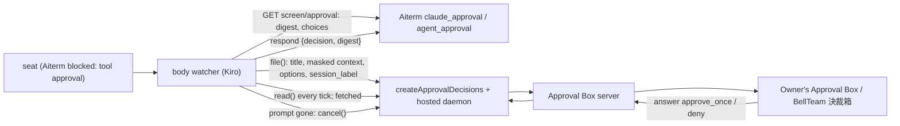

# A seat's tool-approval prompt as an Approval Box card (seat-approval-to-abx, Delta 2026-11-24)

Owner 2026-11-24: a seat stopped on a tool-approval prompt should send a card to him, and his answer approves that one prompt once or denies it. He added: only when the Owner has Approval Box connected; otherwise the same prompt is answered inside BellTeam.

Scope of this page: the card (how BellTeam files, reads and closes it through the connection that runs today). Kiro builds the seat side (watcher, state, the answer back to Aiterm); the in-app answer already exists (`GET/POST /api/bots/:id/screen/approval`, [screen-input.md](../execution/screen-input.md)). The held client package switch is not needed: the body files through its own hosted connector daemon; the apps only read the card.

## Connection

The body's `createApprovalDecisions` (`src/lattice-approval.mjs`) with `daemon` = the paired hosted daemon: `file()` (list, adopt by `session_label`, else POST), `read()` (marks the answer fetched), `cancel()`. Seat cards use the **daemon route only**. The daemon not paired (no `daemon.mode === 'pc'`) means no card: the prompt stays answerable in BellTeam (the in-app path), nothing is filed on a token path, and no new secret request is made for this. Reason: a second token connection per purpose (Flora's rule) would need a new `request_secret` for a feature the paired daemon already carries.

## Card shape

| Field | Value |
| --- | --- |
| `title` | 「◯◯が、「<tool>」を1回だけ実行してよいか、決めてください」 (◯◯ = the Bot's name) |
| `context` | Bot name; harness; the exact tool and command, shown literally and cut at 2000 characters with 「（以下省略）」; the harness's reason text; the time the prompt appeared (JST). Run the body's secret masker over the command before filing: a command can hold a token, and the card is stored by Approval Box. |
| `options` | `approve_once` 「1回だけ許可する」 and `deny` 「許可しない」, in this order, none recommended, none preselected. The ids are the values `POST screen/approval` takes. |
| `requester` | the Bot's roster name (the client rule 2, `basis: "name"`; the body's file call sends no `requester_bot_id`) |
| `session_label` | `Seat <botId> <promptDigest first 16 hex> <firstSeen epoch seconds>`. Never `Lattice …`, so no chart link is attached. The first-seen seconds make a later identical command a new occurrence (without it `file()` would adopt the earlier answered card). |
| `urgency` | normal; no deadline |
| free-text answer | counts as `deny` (no text is sent to the seat); the card says nothing about it |

## States and who moves them

```mermaid
stateDiagram-v2
  [*] --> Watching: seat is up
  Watching --> Filed: approval_required seen, daemon paired, file() returned an id (record: botId, digest, firstSeen, decisionId)
  Watching --> InAppOnly: approval_required seen, daemon not paired or file() failed
  InAppOnly --> Watching: prompt gone
  Filed --> Applying: read() = answered with approve_once or deny
  Applying --> Done: POST screen/approval {decision, digest} = 200
  Applying --> Stale: 409 SCREEN_APPROVAL_CHANGED (dialog changed or gone)
  Filed --> Cancelled: prompt gone (answered in BellTeam, seat stopped, digest changed): cancel(reason)
  Stale --> Watching: nothing is sent; the new prompt, if any, gets its own card
  Cancelled --> Watching
  Done --> Watching
```

- One card per prompt occurrence. The watcher keeps the record (it survives a body restart: `file()` re-adopts by `session_label`, so a restart never files twice).
- The answer is applied only with the digest stored at filing. A changed or gone dialog never receives the Owner's old answer.
- Answered in BellTeam first: cancel the card with 「BellTeamの画面で答えられました」. Answered on the card first: the in-app prompt disappears by itself; a late tap there gets 409.
- `read()` marks the card fetched, so the Owner's app shows the delivery as delivered once the body has applied it (client-v0.5 screen-spec, Answer outcomes).
- `cancel()` on an already answered card answers 4xx (REFUSED): ignore it.
- Every state leaves by the next watch tick or by a prompt change; none waits for the Owner (a card left unanswered stays in the Owner's list until the prompt goes, then it is cancelled).

## Data flow

## What the 決裁箱 screens do with it (client rows follow, Kiro's contract first)

A BellTeam-origin card whose `session_label` does not name a chart task shows no chart line at all (neither 「工程表につなげています」 nor 「この決裁に合う工程は、工程表に見つかっていません」): it was never meant for a chart. Otherwise it is an ordinary BellTeam card (face and name of the Bot, the two buttons, the answer line of screen-spec).
