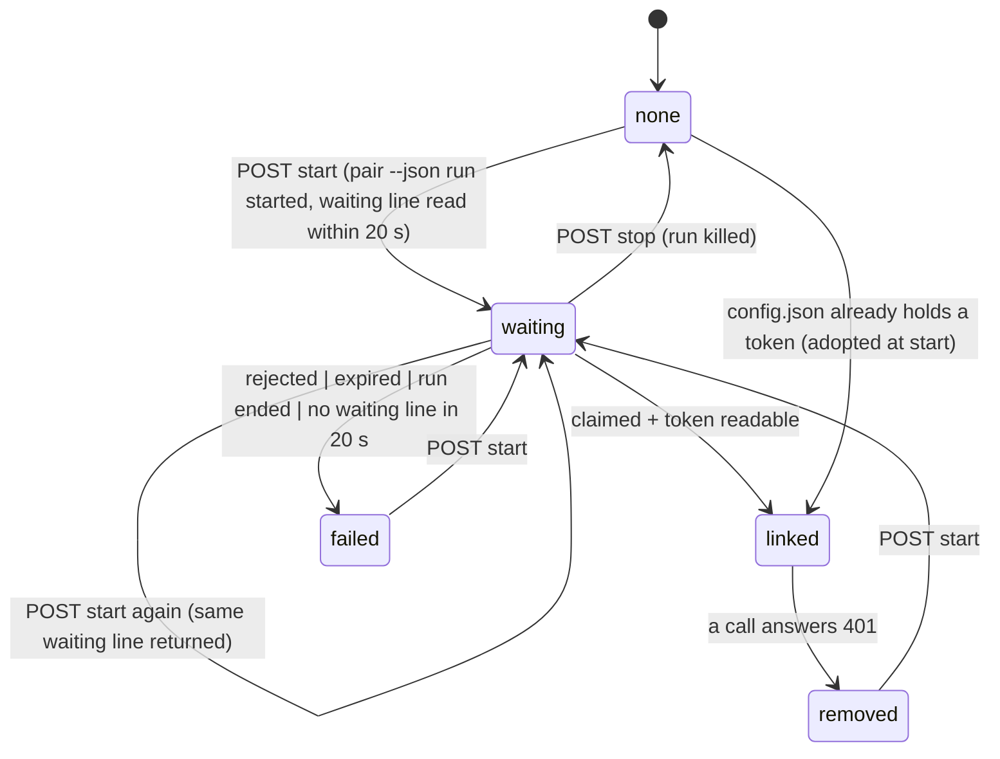
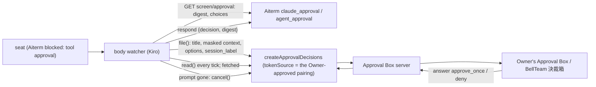

# A seat's tool-approval prompt as an Approval Box card (seat-approval-to-abx, Delta 2026-11-24)

Owner 2026-11-24: a seat stopped on a tool-approval prompt should send a card to him, and his answer approves that one prompt once or denies it. He added: only when the Owner has Approval Box connected; otherwise the same prompt is answered inside BellTeam.

Scope of this page: the card (how BellTeam files, reads and closes it through the connection that runs today). Kiro builds the seat side (watcher, state, the answer back to Aiterm); the in-app answer already exists (`GET/POST /api/bots/:id/screen/approval`, [screen-input.md](../execution/screen-input.md)). The held client package switch is not needed: the body files through its own connector connection (paired once by the Owner's QR scan); the apps only read the card.

## Connection (third version, 2026-11-24: the Owner's own flow, no token pasted)

History, so nobody builds the wrong one: #2510 said "hosted daemon only" (it cannot pair while PC_OFFER is off, and a decision filed through it never appears in `/v1`); #2531/#2532 said "connector token path with a token the Owner creates and pastes" (the Owner rejected it: 「その仕組みは却下。決裁箱で子を追加するのと同じやり方じゃダメなんですか？」). This page replaces both.

The body pairs ONCE as a connector of the Owner's Approval Box account, the same way the Owner adds another device: BellTeam shows a QR code, he reads it in the Approval Box app (接続 → 「AIをつなぐ」 → 「QRコードを読む」) and approves. Nayuta builds an explicit `/v1` mode for `approval-box pair --json` (same `approval-box.pair.v1` lines `waiting`, `claimed`, `bound`/error; `qr_text` = `<publicUrl>/pair?c=<code>`; the result is a connection on the server path). PC_OFFER stays off and `a490p-pair-on-sitting` (the peer-channel pairing at the PC_OFFER sitting) is unchanged; this is a second, earlier pairing of the same body.

After `claimed` the pairing leaves a connection token in the pairing home (`<daemon HOME>/config.json`, 0600, the body's own uid). Seat cards use it directly on `/connector/v1`:

- `createApprovalDecisions` gets one new input, `tokenSource: async () => string | null`. When given, `call()` uses it instead of `handle()`/`withResolved`; null means `SEAT_APPROVAL_DECISIONS_UNAVAILABLE`. The token is read at call time, never copied into the secret store, a card, a log or the route answers.
- The seat-approval instance: `createApprovalDecisions({ tokenSource: readPairedToken, daemon: null, code: 'SEAT_APPROVAL_DECISIONS', ... })` (the scope and `request_secret` pair in `application-services.mjs`, `seat-approvals` / `seat-approvals-approval-box`, go away: no secret card exists for this).
- The Lattice effects and running exclusions keep their own connections and paths unchanged. The hosted daemon (`--hosted`) stays what it is for a490p (it idles `not_paired` while PC_OFFER is off, which is harmless). It does not read this pairing: `pcPrepared()` is false without peer-channel keys.
- If the Owner removes the connection in Approval Box, the next call is 401: the link state becomes `removed` and the view below offers 「もう一度つなぐ」. Nothing is filed meanwhile; the prompt stays answerable inside BellTeam.
- At the PC_OFFER sitting the peer-channel pairing may replace this token (the same `config.json`). Whether the new connection's token still works on `/connector/v1` is Nayuta's to state in a490p; until then nothing here depends on it.

Dedupe: `file()` finds an earlier card by listing `GET /decisions` (the connector's 24 h window) and matching `session_label` exactly. The watcher's own record (botId, digest, firstSeen, decisionId) is the primary key, so a card is read and cancelled by id and a long list never causes a second filing for a known prompt.

## The pairing view (the same on every client)

One view, **「AIの許可待ちを決裁箱へ送る」**, in the one place every client already has for the 決裁箱 connection: directly under 「決裁箱につながっています」 / つなぎを外す (Apple: the end of the 決裁箱 list; Web: the 決裁箱 dialog toolbar; Windows/Linux/Android: the same 設定 block). It is a view of the Owner's session only. Each client draws the QR from `qrText` with the component it already uses for the device pairing (Gate `waiting`); no client talks to the daemon or to Approval Box for this.

| State (route `state`) | Shown (Japanese, plain) | Action |
| --- | --- | --- |
| `none` | 「AIが許可を待って止まった時、決裁箱のアプリに届きます。つなぐのは1回だけです。」 | 「つなぐ」 |
| `waiting` | the QR code and the typed code; 「決裁箱のアプリで、接続 → 「AIをつなぐ」 → 「QRコードを読む」を開き、このQRコードを読んで、許可してください。」 and the expiry time (JST) | 「やめる」 |
| `linked` | 「つながっています。AIが許可待ちで止まると、決裁箱に届きます。」 | none |
| `removed` | 「決裁箱でつなぎが外されています。もう一度つないでください。」 | 「もう一度つなぐ」 |
| `failed` (reason `rejected`) | 「決裁箱のアプリで「心当たりがない」が押されました。」 | 「もう一度つなぐ」 |
| `failed` (reason `expired`) | 「許可の待ち時間が過ぎました。もう一度つないでください。」 | 「もう一度つなぐ」 |
| `failed` (other) / `unavailable` | 「いまはつなげません。少し待って、もう一度押してください。」 | 「もう一度つなぐ」 |

Never red or amber except `failed`; `none` and `linked` are neutral.

Every state leaves by the Owner's tap, the run ending, or a bounded wait (the run is capped at the code's `expires_at`, 5 minutes; the 20 s bound is the same as `approval_box_pair`'s). None waits for an operator.

## Routes and owners

Body routes in the approval-box-extension module (same-origin Owner session like `/api/approvals`):

| Route | Answer |
| --- | --- |
| `GET /api/approvals/seat-link` | `{state, code?, typedSecret?, qrText?, expiresAt?, reason?}` (state and reason as in the table) |
| `POST /api/approvals/seat-link/start` | starts or returns the running pairing; same shape |
| `POST /api/approvals/seat-link/stop` | kills the run; same shape |

The module owns these three calls and nothing else; it keeps no pairing data. The pair run, the pairing home, `readPairedToken` and the 401 detection belong to Molly's `approval-box-daemon.mjs` (the body already runs `approval_box_pair`'s `pair --json` there; the MCP tools `approval_box_pair*` stay for a490p and are not used by clients).

| Who | Builds |
| --- | --- |
| Nayuta | `approval-box pair --json` `/v1` mode (lines, `qr_text`, config written on `claimed`), the release/pin; states in a490p whether the later peer-channel token works on `/connector/v1` |
| Molly | the pair-run wrapper (start/status/stop, 20 s waiting-line bound, adopt an existing token), `readPairedToken`, the 401 → `removed` detection, the three routes, the `tokenSource` input of `createApprovalDecisions`, removal of the seat-approvals secret pair |
| Kiro | the seat watcher on the new instance (no paired-daemon gate; no card while the link is not `linked`); the in-app entry stays the fallback |
| Rapi, Anis, Neon | the pairing view per table, from the three routes (after Molly's routes exist; Admi's Web has no 決裁箱 view yet) |
| Delta | this page, screen-spec words; the link-state check in the client rows |

## Card shape

| Field | Value |
| --- | --- |
| `title` | 「◯◯が、「<tool>」を1回だけ実行してよいか、決めてください」 (◯◯ = the Bot's name) |
| `context` | Bot name; harness; the exact tool and command, shown literally and cut at 2000 characters with 「（以下省略）」; the harness's reason text; the time the prompt appeared (JST). Run the body's secret masker over the command before filing: a command can hold a token, and the card is stored by Approval Box. |
| `options` | `approve_once` 「1回だけ許可する」 and `deny` 「許可しない」, in this order, none recommended, none preselected. The ids are the values `POST screen/approval` takes. |
| `requester` | the Bot's roster name (the client rule 2, `basis: "name"`; the body's file call sends no `requester_bot_id`) |
| `session_label` | `Seat <botId> <promptDigest first 16 hex> <firstSeen epoch seconds>`. Never `Lattice …`, so no chart link is attached. The first-seen seconds make a later identical command a new occurrence (without it `file()` would adopt the earlier answered card). |
| `urgency` | normal; no deadline |
| free-text answer | counts as `deny` (no text is sent to the seat); the card says nothing about it |

## States and who moves them

```mermaid
stateDiagram-v2
  [*] --> Watching: seat is up
  Watching --> Filed: approval_required seen, file() returned an id (record: botId, digest, firstSeen, decisionId)
  Watching --> InAppOnly: approval_required seen, link not linked or file() failed
  InAppOnly --> Watching: prompt gone
  Filed --> Applying: read() = answered with approve_once or deny
  Applying --> Done: POST screen/approval {decision, digest} = 200
  Applying --> Stale: 409 SCREEN_APPROVAL_CHANGED (dialog changed or gone)
  Filed --> Cancelled: prompt gone (answered in BellTeam, seat stopped, digest changed): cancel(reason)
  Stale --> Watching: nothing is sent; the new prompt, if any, gets its own card
  Cancelled --> Watching
  Done --> Watching
```

- One card per prompt occurrence. The watcher keeps the record (it survives a body restart: `file()` re-adopts by `session_label`, so a restart never files twice).
- The answer is applied only with the digest stored at filing. A changed or gone dialog never receives the Owner's old answer.
- Answered in BellTeam first: cancel the card with 「BellTeamの画面で答えられました」. Answered on the card first: the in-app prompt disappears by itself; a late tap there gets 409.
- `read()` marks the card fetched, so the Owner's app shows the delivery as delivered once the body has applied it (client-v0.5 screen-spec, Answer outcomes).
- `cancel()` on an already answered card answers 4xx (REFUSED): ignore it.
- Every state leaves by the next watch tick or by a prompt change; none waits for the Owner (a card left unanswered stays in the Owner's list until the prompt goes, then it is cancelled).

## Data flow

## What the 決裁箱 screens do with it (client rows follow, Kiro's contract first)

A BellTeam-origin card whose `session_label` does not name a chart task shows no chart line at all (neither 「工程表につなげています」 nor 「この決裁に合う工程は、工程表に見つかっていません」): it was never meant for a chart. Otherwise it is an ordinary BellTeam card (face and name of the Bot, the two buttons, the answer line of screen-spec).
