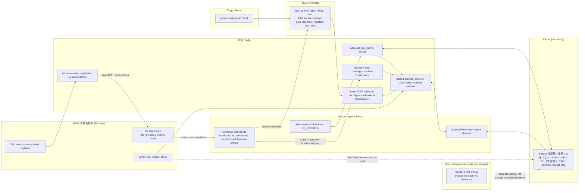
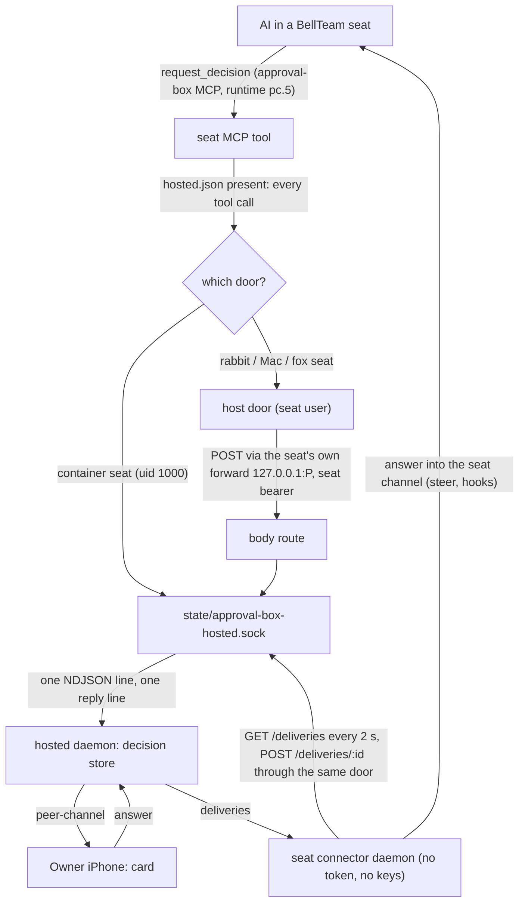

# BellTeam seats on the hosted Approval Box daemon (a516e, abx-first-real-request; Delta 2026-11-26)

Owner of this page: Delta (決裁箱拡張). It draws the Owner's one sitting: every BellTeam seat (container seats, and seats on rabbit, Mac and fox) files its Approval Box requests through the one hosted daemon the body pairs once, and the first real request is checked end to end. This module owns exactly two steps: the seat switch (`use-hosted` on each seat host) and the first-request check. Every other box keeps its owner and its own page; this page draws the connection and does none of their steps.

Sources: [runtime/approval-box-daemon.md, Seats on the hosted daemon](../runtime/approval-box-daemon.md), [terminals README, Approval Box door](../terminals/README.md), [data-flow RT24](../../data-flow.md), [seat-approval-card.md](seat-approval-card.md). Chart: `bellteam-dev-added`: a516e-use-hosted-container-delta, a516e-use-hosted-delta, abx-first-real-request-delta.

## 1. Who owns what

| Box | Owner | What it is here | Page that is canonical for it |
| --- | --- | --- | --- |
| Seat switch | **Delta (this module)** | `approval-box use-hosted --socket <door>` on each seat host, the check that it took, `use-hosted --off` to undo | this page |
| First real request check | **Delta (this module)** | one real request from a BellTeam seat, followed to the Owner's iPhone and back | this page |
| Hosted daemon, pairing, seats' door on the container, body route `/api/seat-mcp/approval-box/local` | Molly (body, runtime) | `approval_box_pair` to Bound; the relay socket `/srv/bellteam/state/approval-box-hosted.sock` (0666); the route behind the seat bearer | runtime/approval-box-daemon.md |
| Harness registration (the seats' MCP and hook entries) | Molly (a532b2 stage 5, harness-entries) | E2 item `approval-box` runs `~/.approval-box/bin/approval-box harness-entries --json` and writes what it names into each seat's CLI files; applied at body start, on a Bot registry change, or by one `configureHarnessEntries` pass | runtime/cli-registration.md |
| Host door on rabbit, Mac, fox (`doorHook`, door program, its address and access) | Krust (terminals, P10) | POSIX `~/.bellteam/approval-box-door.sock` (0600 in a 0700 directory), Windows `\\.\pipe\bellteam-approval-box-door-<user>` (default DACL, accepted: Everyone opens read-only and cannot file or read); started after each launch or resume of a seat; gone when no seat lives | terminals/README.md, RT24 |
| Generic post-launch hook | Elegg (Aiterm) | runs the hook after launch and resume; Aiterm has no approval door code since 0.70.103, so the remote-host arrow goes to Krust's door, never to Aiterm | Aiterm docs |
| Connector commands and runtime, `PC_OFFER`, the Owner's pairing screens | Nayuta (Approval Box) | `install-runtime`, `use-hosted --socket`, `--off`, `harness-entries`; opening `PC_OFFER`; the iPhone app | Approval Box docs |
| Seat tool-approval cards | Kiro | unchanged: a seat stopped on a tool prompt files a card through the body's own seat-link connector (a second, separate QR pairing), not through the hosted daemon | seat-approval-card.md |

## 2. Function diagram



Each arrow is a public interface of its target (a command, a socket, an HTTP route, a file the owner defines). This module reads nothing inside Molly's, Krust's or Nayuta's code or storage; it runs their published commands and reads their published answers.

## 3. Data flow



Data ownership: the decision content lives only in the hosted daemon's store (Molly); the seat keeps no token and no keys; the doors keep nothing (the host door holds the seat bearer in memory only, Krust). This module stores nothing: its record of the sitting is the chart notes of its three tasks.

## 4. States of a seat host

```mermaid
stateDiagram-v2
  [*] --> OwnPath: today (the seat's own connector, /mcp path)
  OwnPath --> RuntimeReady: install-runtime pc.5 into ~/.approval-box (no hosted.json yet, so OwnPath still answers)
  RuntimeReady --> Registered: registration pass writes the new runtime into the seat's MCP and hook entries
  Registered --> Hosted: Molly reports Bound; use-hosted --socket <door> writes hosted.json
  Hosted --> OwnPath: use-hosted --off (any failed check, or the Owner says stop)
  RuntimeReady --> OwnPath: use-hosted never run
  note right of Hosted: before Bound the daemon answers 503 not_paired, so the switch never runs before Bound
```

Every state leaves by a command this module runs (`--off`), never by waiting for another module. A running seat keeps its old entries until its CLI restarts (the registration pass does not run at seat start); the check below names which seats were restarted.

## 5. The sitting, in order

| Step | Who | Done when |
| --- | --- | --- |
| 1 | Nayuta | open /v1 decisions cleared, `PC_OFFER` on |
| 2 | Molly | pairing reports **Bound** (the Owner's iPhone steps above) |
| 3a | Delta | container seats: `install-runtime` pc.5, `use-hosted --socket /srv/bellteam/state/approval-box-hosted.sock` |
| 3b | Molly | one registration pass on the entry named in section 6 (Delta tells her; she adds it) |
| 3c | Delta | rabbit, Mac, fox: `use-hosted --socket <host door>` (a door exists only while a seat runs there; on fox use runtime pc.5) |
| 4 | Delta | first real request: a BellTeam seat files one request; the card is on the Owner's iPhone; his answer returns to the seat; `list_my_decisions` reads it answered |
| 5 | Delta | one result to Tronie, with what was checked and what was not |

Not before Bound: a switch earlier makes every request tool on that host answer 503 (Nayuta).

## 6. What Delta asks of Molly

The entry is the one the runtime itself names: E2's `approval-box` item already runs `~/.approval-box/bin/approval-box harness-entries --json`. Today that prints runtime 0.1.37 and no `hosted.json` exists on this machine. After `install-runtime` the same command names the pc.5 runtime, so the registration needs no new item of its own: it needs **one live pass of `configureHarnessEntries` after the seats have installed the runtime** (otherwise the new runtime reaches the entries only at the next body start or Bot registry change). Delta runs the install on the seats; Molly runs the pass.

## 7. Failure handling and protections

| Case | What happens | Who leaves it |
| --- | --- | --- |
| Daemon not paired when a seat is switched | 503 `not_paired` on every request tool of that host | `use-hosted --off` (Delta); the switch is not run before Bound |
| No host door (no seat running on that host) | the connector answers `door_unavailable` and retries (10 s in its tools, 2 s by its daemon) | the next launch or resume registers the door (Krust) |
| Another local user opens the fox pipe | Windows lets Everyone open a pipe read-only; a read-only client cannot write a request line, and the door closes a client that does not finish one, so nothing is filed or read through it (Tronie ruling 2026-11-26: no DACL change, the fox step does not wait; task `a516e-fox-door-dacl` retired) | Krust's door closes it at 30 s |
| Request filed, no card on the iPhone | the check fails; the seat is switched back with `--off`; the cause goes to the owner of the failing box | Delta reports, owner repairs |

Protected by these steps: the seat bearer and decision content (never copied by this module), the wrong target (a seat is switched only to the door named for its host class). No other guard is added.
