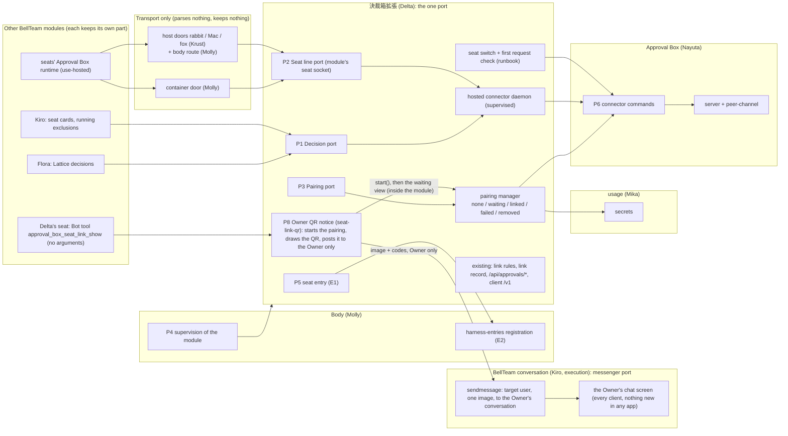
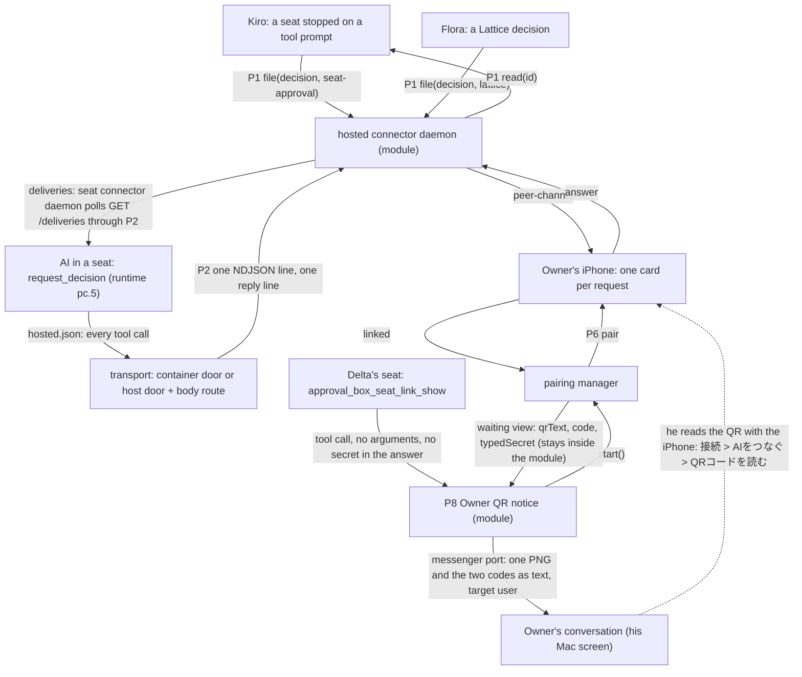
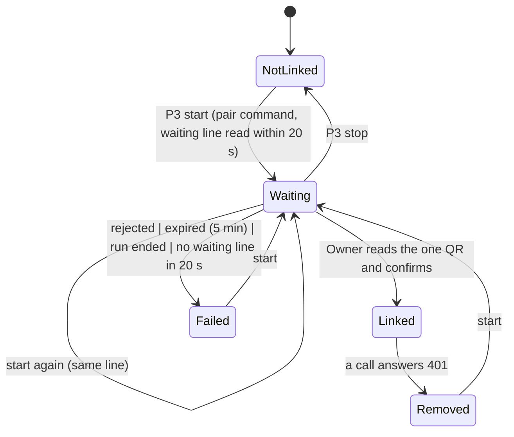
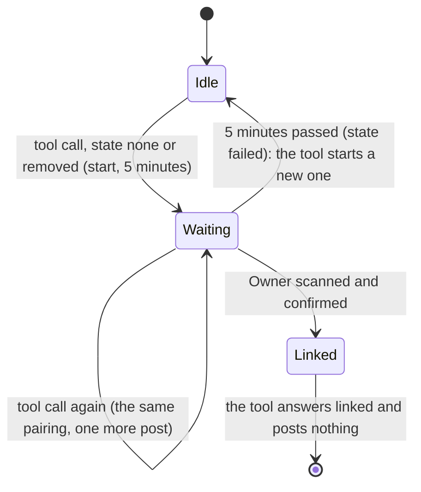

# One port to Approval Box: the 決裁箱拡張 module (abx-one-port-redesign; Delta 2026-11-26)

Owner of this page: Delta (決裁箱拡張). Ruling (Owner, through Tronie, 2026-11-26): module connections go through contracted ports; a spaghetti diagram is a wrong design. BellTeam has exactly **one** port to Approval Box: this module. It owns the BellTeam-side Approval Box connection: the hosted connector, its one pairing to the Owner's Approval Box, and one published interface for filing and reading decisions. Every other BellTeam module uses only that interface and does none of this module's steps; this module reaches Approval Box only through Approval Box's published connector commands. Result for the Owner: **one pairing, one QR**.

This page replaces the first drawing of the Owner's sitting (#2626/#2627). Other pages stay canonical for their own boxes: [runtime/approval-box-daemon.md](../runtime/approval-box-daemon.md) (transport: the container door), [terminals README, Approval Box door](../terminals/README.md) (transport: the host doors), [seat-approval-card.md](seat-approval-card.md) (the card Kiro files), [child-join.md](child-join.md) (the 決裁箱 window as a child device, unrelated to this port). Chart: `bellteam-dev-added/abx-one-port-redesign`; the owners' changes follow this page.

## 1. The ports (who calls what)

| Port | Published by | Caller | Operations | Notes |
| --- | --- | --- | --- | --- |
| **P1 Decision port** (typed, in the body; reached as `approvals.decisions`, the same facade object that carries `ownerTask` / `link`, L20) | this module | Kiro (seat tool-approval cards, running exclusions: `file`, `read`, `cancel`, `capabilities`); Flora (`read` and `cancel` only, for the legacy Lattice records filed before 2026-11-14) | see the contract under this table | no caller holds a credential, a secret card or a token |
| **P2 Seat line port** (the connector's own NDJSON line protocol, one line in, one line out) | this module, at the module's seat socket | transport only: the container door and the body route (Molly), the host doors (Krust) | the lines the seat's Approval Box runtime sends after `use-hosted` (requests, uploads, `GET /deliveries`, `POST /deliveries/:id`) | the doors parse nothing and keep nothing; a door that cannot reach it answers `503 APPROVAL_BOX_DAEMON_UNAVAILABLE`. **Opener side on Windows hosts** (this module's contract, Krust's #2630/#2634): the default pipe name can be squatted, so the door may serve on a fresh address written in `~/.bellteam/approval-box-door.addr`; whoever opens the door reads that file first (default name only if absent) and sends **only** the hello `{"bellteam_door":"hello","nonce":…}` until the reply carries a valid proof (HMAC-SHA256 of the nonce under `~/.bellteam/approval-box-door.key`, 2 s limit); a peer that does not prove is a stranger and gets nothing else. Krust owns the door side. The opener on a host is the seat's connector daemon, which is Nayuta's code and runs on the host, not in this module's process: the module states the contract and asks Nayuta for it through P6 (section 9) |
| **P3 Pairing port** (Owner-session HTTP, same origin as `/api/approvals`) | this module | P8 only, inside the module (2026-11-27). The clients' pairing view (Rapi, Anis, Neon) is retired by the Owner's ruling: an app that is already connected shows no 「決裁箱につなぐ」 block, so the Owner never meets two connections of one name | `get()`, `start()`, `stop()` (state none / waiting / linked / failed / removed, `code` (8 characters, ABCD-EFGH), `typedSecret` (16 characters), `qrText`, `expiresAt`, `reason`) | the HTTP routes `/api/approvals/seat-link` stay for now (diagnostics read them) and are removed in the same train as the clients' blocks (tasks requested through Tronie from Rapi, Anis, Neon); no client may call them after that |
| **P4 Supervision port** | Molly (body, runtime) | this module | the body starts, stops and watches the module's child process like any module and builds the module's **parent-side object** (section 1a); the parent-side object supervises the connector daemon | the module.json hosting contract that exists today (`approval-box-parent-*`) |
| **P5 Seat entry contract** (`bellteam.harness-entries.v1`, E1) | this module | Molly's harness-entries (E2 item `approval-box`) | the MCP and hook entry the seats need, naming the installed runtime | a **file** at `/srv/bellteam/state/approval-box-entries/harness-entries.json` (its own folder, 0755, made by the parent-side code: the module child's folder `approval-box-extension` is 0700 and Molly's E2 pass reads as the seat user), written atomically (Molly: the body's boot pass runs before any module child is up, so a command is not possible); content = what the seats' installed runtime prints for `harness-entries --json` (`~/.approval-box/bin/approval-box`, read-only), refreshed at start and every minute, rewritten only when it changes, and an unreadable answer keeps the last file (`src/approval-box-entries.mjs`); Molly switches the E2 item from the binary command to this file once it exists, and until then it keeps running `~/.approval-box/bin/approval-box` (same content) |
| **P6 Connector commands** | Nayuta (Approval Box) | this module only | `pair`, `install-runtime`, `use-hosted --socket` / `--off`, `harness-entries --json`, `connection export --json`, daemon run, `version --json` | nobody else calls them |
| **P8 Owner QR notice** (2026-11-27, seat-link-qr-in-chat) | this module (parent-side adapter, `src/approval-box-parent-seat-link-qr.mjs`) | Delta's seat only, through one Bot tool `approval_box_seat_link_show` (no arguments; the answer carries no secret) | start the pairing through the module's own pairing manager (the P3 object), take the waiting view, draw the QR as a PNG, post it with the code and the 確認コード to the Owner's conversation through the **messenger port** (`sendmessage`, target `user`, one image); answers `posted` (+ expiry JST) / `linked` / `not_started` / `post_failed` | the secrets leave the module only into the Owner's own conversation (the rule on the waiting view); no other module's file or state is read; clients get no screen |
| **P7 Credential custody** | Mika (usage, `secrets`) | this module | the one connection's secret is kept through the existing usage `secrets` port | usage no longer calls Approval Box itself |

### P1 contract (Kiro's read of what execution calls today, 2026-11-26)

| Operation | Contract |
| --- | --- |
| `file(decision, origin)` | `decision` = title, context, options, requester, `session_label` (the caller sets it: seat `Seat <botId> <digest16> <firstSeen>`, exclusions the stored item label). **Idempotent per `session_label`**: a request with the same label is adopted, never filed twice (a lost answer must never file twice); returns `{decisionId, existing}`. `origin` only adds to the requester, never replaces `session_label`. The module fixes urgency and client, and retries once with `check_token` when Approval Box asks for `confirm_required` |
| `read(id)` | `{status: pending \| held \| answered \| cancelled, answer: {optionId, text}}`; reading an answered request marks it fetched (otherwise its delivery stays "waiting"). A free-text answer is the caller's to treat (seat cards treat it as deny) |
| `cancel(id, reason)` | returns `{status: 'cancelled'}`; `reason` is free Japanese text shown to the Owner; cancelling an answered or cancelled request is `REFUSED`, not success |
| `capabilities()` | the `capabilities` array of the runtime the seats actually run (pc.5 after `install-runtime`), from the connector's `version --json`; execution needs one fact: it contains `bellteam-requester-wake` (an idle seat may close with an answer pending) |
| `connection()` | linked / not linked and, for Molly's read-only `approval_box_daemon_status` diagnostic, the daemon's mode, paired, reason and version |
| Errors | a typed `kind` on every error: `UNAVAILABLE` (not linked, 401, network, 5xx: ends the caller's tick), `REFUSED` (a 4xx: skip that one request), `GONE` (`read` of an id the connection does not know or purged; Flora's name for it is NOT_FOUND: the caller drops its record; a running-exclusions id and a Lattice legacy id filed on the old connections are such ids, so Kiro re-files with the same label and Flora asks the chart creator once). Callers map the kind to their own codes; there is no token-path fallback for old ids |
| Time | each call returns within about 5 s or fails `UNAVAILABLE` (running exclusions and Lattice's nudge call it every 60 s on a shared chain) |

Execution's engine runs in its own process while P1 is in the body: the engine reaches `capabilities()` through a parent effect on the body (the route execution already uses for body services); Kiro names the effect, Molly hosts it, and until it exists Kiro keeps the direct read.

### 1a. Where the connector runs (Tronie ruling B, 2026-11-26)

The hosted connector runs as the module's **parent-side adapter in the body**, where the module's pairing and effects already live (`src/approval-box-parent-*`), owned by this module. The module publishes P1, P2, P3 and P5 as **one object**; the module's child process stays sandboxed and unchanged (no new IPC, no spawn right, no new failure path). The body only builds that object instead of the in-body daemon service, and hands the doors a function to call (same socket path as today). Consequence, accepted: a change to the parent-side adapter ships in a body train (Molly), not as a module-only swap. The interface does not change if the connector later moves into the child (A stays open). Callers (Kiro, Flora) move to P1 before anything is deleted, and everything rides one train.

## 2. Function diagram



Every arrow into this module lands on P1, P2, P3, P5 or P8; every arrow out lands on P6 or P7. No other module reads or writes this module's files, state or the connector's home.

## 3. Data flow



Data ownership: decision content lives only in the hosted connector's store (this module); the seat keeps no token and no keys; the doors keep nothing (a host door holds a seat bearer in memory only, Krust); callers keep ids (Kiro's record of botId, digest, first-seen, id) and nothing of the connection.

## 4. States



Every state leaves by the Owner's tap, the run ending or a bounded wait; none waits for an operator. P1 `file` in any state but Linked answers `UNAVAILABLE` and the caller keeps its own fallback (Kiro's in-app entry stays); P2 in any state but Linked answers `503 not_paired`.

```mermaid
stateDiagram-v2
  [*] --> OwnPath: seat host today (own connector, /mcp path)
  OwnPath --> RuntimeReady: install-runtime pc.5 (no hosted.json yet, OwnPath still answers)
  RuntimeReady --> Registered: registration pass writes the new runtime into the seat's entries
  Registered --> Hosted: module Linked; use-hosted --socket <door> writes hosted.json
  Hosted --> OwnPath: use-hosted --off (a failed check, or the Owner says stop)
  note right of Hosted: a seat reads the new entries at its next normal start; nobody force-restarts a seat (Tronie 2026-11-26)
```

## 5. The seven connections today, and where each ends up

Source: `node /srv/bellteam/shared/tools/assign-owner/who-owns.mjs --uses approval-box` (Tronie).

| Today | Owner | After | What the owner changes |
| --- | --- | --- | --- |
| approval-box-extension: client `/v1` (read, answer) + connector pairing | Delta | stays inside this module; pairing becomes P3 | Delta |
| execution: `connector /v1` (seat cards via the seat-link token, running exclusions via their own secret pair) | Kiro | P1 `file/read/cancel` with `origin`; the seat-link token source and the secret pair retire; no second pairing | Kiro changes the two call sites in `application-services.mjs` plus the secret pair and the token source |
| execution: `version --json (capabilities)` (`src/idle-sessions.mjs`) | Kiro | P1 `capabilities()` through a parent effect (see the P1 contract) | Kiro |
| lattice: `connector /v1` (`createLatticeDecisions`, own secret pair) | Flora | P1 `read` and `cancel` only (since 2026-11-14 the Lattice child files nothing through this route; owner-lane cards go through `ownerTask` / `link`); the secret pair retires | Flora writes a thin adapter over the P1 client (about 20 lines: read, cancel, the error mapping), drops `src/lattice-approval.mjs` from her module.json in the same step and removes the Lattice secret pair request |
| integration: `connector /v1` (`approval-box-parent-facade`) and the in-body daemon service | Molly | under ruling B the body builds the module's parent-side object instead of the in-body daemon service (`services.approvalBoxDaemon`, started and closed in `application-runtime.mjs`) and hands her door route the object's `call` function (P2, parses nothing, same socket path); the MCP tools `approval_box_pair` and `approval_box_pair_status` retire (the Owner pairs himself in the view, P3); `approval_box_daemon_status` stays as a read-only diagnostic over `connection()` | Molly (her own function and data-flow drawing first, then the code) |
| runtime: `harness-entries (approval-box)` | Molly | stays a seat-registration contract, now fed by P5 | Molly points the E2 item at the module's E1 when it exists |
| usage: `connection export --json` | Mika | **nothing calls it today** (Mika 2026-11-26: its only caller, the submitted-secret consumer, was retired in #2306); Mika removes the three leftover drawings (usage module.json port, data-flow X5, the feature-map edge). If the module needs the connection's identity it calls the export itself and keeps the result through P7 (Nayuta confirmed 2026-11-26: it returns `{schema approval-box.connection.v1, server, token}`, the /v1 connection bearer; the module uses it for the connection's identity and server only, never to file or read decision content, because the /v1 content routes close on 2026-12-12) | Mika drops the direct call |

## 6. Files, claimed by exactly one module

| File | Module after this page | Why |
| --- | --- | --- |
| `src/approval-box-daemon.mjs`, `src/approval-box-seats-socket.mjs` (the connector controller and the relay socket it starts), the new P1 file `src/approval-box-port.mjs` | **approval-box-extension**, in a new `parentSource` list of its `module.json` (parent-side, body process; the existing `source` list keeps pinning only the child files) | the hosted connector and its pairing are this module's |
| `src/approval-box-daemon-mcp.mjs` | runtime (Molly) | the Bot MCP tools; `approval_box_pair` and `approval_box_pair_status` retire, `approval_box_daemon_status` stays |
| `src/lattice-approval.mjs` (`createApprovalDecisions`) | **deleted** (the old token path: Kiro's #2639 and Flora's #2641 are on P1; nothing imports it) | one port, no second connector client |
| `src/approval-box-door-route.mjs` | integration (Molly): transport to P2 | the body's route for the remote seats; parses nothing, calls the module object's `call` |
| `src/terminals/approval-door*.mjs` | terminals (Krust): transport | the host doors |
| `src/approval-box-parent-*.mjs` | runtime/integration (Molly): P4 | hosting of this module |
| `src/seat-approvals.mjs`, `src/http-seat-approvals-api.mjs`, `src/running-exclusions.mjs`, `src/running-exclusions-mcp.mjs`, `src/http-running-exclusions-api.mjs`, `src/idle-sessions.mjs` | execution (Kiro) | they call P1 or read `capabilities()` only |

The claim is made here first (diagrams first). `module.json` `source` and `provides` follow in the code step with the test that pins the list today to the `approval-box-extension*` files (`test/approval-box-extension-child.test.mjs`); Flora's `module.json` drops `src/lattice-approval.mjs` in the same step.

### What the module must keep from the lab-proven daemon (Molly, #2301 and Centi's a490t-lab)

- The daemon's state directory `/srv/bellteam/state/approval-box-daemon/` and the seats' socket `/srv/bellteam/state/approval-box-hosted.sock` stay **unchanged**: the seats' `hosted.json` and the doors need no change and no new mount.
- Kill the daemon and a new one is up within about 3 s; restarts are bounded and never a permanent give-up (restart limit b1eb6df1).
- Starting the daemon never holds the module's own start (a500).
- The connector runtime comes from the image (the Dockerfile `install-runtime` step; `node-datachannel` sits next to that copy), not from the module's payload: the module runs it from the image path.

### Release shape (Molly)

The code step touches the body's import closure (`application-runtime`, `application-services`, `mcp-tools`, the door route) and this module's row, so it is a body (container) row plus an approval-box-extension row, the body first, then the module row. A body swap restarts every seat, so by the one-release rule it rides **one** train, and because the sitting has no restart step that train is live **before** the sitting. Production was never paired, so nothing is lost in between. Molly's rows `a490p-pair-on-sitting` and Nayuta's `a490p-go` have nothing left to do once P3 exists and are retired by their owners; the sitting rows of this module wait on the P3 row instead.

## 7. The sitting, in order (no restart step)

| Step | Who | Done when |
| --- | --- | --- |
| 0 | Delta, Molly, Kiro, Flora, Mika | the module takes the daemon files (parent-side, section 1a) and publishes P1, P2, P3, P5 as one object; each owner moves only their own side (section 5). **Kiro's seat cards are on P1 and the `pair --json --v1` link (#2545) is retired before step 1**: once `PC_OFFER` is on the apps stop showing /v1 decisions, so a card filed through the old link would not be seen (Nayuta) |
| 1 | Nayuta | open /v1 decisions cleared, `PC_OFFER` on (never before step 0 is done for the seat cards) |
| 2 | Owner | one QR on his iPhone through P3 (the pairing view) until the state reads **Linked** |
| 3 | Delta | container seats: `install-runtime` pc.5, `use-hosted --socket /srv/bellteam/state/approval-box-hosted.sock`; then rabbit and Mac on each host's door (a door exists only while a seat runs there) |
| 4 | Molly | after Delta's message "install done" (sent once the E1 file shows the installed runtime; it refreshes every minute): one on-demand registration pass (her script backs up the seat files first; only approval-box lines are expected) |
| 5 | Delta | fox and any Windows seat: the same on the pipe, runtime pc.6 (the opener proof), only after Krust's `door-pipe-owner-check` is done (a Windows door could hand a seat bearer to a pipe squatted by another local account) |
| 6 | Delta | first real request from one seat that **starts after step 4**: the card is on the iPhone, his answer returns to the seat, `list_my_decisions` reads it answered; one result to Tronie |

Before Linked, a switched host answers 503 `not_paired`, so no host is switched before step 2. A seat that started before step 4 keeps its old entries until its own next normal start; nobody restarts it.

## 8. Failure handling and protections

| Case | What happens | Who leaves it |
| --- | --- | --- |
| Not linked when a caller files | `UNAVAILABLE`; the caller keeps its fallback (Kiro's in-app entry) | the Owner links (P3) |
| 401 from Approval Box | state Removed; the caller's `file` answers `UNAVAILABLE`; no retry storm (one call per tick) | the Owner links again |
| No host door (no seat on that host) | the connector answers `door_unavailable` and retries | the next launch or resume registers the door (Krust) |
| Request filed, no card | the check fails; `use-hosted --off` on the host; the cause goes to the owner of the failing box | Delta reports, the owner repairs |
| Another local user opens the Windows pipe | read-only clients cannot write a request line and are closed at 30 s; no DACL change (Tronie 2026-11-26) | Krust's door |
| Another local account owns the pipe name first | the Windows step does not run until `door-pipe-owner-check` is done | Krust |

Protected: the seat bearer and decision content (never copied by a caller), the wrong target (a host is switched only to the door named for its class). No other guard is added.

## 9. Open points for the owners (Delta asks, each answers in one message)

- Nayuta: **confirmed 2026-11-26**. The connector's `pair` (8-character code + QR) makes the one connection the hosted daemon uses; with `PC_OFFER` on, the daemon files every decision over the peer channel, Kiro's seat cards included; no second token and no `pair --v1` link remain (`--v1` exists only for a server without peer_channel). The /v1 content routes close on 2026-12-12 (approval-box k12), so the seat-card link must be moved onto P1 before `PC_OFFER` goes on and then retired.
- Nayuta (P3): **answered 2026-11-26**. The app takes both, in order: `code` (8 characters) in 接続 → AIをつなぐ → コードを確認, then `typed_secret` (16 characters) in the confirm sheet's field 「PCに16文字のコードが出ている時は、ここに入力してください。」, then つなぐ; without `typed_secret` the app claims the pairing but makes no key binding and the daemon never reaches pc. Scanning `qr_text` on 接続 → QRコードを読む does both at once (only when the QR is on another screen than the phone). The pairing view shows `code` and `typedSecret` as two labelled values plus the QR (the clients' pairing view follows: Rapi, Anis, Neon).
- Mika: **confirmed 2026-11-26**: nothing in usage needs the call and `secrets` is the only usage port the module uses.
- Flora: **answered 2026-11-26**: P1 covers what Lattice calls (only `read`, `cancel`), with the four points of the P1 contract (read marks fetched inside `read`, three failure kinds, `cancel` result, the 5 s bound). She puts her change on the chart when P1 is published and its path (`approvals.decisions`) is on main.
- Kiro: **answered 2026-11-26** with five points, all in the P1 contract above (idempotent `file`, `read` result and fetched mark, typed errors with a 5 s bound, `GONE` for old ids, `capabilities()` with the engine's route). Open with Kiro: the name of the parent effect.
- Nayuta (P6): **done 2026-11-26, connector `0.2.0-pc.6`** (npm next, kitepon/approval-box PR #130): on Windows the connector reads `~/.bellteam/approval-box-door.addr` first, then the `use-hosted --socket` address, sends only the hello and accepts a door only when the proof (HMAC-SHA256 of `<nonce>\n<address>` under `~/.bellteam/approval-box-door.key`) arrives within 2 s; no key or only strangers: `503 door_unproven`. `--socket` must be the exact string the door listens on. The fox step uses the pc.6 runtime and is the live check. (Original ask:) the Windows opener side of P2 (section 1): the host connector daemon, pointed at the door by `use-hosted`, reads `~/.bellteam/approval-box-door.addr` first and verifies the door's hello proof (key `~/.bellteam/approval-box-door.key`) before it sends anything. How the connector learns the two paths (flags of `use-hosted`, or fixed names) is hers to decide; until it does this, a Windows host works only while the default pipe name is not squatted, and the door side (Krust) never serves a stranger.
- Molly: **confirmed 2026-11-26** with the corrections in section 5 (the body ran the daemon in-process), the obligations and release shape before section 7, and the E1 file path in P5. Open with Delta: the module must read the installed seat runtime's E1 (the seats' profile is uid 1000) or publish it from the pinned version; settled at the code step.

## 10. The Owner's QR in his conversation (seat-link-qr-in-chat; Delta 2026-11-27)

Read for this change (origin/main 61f90abc, 2026-11-27 23:0x JST; file: last commit): src/approval-box-daemon.mjs 8766ba32 (`controller.pair`, `controller.pairing` get/start/stop, `pairingView`), src/approval-box-daemon-mcp.mjs d9eaf670 (the one Molly-only tool), src/mcp-tools.mjs de18ff8e (tool registry and `runBellTeamTool` context), src/application-runtime.mjs de18ff8e (the tool context carries `messenger` and `approvalBoxDaemon`), src/application-services.mjs be8e7704, src/messenger.mjs a92b6ea8 (`sendmessage`, `prepareDirect`: target `user`, `images` as `{mime, data}`), src/approval-box-parent-effects.mjs 4858df18, src/approval-box-extension/http-api.mjs and src/approval-box-parent-facade.mjs (the `seat-link` routes), and the diagrams runtime/approval-box-daemon.md, approval-box-extension/child-join.md, apple/approvals.md, screen-spec.md, this page. Mismatches found and fixed in this diff: (a) runtime/approval-box-daemon.md still drew a `seatLink` slot, a `--v1` run and a token in `config.json`; the code at 8766ba32 has none of them (only `controller.pairing` over `pair --json`), and the stale shortcut comment in the daemon file is removed; (b) the Apple page and child-join.md drew a client block 「決裁箱につなぐ」 under 「決裁箱につながっています」: two connections of one name in one window, against the Owner's ruling (apps join as child devices; the body is an AI on the AI path), now retired in the diagrams, the client removal is requested through Tronie from Rapi, Anis, Neon; (c) the P3 caller "clients' pairing view" is replaced by P8 here.

Rulings: the BellTeam body is an AI on the AI path (Owner 11/24, 11/26); the only step left to the Owner is the scan in the iPhone Approval Box 「AIをつなぐ」, because the connector's key is admitted by the parent key on his phone (Nayuta: the server, a session or a child cannot admit a reader). Already connected apps get no new block (the Mac window's 「決裁箱につながっています」 is the child join and is correct). Owner on this work: use only the contracted ports; an ugly connection is wrong.

Ports used, nothing else: (1) this module's own pairing manager (the P3 object: `start()`, the waiting view); (2) BellTeam's messenger port, `sendmessage` with `target: user` and one image (the public send path the `sendmessage` tool uses). No other module's file or state is read. The seats' move to the hosted path after `linked` stays this module's own step (section 7: `use-hosted` through P6, registration through P5/E2, the first real request through P1); no caller does any of it.

| Step | Who | What |
| --- | --- | --- |
| 1 | Tronie | asks the Owner once, when he has the iPhone in hand; tells Delta |
| 2 | Delta's seat | calls `approval_box_seat_link_show` (no arguments) |
| 3 | P8 | `pairing.start()`: none or removed starts `pair --json`, waiting is reused, linked answers `linked` |
| 4 | P8 | the waiting view (`qrText`, 8-character `code`, 16-character `typedSecret`, `expiresAt`) draws a PNG (`qrcode-generator`, MIT, one file) and posts one message with the image and the two codes to the Owner's conversation; the answer to the seat is `{outcome: 'posted', expiresAt}` and holds no secret |
| 5 | Owner | on his Mac screen reads the image with the iPhone Approval Box: 接続 > AIをつなぐ > QRコードを読む > つなぐ (QR not readable: 「コードを確認」 takes the 8 characters, the next screen the 16) |
| 6 | module | the pairing manager reads `linked`; Delta runs section 7 steps 3-5 |



Failure handling: the pairing does not start (daemon not available, `PAIR_NO_WAITING_LINE`): the tool answers `not_started` with the module's reason and posts nothing; the post to the Owner fails: the tool answers `post_failed`, the pairing stays waiting and the next call posts again (it never starts a second pairing while one waits); the QR expires unseen: the next call issues a new one. Nothing here is a guard: every state leaves by the next call or by the 5-minute expiry. Protection named: the secrets of the waiting view go only to the Owner's own conversation; the tool result, the logs and every seat see none of them.
