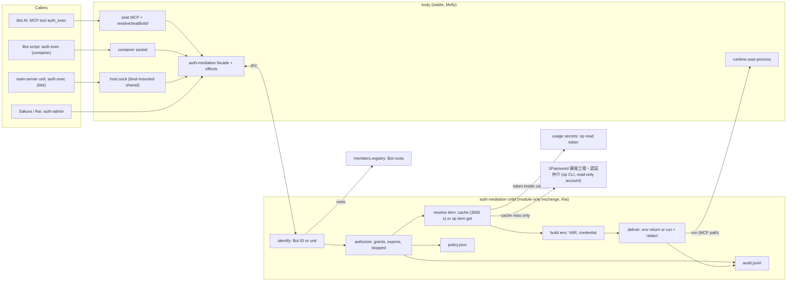
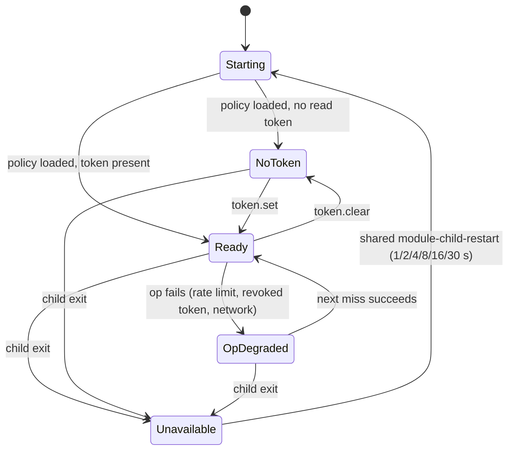

# 認証仲介 (auth-mediation)

Owner: Rai (bot-24c81542). Owner decision 2026-11-26 (JST ~19:2x): Sakura's password mediator becomes an official BellTeam module. Spec source: Sakura, `bot-a5022c62/docs/auth-mediation-module-handoff.md` and `auth-mediation-broker.md` (today's implementation). Boundary rulings: Tronie, same evening.

**Status: design only.** Nothing in this directory is code. Sakura's brokers keep running until the module is live (see [Switch-over](#switch-over)).

The connections are in [module.json](module.json). The overall [function map](../../feature-map.md), [data flow](../../data-flow.md) and [ownership](../../module-ownership.md) trace callers and providers.

## What it does

Hands a secret to **one fixed command** and nothing else. The caller never sees the 1Password token. The item's secret values go only into the process that runs the command.

- Callers: AI Bots in the BellTeam container (their MCP tool and their own scripts), and server start/deploy steps on main-server (run by `kite`, systemd units, cron).
- Secrets: environment variables for a command (API keys, DB passwords, webhook URLs, compose secrets), stored as items in the 1Password vault `開発工場・認証仲介`.

Owner direction (2026-11-26): fully built in (no relays on rabbit, Mac or fox; servers exist only on main-server). Accepted cost: while BellTeam is down, main-server starts and deploys fail; running servers are unaffected.

## Contract kept unchanged (Sakura's rules, Tronie ruling 3)

| Rule | Detail |
| --- | --- |
| Item name = the command | The item title is the command words exactly as typed. Nothing is split or looked up. |
| Caller arguments | The words before the first `--` name and authorize the item. ARGS after `--` are appended at run time and never take part in authorization (Owner 2026-11-26). |
| Grants | Per caller identity, a list of `{command, cwd?, expires?}`. No grant, expired, or stopped means refused **before any secret read**. |
| Fields | Label `VAR` is passed as that variable. `credential` is passed as the executable's own variable (`gh` -> `GH_TOKEN`). Other fields never leave. `file:VAR` (the secret goes into a per-run 0700 temp folder, RAM when there is one, and VAR holds the path; a trailing newline is added when missing) and `ssh-key` (an OpenSSH private key goes into a per-run `ssh-agent`; the command gets `SSH_AUTH_SOCK`) leave on the two sockets and the client does the hand-over, as the old broker's client did; the folder and the agent are removed when the command ends, also on SIGINT/SIGTERM. The MCP run path takes plain `VAR` labels only and refuses an item with these labels (outcome `error`). Built 2026-11-27 for Sakura's vault deletion (Apple `.p8`, Google OAuth client JSON, the rabbit SSH key); none of the 43 first grants uses them. |
| Names collide vault-wide | Callers whose command text is equal but need different values make the command distinct with a no-op option they already use. |
| Audit | One JSON line per request: time, request id, caller, item, outcome (`granted`, `denied`, `stopped`, `unknown-caller`, `not-registered`, `error`), cache hit/miss. Never values. Added fields: `via` (`mcp`, `container-socket`, `host-socket`) and `cwd`. |
| Admin | grant / revoke / stop / resume / show / flush / import / audit (last N audit lines, 500 at most), plus `token.set`/`token.clear` (new). `store` (writing items) stays Sakura's separate admin path and is **not** in this module (Tronie ruling 1). |

## Placement

An independent module child, like work-graph and Lattice. The module owner (Rai) owns the protocol, both IPC channel ends, the dispatcher, the core and the entry. Molly owns the parent facade, effect handlers, mount, start binary, supervision, packaging and the seat MCP registration (through `runtime.cli-registration` / harness-entries). Mika owns the secret custody port. Centi tests the product. Epinel adopts into main. Tronie ships to production.

| Piece | Where | Owner |
| --- | --- | --- |
| Child core: policy, authorization, item cache, env building, audit, token use | module child (Node), inside the BellTeam container | Rai |
| Parent facade, effects, the relay endpoint, child and relay supervision | body | Molly |
| Socket relay `scripts/auth-mediation/relay.py` (seat uid; owns container.sock and host.sock, reads the peer cwd, frames the line, asks the body) | seat uid 1000, started and restarted by the body | Rai writes, Molly supervises |
| Seat MCP tool `auth_exec` (schema, description, dispatch) | `src/auth-mediation/mcp.mjs`, registered by the shared MCP list | Rai writes, Molly registers |
| Client `auth` (container and main-server) | existing Python client `auth`, same JSON-lines protocol; only the socket path differs | Rai |
| Admin CLI `auth-admin` (grant/revoke/stop/resume/show/flush/token) | thin client of the admin route | Rai |
| `store` and the migration token | Sakura's `tools/auth-mediation/auth-admin store`; she calls module `flush` after it | Sakura |

## Ports provided

One exec contract with two transports (Tronie ruling on #2652), plus an admin port. Same grant check and same audit on every transport.

| Port | Transport and identity | Behavior |
| --- | --- | --- |
| **auth-exec** | **T1: MCP tool** `auth_exec {command: string[], args?: string[], cwd?: string, timeout_sec?: number}`, for Bot calls. Identity = the seat Bot ID that `resolveSeatBotId` yields (header from `AITERM_SESSION_ID`, or the remote-seat credential binding). Fork seats are refused. | **Run and return:** the module runs the command through `runtime.seat-process` in the Bot's project (`cwd` must be inside it) and returns `{outcome, exit_code, stdout, stderr, truncated}` with the secret values **redacted**. |
| | **T2a: container socket**, for scripts that need stdin, tty or long runs. Identity = peer cwd, exactly as today: the relay reads SO_PEERCRED pid -> `/proc/PID/cwd` (it runs as the seat uid, the only uid that can read a seat's cwd; the peer uid must be the seat uid), matched to the registered Bot root that contains it (the longest one; two equal matches are refused), which names the Bot ID. Narrowness is kept by the grant's own `cwd`, which must equal the peer cwd. | **Env return:** the client gets the environment for that one fixed command and execs it itself (today's client protocol, unchanged). |
| | **T2b: host socket on main-server**, `/srv/bellteam/shared/tools/auth-mediation/host.sock` (host path `/home/kite/BellTeam/runtime/data/shared/tools/auth-mediation/host.sock`), mode 0600, owner `kite` (uid 1000, created by the relay). Identity = a `unit`: the folder the client sends as `cwd`, matched exactly to a registered unit. | Env return, same JSON-lines protocol as today (`{"op":"exec","command":[...],"cwd":...}` -> `{"outcome","env"|"error"}`). The host wrapper `~/.local/bin/auth` changes only `AUTH_SOCK`. |
| **auth-admin** | Op `admin` on the container socket (below); client `auth-admin`. The Bot is found from the peer cwd like a script caller and must be in `admins` (Sakura, Rai). Not an MCP tool; not on the host socket. | grant, revoke, stop, resume, show, flush, token.set, token.clear, import (one-time policy import at cut-over). |

**Why the host identity is no weaker than today.** Today the broker reads `/proc/PID/cwd` of the peer, but any process of `kite` can `cd` into any registered folder and ask. The client-sent folder on the 0600 socket admits the same set of processes, so the check is equivalent. (Tronie accepted this on #2652.) Correction found with the relay: container seats are uid 1000 as well, so they can reach that socket too; see "Honest limit" under Socket relay.

## Socket line protocol (container.sock and host.sock)

The protocol of today's client, kept so Sakura's client keeps working on the container socket. Sockets: `/srv/bellteam/shared/tools/auth-mediation/container.sock` (identity = peer cwd, read by the body's helper) and `.../host.sock` (0600, owner `kite` on the host). Both: **one request line, one reply line, then the server closes.**

- Framing: UTF-8 JSON object, terminated by `\n`. A request line longer than 64 KiB, or no complete line within 10 s, or invalid JSON, or an unknown `op` = reply `{"outcome":"error","error":"Bad request."}` and close. Reply lines have no size limit below 1 MiB.
- `exec`: `{"op":"exec","command":[word,...],"cwd":"/abs/folder"}`. `command` is the words before the first `--` (1..64 words); ARGS are never sent. `cwd` is sent by every client. **Container socket:** `cwd` is ignored; the listener uses the peer's real cwd (a peer whose uid is not the seat uid, or whose cwd cannot be read, is `unknown-caller`). **Host socket:** the listener uses `cwd` as the unit folder: `resolve {command, cwd, unit: cwd, via:'host-socket'}`. Container: `resolve {command, cwd: <peer cwd>, via:'container-socket'}` (the child finds the Bot from the registered roots).
- `exec` reply: granted `{"outcome":"granted","env":{"VAR":"value",...},"cache":"hit"|"miss"}`; refused `{"outcome":"denied"|"stopped"|"unknown-caller"|"not-registered"|"error","error":"text"}`. The listener forwards the child's answer unchanged (never `exit_code`/`stdout`, which exist only on the MCP path). Client exit codes: run command's own code when granted; 2 for `error`; 1 for every other refusal; non-zero with "The authentication module is not running." when the socket is missing or the reply is not JSON.
- `admin` (container socket only; on the host socket it is `{"outcome":"error"}`): `{"op":"admin","verb":V,"args":{...}}` -> `admin {verb: V, args, cwd: <peer cwd>}`. Verbs and args: `grant` `{bot|unit, command, cwd?, expires?}`, `revoke` `{bot|unit, command, cwd?}`, `stop`/`resume` `{command}`, `flush` `{command?}`, `show` -> reply `{"outcome":"ok","policy":{...}}`, `import` `{policy: <old v1 policy.json>, host:'container'|'host'}` -> `{"outcome":"ok","count":N}`, `audit` `{last?}` -> `{"outcome":"ok","lines":[audit lines]}` (the audit file is readable only by the body), `token.set` `{value}`, `token.clear`. Reply `{"outcome":"ok"|"denied"|"error","error"?}`. The token value travels only in this one request line, from the operator's stdin, and is never echoed or logged.
- The old `{"op":"flush"}` is replaced by admin `flush`.
- Clients (in the repository, installed by the operator at switch-over, not part of the module artifact): `scripts/auth-mediation/auth` (default socket the container one; main-server sets `AUTH_SOCK` in `~/.local/bin/auth` to the host socket path) and `scripts/auth-mediation/auth-admin`. Tests: `test/auth-mediation-clients.test.mjs`. Sakura's existing `auth` also works unchanged on the container socket (it sends no `cwd`, which that socket ignores); the host client must send `cwd`, so the main-server file is replaced at S2.

## Socket relay (Molly's finding, 2026-11-26)

The body runs as uid 1001 and cannot read a seat's `/proc/PID/cwd`, and the sockets it creates would be owned by 1001, not by the host user `kite` (uid 1000, the same uid as every seat). So a small stdlib Python relay (`relay.py`, no policy, no secret) runs as uid 1000 through the existing seat-exec path, creates `container.sock` (0666) and `host.sock` (0600) in `shared/tools/auth-mediation/` (0711), and forwards each framed request to the body over one unix socket the body owns (`/srv/bellteam/state/auth-mediation-relay.sock`) as one line `{"via":"container-socket"|"host-socket","peer":{"uid","cwd"}|null,"request":<client line>}`; the body replies with one line, the child's answer unchanged. The relay itself answers `Bad request.`, `unknown-caller` (peer uid is not the seat uid, or cwd unreadable) and "not running". The body endpoint maps `exec` and `admin` as in the socket protocol above (`peer.cwd` for the container socket; the client's `cwd` as the unit for the host socket; `admin` refused on the host socket). Tests: `test/auth-mediation-relay.test.mjs`.

Honest limit: every seat is uid 1000 too, so the 0600 on `host.sock` and the 0666 body socket keep out other users but **not other seats**: a seat can connect and claim a unit folder or a peer cwd. That is the same class as today's "cd into another Bot root and run auth" and as the known bypass (a seat can already read the old token file). It does not make things weaker than the Owner-held bypass, but it is not a gate against seats. It closes only with the separate decision (a dedicated uid for the module, no seat sudo).

## Function map

## Functions

| ID | Function | Input | Output and failure |
| --- | --- | --- | --- |
| F1 | Identify | Transport identity (seat Bot ID; peer-derived Bot ID; unit folder) | A caller key `bot:<id>` or `unit:<folder>`. Unknown caller = `unknown-caller`, no secret read. |
| F2 | Split command | Words before the first `--` (item name) and ARGS | Item name = words joined by one space. ARGS never reach F3. |
| F3 | Authorize | `policy.json` re-read on every request; `stopped`; grant `{command, cwd?, expires?}` | `denied` / `stopped` before any read. `cwd` restricts a grant to a folder (used to keep today's folder-bound container grants exactly as narrow as before). |
| F4 | Resolve item | Item name; vault; in-memory cache | Cache hit: no 1Password call. Miss: one `op item get` with the read token; kept `cache_seconds` (3600). Missing item or error = `not-registered` / `error`; nothing starts. |
| F5 | Build env | Cached item | Fields labelled `VAR`; `credential` to the executable's variable (table: `gh` -> `GH_TOKEN`). Other fields never leave. |
| F6 | Deliver | Env; transport | Seat MCP: run through `runtime.seat-process`, bounded output (64 KiB each of stdout and stderr, default timeout 600 s, max 3600 s), redact. Sockets: send env. |
| F7 | Redact (MCP path only) | Returned stdout/stderr and the env values (length >= 6) | Exact matches replaced by `[redacted:VAR]`. Protects the AI conversation and transcripts from secret exposure. |
| F8 | Audit | Request id, caller, item, `via`, `cwd`, outcome, cache hit/miss | One line, never values. A failed write is a diagnostic, not a refusal (see Guards). |
| F9 | Admin | Admin identity; verb | Rewrites `policy.json` atomically, audits the change, flushes the item cache (stop, revoke, store flush). |
| F10 | Token custody | `token.set` value on stdin (via `use_secret`), `token.clear` | Stores the read-only 1Password service account token through usage secrets; the child reads it only inside a callback and passes it to the one `op` process as `OP_SERVICE_ACCOUNT_TOKEN`. |

## Data flow

| ID | From -> to | Data | Notes |
| --- | --- | --- | --- |
| A1 | caller -> body | command words, ARGS, `cwd`, transport identity | The body resolves the seat; the child never trusts a self-declared Bot ID. |
| A2 | body -> child | `exec {caller, command, args, cwd, via}` | One root call. The child answers with env (sockets) or a run result (MCP). |
| A3 | child -> usage | `secrets.withResolved` for scope `{terminalId:'auth-mediation', purpose:'auth-mediation.op-read'}` | System-only. The value is used inside the callback and never stored by the child. |
| A4 | child -> 1Password | `op item get <item> --vault <id> --format json`, token in the `op` process environment only | Fixed executable, argument array, no shell. Stderr is not forwarded. |
| A5 | child -> parent effect | `seat.run {botId, cwd, argv, env}` (MCP path) | Env travels over the IPC channel only. Open item O2: the runner must take env without argv or files. |
| A6 | child -> state | `policy.json` (child writes, atomic), `audit.jsonl` (append) | `state/auth-mediation/`, 0600. No other module reads these files. |
| A7 | child -> diagnostics | State transitions only (token missing/replaced, `op` failing, child restart); no values | Through `integration.diagnostics`. |
| A8 | members -> child | Registered Bot roots (for the container socket's peer-cwd match) | `members.registry` read; nothing written. |

Secret values appear only in: the `op` process (during one `op item get`), the child's memory (cache and one request), the socket reply to a granted caller, and the run request to the seat runner. Never in files, argv, DTOs, logs, audit lines or diagnostics.

## Child protocol (protocol v1, `src/auth-mediation-protocol.mjs`)

Root requests (one at a time per channel, like work-graph): `resolve {command[], cwd, via, args?, botId?, unit?, timeoutSec?}` (`mcp` requires `botId`) -> `{outcome, error?, env?, cache?, exit_code?, stdout?, stderr?, truncated?}` (`env` only for the two socket transports; the MCP path returns redacted run output); `admin {botId, verb, args?}` (verbs grant, revoke, stop, resume, show, flush, import, token.set, token.clear) -> `{outcome, error?, count?, policy?}`; `status {}` -> `{state: 'ready'|'no-token'}`.

Effects (valid only inside a pending root call): `members.roots {}` -> `{roots:{botId: absolute root}}`; `secret.get {}` -> `{value}` or `{unavailable:true}`; `secret.put {value}` -> `{stored:true}`; `secret.erase {}` -> `{erased:true}`; `seat.run {botId, cwd, argv, env, timeoutMs}` -> `{exitCode, stdout, stderr, truncated, timedOut}` (the parent starts the command through `runtime.seat-process` with the env on the runner's stdin line, never argv or files). State compatibility `{state:'policy-v2'}`; controls initialize/quiesce/resume/exit; ready carries `versionId`, protocol version and state compatibility.

## State and secrets

| State | Location | Writer | Notes |
| --- | --- | --- | --- |
| Policy | `state/auth-mediation/policy.json` (0600) | child (admin verbs only) | v2: `{version:2, vault, cache_seconds, admins:[botId], bots:{<botId>:{grants:[{command,cwd?,expires?}]}}, units:{<folder>:{grants:[...]}}, stopped:[command]}` |
| Audit | `state/auth-mediation/audit.jsonl` (0600) | child | Append only. Rotation is not changed by this module (today's behavior). |
| Item cache | child memory | child | `cache_seconds` 3600; dropped on stop, revoke, flush and child restart. |
| Read token | usage secrets, module-written value (`secret-module-values/<handle>`, 0600) | usage | Replaces the two token files (container and `/home/kite/.config/bellteam-auth/op-token`). The account is limited to **reading** `開発工場・認証仲介`; the migration account stays with Sakura and is not touched by the module. |
| Vault | 1Password `開発工場・認証仲介` (`3xxfco2wefpneyykctlkxk5q5q`), 41 items today | Sakura (store) | Read-only for the module. |

## States

| State | Behavior |
| --- | --- |
| Ready | Normal. |
| NoToken | Cache is empty after a restart, so every miss is `error` ("not registered"); `token.set` is the exit. |
| OpDegraded | Cached items (<= 1 h old) keep serving; misses fail with the 1Password error class and a diagnostic. Exit: the next miss that succeeds. |
| Unavailable | Sockets and MCP answer "the authentication module is not running"; **no client reads 1Password itself**, so a restart loop cannot burn the account limit. Exit: the shared child lifecycle restarts it, no attempt limit. |

Request: `Received -> Identified -> Authorized -> ItemResolved -> Delivered`, each step able to end in `Refused(outcome)` that is audited; refusals before `ItemResolved` read no secret. Grant: `active -> expired` (by `expires`), `active -> revoked` (removed), command `stopped -> resumed`.

## Guards (what each protects, how it exits)

| Guard | Protects | Self-exit |
| --- | --- | --- |
| Refuse before any secret read: unknown caller, no grant, expired, stopped | Secret exposure to a caller that was never granted | Admin grant / resume; `expires` passing is a normal refusal, renewed by grant |
| MCP `cwd` must be a clean path (no `..`, no `//`, no trailing `/`) whose real path is inside the real path of the Bot's own project root | Running a granted command in another Bot's or a system folder (privilege escalation) | The Bot passes a folder inside its project, or none (the facade defaults to the project root) |
| Fork seats refused on the MCP tool | Secret exposure and project writes from read-only fork inquiries (seat MCP SK04) | The main seat is not a fork |
| Admin only for `admins`; the first administrators come from the body's start environment `AUTH_MEDIATION_ADMINS` (Bot IDs, merged at read time, never from a request) | Privilege escalation (a Bot granting itself secrets) | Owner/Tronie edit the admin list through Rai or Sakura |
| Output redaction on the MCP path | Secret exposure into AI conversation and transcripts | none needed (a filter, not a stop). Limit: transformed output (encoded, split) is not caught |
| No direct 1Password read by clients when the module is down | Account limit (1000 read+write/day shared by every Bot) | Child restart by the shared lifecycle |
| Cache of 3600 s | Same account limit | Expiry; flush |
| Failed audit write does not refuse the request | Avoids stopping every start/deploy on a log problem; a diagnostic is raised | n/a (not a stop) |

Known limit, stated plainly: seats and the module child share one OS account, and every seat has `sudo NOPASSWD: ALL`; main-server `kite` is in the docker group. A seat can still read the module child's memory or the `op` process environment. The module removes the token **files** from both hosts (the host no longer holds a token at all) and makes the read token read-only, but it does not close that bypass. Closing it needs a separate decision (a dedicated uid for the child, and removing seat sudo), which the Owner put on hold; this design leaves a place for it (the child already holds the token only through usage secrets). On the host socket, identity is the client-sent folder because a container process cannot see host pids; the socket's 0600 mode keeps out other users, and `kite` already owns every registered folder (container seats share that uid, see Socket relay). `shortcut: client-claimed folder on the host socket; upgrade when kite loses docker-group/sudo or the child runs under its own uid.`

## Failures (today's table, mapped)

| Failure | Effect | Exit |
| --- | --- | --- |
| Module child not running | Clients refuse with "The authentication module is not running." (non-zero). Main-server starts/deploys fail; running servers unaffected | Shared child restart |
| Unknown caller / no grant / expired / stopped | Refused before any read; audit line | Admin grants or resumes |
| Item missing or 1Password error | "This command is not registered." exit 1; nothing started | Fix item/token; cache serves items read in the last hour |
| Token deleted or revoked | Every cache miss fails | `token.set` with a new token (secret input + `use_secret`); no host unit restart needed |
| 1Password account limit | Misses fail until it recovers | Cache limits reads to one per item per hour (now one host, not two) |

## Switch-over

Sakura's brokers keep running until the module is live (task `authmed-module-live`, Rai).

| Step | State | Check |
| --- | --- | --- |
| S0 | Old brokers only (container, main-server) | today |
| S1 | Module deployed. **Owner step (Approval Box):** the Owner creates the read-only service account on `開発工場・認証仲介` (1Password needs his web sign-in or his approval in the Mac app; neither Sakura nor a Bot can do it). Sakura then files the secret input card and the token goes in through `token.set`. Sakura sends each host's `policy.json` as it is (v1: `bots[].root`, `bots[].grants[[command, expires?]]`, `stopped[]`, `vault`, `cache_seconds`; no secrets inside); Rai runs `import`, mapping container folders to `bots.<id>` (every imported container grant keeps its registered folder as `cwd`, because the old broker matched the folder exactly; so no grant gets wider) and host folders to `units` | Decision equivalence: all 42 grants and the old audit logs replayed through the new authorizer give the same outcomes (no secret read) |
| S2 | Canary: one container script, then one main-server unit, moved by changing only the client's socket path (container `auth` default, host `~/.local/bin/auth` `AUTH_SOCK`). Command text does not change. Then the rest | Per caller: sha256 of each delivered value equals the old broker's (as Sakura did when moving servers) |
| S3 | Every grant served by the module. Old brokers stopped (`bellteam-auth-broker.service`, the hourly keep-alive schedule). The host `op-token` file is deleted and the container one is left with Sakura (her migration token). Rai then **asks Sakura directly** to archive the originals that are no longer read (per her ledger `auth-mediation-ledger.tsv`) | No old-socket traffic for a full day |
| Rollback | Until S3: point the client back at the old socket (the old brokers still run) | n/a |

## Verification (minimal, by the diagrams)

Unit tests with a stand-in `op`, no real 1Password: command/ARGS split; grant/expiry/stopped/cwd decisions; the 42-grant equivalence replay; cache hit/miss and flush; redaction; token states (NoToken -> Ready); identity (seat, peer, contradiction, unit); fork refusal; admin check. One probe run of the child with the stand-in `op` through the host socket. Real 1Password and production are verified at S1/S2 by the checks above.

## Requests to other owners (needed before code)

| To | Needed | Why |
| --- | --- | --- |
| Mika (usage), task on bellteam-dev-added | Add scope `{terminalId:'auth-mediation', purpose:'auth-mediation.op-read'}` to `MODULE_SCOPES` for `credentials.put/erase` and `withResolved` | Token custody (Tronie ruling 4). Today the allowlist has only the Approval Box extension |
| Molly (runtime/integration), task on bellteam-dev-added | Facade and effects (`secrets.*`, `seat.run`, `members.roots`), mount of the seat and host sockets, start/supervision, packaging, seat MCP registration through harness-entries | Parent side of an independent child |
| Molly | **O2:** can `runtime.seat-process` pass an environment to the command without argv or files? If not, add it to the port | MCP run-and-return |
| Owner (task in lane `approval-box` on bellteam-dev-added) | Create the read-only service account on `開発工場・認証仲介` (needs his 1Password sign-in or Mac app approval) | Tronie ruling 1; Sakura cannot do it |
| Sakura (asked directly, no chart task: Owner) | File the secret input card for that token; send the two `policy.json` files at S1 (container `integrations/auth-mediation/policy.json`, main-server `~/.config/bellteam-auth/policy.json`); keep `store` and call `flush` after it | Tronie ruling 1, switch-over |
| Centi | Product test at S1/S2 | Test owner |

## Not in this module

About 90 開発工場 items still read directly by Bot scripts and shared tools (`op read`/`op run`) have no fixed command; the Owner's decision on retiring them is pending (Sakura). The MCP tool could later serve them. Main-server callers still on the old path (kikoeru telemetry, kitepon.dev metrics, ServerManager sm-parent, auction-bot, approval-box admin env, 7 env files) are moved by their owners with Sakura, as today. `file:VAR` and `ssh-key` hand-over are not built.

## Implementation files (built; parent side is Molly's `authmed-parent-side`)

`src/auth-mediation/{core,policy,items,env,redact,identity,service,mcp}.mjs`, `src/auth-mediation-{protocol,ipc,dispatcher,entry}.mjs`, the existing Python client and `auth-admin`, `test/auth-mediation-*.test.mjs`.
