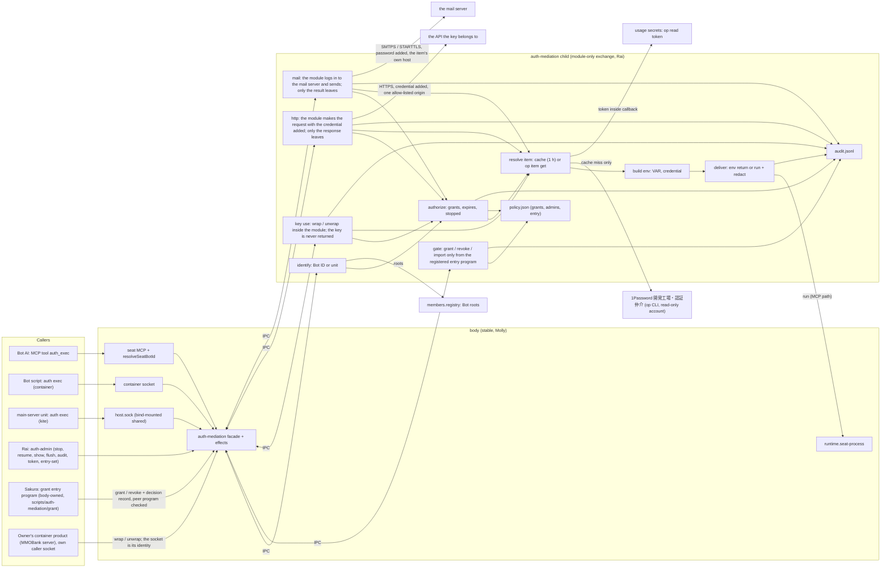
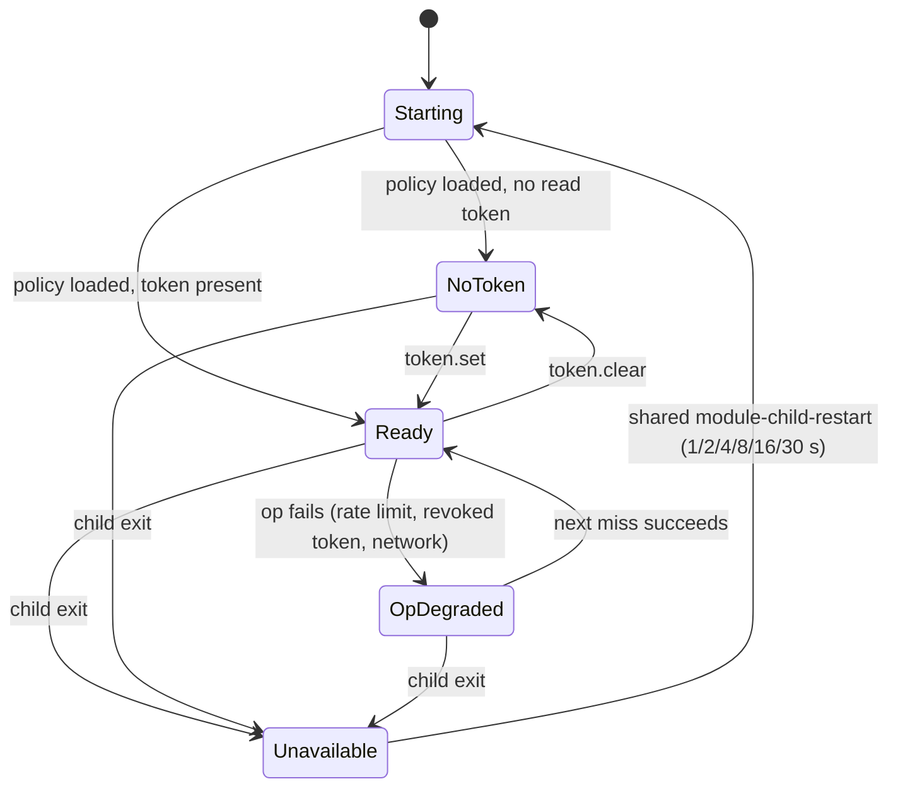

# 認証仲介 (auth-mediation)

Owner: Rai (bot-24c81542). Owner decision 2026-11-26 (JST ~19:2x): Sakura's password mediator becomes an official BellTeam module. Spec source: Sakura, `bot-a5022c62/docs/auth-mediation-module-handoff.md` and `auth-mediation-broker.md` (today's implementation). Boundary rulings: Tronie, same evening.

**Status: design only.** Nothing in this directory is code. Sakura's brokers keep running until the module is live (see [Switch-over](#switch-over)).

The connections are in [module.json](module.json). The overall [function map](../../feature-map.md), [data flow](../../data-flow.md) and [ownership](../../module-ownership.md) trace callers and providers.

## What it does

Hands a secret to **one fixed command** and nothing else. The caller never sees the 1Password token. The item's secret values go only into the process that runs the command.

- Callers: AI Bots in the BellTeam container (their MCP tool and their own scripts), and server start/deploy steps on main-server (run by `kite`, systemd units, cron).
- Secrets: environment variables for a command (API keys, DB passwords, webhook URLs, compose secrets), stored as items in the 1Password vault `開発工場・認証仲介`.

Owner direction (2026-11-26): fully built in (no relays on rabbit, Mac or fox; servers exist only on main-server). Accepted cost: while BellTeam is down, main-server starts and deploys fail; running servers are unaffected.

## Contract kept unchanged (Sakura's rules, Tronie ruling 3)

| Rule | Detail |
| --- | --- |
| Item name = the command | The item title is the command words exactly as typed. Nothing is split or looked up. |
| Caller arguments | The words before the first `--` name and authorize the item. ARGS after `--` are appended at run time and never take part in authorization (Owner 2026-11-26). |
| Grants | Per caller identity, a list of `{command, cwd?, expires?}`. No grant, expired, or stopped means refused **before any secret read**. |
| Fields | Label `VAR` is passed as that variable. `credential` is passed as the executable's own variable (`gh` -> `GH_TOKEN`). Other fields never leave. `file:VAR` (the secret goes into a per-run 0700 temp folder, RAM when there is one, and VAR holds the path; a trailing newline is added when missing) and `ssh-key` (an OpenSSH private key goes into a per-run `ssh-agent`; the command gets `SSH_AUTH_SOCK`) leave on the two sockets and the client does the hand-over, as the old broker's client did; the folder and the agent are removed when the command ends, also on SIGINT/SIGTERM. The MCP run path takes plain `VAR` labels only and refuses an item with these labels (outcome `error`). Built 2026-11-27 for Sakura's vault deletion (Apple `.p8`, Google OAuth client JSON, the rabbit SSH key); none of the 43 first grants uses them. |
| Names collide vault-wide | Callers whose command text is equal but need different values make the command distinct with a no-op option they already use. |
| Audit | One JSON line per request: time, request id, caller, item, outcome (`granted`, `denied`, `stopped`, `unknown-caller`, `not-registered`, `error`), cache hit/miss. Never values. Added fields: `via` (`mcp`, `container-socket`, `host-socket`) and `cwd`. |
| Admin | grant / revoke / stop / resume / show / flush / import / audit (last N audit lines, 500 at most; optional `since` (ISO time) and `match` (text the line must contain, e.g. a caller or an outcome) are applied before the cut, so an older event is reachable), plus `entry.set` {path, sha256} (register the grant entry program), plus `token.set`/`token.clear` (new). `store` (writing items) stays Sakura's separate admin path and is **not** in this module (Tronie ruling 1). |

## Placement

An independent module child, like work-graph and Lattice. The module owner (Rai) owns the protocol, both IPC channel ends, the dispatcher, the core and the entry. Molly owns the parent facade, effect handlers, mount, start binary, supervision, packaging and the seat MCP registration (through `runtime.cli-registration` / harness-entries). Mika owns the secret custody port. Centi tests the product. Epinel adopts into main. Tronie ships to production.

| Piece | Where | Owner |
| --- | --- | --- |
| Child core: policy, authorization, item cache, env building, audit, token use | module child (Node), inside the BellTeam container | Rai |
| Parent facade, effects, the relay endpoint, child and relay supervision | body | Molly |
| Socket relay `scripts/auth-mediation/relay.py` (seat uid; owns container.sock and host.sock, reads the peer cwd, frames the line, asks the body) | seat uid 1000, started and restarted by the body | Rai writes, Molly supervises |
| Seat MCP tool `auth_exec` (schema, description, dispatch) | `src/auth-mediation/mcp.mjs`, registered by the shared MCP list | Rai writes, Molly registers |
| Client `auth` (container and main-server) | existing Python client `auth`, same JSON-lines protocol; only the socket path differs | Rai |
| Admin CLI `auth-admin` (grant/revoke/stop/resume/show/flush/token) | thin client of the admin route | Rai |
| `store` and the migration token | Sakura's `tools/auth-mediation/auth-admin store`; she calls module `flush` after it | Sakura |

## Ports provided

One exec contract with two transports (Tronie ruling on #2652), plus an admin port. Same grant check and same audit on every transport.

| Port | Transport and identity | Behavior |
| --- | --- | --- |
| **auth-exec** | **T1: MCP tool** `auth_exec {command: string[], args?: string[], cwd?: string, timeout_sec?: number}`, for Bot calls. Identity = the seat Bot ID that `resolveSeatBotId` yields (header from `AITERM_SESSION_ID`, or the remote-seat credential binding). Fork seats are refused. | **Run and return:** the module runs the command through `runtime.seat-process` in the Bot's project (`cwd` must be inside it) and returns `{outcome, exit_code, stdout, stderr, truncated}` with the secret values **redacted**. |
| | **T2a: container socket**, for scripts that need stdin, tty or long runs. Identity = peer cwd, exactly as today: the relay reads SO_PEERCRED pid -> `/proc/PID/cwd` (it runs as the seat uid, the only uid that can read a seat's cwd; the peer uid must be the seat uid), matched to the registered Bot root that contains it (the longest one; two equal matches are refused), which names the Bot ID. Narrowness is kept by the grant's own `cwd`, which must equal the peer cwd. | **Env return:** the client gets the environment for that one fixed command and execs it itself (today's client protocol, unchanged). |
| | **T2b: host socket on main-server**, `/srv/bellteam/shared/tools/auth-mediation/host.sock` (host path `/home/kite/BellTeam/runtime/data/shared/tools/auth-mediation/host.sock`), mode 0600, owner `kite` (uid 1000, created by the relay). Identity = a `unit`: the folder the client sends as `cwd`, matched exactly to a registered unit. | Env return, same JSON-lines protocol as today (`{"op":"exec","command":[...],"cwd":...}` -> `{"outcome","env"|"error"}`). The host wrapper `~/.local/bin/auth` changes only `AUTH_SOCK`. |
| **auth-admin** | Op `admin` on the container socket (below); client `auth-admin`. The Bot is found from the peer cwd like a script caller and must be in `admins` (Sakura, Rai). Not an MCP tool; not on the host socket. | stop, resume, show, flush, audit, token.set, token.clear, entry.set from `auth-admin`. grant and revoke (and import) only from the grant entry program once one is registered (F11, F12); `auth-admin` no longer has grant / revoke. |

**Why the host identity is no weaker than today.** Today the broker reads `/proc/PID/cwd` of the peer, but any process of `kite` can `cd` into any registered folder and ask. The client-sent folder on the 0600 socket admits the same set of processes, so the check is equivalent. (Tronie accepted this on #2652.) Correction found with the relay: container seats are uid 1000 as well, so they can reach that socket too; see "Honest limit" under Socket relay.

## Socket line protocol (container.sock and host.sock)

The protocol of today's client, kept so Sakura's client keeps working on the container socket. Sockets: `/srv/bellteam/shared/tools/auth-mediation/container.sock` (identity = peer cwd, read by the body's helper) and `.../host.sock` (0600, owner `kite` on the host). Both: **one request line, one reply line, then the server closes.**

- Framing: UTF-8 JSON object, terminated by `\n`. A request line longer than 64 KiB, or no complete line within 10 s, or invalid JSON, or an unknown `op` = reply `{"outcome":"error","error":"Bad request."}` and close. Reply lines have no size limit below 1 MiB.
- `exec`: `{"op":"exec","command":[word,...],"cwd":"/abs/folder"}`. `command` is the words before the first `--` (1..64 words); ARGS are never sent. `cwd` is sent by every client. **Container socket:** `cwd` is ignored; the listener uses the peer's real cwd (a peer whose uid is not the seat uid, or whose cwd cannot be read, is `unknown-caller`). **Host socket:** the listener uses `cwd` as the unit folder: `resolve {command, cwd, unit: cwd, via:'host-socket'}`. Container: `resolve {command, cwd: <peer cwd>, via:'container-socket'}` (the child finds the Bot from the registered roots).
- `exec` reply: granted `{"outcome":"granted","env":{"VAR":"value",...},"cache":"hit"|"miss"}`; refused `{"outcome":"denied"|"stopped"|"unknown-caller"|"not-registered"|"error","error":"text"}`. The listener forwards the child's answer unchanged (never `exit_code`/`stdout`, which exist only on the MCP path). Client exit codes: run command's own code when granted; 2 for `error`; 1 for every other refusal; non-zero with "The authentication module is not running." when the socket is missing or the reply is not JSON.
- `admin` (container socket only; on the host socket it is `{"outcome":"error"}`): `{"op":"admin","verb":V,"args":{...}}` -> `admin {verb: V, args, cwd: <peer cwd>}`. Verbs and args: `grant` `{bot|unit, command, cwd?, expires?, decision?}`, `revoke` `{bot|unit, command, cwd?, decision?}` (`decision {id, role?, record?, need?, reason}`: required once an entry is registered, kept in the audit), `entry.set` `{path, sha256}`, `stop`/`resume` `{command}`, `flush` `{command?}`, `show` -> reply `{"outcome":"ok","policy":{...}}`, `import` `{policy: <old v1 policy.json>, host:'container'|'host'}` -> `{"outcome":"ok","count":N}`, `audit` `{last?}` -> `{"outcome":"ok","lines":[audit lines]}` (the audit file is readable only by the body), `token.set` `{value}`, `token.clear`. Reply `{"outcome":"ok"|"denied"|"error","error"?}`. The token value travels only in this one request line, from the operator's stdin, and is never echoed or logged.
- The old `{"op":"flush"}` is replaced by admin `flush`.
- Clients (in the repository, installed by the operator at switch-over, not part of the module artifact): `scripts/auth-mediation/auth` (`auth exec COMMAND...` as before, `auth sign NAME [--data-file FILE|-]` (the module signs the bytes from stdin and prints the signature as base64), `auth ssh NAME[,NAME...] -- COMMAND...` (a per-run ssh agent served by the module; the command runs with `SSH_AUTH_SOCK`), and `auth http NAME METHOD PATH [-H 'Name: value'] [--data TEXT | --data-file FILE|-]` for a credentialed request: the response body goes to stdout, exit 22 for status >= 400; default socket the container one; main-server sets `AUTH_SOCK` in `~/.local/bin/auth` to the host socket path) and `scripts/auth-mediation/auth-admin`. Tests: `test/auth-mediation-clients.test.mjs`. Sakura's existing `auth` also works unchanged on the container socket (it sends no `cwd`, which that socket ignores); the host client must send `cwd`, so the main-server file is replaced at S2.

## Socket relay (Molly's finding, 2026-11-26)

The body runs as uid 1001 and cannot read a seat's `/proc/PID/cwd`, and the sockets it creates would be owned by 1001, not by the host user `kite` (uid 1000, the same uid as every seat). So a small stdlib Python relay (`relay.py`, no policy, no secret) runs as uid 1000 through the existing seat-exec path, creates `container.sock` (0666) and `host.sock` (0600) in `shared/tools/auth-mediation/` (0711), and forwards each framed request to the body over one unix socket the body owns (`/srv/bellteam/state/auth-mediation-relay.sock`) as one line `{"via":"container-socket"|"host-socket","peer":{"uid","cwd","program"?}|null,"request":<client line>}` (`program {path, sha256, sealed}` or null, added by the relay for `admin` requests only); the body replies with one line, the child's answer unchanged. The relay itself answers `Bad request.`, `unknown-caller` (peer uid is not the seat uid, or cwd unreadable) and "not running". The body endpoint maps `exec` and `admin` as in the socket protocol above (`peer.cwd` for the container socket; the client's `cwd` as the unit for the host socket; `admin` refused on the host socket). Tests: `test/auth-mediation-relay.test.mjs`.

Honest limit: every seat is uid 1000 too, so the 0600 on `host.sock` and the 0666 body socket keep out other users but **not other seats**: a seat can connect and claim a unit folder or a peer cwd. That is the same class as today's "cd into another Bot root and run auth" and as the known bypass (a seat can already read the old token file). It does not make things weaker than the Owner-held bypass, but it is not a gate against seats. It closes only with the separate decision (a dedicated uid for the module, no seat sudo).

## Caller sockets (key use for container products)

A container product of the Owner (MMOBank's server) cannot use host.sock: that socket names the caller by a folder the client claims, so any container that could open it could claim another unit's keys. Instead the relay creates one socket per container caller, `callers/<name>/<name>.sock` under the shared auth-mediation folder (host: `/home/kite/BellTeam/runtime/data/shared/tools/auth-mediation/callers/<name>/<name>.sock`, mode 0666 so a container uid can open it, the folder 0755 so the socket survives a relay restart when only the folder is mounted). The relay names the caller by the socket (unit id = the socket's path in the BellTeam container) and forwards `{via:'caller-socket', unit, request}`; the body endpoint accepts only the key-use operations (`wrap`, `unwrap`, `sign`, `sign-digest`, `ssh-*`), `http` and `mail-send` on it, never exec or admin. The callers are a fixed list in `relay.py` (`CALLERS = ("mmobank", "auctionbot", "reminderbot", "reminderbot-public", "yuihome", "forklore-web", "forklore-mcp", "poly-daily", "ip-mcp", "call-bridge", "x-article-mcp", "bingo", "bellteam-push", "bughub", "approval-box", "approval-box-test", "books", "bellteam-body")`; the relay holds at most 64 MiB of unfinished request lines and 8 open run streams at one moment (one thread per connection otherwise lets many slow 13 MiB lines fill its memory): beyond that the caller gets `The module is busy; try again.`; a request line has 30 s in total (a trickling client is cut and frees its share); 8 run streams at once is the intended limit (the run owners today: Gretel's restore and VPS admin, Nero's cloudflared, at most one each per item); `bellteam-push` and `bellteam-body` (the BellTeam body itself, uid/gid 1001, forwarding seat MCP traffic to the call bridge with the bridge bearer through `http-stream`) are restricted: its socket is 0660 and the relay never re-chmods its folder, so the host prepares the folder once (group = the service group, setgid, 0750) and the socket inherits that group; unprepared, only the relay's uid can open it): a new one is a body train, deliberately. Line protocol for key use: `{"op":"wrap"|"unwrap","name":"<key name>","data":"<base64, wrap 1..1024 bytes>","aad":"<optional, 256 chars>"}` -> `{"outcome":"granted","data":"<base64>"}` or `{"outcome":"denied"|"unknown-caller"|"not-registered"|"error","error":"..."}`.

## Function map

## Functions

| ID | Function | Input | Output and failure |
| --- | --- | --- | --- |
| F1 | Identify | Transport identity (seat Bot ID; peer-derived Bot ID; unit folder) | A caller key `bot:<id>` or `unit:<folder>`. Unknown caller = `unknown-caller`, no secret read. |
| F2 | Split command | Words before the first `--` (item name) and ARGS | Item name = words joined by one space. ARGS never reach F3. |
| F3 | Authorize | `policy.json` re-read on every request; `stopped`; grant `{command, cwd?, expires?}` | `denied` / `stopped` before any read. `cwd` restricts a grant to a folder (used to keep today's folder-bound container grants exactly as narrow as before). |
| F4 | Resolve item | Item name; vault; in-memory cache | Cache hit: no 1Password call. Miss: one `op item get` with the read token; kept for the key's own cache period: an item field `cache_seconds` (whole seconds, 0 = never kept, at most 86400; the lower-case label never leaves the module) decided per key by what it protects (Owner 2026-11-28), else the policy's `cache_seconds` (default 3600 = 1 h, Owner 2026-11-27: a value edited in the 1Password app reaches products within an hour; the account is on Business, 50,000 requests a day and 10,000 reads an hour per token, and the 93 grants cost about 2,200 reads a day at this setting). An entry's age is judged against the **current** `cache_seconds` at every lookup, so changing the setting also changes entries already cached. For a 24 h hold (an exhausted quota) set `cache_seconds` with a no-grant `import`; no restart. Missing item or error = `not-registered` / `error`; nothing starts. |
| F5 | Build env | Cached item | Fields labelled `VAR`; `credential` to the executable's variable (table: `gh` -> `GH_TOKEN`). Other fields never leave. |
| F6 | Deliver | Env; transport | Seat MCP: run through `runtime.seat-process`, bounded output (64 KiB each of stdout and stderr, default timeout 600 s, max 3600 s), redact. Sockets: send env. |
| F7 | Redact (MCP path only) | Returned stdout/stderr and the env values (length >= 6) | Exact matches replaced by `[redacted:VAR]`. Protects the AI conversation and transcripts from secret exposure. |
| F8 | Audit | Request id, caller, item, `via`, `cwd`, outcome, cache hit/miss | One line, never values. A failed write is a diagnostic, not a refusal (see Guards). |
| F9 | Admin | Admin identity; verb; for grant / revoke / import also the peer program and the decision record (F11) | Rewrites `policy.json` atomically, audits the change, flushes the item cache (stop, revoke, store flush). |
| F11 | Grant gate | `policy.entry {path, sha256}` (registered by `entry.set`); the peer program `{path, sha256, sealed}` the relay read (A9); `args.decision {id, role, record, need, reason}` | Once an entry is registered, `grant`, `revoke` and `import` run only when the peer program is sealed (its file and every folder above it are owned by root and not group/other-writable, so no seat can edit it), its path equals `entry.path` and its sha256 equals `entry.sha256`; `grant` and `revoke` must also carry `decision.id` and `decision.reason`. Otherwise `denied`, audited, policy untouched. The module judges nothing about the decision itself; it only requires the entry and keeps the record. Without a registered entry the gate is off (a new install). |
| F12 | Grant entry program | `grant grant|revoke --bot|--unit ... --role --record --need standing|one-off --reason COMMAND` (Sakura's seat-side checks: all four fields, standing = no `--until`, one-off = `--until`) | The one program the gate accepts. Lives at `/app/scripts/auth-mediation/grant` in the image (root-owned: a seat cannot edit it); talks to the container socket itself, because the module identifies the calling process; sends `decision {id, role, record, need, reason}` with the admin request. Prints the decision id. |
| F13 | Key use (wrap / unwrap) | `keyuse {action: wrap|unwrap, name, data (base64), aad?, via?, cwd?, unit?}` (also on the host and container sockets: the caller is the unit or the Bot the transport names); item `wrapkey <name>` with field `wrap_key` (32 random bytes, base64); grant command `wrapkey <name> wrap` or `wrapkey <name> unwrap` | Same authorize and audit as F3 / F8. The key is read through F4 (its own cache period, 0 = never kept), used for one AES-256-GCM operation with `aad` authenticated, and dropped; the answer holds only `data`: base64(nonce 12 B | ciphertext | tag 16 B) for wrap, the plain bytes for unwrap. No state: the caller stores the key name beside each blob, so rotation is "unwrap with the old name, wrap with the new one". A wrong blob, `aad` or key = `error` "Cannot unwrap." (no detail). Owner ruling 2026-11-28: the broker uses keys inside itself and hands out only results; handing a key to a command as an environment variable is the defect this closes, one use at a time (the exec path stays for uses not yet moved). |
| F14 | Http (a request with the credential added inside the module) | `http {name, method, path, headers?, body?, timeoutSec?, via, cwd?, unit?}`; item `http <name>` with lower-case fields `http_base` (https origin + optional path prefix), `http_auth` (`bearer` | `basic` | `header:<Name>` | `query:<name>` | `form` | `none` | `jwt-es256` | `oauth2-password`), `http_secret`, optional `http_methods` (default GET); grant command `http <name>` | Same identify, authorize and audit as F1 / F3 / F8 (container socket, host socket or a caller socket). Item options (all lower-case, all decided by Sakura in 1Password): `http_allow_plain` = `1` allows `http://` only when the base host is an IP literal in a private range (127.0.0.0/8, 10/8, 172.16/12, 192.168/16: the credential then travels in clear on that LAN, and the item is the explicit consent); `http_passthrough_paths` (comma list of path prefixes under the base) = on those paths the module adds NO credential and forwards the CALLER's own `Authorization` header instead (a short-lived token the caller derived, such as an upload JWT; the module's key is never added there); `http_auth` = `form` with `http_form_fields` (`client_id=...&client_secret=...`) appends those fields to the caller's `application/x-www-form-urlencoded` body (OAuth token exchange); `none` = no credential is added (`http_base` may be the secret URL itself); on ANY item whose `http_base` has a path (a webhook URL), the caller's path `/` (optionally with its own query, e.g. `/?wait=true`) means exactly that URL with that query (the caller never learns the path) and the item credential, if any, is added as usual, and the URL's long path segments are scrubbed from the answer; `oauth2-refresh` (Google style: Search Console; Plaud) = the item holds `http_oauth_client_id` and `http_oauth_client_secret` (both or neither: without them the form carries only `refresh_token`, as Plaud's refresh does), `http_secret` = the refresh token, optional `http_oauth_token_url` (https, default Google's) and `http_oauth_user_agent`; one refresh at a time per item (a provider that rotates the refresh token refuses a parallel second one), the access token is kept as long as `expires_in` says (up to a day) bounded by `cache_seconds`; the module posts the refresh grant, keeps the access token in memory (renewed once on 401, bounded by `cache_seconds`), adds it as the bearer, and keeps a refresh token the provider returns in `http-tokens.json` (the item's value wins when changed); a second item with `http_capture_for` = `http <refresh item>` (and `http_auth` form carrying the client id and secret) does a re-consent code exchange: the answer's `refresh_token` is kept for the named item and shown as `[stored]`, so it never reaches the caller; `aws-sigv4` = the module signs the request with AWS Signature V4 (S3, Cloudflare R2) after the body and headers are final: `http_secret` = secret access key, `http_aws_access_key`, optional `http_aws_region` (default `auto`) and `http_aws_service` (default `s3`); the signature covers the whole body hash; a passthrough path skips it; verified against the AWS published S3 test vector; `jwt-es256` = the module signs a short-lived JWT (`http_jwt_key` PEM, `http_jwt_kid`, optional `http_jwt_iss`, `http_jwt_aud`, `http_jwt_ttl` 60..3600 s default 600, `http_jwt_claims` JSON) and sends it as the bearer; `oauth2-password` = the module posts `http_token_fields` (form text with the username and password) to `http_token_path` on the base origin, keeps `access_token` in memory only (renewed after `expires_in` minus 2 minutes, default 50 minutes) and adds it as the bearer; on HTTP 401, or HTTP 200 whose JSON has `result.statusCode` 210, it fetches a new token and repeats the request once, and returns the second answer as it is (a failed token request is `The token request failed.`; every flush, stop, revoke or token change drops the kept tokens, and the item's `cache_seconds` bounds the token's age, 0 = never kept); rotation (Threads long-lived tokens): `http_rotate_path` (e.g. `/refresh_access_token`) with optional `http_rotate_query` (fixed part, e.g. `grant_type=th_refresh_token`), `http_rotate_param` (default `access_token`) and `http_rotate_days` (default 30): before a request, when due, the module GETs that path on the base origin with the current token, and keeps the answer's `access_token` as the newest in `http-tokens.json` next to policy.json (0600, written whole by rename, one change at a time); a changed `http_secret` in the item wins (the state remembers which item value it came from) and is refreshed from at once; the base URL passes the same https / private-plain check as a request BEFORE the token is sent anywhere; a broken state file counts as none (the item's value wins, a fresh file is written) and the file is rewritten only when something changed; a failed refresh keeps the working token and tries again in an hour; the file holds a live token at rest (backups of the state folder carry a secret) and stop / revoke / flush leave it on purpose; audit lines `rotated` / `rotation-failed` carry no token; proxy (a Korean-only site through NordVPN): `http_proxy_host`, `http_proxy_port` (default 89), `http_proxy_user`, `http_proxy_password`, optional `http_proxy_discover` (an https URL whose JSON answer lists servers, least loaded first: only a `krNNN.nordvpn.com` (or `krNNN.proxy.nordvpn.com`) `hostname` is taken and used as `krNNN.proxy.nordvpn.com`, else the fixed host stays): the module speaks TLS to the proxy first (NordVPN's port 89 is an HTTPS proxy, certificate verified for the proxy host), sends CONNECT with the proxy login over that TLS, then speaks TLS to the origin through the tunnel (the proxy sees no request), GET only, the proxy login is scrubbed from every answer; `http_paths_relative` = `1` (the caller's path is read relative to the base path: on a webhook base, `/messages/<id>` is the base + `/messages/<id>`; without it a path is a full path under the base, as Stripe's `/v1/...`; the prefix check and `http_method_paths` then run unchanged, a `..` that leaves the base is refused), `http_method_paths` (`GET:/messages/,POST:/`: a method listed there may only be used under its paths, relative to the base path; a prefix ending in `/` matches by prefix, otherwise the path itself or below; an unlisted method is limited only by `http_methods`; an entry that cannot be read (no colon, unknown method, a path not starting with `/`) refuses every request of the item, so a typo never leaves a method unlimited: for a Discord webhook base, GET only under `/messages/` so the webhook object with its token cannot be read), `http_extra_headers` (JSON object, set last, the caller cannot override them) and `http_allow_headers` (comma list of further caller header names, never authorization/host/content-length). A request path that hides a separator (an encoded slash `%2f`, backslash `%5c`, NUL `%00`, dot `%2e`, question mark `%3f` or hash `%23`, any case) is refused: the server could read it differently from the module's own prefix and passthrough decision. A passthrough entry `/` makes every path passthrough (the module's credential is then never added: the item's choice); `http_allow_plain` with `127.x` reaches the module container's own loopback, so only Sakura writes such an item. The URL is `http_base` + `path` and must stay on that origin and prefix (no `..`, no scheme or host in the path, no redirect followed: a 3xx is returned as it is). Caller headers are limited to a safe list (no free-form `x-` headers except request ids); the module adds the credential, so a caller can never read it or send it elsewhere. Only the response leaves: status, a few headers, the body (11 MiB at most; a request body may be 9 MiB; `x-ratelimit-*`, `ratelimit-*` and `retry-after` headers are shown; any copy of the credential, raw or in its base64 form, replaced in the body and in the shown headers). Owner ruling 2026-11-28: the key stays in the module; this replaces `printenv` grants whose script only calls an HTTP API. Audit: caller, `http <name>`, method, path without its query, status, outcome; never headers or bodies. |
| F15 | Sign (a signature or MAC made inside the module) | `keyuse {action: 'sign', name, data (base64 bytes to sign, at most 3 KiB), via, cwd?, unit?}`; item `signkey <name>` with lower-case fields `sign_key` (PEM private key, or the secret text for HMAC) and `sign_alg` (`ES256` `ES384` `RS256` `EdDSA` `HS256` `HS384` `HS512`); grant command `signkey <name> sign` | Same identify, authorize and audit as F13. The algorithm comes from the item, never from the caller (no algorithm confusion). Answer: the signature as base64 (ES* in the raw r||s form that JWT uses; HS* the MAC). The caller builds what is signed (a JWT signing input, a webhook body) and assembles the result; what it gets is a signature, never the key. `sign-digest` is the same for an RSA key (`sign_alg` RS256) when the caller has already hashed what it signs (a SHA-256, SHA-384 or SHA-512 digest of 32, 48 or 64 bytes, RSASSA-PKCS1-v1_5; the hash follows the length): it lets a signing tool with a remote-signer provider (Android: jarsigner and apksigner) sign files of any size without sending them and without ever seeing the keystore. Replaces the private keys and signing secrets that products read from their environment (ASC .p8, APNs, Play and Apple client assertions, webhook and session secrets). Owner ruling 2026-11-28. Audit: caller, key name, action, outcome; never the data or the signature. |
| F16 | SSH agent (the key signs inside the module) | `keyuse {action: 'ssh-identity' | 'ssh-sign', name, data? (the agent's bytes to sign, base64), flags?, via, cwd?, unit?}`; item `sshkey <name>` with the lower-case field `ssh_key` (an unencrypted OpenSSH private key: ed25519, rsa or ecdsa); grant command `sshkey <name> sign` | Same identify, authorize and audit as F13 (the audit also records the action). `ssh-identity` answers the public key blob; `ssh-sign` answers the SSH signature blob (`ssh-ed25519`, `rsa-sha2-256` / `rsa-sha2-512` by flags, `ecdsa-sha2-nistp*`). The client `auth ssh NAME[,NAME...] -- COMMAND...` makes a per-run agent socket in an owner-only folder that only forwards the two agent requests (list, sign) to the module, sets `SSH_AUTH_SOCK`, runs the command and removes the socket; the key is never in the client, a file or an environment variable. Owner ruling 2026-11-28 (ssh keys: the module serves the agent). Limit: while the command runs it can ask for signatures, as with any agent; after it ends nothing remains. **Remote clients without a module socket (fox):** `auth ssh-stdio NAME[,NAME...]` speaks the same two agent requests (list, sign) on stdin and stdout instead of a socket, so it can be the forced command of a restricted entry key on main-server (`command="cd <a folder for this key only> && auth ssh-stdio fox-lan,fox-macbook",restrict,no-pty ...`): a forwarder on the remote machine carries the agent protocol over that ssh connection and presents it to its ssh client as an agent (a named pipe on Windows). The caller is the folder the forced command starts in, so the grants `sshkey <name> sign` go to that folder; the entry key alone opens nothing else (no shell, no forwarding) and revoking the grants stops every signature. |
| F17 | Mail send (the module logs in to the SMTP server and sends) | `mail {action: 'send', name, to[] (1..10), subject, text (32 KiB at most), html?, from_name?, reply_to?, via, cwd?, unit?}`; item `mail <name>` with lower-case fields `mail_host`, `mail_port` (465 implicit TLS, 587 STARTTLS), `mail_tls` (`implicit` | `starttls`), `mail_user`, `mail_password`, optional `mail_from` (default `mail_user`); grant command `mail <name> send` | Same identify, authorize and audit as F1 / F3 / F8. The sender address is always the item's (the caller may add a display name and one reply-to); every header value is checked for line breaks and every address for shape. TLS is verified against the item's host (no switch to turn it off). Answer: `{outcome: granted, message_id}` or `{outcome: error, error}` with a class the caller can act on: `MAIL_NOT_SUBMITTED` (connection, timeout or a 4xx before the message was accepted: retry is safe; every failed answer also carries `detail`, the server's status such as `smtp 535` or a fixed word, never a value from the item or the request), `MAIL_REJECTED` (a 5xx, authentication or a bad item: do not retry), `MAIL_UNKNOWN` (the connection ended after the message was sent and before the server answered: never retry). Audit: caller, `mail <name>`, recipient count, message id, outcome class; never addresses, subject, body or password. Owner ruling 2026-11-28 (mail passwords stay in the module). Read, sort and login-check follow (docs/mail-op-design-20261128.md in Rai's project). |
| F18 | Mail read (the module logs in to the IMAP server and reads) | `mail {action: 'read' (also 'sort' and 'check', F19 / F20), name, mailbox? (a folder, `*` = every folder; default INBOX), search? {unseen, since, before (YYYY-MM-DD), from, subject (printable ASCII, 100)}, order? (newest | oldest), limit? (1..50, default 20), fetch? (none | headers | text | raw), uid?, folders?, via, cwd?, unit?}`; item `mail <name>` also holds `mail_imap_port` (default 993); grant command `mail <name> read` | Same identify, authorize and audit as F17. **Read-only by construction**: every folder is opened with EXAMINE and bodies are fetched with BODY.PEEK, so nothing can be changed, \Seen included; the search is built from fixed words and validated values, never a caller's IMAP string. Answer: `folders` (name, special-use role) or `messages` (folder, uid, uidvalidity, flags with keywords, internaldate, size, and by `fetch` the headers (From To Cc Subject Date Message-ID Authentication-Results), the text, or the raw message as base64; 256 KiB per part, one message by `uid` up to 1 MiB, 2 MiB in all, `truncated` says when a cut happened). TLS is verified against the item's host. Audit: caller, `mail <name> read`, folder and message counts; never subjects, addresses or bodies. Callers: Gretel's mailbox checks, Phantom's sorter (read part). Sorting (flags, archive) and the login check follow as their own grants. |
| F19 | Mail sort (add keywords, archive; Phantom's mailbox sorter) | `mail {action: 'sort', name, uid, uidvalidity, add? (keywords), archive? (boolean), via, cwd?, unit?}`; item `mail <name>` also holds `mail_sort_keywords` (the only keywords this key may add, comma separated; none = none allowed) and `mail_sort_mailbox` (default INBOX); grant `mail <name> sort` (separate from read) | One message per call, in the item's mailbox only (the caller does not name it). Keywords are added with `UID STORE +FLAGS` and only from the item's list; system flags (`\\Seen`, `\\Deleted` ...) can never be set or removed, and nothing is ever removed. `archive` is `UID MOVE` to the folder whose special-use is `\\Archive` and nowhere else; no copy, delete, expunge or append. Before it acts the module checks the server: the `uidvalidity` must equal the mailbox's (a changed validity means the uid is another message), the folder list has an `\\Archive` folder, CAPABILITY has MOVE, PERMANENTFLAGS has `\\*` (custom keywords persist); if any check fails nothing is changed and the answer is MAIL_REJECTED. Answer `{outcome, flagged[], moved}`. The two writes are not atomic: if the move fails after the keywords were set, the keywords stay and the answer is MAIL_REJECTED; a retry is safe (adding a keyword twice changes nothing, and an already moved uid answers "no such message"). Audit: caller, `mail <name> sort`, counts; never subjects or addresses. |
| F20 | Mail login check (Gretel's public-port probe) | `mail {action: 'check', name, protocol: 'imap993' | 'smtp465' | 'smtp587-starttls', via, cwd?, unit?}`; grant `mail <name> check` | Logs in to the item's host on that public port (normal certificate and hostname verification) and stops after the login: nothing is sent, nothing is read. Answer `{outcome, tls_verified}`. A wrong password or a failed verification is MAIL_REJECTED, a connection that does not open MAIL_NOT_SUBMITTED. |
| F21 | Gmail (the module holds the OAuth refresh token and makes the Gmail API calls) | `gmail {action: 'list' | 'get' | 'modify', name, q?, max_results?, page_token?, id?, format?, add_labels?, remove_labels?, via, cwd?, unit?}`; item `gmail <name>` with lower-case `gmail_client_id`, `gmail_client_secret`, `gmail_refresh_token`, `gmail_add_labels` (the only label ids this key may add, comma separated) and `gmail_remove_labels` (the only label ids it may remove; default `INBOX`); grants `gmail <name> read` (list, get) and `gmail <name> sort` (modify) | Fixed calls only, on `gmail.googleapis.com` for the user `me`: `threads.list` (q <= 200 printable characters, max_results <= 50, page_token), `threads.get` (id of letters and digits, format full | metadata | minimal), `threads.modify` (add and remove label ids from the item's lists only; anything else is refused before the call). The module exchanges the refresh token for a short-lived access token (kept in memory until it expires, never returned) and answers with Google's status and body unchanged, so a caller's retry on a 403 rateLimitExceeded or 429 still works (the body is cut at 1 MiB). Owner ruling 2026-11-28: the OAuth secrets stay in the module. Audit: caller, `gmail <name> <read|sort>`, action, status; never queries, ids or bodies. First caller: Phantom's Gmail sorter. |
| F22 | Run (the module runs the item's fixed command with its secrets; the caller only pipes bytes) | `run {name, via, cwd?, unit?, stream}` to the child (the relay adds `stream`, the client line cannot); item `run <name>` with lower-case `run_argv` (JSON array, fixed), `run_env_<NAME>`, `run_file_<NAME>` (0600 file on tmpfs, path in env `<NAME>`), `run_ssh_key` (per-run ssh-agent), `run_stdin` (default on), `run_stdin_prefix` (secret first on stdin, then the caller's bytes), `run_max_seconds` (default 3600, 0 = until stopped), `run_max_bytes_in`, `run_parallel`, `run_state_dir` = `1` (env `STATE_DIR`: a persistent folder 0700 under the module's state, named after the item) and `run_socket_dir` = `1` (env `SOCKET_DIR`: a folder 0755 in `run-sockets/` which the relay makes 1777 and the host shares, so a service's unix socket there is reachable from main-server; the folder is named after the item, never after the caller); grant command `run <name>` | Same identify, authorize and audit as F1 / F3 / F8. The module refuses an item whose `run_argv` contains one of its own secret values (argv is visible to every process). The relay opens a one-shot socket `runs/<uuid>.sock` (0666 in a 0711 folder, random name), the child joins it after the grant and the caller's connection is pumped to it both ways: caller bytes -> stdin; output back as frames `tag(1) len(4, big endian) bytes` (1 stdout, 2 stderr cut at 64 KiB with every secret value replaced, 3 exit code, last, 4 heartbeat every 15 s, empty: a vanished caller is noticed when the relay's write fails, so a long-lived silent command such as cloudflared ends with its supervisor); no byte passes through the body IPC, so a 2 GB stream is a pipe. The process runs in its own process group with only PATH, HOME (its tmpfs folder) and the item's env; at most 4 runs, one per item unless `run_parallel`; it ends on exit, `run_max_seconds`, input over `run_max_bytes_in`, a hang-up seen on output, or stop / revoke / flush of the item, and with the child itself: its disconnect, SIGTERM or exit stops every run and removes the run folders, and at its start the child sweeps what a hard kill left (each run folder records the command's process group and the agent with pid and start time; the sweep kills them and removes the folder). Audit: caller, `run <name>`, outcome granted; at the end `run-ended` with exit, reason, bytes in and out, seconds; never a byte of content. Client `auth run NAME < in > out` (exit code = the command's, 124/125 = stopped by the module). shortcut: stdout is not scrubbed (a fixed command's output is its product), a secret split across two stderr chunks is not scrubbed (the item owners keep secrets out of stderr), and a caller that vanishes while the command is silent is noticed at the next output or at `run_max_seconds`. |
| F23 | Http stream (the same request as F14, the response piped as it comes) | `{op:'http-stream', name, method, path, headers?, body?}` (the relay adds `stream`, as for run); same item `http <name>`, grant, path rules and credential; item option `http_stream_max_seconds` (default 3600) | Answer line first (`granted` or a refusal), then frames on the per-run stream: tag 5 `{status, headers}` (the usual shown headers plus `mcp-session-id`, `mcp-protocol-version`), tag 1 body bytes as they arrive with every secret replaced (also across chunk borders), tag 4 heartbeat, tag 3 end code. No redirect, the request body is limited as in F14 (9 MiB). The client `auth serve NAME --listen 127.0.0.1:PORT` is a loopback HTTP forwarder for MCP streamable HTTP / SSE clients: any path under the item's base, no credential from the client, at most 16 requests at a time (the 17th gets 503), responses end by closing the connection. Audit: `granted` with status and `stream: true`, then `stream-ended`. An http-stream shares the relay's 8-stream pool with `run` and may live up to `http_stream_max_seconds` (default 3600): 8 open MCP streams make every further run or stream answer busy (the forwarder says 502), so the owners plan for few long streams. Any process in the container that can reach the loopback forwarder uses the item's credential for its calls: that is the design (the forwarder is the caller's own credential-free door), so run `auth serve` only where every local process may act as that client. |
| F24 | QNAP QTS session (the module logs in to a QNAP NAS and adds the session id to the caller's calls) and certificate pinning | item `http <name>` with `http_auth` = `qts-session`, `http_qts_user`, `http_secret` = the NAS password, optional `http_qts_session_seconds` (default 300, max 3600), `http_base` = the NAS origin (https; a path prefix such as `/cgi-bin` limits the calls), optional `http_pin_sha256` (colon-hex SHA-256 of the NAS certificate; with it the TLS handshake is checked against that one certificate and nothing else is trusted; a pinned item cannot use a proxy); grant `http <name>` | The module posts `user`, `pwd` = base64(password) and `remme=0` to `/cgi-bin/authLogin.cgi` on the origin, takes `<authSid>` when `<authPassed>` is `1`, keeps the session in memory for the session time, and puts `sid=<it>` into the caller's urlencoded form body (POST, any `sid` the caller sent is replaced) or, for a GET or a body of another content type (a multipart upload), into the query so the body stays byte for byte (the expired-session retry is not done for `stream` mode); an answer holding `<authPassed>0</authPassed>` (QTS answers 200 for an expired session) triggers ONE new login and a repeat of the request. No logout (sessions expire). The password, its base64 form and the sid are scrubbed from answers; the audit holds no value. Network: the host's DOCKER-USER rule drops container traffic to the NAS; a single exception for the BellTeam container to 192.168.1.3 tcp/443 is the Owner's decision (Approval Box K-FFH68F, Laplace's conditions). |
| F10 | Token custody | `token.set` value on stdin (via `use_secret`), `token.clear` | Stores the read-only 1Password service account token through usage secrets; the child reads it only inside a callback and passes it to the one `op` process as `OP_SERVICE_ACCOUNT_TOKEN`. |

## Data flow

| ID | From -> to | Data | Notes |
| --- | --- | --- | --- |
| A1 | caller -> body | command words, ARGS, `cwd`, transport identity | The body resolves the seat; the child never trusts a self-declared Bot ID. |
| A2 | body -> child | `exec {caller, command, args, cwd, via}` | One root call. The child answers with env (sockets) or a run result (MCP). |
| A3 | child -> usage | `secrets.withResolved` for scope `{terminalId:'auth-mediation', purpose:'auth-mediation.op-read'}` | System-only. The value is used inside the callback and never stored by the child. |
| A4 | child -> 1Password | `op item get <item> --vault <id> --format json`, token in the `op` process environment only | Fixed executable, argument array, no shell. Stderr is not forwarded. |
| A5 | child -> parent effect | `seat.run {botId, cwd, argv, env}` (MCP path) | Env travels over the IPC channel only. Open item O2: the runner must take env without argv or files. |
| A6 | child -> state | `policy.json` (child writes, atomic), `audit.jsonl` (append) | `state/auth-mediation/`, 0600. No other module reads these files. |
| A7 | child -> diagnostics | State transitions only (token missing/replaced, `op` failing, child restart); no values | Through `integration.diagnostics`. |
| A9 | relay -> body -> child (admin only) | `peer.program {path, sha256, sealed}`: the relay reads `/proc/PID/cmdline` (`python3 /abs/script`: the script is the peer's program), hashes the file and checks that nothing seats own is on its path | Not part of the client's line; the relay's client cannot set it. Null when the peer is not `interpreter /abs/script` |
| A10 | entry program -> child | `admin grant|revoke {…, decision {id, role, record, need, reason}}` | No secret values. The audit keeps `decision` (known keys only, 500 characters each), `target`, `expires`, `grant_cwd` with the verb |
| A11 | container caller -> its caller socket -> relay -> body -> child (key use only) | `{op: wrap|unwrap, name, data, aad?}`; the relay adds `unit` = the socket's own path and `via: 'caller-socket'` | One socket per container caller (`callers/<name>/<name>.sock`, 0666, relay list in `relay.py`); a caller socket accepts wrap / unwrap / sign / http only, never exec or admin. Whoever can open that socket is that caller; mount only its folder into the product's container |
| A12 | child -> 1Password | `op item get "wrapkey <name>"` (same read as F4) | The key field `wrap_key` is lower-case, so the exec transports never return it even if someone grants exec on that item name |
| A13 | caller -> socket (container, host or caller socket) -> relay -> body -> child (http) | `{op:'http', name, method, path, headers?, body? (base64), timeout_sec?}` | One client line (64 KiB), same identity rules as exec; the answer is `{outcome, status, headers, body (base64), truncated}` or a refusal |
| A14 | caller -> socket (container, host or caller socket) -> relay -> body -> child (run) and relay <-> child on a per-run stream socket | `{op:'run', name}`; the relay adds `stream` = its one-shot socket; then raw bytes in, framed bytes out | The answer line comes first (`granted` or a refusal), then the stream; the child dials the relay's socket (the relay runs as the seat uid, the child as another uid, so the socket is 0666 in a 0711 folder with a random name) |
| A14 | child -> the API named by the item | HTTPS request, credential added inside the child | The only new outbound connection of the child; its origin is fixed by the item's `http_base`, set by Sakura in 1Password, never by the caller. The credential is read as any item (F4, its own cache period) |
| A8 | members -> child | Registered Bot roots (for the container socket's peer-cwd match) | `members.registry` read; nothing written. |

Secret values appear only in: the `op` process (during one `op item get`), the child's memory (cache and one request), the socket reply to a granted caller, and the run request to the seat runner. Never in files, argv, DTOs, logs, audit lines or diagnostics.

## Child protocol (protocol v1, `src/auth-mediation-protocol.mjs`)

Root requests (up to 8 side by side per channel; a long MCP run must not hold up the socket callers; admin verbs are serialized inside the child because they rewrite `policy.json`): `resolve {command[], cwd, via, args?, botId?, unit?, timeoutSec?}` (`mcp` requires `botId`) -> `{outcome, error?, env?, cache?, exit_code?, stdout?, stderr?, truncated?}` (`env` only for the two socket transports; the MCP path returns redacted run output); `admin {botId|cwd, verb, args?, program?}` (verbs grant, revoke, stop, resume, show, flush, import, audit, entry.set, token.set, token.clear; `program {path, sha256, sealed}` is the peer program the relay read) -> `{outcome, error?, count?, policy?}`; `status {}` -> `{state: 'ready'|'no-token'}`; `keyuse {action: wrap|unwrap|sign|sign-digest|ssh-identity|ssh-sign, name, data?, aad?, flags?, via?, cwd?, unit?}` (the caller is named by the transport: a caller socket's unit, the host socket's folder, or the container socket's peer folder) -> `{outcome, error?, data?}` (`data` is the only value that leaves: the wrapped blob or the unwrapped bytes, base64); `http {name, method, path, headers?, body?, timeoutSec?, via, cwd?, unit?, botId?}` -> `{outcome, error?, status?, headers?, body?, truncated?}`.

Effects (valid only inside a pending root call): `members.roots {}` -> `{roots:{botId: absolute root}}`; `secret.get {}` -> `{value}` or `{unavailable:true}`; `secret.put {value}` -> `{stored:true}`; `secret.erase {}` -> `{erased:true}`; `seat.run {botId, cwd, argv, env, timeoutMs}` -> `{exitCode, stdout, stderr, truncated, timedOut}` (the parent starts the command through `runtime.seat-process` with the env on the runner's stdin line, never argv or files). State compatibility `{state:'policy-v2'}`; controls initialize/quiesce/resume/exit; ready carries `versionId`, protocol version and state compatibility.

## Waiting rules (timeouts)

A request that carries a command has a deadline that follows what the caller asked for; everything else stays short. MCP `resolve`: the root call lasts `timeoutSec + 30 s` (default 600 s, at most 3600 s asked); the `seat.run` effect lasts `timeoutMs + 20 s`, and the run itself ends at `timeoutMs` (abort = `timedOut`, `truncated` true). Socket `resolve`, `admin` and `status`: 60 s; `secret.*` and `members.roots`: 30 s. A run that exceeds its own deadline answers `granted` with the run's partial output and `truncated`, never "not running". (Found 2026-11-27 from a 1800 s `auth_exec` that ended after 30 s: the fixed 30 s effect timeout and the 60 s root timeout ended the call, and the parent turned that into "not running". Long runs belong on the socket client, which runs the command itself and has no deadline of its own.) A SIGKILL of the socket client leaves its temp folder and agent behind, since nothing can run then.

## State and secrets

| State | Location | Writer | Notes |
| --- | --- | --- | --- |
| Policy | `state/auth-mediation/policy.json` (0600) | child (admin verbs only) | v2: `{version:2, vault, cache_seconds, admins:[botId], bots:{<botId>:{grants:[{command,cwd?,expires?}]}}, units:{<folder>:{grants:[...]}}, stopped:[command]}` |
| Audit | `state/auth-mediation/audit.jsonl` (0600) | child | Append only. Rotation is not changed by this module (today's behavior). |
| Item cache | child memory | child | `cache_seconds` (default 3600), judged at lookup; dropped on stop, revoke, flush and child restart. |
| Read token | usage secrets, module-written value (`secret-module-values/<handle>`, 0600) | usage | Replaces the two token files (container and `/home/kite/.config/bellteam-auth/op-token`). The account is limited to **reading** `開発工場・認証仲介`; the migration account stays with Sakura and is not touched by the module. |
| Vault | 1Password `開発工場・認証仲介` (`3xxfco2wefpneyykctlkxk5q5q`), 41 items today | Sakura (store) | Read-only for the module. |

## States

| State | Behavior |
| --- | --- |
| Ready | Normal. |
| NoToken | Cache is empty after a restart, so every miss is `error` ("not registered"); `token.set` is the exit. |
| OpDegraded | Cached items (<= 1 h old) keep serving; misses fail with the 1Password error class and a diagnostic. Exit: the next miss that succeeds. |
| Unavailable | Sockets and MCP answer "the authentication module is not running"; **no client reads 1Password itself**, so a restart loop cannot burn the account limit. Exit: the shared child lifecycle restarts it, no attempt limit. |

Admin request: `Received -> Identified (admin) -> EntryChecked (grant, revoke, import only, when an entry is registered) -> Applied`, with `Refused(denied)` at either check (audited). Entry: `Unregistered -> Registered(path, sha256)` by `entry.set` (an admin; never cleared, only replaced). A changed entry program is `Registered` with a stale sha256 and every grant / revoke is refused until Rai re-registers it (`auth-admin entry-set`).

Request: `Received -> Identified -> Authorized -> ItemResolved -> Delivered`, each step able to end in `Refused(outcome)` that is audited; refusals before `ItemResolved` read no secret. Grant: `active -> expired` (by `expires`), `active -> revoked` (removed), command `stopped -> resumed`.

## Guards (what each protects, how it exits)

| Guard | Protects | Self-exit |
| --- | --- | --- |
| Refuse before any secret read: unknown caller, no grant, expired, stopped | Secret exposure to a caller that was never granted | Admin grant / resume; `expires` passing is a normal refusal, renewed by grant |
| MCP `cwd` must be a clean path (no `..`, no `//`, no trailing `/`) whose real path is inside the real path of the Bot's own project root | Running a granted command in another Bot's or a system folder (privilege escalation) | The Bot passes a folder inside its project, or none (the facade defaults to the project root) |
| Fork seats refused on the MCP tool | Secret exposure and project writes from read-only fork inquiries (seat MCP SK04) | The main seat is not a fork |
| The http operation only calls the origin and path prefix written in the item (`http_base`); the credential is added by the module; redirects are not followed; request headers are a safe list; the response never carries the credential | Secret exposure to a wrong target (a caller steering the credential to its own server) and SSRF | Sakura edits the item or the grant; a caller that needs another API gets another item. Limit: a granted caller can make any request the credential allows on that origin (that is what the grant means) |
| Caller socket = caller identity for a container product; key use and http only (wrap / unwrap / sign / http), no exec, no admin; a key item field `wrap_key` never leaves the module | Secret exposure: a container with host.sock could claim any unit and read other units' keys; the master key leaving as an environment variable or file | A new container caller is one name in the relay's list (body train); revoke its grant to stop it. Limit: any process on main-server that can open the socket file acts as that caller (same trust level as the host's own files; closes with the dedicated-uid decision) |
| Grant, revoke and import only from the registered grant entry program (sealed path, sha256 equal) with the decision record; `entry.set` registers it | Broker keys lent without the grant-decision check (secret exposure, privilege escalation; Owner 2026-11-27) | A changed entry program is re-registered by Rai (`auth-admin entry-set`); `entry.set` is an admin verb and is not gated, so the gate always has a way out. Limit: the gate is a rule, not a wall. Seats share uid 1000 and have sudo, and a seat can still write a frame to the body's relay socket or forge its own process title; this stops the wrong program, an edited program, a removed hook and a slip, not a deliberate forger (closes only with the dedicated uid decision). `shortcut: process identity from /proc cmdline; upgrade with the module's own uid` |
| Admin only for `admins`; the first administrators come from the body's start environment `AUTH_MEDIATION_ADMINS` (Bot IDs, merged at read time, never from a request) | Privilege escalation (a Bot granting itself secrets) | Owner/Tronie edit the admin list through Rai or Sakura |
| Output redaction on the MCP path | Secret exposure into AI conversation and transcripts | none needed (a filter, not a stop). Limit: transformed output (encoded, split) is not caught |
| No direct 1Password read by clients when the module is down | Account limit (1000 read+write/day shared by every Bot) | Child restart by the shared lifecycle |
| Cache of 1 h (`cache_seconds`); requests for one item that arrive during its first read wait for that read (one `op item get`) | Same account limit |
| At most 4 MCP runs at once (the fifth answers `error` before any secret read and writes no audit line: it is refused before `core.resolve`, and the answer itself tells the caller) | Starving the socket callers (main-server deploys) of the child's 8 slots | A run ends or is aborted at its own deadline | Expiry; flush |
| Failed audit write does not refuse the request | Avoids stopping every start/deploy on a log problem; a diagnostic is raised | n/a (not a stop) |

Known limit, stated plainly: seats and the module child share one OS account, and every seat has `sudo NOPASSWD: ALL`; main-server `kite` is in the docker group. A seat can still read the module child's memory or the `op` process environment. The module removes the token **files** from both hosts (the host no longer holds a token at all) and makes the read token read-only, but it does not close that bypass. Closing it needs a separate decision (a dedicated uid for the child, and removing seat sudo), which the Owner put on hold; this design leaves a place for it (the child already holds the token only through usage secrets). On the host socket, identity is the client-sent folder because a container process cannot see host pids; the socket's 0600 mode keeps out other users, and `kite` already owns every registered folder (container seats share that uid, see Socket relay). `shortcut: client-claimed folder on the host socket; upgrade when kite loses docker-group/sudo or the child runs under its own uid.`

## Failures (today's table, mapped)

| Failure | Effect | Exit |
| --- | --- | --- |
| Module child not running | Clients refuse with "The authentication module is not running." (non-zero). Main-server starts/deploys fail; running servers unaffected | Shared child restart |
| Unknown caller / no grant / expired / stopped | Refused before any read; audit line | Admin grants or resumes |
| Item missing or 1Password error | "This command is not registered." exit 1; nothing started | Fix item/token; cache serves items read in the last hour |
| Token deleted or revoked | Every cache miss fails | `token.set` with a new token (secret input + `use_secret`); no host unit restart needed |
| 1Password account limit | Misses fail until it recovers | Cache limits reads to one per item per hour (now one host, not two) |

## Switch-over

Sakura's brokers keep running until the module is live (task `authmed-module-live`, Rai).

| Step | State | Check |
| --- | --- | --- |
| S0 | Old brokers only (container, main-server) | today |
| S1 | Module deployed. **Owner step (Approval Box):** the Owner creates the read-only service account on `開発工場・認証仲介` (1Password needs his web sign-in or his approval in the Mac app; neither Sakura nor a Bot can do it). Sakura then files the secret input card and the token goes in through `token.set`. Sakura sends each host's `policy.json` as it is (v1: `bots[].root`, `bots[].grants[[command, expires?]]`, `stopped[]`, `vault`, `cache_seconds`; no secrets inside); Rai runs `import`, mapping container folders to `bots.<id>` (every imported container grant keeps its registered folder as `cwd`, because the old broker matched the folder exactly; so no grant gets wider) and host folders to `units` | Decision equivalence: all 42 grants and the old audit logs replayed through the new authorizer give the same outcomes (no secret read) |
| S2 | Canary: one container script, then one main-server unit, moved by changing only the client's socket path (container `auth` default, host `~/.local/bin/auth` `AUTH_SOCK`). Command text does not change. Then the rest | Per caller: sha256 of each delivered value equals the old broker's (as Sakura did when moving servers) |
| S3 | Every grant served by the module. Old brokers stopped (`bellteam-auth-broker.service`, the hourly keep-alive schedule). The host `op-token` file is deleted and the container one is left with Sakura (her migration token). Rai then **asks Sakura directly** to archive the originals that are no longer read (per her ledger `auth-mediation-ledger.tsv`) | No old-socket traffic for a full day |
| Rollback | Until S3: point the client back at the old socket (the old brokers still run) | n/a |

## Verification (minimal, by the diagrams)

Unit tests with a stand-in `op`, no real 1Password: command/ARGS split; grant/expiry/stopped/cwd decisions; the 42-grant equivalence replay; cache hit/miss and flush; redaction; token states (NoToken -> Ready); identity (seat, peer, contradiction, unit); fork refusal; admin check. One probe run of the child with the stand-in `op` through the host socket. Real 1Password and production are verified at S1/S2 by the checks above.

## Requests to other owners (needed before code)

| To | Needed | Why |
| --- | --- | --- |
| Mika (usage), task on bellteam-dev-added | Add scope `{terminalId:'auth-mediation', purpose:'auth-mediation.op-read'}` to `MODULE_SCOPES` for `credentials.put/erase` and `withResolved` | Token custody (Tronie ruling 4). Today the allowlist has only the Approval Box extension |
| Molly (runtime/integration), task on bellteam-dev-added | Facade and effects (`secrets.*`, `seat.run`, `members.roots`), mount of the seat and host sockets, start/supervision, packaging, seat MCP registration through harness-entries | Parent side of an independent child |
| Molly | **O2:** can `runtime.seat-process` pass an environment to the command without argv or files? If not, add it to the port | MCP run-and-return |
| Owner (task in lane `approval-box` on bellteam-dev-added) | Create the read-only service account on `開発工場・認証仲介` (needs his 1Password sign-in or Mac app approval) | Tronie ruling 1; Sakura cannot do it |
| Sakura (asked directly, no chart task: Owner) | File the secret input card for that token; send the two `policy.json` files at S1 (container `integrations/auth-mediation/policy.json`, main-server `~/.config/bellteam-auth/policy.json`); keep `store` and call `flush` after it | Tronie ruling 1, switch-over |
| Centi | Product test at S1/S2 | Test owner |

## Not in this module

About 90 開発工場 items still read directly by Bot scripts and shared tools (`op read`/`op run`) have no fixed command; the Owner's decision on retiring them is pending (Sakura). The MCP tool could later serve them. Main-server callers still on the old path (kikoeru telemetry, kitepon.dev metrics, ServerManager sm-parent, auction-bot, approval-box admin env, 7 env files) are moved by their owners with Sakura, as today. `file:VAR` and `ssh-key` hand-over are not built.

## Implementation files (built; parent side is Molly's `authmed-parent-side`)

`src/auth-mediation/{core,policy,items,env,redact,identity,service,mcp}.mjs`, `src/auth-mediation-{protocol,ipc,dispatcher,entry}.mjs`, the existing Python client and `auth-admin`, `test/auth-mediation-*.test.mjs`.
