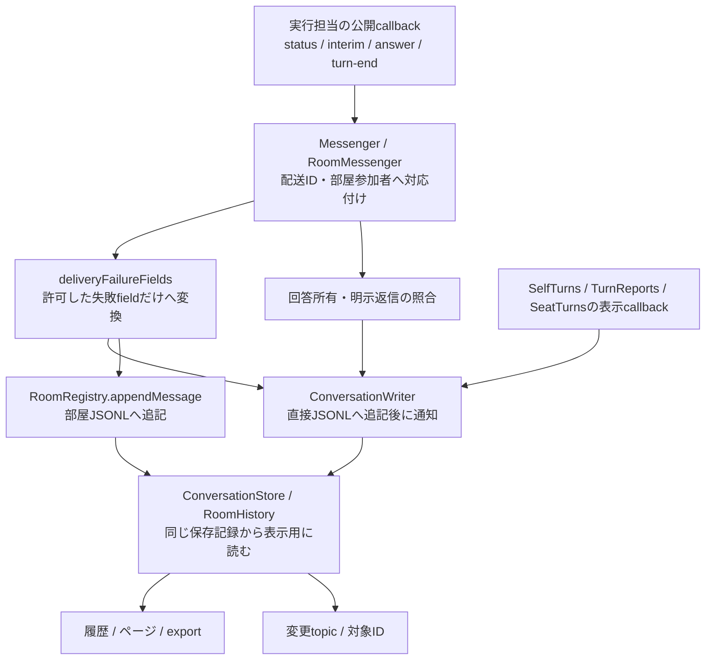

# 会話・履歴

責任者：N102。直接・Bot間・部屋・通話の受付、発言/回答/保存画像、履歴・SSE内容と報告を所有する。native実行の結論は[AI実行制御](../execution/README.md)、表示は[Web](../web/README.md)、Bridge内部は[Bridge製品](../bridge/README.md)の担当。

[接続の正本](module.json) / [全体図](../../feature-map.md) / [担当・変更手順](../../module-ownership.md)。変更前は呼出元のintegration/Bridgeと、使用先execution/members/usage/Throughlineの正本も読む。

## 内部図の正本

- [会話・履歴・SSEの流れ](flow.md)
- [受付と回答所有、保存画像、部屋の配送](delivery.md)
- [部屋定義と履歴](rooms.md)
- [自主回答と報告](observation.md)
- [通話の本体受付](calls.md)

旧conversation-flow/delivery-details/observation-details/registry-details/boundary-detailsの担当章は上の正本への参照にした。実行の詳細とidleの判断は[実行担当](../execution/README.md)に残る。

## 公開窓口と契約

| 窓口 | 入力 | 出力と保存責任 | 実装 |
| --- | --- | --- | --- |
| messages | from/target/message/image(s)、room/targets/responseTo、Bridge event | 受付deliveryと既存ID。直接/部屋の発言を保存後にtransportへ渡す。running/steeredを完了へ読み替えない | BellTeamMessenger、RoomMessenger、createCallBridgeServer |
| history | Bot/room、limit/before/after、表示カード | 履歴ページ/export、画像取得URL、SSE topic/対象ID。画像bytesと本文をSSEへ載せない | ConversationStore、RoomHistory、TimelineIndex、createMessageViews/createMessageEvents |
| membership-cleanup | removeBot(botId) | 部屋参加者/代表/予定targetsから除く。投稿履歴は保持。Bot本体の削除完了を決めない | RoomRegistry.removeBot |
| room-access | roomsとroom ID、caller ID | 部屋存在/所属/代表の検証。既存ROOM_NOT_FOUND/ROOM_MEMBER_REQUIRED/ROOM_REPRESENTATIVE_REQUIREDを返す | room-access.mjs |

membership-cleanupの対象Bot画像prepare/drain/opaque lease/cancelと初回readRemovalStates providerは[保存画像の削除境界](delivery.md#対象bot削除の保存境界)、RoomRegistryのclaimDue/skipDueは[予定の消化保存](rooms.md#部屋予定の消化保存)を正本とする。両方とも同じ親実体を保持し、membersは公開窓口だけを呼ぶ。

HTTPの機能固有handlerは`http-conversation-api.mjs`（Bot履歴/投稿/queue、export、SSE/保存画像）、`http-room-api.mjs`、`http-delivery-api.mjs`に置く。MCPの会話/部屋toolは`mcp-conversation-tools.mjs`のconversationTools/callConversationToolにschema・説明・処理をまとめる。部屋予定のMCP schema/handlerはmembersが持ち、room-accessを使う。

`createMessageViews`は任意`ownerSecretGuide({requestId,botId,roomId}) -> Promise<null|{url:string}>`を受け、選択済みBot/roomページの秘密カードだけへ`secret_request.ownerGuide.url`を複製して付ける。RootがOwner向けHTTPにだけusageの同一getterを渡し、internalはnullとする。URL取得失敗はカードを保持。索引/元row/本文/一般export/recent/receipt/通知/SSE payloadは変えない。usageのrun・許可/停止/期限・公式origin検証とWebの固定文言/URL再検証は各担当。具体順序は[履歴表示図](flow.md#履歴を画面へ戻す)を正本とする。

共通MCP入口がtool存在・引数キー・呼出席の存在・台帳refreshを確認してから専用handlerへ渡す。handlerの入力は`{name,args,from,registry,messenger,store,rooms,roomMessenger,deliverMessage,deliverRoomMessage,listQueued}`。内部HTTPへの配送窓口を注入した場合はその窓口を優先する。avatar本文を返却から外す表現処理と認証・共通エラーは統合が持つ。`mcp-tools.mjs`からの既存resolveBotImagePath exportは維持する。

`conversation-services.mjs:createConversationServices`は`{root,bots,transport,notifications,aiControl,settings,seatRuntime?,readRemovalStates?}`を受け、同じstore/assets/messenger実体とinitializeを返す。構築時からassetsの初回削除状態読取が始まる。共通組立ては初期案内のinitialize後にこのinitializeを呼び、assets復元完了後にselfTurns/seatTurns/rooms/roomMessengerを受け取る。factoryの構築だけでHTTPやtimerを起動しない。start/stop順はapplication-runtimeが登録する。

## 保存と実行結果の変換

[受付後の追跡中断](delivery.md#受付済みの追跡中断)は任意deliveryTrackingとして公開し、元failedと受付済み/完了不明の根拠を分ける。

`ConversationWriter`だけが直接JSONLのappend/配送状態/途中経過を実装する。Messengerはwriterを継承してappend系の互換窓口を保つ。既callerがappendを差し替えた場合も状態/途中経過の保存を同じ窓口へ通す。直接/部屋のmcp_errorとnative_launchは同fileのdeliveryFailureFieldsで変換し、任意例外本文やnative内部情報を新しい保存fieldへ流さない。失敗/停止の結論はtransportが渡した値を保ち、会話側で成功へ変えない。

利用者の回答保存はMessenger.recordUserReplyが持つ。明示user返信を優先し、差し込み・空回答・claimedReplyIdsの既契約を維持する。通知で始まったターンの最終回答はOwner画面用のinterim-word(kind=answer)として残し、送信元や部屋への新投稿にしない。SelfTurnsの重複抑止とcursorの順序は[自主回答の図](observation.md)に従う。

| 所有データ | writer / 読取 |
| --- | --- |
| logs/direct-messages.jsonl | ConversationWriter / ConversationStore |
| rooms/id/room.json、messages.jsonl | RoomRegistry / RoomRegistry・RoomHistory |
| 保存画像のowner別領域 | MessageAssets.save/saveAll/open。席path読取はruntimeの公開窓口 |
| logs/self-turns.json | SelfTurns。cursor/seen/pendingはこの機能が持つ |
| rooms/id/schedule.json | 親RoomRegistryが唯一writer。membersの予定定義を使い、targets/command拒否/資格とclaim/skip消化保存はconversation |

RoomRegistryのlist/set/remove/mark/read/write予定窓口、schedule-definitionのnormalizeSchedule/scheduleDocument、schedule-mutationsのmutateSchedules/nextScheduleRevision/scheduleRevisionは維持する。保存済みfailed配送の明示closeは元配送の状態を変更しない。新会話の復旧は旧配送の成功証明にしない。

## 変更の範囲と検証

初回分離ではMCPの説明/schema/handler、HTTPの会話handler、writer/失敗変換、会話callbackの組立てを専用fileへ移した。初回共有差分はmcp-tools/http-bot-api/http-application-api/application-servicesの登録・呼出で、統合担当が取り込む。公開HTTP経路/status/JSON、MCP入力schema、JSONLの形式、実行callbackの意味と初期化順は保つ。各機能の内部変更はこれらの登録を再編集せず行える。共用mcp-schemaの構文補助とHTTPの認証/dispatchは統合が持つ。

直接境界の確認先はconversation-module、messenger、mcp-tools/seat-mcp、room-messenger/routing/registry、delivery-recovery、call-bridge-server、message-assets、conversation-store/export、http-server/events、server-history-performance、self-turns/turn-reports、application-runtime、launch-action-required、execution-source。全試験と実席操作を定型の完了条件に加えない。

SelfTurnsの変更検知はThroughline公開observer-checkと既observer-readを使用する。project/checkToken/read cursor/seen/pendingと保存/取消の正本は[自主回答の図](observation.md)。席側runtimeの旧DB/WAL署名窓口もruntime担当の差分で除去し、consumerと同時結合した。Throughline内部のsource解析は製品が所有する。
