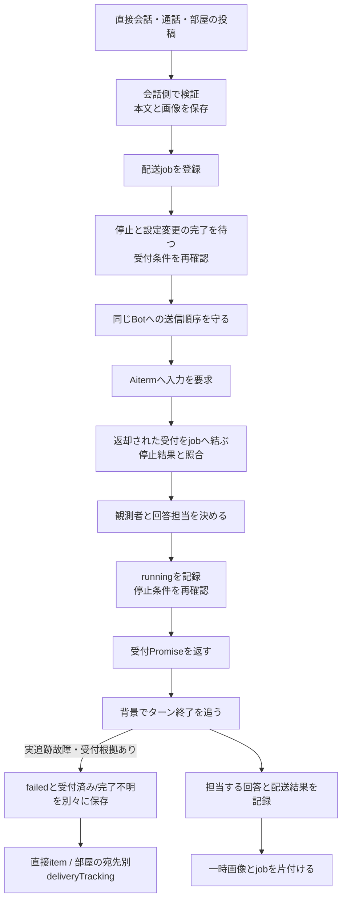
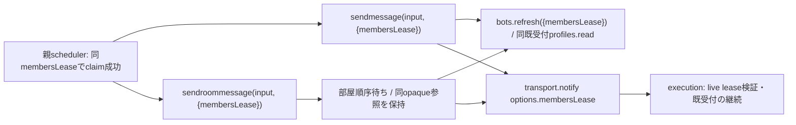
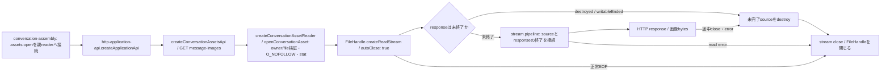
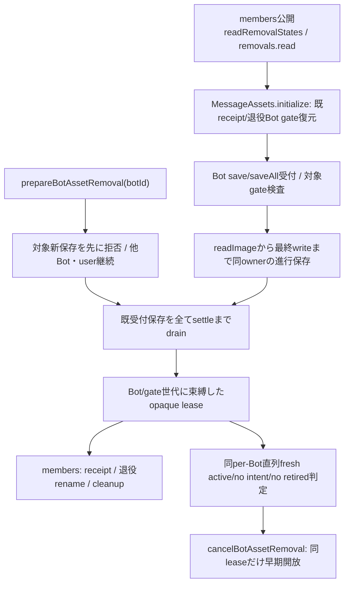
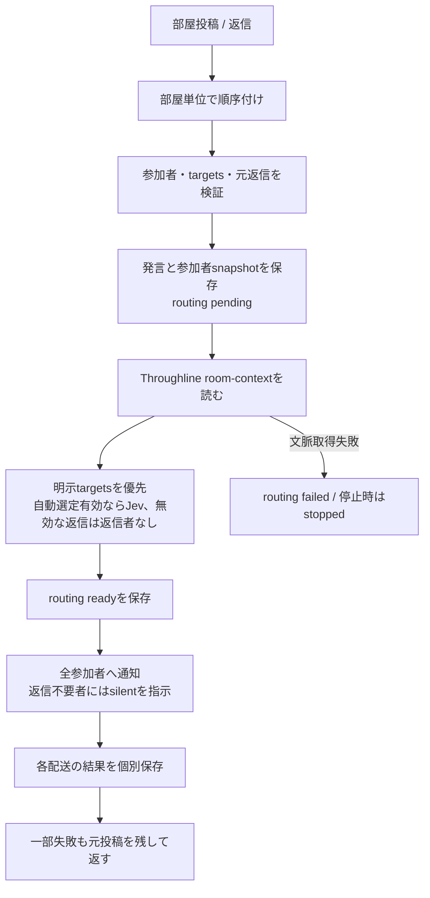
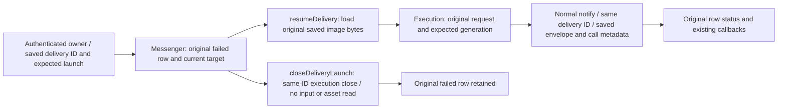

# delivery — 会話・履歴

[担当と公開契約](README.md) / [全体図](../../feature-map.md)。章を旧詳細図から移管した。

## 入口が違っても、受付と終了は別の時点

| 入口/caller | 会話側の実関数 | 受付後の仕事と失敗の返し先 |
| --- | --- | --- |
| HTTPの利用者送信・初期会話 | `prepareUserTurn → startUserTurn → enqueueUserTurn` | 利用者発言を先に保存。`completion.accepted`だけをHTTPへ返し、背景の`finishUserTurn`が回答を保存。後の失敗は状態記録とstderrであり、返却済みHTTPを変更しない |
| 完了まで必要なcaller | `userTurn` | 同じ準備後、completionと回答保存まで待つ。受付だけのAPIへ置換しない |
| MCP/内部HTTPのBot間送信・予定 | `sendmessage → notificationCallbacks → transport.notify` | direct記録を先に保存。通知の最終回答は送信元へ自動返信せず、宛先BotとOwnerの会話へ表示 |
| 通話bridge | `receiveCallBridge` | call session/event/seqを記録。失敗時も元記録を残しfailed/stoppedを追記。通話の戻り先は保存metadataで指定 |
| BotからOwnerへの送信 | `sendmessage`のtarget=user分岐 | native処理なし。画像はこの入口の一枚契約、直接記録と通知で完了 |
| 部屋 | `RoomMessenger.sendroommessage → sendRoomMessageInOrder` | 発言・参加者・返信者のsnapshotと各配送状態を部屋に保存。下図へ |

`recordUserReply`は、そのターンの間にBotが明示的にOwnerへ送った新しい記録を優先し、`knownReplyIds/claimedReplyIds`で二度の回答保存を避ける。空回答を新しい発言にしない。この処理は通知の単なる表示callbackとは責務が違う。

### members予定から配送への既受付lease

第2内部引数の`membersLease`だけを呼出時に捕捉し、同じ参照をnotify optionsへ渡す。Roomは前投稿の成功/失敗待ちと各宛先のfanoutを越えて同じopaqueを保持する。入力本文/会話record/queue/通知文/返却へleaseを保存せず、第1引数の同名fieldから権限を作らない。第2引数省略時は従来のoptionsを保つ。leaseの実在/世代/相関と継続・終端はexecution/runtimeが検証し、会話はclone/再入場/finish/再送を行わない。既全体停止のadmitWork/requireAccessも維持する。ユーザーturn/過去配送の再開/通話の意味をこの予定接点で拡張しない。

配送前のBot台帳refreshにも同じ`{membersLease}`を渡す。integration facadeは同live leaseのfresh profiles.readとしてchannelへ継承し、新root入場/finishを追加しない。context無しrefreshは通常の新rootで、交換中は503。pure projectionを本人性の代用にせず、既受付の名前解決は捕捉identity/親projectionで継続する。RoomRegistryのrefreshは同じ親台帳の読取のまま。

## 会話の保存画像と、nativeへ渡す一時画像を分ける

`prepareUserTurn/sendmessage/sendRoomMessageInOrder → MessageAssets.save/saveAll`は画像の実bytesを確認し、ownerごとの保存領域へ0600/wxで作る。`directory`はOwner画像とBot画像を別の保存先へ置く。`readImageBytes/detectMime`はサイズ/形式を検証し、HTTP読取は`open`からstreamを返す。席由来のpath読取はSeatRuntimeの窓口を使う。

`saveAll`は順番に保存するため、後の画像失敗でも先の保存が残り得る。一括rollbackの保証はない。これとtransportのdata→一時file・finally削除は別の寿命である。WebのBlob URLとも共通の削除関数へ統合しない。実装：[message-assets.mjs](../../../../src/message-assets.mjs)、[Webの画像所有](../../web-management-details.md)。

### 保存画像GETの読取り寿命

| DFD接点 | データと所有 | 終端 |
| --- | --- | --- |
| client → handler → `assets.open` | 本体は`createConversationAssetReader`へ接続。同じ`{mime,size,stream}`契約の`MessageAssets.open`は親直接読取用。URLのowner/fileを検証し、保存画像を読み取る。開いたFileHandleは返却streamが所有 | open/stat失敗はopen内でcloseし、既存HTTPエラーへ返す |
| 保存領域 → stream → pipeline → response → client | MIME/sizeを応答header、画像bytesを本文へ渡す。handlerがsourceとresponseの寿命を接続 | 正常finishはEOF/autoClose、途中close/errorはpipelineが未完了streamをdestroyしてautoClose。読取り失敗はresponseも破棄し、送信済みheaderへJSONを追記しない |

`assets.open`待機中にresponseが閉じた/終了した場合は、取得後にstreamを破棄し、既終了responseへpipeしない。Node26のpipelineは終了済みresponseに同期例外`ERR_STREAM_UNABLE_TO_PIPE`を投げるため、この分岐がFileHandleの解放を保証する。未終了responseはpipeline完了callbackで転送エラーを受け取り、未処理errorとして本体へ流さない。成功時のURL/headers/bytesと保存領域は維持する。機能固有の実装は[http-conversation-api.mjs](../../../../src/http-conversation-api.mjs)と[親reader](../../../../src/conversation-assets.mjs)、試験は[HTTP画像streamの終端](../../../../test/http-conversation-assets.test.mjs)。試験は本体と同じ親readerを使用する。終端はstream層の契約で確認し、ServerResponseの実socket切断は未検証。

### 対象Bot削除の保存境界

factory option `readRemovalStates: () => Promise<{removals:[{botId:string,active:boolean,hasIntent:true,retired:boolean}]}>`をmembers facadeへ接続する。省略時も`bots.readRemovalStates()`を呼び、空一覧へ失敗を丸めない。構築時に一度読取りを開始し、`assets.initialize(): Promise<void>`とconversation.initializeが復元完了を待つ。初回読取前/失敗時はBot画像を受付せず、userは継続。restoreは既receipt/退役の読取結果だけでgateを閉じ、新しいtombstoneや削除副作用を作らない。active+retired/不正DTOは失敗。親の同じMessageAssetsをmodule交換で保持し、復元を繰り返して開けない。

`prepareBotAssetRemoval(botId): Promise<string>`は新保存を同期的に閉じ、save/saveAllのreadImage前から最終write/failureまで待つ。同じgateのprepareは同じleaseへ合流する。`cancelBotAssetRemoval(botId,lease,{active,hasIntent,retired}): boolean`は同leaseと厳密なtrue/false/falseだけで開放する。判定はmembersの同per-Bot直列化内の専用fresh判定から渡し、read一覧の不在を許可へ変換しない。旧lease/不明/receipt残存/rename済みでは開けない。削除失敗の結論、既receiptの寿命とcleanupはmembersが所有する。

## 部屋は全員への配送と返信担当を分ける

| 段階 | caller/実関数 | 保存と失敗 |
| --- | --- | --- |
| 投稿順序 | `sendroommessage` / `roomTasks` | 前投稿が失敗しても次の別投稿は処理。current PromiseだけをMapから除く |
| 投稿前 | `sendRoomMessageInOrder` | 自動選定無効でtargetsなしの新規投稿は409。既responseTo/fromの返信はalready_posted。検証と受付後にだけ画像/発言を保存 |
| 文脈 | `roomTurnsFromThroughline` | 現状は明示targetsでも呼ぶ。schema/room/latest messageを検証。不正は投稿後のrouting失敗になる。不要と決めつけて省略しない |
| 選定 | `chooseRoomResponder` | manual targetsが優先。TypeSafeを設定して有効にした時だけJevが現発言・前会話・参加者から選ぶ。確率/所属を検証し0.6以上で一人。自動選定無効でtargets省略/空配列の返信はresponders=[]となり、全員へsilentを指示 |
| 通知 | `roomEnvelope` / `Promise.allSettled` | 配送対象と返信者のsnapshotを分ける。全員の受付結果を回収。各onStatusで部屋recordを更新、途中経過/最終回答は各BotのOwner会話へ |
| 返信 | `mcp-conversation-tools.mjs`の`respond_to_room` | 元発言/宛先/返信者に対応付ける。silentは制御応答、replyだけ新規部屋投稿。新投稿は新しい返信担当判定を持つ |

## Saved image and call delivery recovery

The owner-only `delivery.resume` and `delivery.closeLaunch` entries use the saved failed row and the expected target launch. Content type and sender category do not determine recoverability: image, user, scheduler and call rows use the same saved-ID lookup. Authentication and actor capture stay in the parent; bridge peers gain no recovery authority. A missing row, a non-failed row or a missing target remains invalid input to this failed-delivery API. Execution owns the decision whether the original input was issued and the target generation can be recovered.

| Function / DFD edge | Ownership and contract |
| --- | --- |
| `resumableDelivery` → saved row | Conversation selects the original failed row and existing target. Remove the blanket `image`, `session_id` and Bot-only sender exclusions; the persisted sender is not a new caller-supplied identity. |
| Saved assets → `resumeDelivery` → execution | Load `image_assets` or the legacy `image_asset` through the existing bounded no-follow reader, before reconciliation. Pass `{mime,data}` bytes, never a private saved path. A record claiming an attachment without any saved reference is incomplete input (`IMAGE_ASSET_NOT_FOUND`); never silently omit it. Existing filesystem errors remain input-read failures. Future legacy Bot-to-Bot sends save their attachments as well; the ordinary durable parent receipt already does so. |
| Saved call metadata → `callEnvelope` / `queue.call` | Keep the original session/event/seq, sender label and `call_reply_required`. Initial call receipt and recovery use the same envelope builder. Earlier rows without `call_reply_required` retain the previous default of requesting a reply. |
| Reconcile → notify | Keep the existing closed effect wire and opaque recovery handle. The existing API sends the original never-issued input after execution reconciliation; it is not observation-only. Execution must not authorize a second input from an accepted or unresolved send. Kiro owns this contract and its production execution-module implementation. |
| `closeDeliveryLaunch` → execution | Do not read, resend or reconstruct attachments. Closing the matching launch retains the original failed history and original ID. |

No new retry limit, queue, watcher, guard or stored schema is introduced. Image references and `call_reply_required` are existing optional fields. Missing source bytes cannot be reconstructed from an old image flag; that is missing required input, not a reason to exclude all image deliveries. The changed Messenger executes in the conversation child and is in the existing signed conversation archive. The existing parent HTTP/facade/effect signatures remain unchanged; activate the conversation module together with Kiro's compatible execution module through the normal signed module-update path. Source adoption and archive membership alone do not prove production activation.

## 受付済みの追跡中断

executionの[待機契約](../execution/wait-contract.md)が既onStatus(status,error)の第3引数へ渡す既知3値を、直接user/Bot/通話/復旧と部屋で同じ意味のまま転送する。delivery-tracking.mjsはfailedかつschema=bellteam.delivery-tracking.v1/admission=accepted/completion=unknownだけを固定3値へ作り直す。余分なfieldと任意error本文は保存しない。

保存JSONLの任意delivery_trackingは、直接ではConversationWriter、部屋では宛先別room-delivery-statusが持つ。ConversationStore/RoomHistoryは同配送の最新statusと根拠を一緒に選び、後続statusで古い根拠を残さない。公開HTTPページ/MCP履歴の直接item.deliveryTracking、部屋deliveries[]の要素.deliveryTrackingへ返す。部屋トップレベルには付けない。入力schema・URL/status・SSEのtopic/対象ID・既failed/stopped値は変えない。過去のfield無しfailedへ根拠を後付けしない。

表示は直接『受付済み・完了未確認』。部屋のrouting失敗/根拠なしfailedを優先し、それ以外に根拠付きfailedがある場合『完了未確認の宛先あり』とし、混在する他宛先の受付/成功を補完しない。Web/Apple/Windows各担当が表示する。未知/不正tupleでは従来の表示を保つ。

検証はconversation-tracking.test.mjs。実executionの人工wait故障→Messenger→JSONL→Store、user/通知/部屋callback、HTTPページとMCP投影、後続状態/不正任意fieldを確認する。test/fixtures/delivery-tracking-wire.jsonは保存経路から得た直接/混在部屋の公開ページと一致を固定する。native/実席・実DB・本番の受入を代用しない。

## D1: closed delivery failure reason

Conversation owner: N102. Observation/configuration/launch/send, callback-before-acceptance-rejection ordering and the single integrated writer/readback case: Kiro. Web wording: Admi. Root's final amendment supersedes the earlier refusal-only proposal; no uncertainty gate or new refusal state is introduced here.

| Function | Input / output and ownership | Failure rule |
| --- | --- | --- |
| Existing deliveryFailureFields | Runtime error → optional stored delivery_error:{code} | Fixed codes: BOT_OBSERVATION_FAILED, BOT_CONFIGURATION_FAILED, BOT_LAUNCH_FAILED, BOT_SEND_FAILED, BOT_DELIVERY_FAILED (fallback). BOT_SESSION_UNCONFIRMED remains legacy-compatible display data. Never copy message/stack or infer no-input proof from a code |
| Callback/channel and direct-log validators | Existing delivery.status error and channel error → same closed optional delivery_error | Allow these fixed callback codes and validate the nested code-only tuple. Reject unknown/extra nested fields. Preserve same delivery ID, outcome and delivery_tracking |
| ConversationStore / RoomHistory | Latest same-ID status → direct item.delivery_error / room deliveries[*].delivery_error | Expose only failed plus the canonical code, never a room top-level reason. A later status clears an old reason |

Data flow: Kiro's actual observation/configuration/launch/send failure → existing failure callback → callback normalization and existing same-generation channel when used → shared deliveryFailureFields → existing direct/room status JSONL at original ID → latest-status selection → closed delivery_error on existing history/UI. Kiro saves the callback before rejecting acceptance. Accepted-but-unknown remains existing deliveryTracking and never becomes proof of no input. No queue, replay, HTTP route, schema family or lifecycle action is added.

Only a new pure normalization/closed-validator assertion runs locally. Kiro's assigned unit covers the full writer/readback once; old tests, peer artifact comparisons and duplicate integrated cases are omitted.
