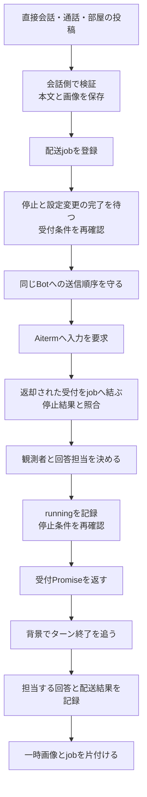
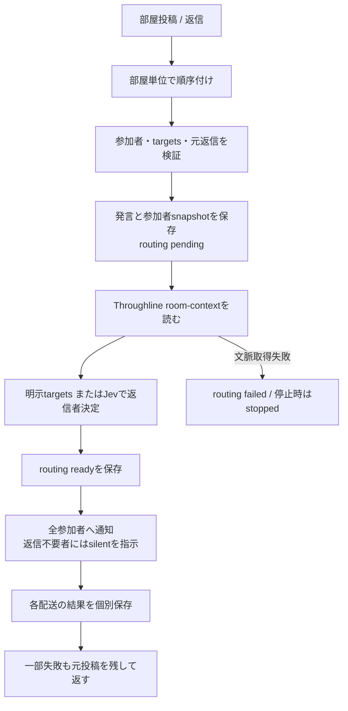

# delivery — 会話・履歴

[担当と公開契約](README.md) / [全体図](../../feature-map.md)。章を旧詳細図から移管した。

## 入口が違っても、受付と終了は別の時点

| 入口/caller | 会話側の実関数 | 受付後の仕事と失敗の返し先 |
| --- | --- | --- |
| HTTPの利用者送信・初期会話 | `prepareUserTurn → startUserTurn → enqueueUserTurn` | 利用者発言を先に保存。`completion.accepted`だけをHTTPへ返し、背景の`finishUserTurn`が回答を保存。後の失敗は状態記録とstderrであり、返却済みHTTPを変更しない |
| 完了まで必要なcaller | `userTurn` | 同じ準備後、completionと回答保存まで待つ。受付だけのAPIへ置換しない |
| MCP/内部HTTPのBot間送信・予定 | `sendmessage → notificationCallbacks → transport.notify` | direct記録を先に保存。通知の最終回答は送信元へ自動返信せず、宛先BotとOwnerの会話へ表示 |
| 通話bridge | `receiveCallBridge` | call session/event/seqを記録。失敗時も元記録を残しfailed/stoppedを追記。通話の戻り先は保存metadataで指定 |
| BotからOwnerへの送信 | `sendmessage`のtarget=user分岐 | native処理なし。画像はこの入口の一枚契約、直接記録と通知で完了 |
| 部屋 | `RoomMessenger.sendroommessage → sendRoomMessageInOrder` | 発言・参加者・返信者のsnapshotと各配送状態を部屋に保存。下図へ |

`recordUserReply`は、そのターンの間にBotが明示的にOwnerへ送った新しい記録を優先し、`knownReplyIds/claimedReplyIds`で二度の回答保存を避ける。空回答を新しい発言にしない。この処理は通知の単なる表示callbackとは責務が違う。

## 会話の保存画像と、nativeへ渡す一時画像を分ける

`prepareUserTurn/sendmessage/sendRoomMessageInOrder → MessageAssets.save/saveAll`は画像の実bytesを確認し、ownerごとの保存領域へ0600/wxで作る。`directory`はOwner画像とBot画像を別の保存先へ置く。`readImageBytes/detectMime`はサイズ/形式を検証し、HTTP読取は`open`からstreamを返す。席由来のpath読取はSeatRuntimeの窓口を使う。

`saveAll`は順番に保存するため、後の画像失敗でも先の保存が残り得る。一括rollbackの保証はない。これとtransportのdata→一時file・finally削除は別の寿命である。WebのBlob URLとも共通の削除関数へ統合しない。実装：[message-assets.mjs](../../../../src/message-assets.mjs)、[Webの画像所有](../../web-management-details.md)。

## 部屋は全員への配送と返信担当を分ける

| 段階 | caller/実関数 | 保存と失敗 |
| --- | --- | --- |
| 投稿順序 | `sendroommessage` / `roomTasks` | 前投稿が失敗しても次の別投稿は処理。current PromiseだけをMapから除く |
| 投稿前 | `sendRoomMessageInOrder` | 自動選定無効でtargetsなしの新規投稿は409。既responseTo/fromの返信はalready_posted。検証と受付後にだけ画像/発言を保存 |
| 文脈 | `roomTurnsFromThroughline` | 現状は明示targetsでも呼ぶ。schema/room/latest messageを検証。不正は投稿後のrouting失敗になる。不要と決めつけて省略しない |
| 選定 | `chooseRoomResponder` | Jevへの入力は現発言・前会話・参加者。確率/所属を検証し0.6以上で一人。manual targetsが優先 |
| 通知 | `roomEnvelope` / `Promise.allSettled` | 配送対象と返信者のsnapshotを分ける。全員の受付結果を回収。各onStatusで部屋recordを更新、途中経過/最終回答は各BotのOwner会話へ |
| 返信 | `mcp-conversation-tools.mjs`の`respond_to_room` | 元発言/宛先/返信者に対応付ける。silentは制御応答、replyだけ新規部屋投稿。新投稿は新しい返信担当判定を持つ |
