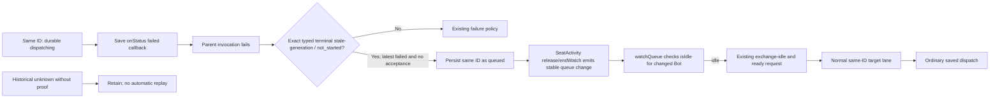

# 親安定の耐久受領と保存済ID

Root公開契約2026-11-06、親接続Molly・実入力Kiro・ready Epi。会話保存N102。

## 機能図

| 機能/実体 | 入力→出力・状態所有 | 失敗 |
| --- | --- | --- |
| DurableMessageReceipts（親に一実体） | 認証済入口のfrom/target/message/images→同配送IDの既direct-message、delivery=queued。user宛はdelivered。既Store/Assets/Writerを使用 | fresh送信者/宛先・入力・認可・添付保存は維持。AI/子admissionを受領条件にしない。fsync成功前は受領0 |
| 同実体append | 全直接記録を同Writerのqueueへ直列化。子はdirect.log.append effectで同窓口へ、Roomは既writer | 子effectは既世代/authority/実終端検査を保持。新旧子のwriterは作らない |
| pending / dispatchSaved / drain / drainTarget | durable受領済queuedだけ列挙、同ID dispatchingを保存後Kiro dispatchへ一回渡す。drainは宛先ごとのlane（drainTarget）を並行に起こし、lane内は保存順に直列で、laneが終わるまで同宛先の新規queuedを拾い続ける | 1宛先の受付待ち/失敗は他宛先の投入を遅らせない。dispatching/unknown/running等は原則再入力0。明示top-level effect=not_startedは従来どおりqueued。加えて、failed callbackを記録した同一dispatchで未acceptanceのまま型付きterminal `EXECUTION_STALE_GENERATION` / `effect=not_started` が返った時だけ同IDをqueuedへ戻す。ここではonPendingを呼ばず、SeatActivityのidle release eventまで待つ。保存失敗ならnative0 |
| Stable BODY transport queue watcher | stable facadeのwatchQueueでrelease/endWatch change.botIdsを受け、各BotのisIdleを読む。idle=trueなら通常requestDrainを一度起動 | busy queue eventは無視。`EXECUTION_NOT_ACCEPTING`はskip（generation running eventが再起床させる）。他エラーはreportしてpublisherへ投げ返さない |
| Epi通常ready / 初回受領onPending | pending drainを起動 | timer/常駐/AI巡回0。stale requeueも独自loopを持たず、queue release/ready eventを使う |

## データフロー図

認証済MCP/HTTP/Bridge → 親安定receive → fresh registry/本人/宛先/閉入力/既認可 → 既Assets保存 → 同ID direct JSONL queued + file/directory fsync → 受領{delivery:'queued',delivery_id,from,target}。
保存後のonPendingは実行待ちの通知だけ。実行/通知失敗を受領失敗へ変換しない。通知の失敗は診断callbackへ渡す。

同ID queued → ready/drain → 宛先別lane（他宛先と並行、同宛先は直列） → 同ID dispatchingの耐久claim → Kiro既queue/実native → 実callback保存 → 履歴/SSE。通常の明示not_started → queued。saved failed＋型付きframe not_started → failed（未達）。ただしfailed callbackの後に同じdispatchからterminal stale-generation/not_startedが返れば、正本の分岐に従い同IDをqueuedへ戻す。その他の作用不明 → unknown。再起動してdispatchingだけ残る場合もunknown相当で自動再入力0。以前からあるunknown rowに後付けの証明を作らず、pendingにも含めない。

### Terminal stale-generation requeue

| Function | Input → output / state | Failure boundary |
| --- | --- | --- |
| `runSaved` terminal classification | Parent-wrapped invocation error plus its preserved typed `executionError` frame and latest same-ID durable status → after an `onStatus('failed')` callback, if no acceptance was observed and the exact frame is `EXECUTION_STALE_GENERATION` with `effect=not_started`, persist `queued` for the same ID | Parse the closed typed frame once and reuse it for the existing saved-`failed` rule. Top-level `effect=unknown` alone is not proof. A stale terminal without the failed callback remains on the old unknown path; generic BUSY/not_started plus failed callback remains failed. Invalid frames and other effects keep the existing policy. Accepted/delivered callback states are not requeued. Historical unknown rows have no dispatch attempt/frame to classify and stay unknown. |
| `SeatActivity.release/endWatch` → stable BODY watcher | Once the seat removes its active job/watch, the public `transport.watchQueue` reports the affected Bot ID. The watcher checks `transport.isIdle(botId)` and requests a drain only when true. | An earlier busy queue event does not trigger a retry. `EXECUTION_NOT_ACCEPTING` is skipped; the existing running/available state edge provides another readiness request. Other watcher errors are reported without escaping into the queue publisher. |
| Existing exchange-idle → target lane | The ordinary request waits for `exchangeMutex` idle, checks fresh execution/AI readiness, then `drain()` claims the queued original ID in its normal target lane | Same target ordering and saved envelope/assets remain in force. Do not invoke `onPending` from this stale branch: that would spin while the old generation still occupies the Bot. No child-restore writer, per-Bot API, timer or new transport lookup is added. |

This parent-source behavior is activated only with the next approved body-resident swap; it does not change or require child restore/writer logic. The integration ownership/reference is [typed stale-generation requeue](../integration/message-receipt.md#typed-terminal-stale-generation-requeue).

既子 direct append → direct.log.append（既registered effect/lease）→ 同親append → 保存ACK → 子の既emit一回。子はdirect JSONLへ書かない。親の既direct log writer一個をMollyが組み立てgetServices.directReceiptsへ供給する。新口未接続はCONVERSATION_EFFECT_UNAVAILABLEで拒否しローカル第二writerへ退避しない。

添付は同ID image_assetsに保存し、実行時に既assets.directory(owner)/fileを使う。user回答所有とBridgeの元session/event/seqは同ID recordに保持し、実行consumerへ渡す。recordUser=falseのonboardingはこの受領口へ無断で変換せず既経路。旧callback/native実参照の付替え0。

## exact接続契約

`DurableMessageReceipts({root,bots,assets,dispatch,onPending?,onMessage?,onError?,requireAccess?})`。`requireAccess({from,target})`は認証/操作資格だけを確認し、AI enabled/child admissionを呼ばない。onMessageは親の新受領/実行だけを通知する。子effectはappendFromChildで同writerに保存し、親の通知を省いて子の既emitを一回行う。親の同実体を`getServices().directReceipts`に入れる。既子初期化は直接writerを作らず同effectへ委譲する。

- `receive`/`sendmessage({from,target,message,image?,images?,executionSource?},{membersLease?})`、`enqueueUserTurn({target,message,images?,recordUser?})`、`receiveCallBridge(既Bridge閉入力)` → `{delivery:'queued'|'delivered',delivery_id,from,target}`。queuedは保存受領のみ、runningは捏造しない。recordUser=falseは既専用経路を維持する。
- `pending() → 保存済record[]`、`dispatchSaved(deliveryId) → {delivery_id,delivery,dispatched}`、`drainTarget(target) → 同結果[]`（宛先1laneを起こすか、動いている同宛先laneの後に再確認）、`drain() → 全宛先laneの同結果[]`。drainの解決は全laneの完了であり、親はlaneを待たずに次のdrain要求を受けられる。StoreのdurableReceiptsはLF確定行だけ、不正ログ/重複IDは実行根拠にしない。
- `dispatch({record,images,queue,callbacks}) → Promise<{delivery:'running'|'steered'|'delivered'}>`。queueは既context/contextId/groupId/from/fromName/target/message（Bridgeはcallも）で元IDを維持。callbacksはonStatus/onInterim/onAnswer/onTurnEnd/onUserComplete。Kiroが元recordのfrom=userならturn、Bridgeなら元session/hintを含むnotifyへ接続する。通常はtop-level effect=not_startedだけ再開可能。加えて同dispatchのfailed callback後にexact typed stale-generation/not_started markerがある場合だけ同IDを再開する。それ以外unknown。入力済trackingを持つcallback後は再開しない。
- Assets use the same parent's existing `saveAll`/`directory`; fsync the saved asset and its directory before receipt. On dispatch, the parent resolves durable references and reads bytes with `readImageBytes`, then hands `{mime,data:base64}` to execution. Execution owns the UID1000-readable temporary copy and its existing cleanup; the private UID1001 saved path is not passed to the seat. The function/data-flow boundary is [saved-image handoff](../integration/message-receipt.md#saved-image-handoff-to-execution).

閉wire enumへqueuedを追加する共通MCP/HTTP返却はMolly担当。これをrunningへ写像しない。通常ready→drainのイベント接続も親担当。本source単体を親接続完了へ補完しない。

既executionSourceは親だけの一時参照としてdispatchへ渡し、本文JSONLへ保存しない。process再生成後に元authorityを捏造して復元しない。入力済callback後の実delivered/running追跡と、stale markerに該当しないfailed追跡は後着例外でqueued/unknownへ上書きしない。

親認可・同asset gate・実dispatcher・通常再開・closeの正本は[integration/message-receipt.md](../integration/message-receipt.md)を参照。親callbacksは同writerへ直接保存するため、会話child追跡不明だけで新規AI入力を待たせない。

## Message author capture and history

| Function | Input → persisted/public output | Ownership and limits |
| --- | --- | --- |
| Stable direct adapter | Existing validated `captureReceipt(method,input,captureActor?)` supplies the authenticated actor synchronously. Owner → `{kind:'user'}`; Bot → `{kind:'bot',botId}`; other/no actor → `{kind:'unknown'}` for `from=user`. | Shared capture port: Molly. N102 adapter passes authorship as a separate receive option, never as an accepted message-body/MCP field. Original executionSource capture/return remains unchanged. |
| Durable receive and ordinary Bot writer | Separate trusted `messageAuthor` receipt option → `direct-message.v1.messageAuthor`; normal Bot outputs derive their Bot ID from the existing sender. Interim writer stores its Bot author. | N102. Image/save/status/dispatch inputs stay unchanged. Unknown actor does not stop delivery. Parent body and child optional-record validator must ship together before new child records use the field. |
| ConversationStore message/peer/interim projection | Author evidence → additive `item.messageAuthor` through existing timeline/page/recent/export/MCP read. Known historical Bot sender → bot; unmarked historical `from=user` → unknown. | No historical rewrite. Existing presentation/IDs/paging/delivery preserved. Unknown is never promoted to user. Belorta's instruction proof reads kind=user explicitly. |

DFD: authenticated HTTP/MCP actor → existing shared capture validation → separate trusted receipt option → existing single parent writer/fsync → canonical direct JSONL → ConversationStore → unchanged timeline/public readers plus messageAuthor. A Bot's `send_user_message` routes with `from=user` but captures the actual Bot actor. New Bot replies and interim/final records flow through their existing writer with Bot author → strict optional child append field → same parent writer. Historical ambiguous user-side records → unknown → readable timeline; no input lock, retry or synthetic identity is introduced.
