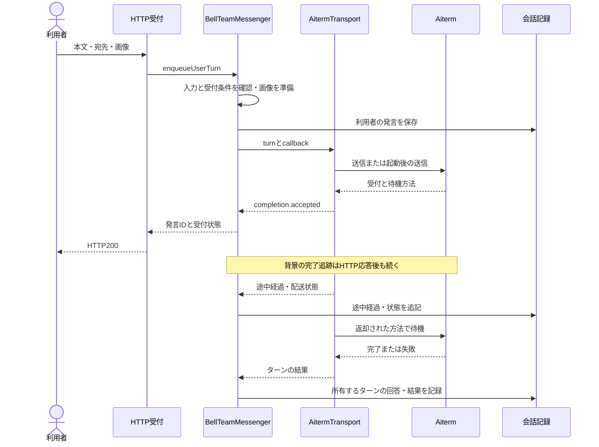
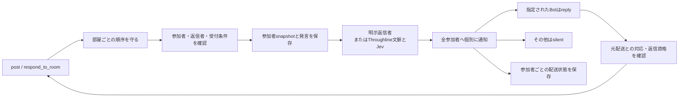
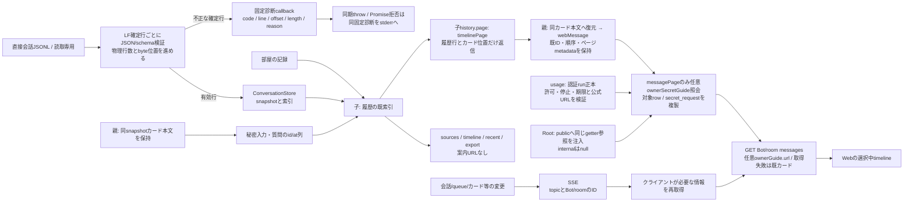
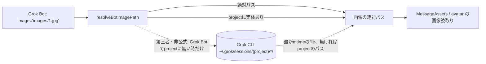
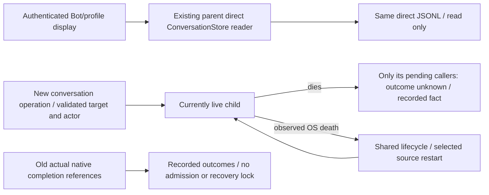

# flow — 会話・履歴

[担当と公開契約](README.md) / [全体図](../../feature-map.md)。章を旧詳細図から移管した。

Mの元delivery照合は[一件readの正本](process.md#m-元deliveryの保存原本一件照合)に従う。認証済Bot本人と保存確定原本の対応だけを閉4fieldで返し、native採用の証明とorigin束縛はexecutionが所有する。

## 人がBotへ送る

`enqueueUserTurn` は受付を待ち、背景の `finishUserTurn` が結果を処理する。`userTurn` は完了を待つ入口なので、HTTPの受付だけを待つ経路と置き換えない。入力拒否、画像の失敗、実行受付前後の失敗で保存済みのものが異なる。

## Bot間・通話・失敗配送の操作

| 入口 | 会話側が決めること | 実行側へ接続するもの |
| --- | --- | --- |
| sendmessage | 送信者/宛先の確認、受付、本文/画像の保存 | notify、配送metadata、進行/回答/終了callback |
| receiveCallBridge | 通話のsession/event/seqと受信内容の保存 | notify、通話metadata、同じ意味のcallback |
| resumeDelivery | 保存済みfailed/unknown配送と宛先を確認し、画像bytes・通話metadataを復元 | 同じ配送IDのnotify、recoveredExecution。明示操作はunknownも再送し得る。詳細は[復旧契約](delivery.md#saved-image-and-call-delivery-recovery) |
| closeDeliveryLaunch | 同じ適用対象の検証後、未解決の起動を閉じる | 本文の再送とは別の明示操作 |

直接通知の `onStatus/onInterim/onAnswer/onTurnEnd` の接続は同じ意味の重複である。notificationCallbacksで共通化した。保存の正本と型付き失敗の変換は[保存責任図](README.md#保存と実行結果の変換)へ接続する。一方、利用者の回答保存には差し込み時の回答所有と重複抑止がある。部屋には参加者別の保存形式と返信者の検証がある。見た目が似ているだけで全経路を同じ処理へまとめない。

## 部屋の会話

自動選定の有効/無効と明示targetsの優先を維持する。全員への配達と「誰が返事するか」は別の判断。投稿（room.post / room.reply）は、記録・返信者の決定・全員への配送の発行が済んだ時点で返す。各席の受付は待たない（Trony裁定2026-11-11、18人の投稿が44秒かかり、親の60秒の呼び出し期限を越えると投稿済みでもエラーが返り二重投稿を招くため）。返却は `{id, room, targets, delivery}` のまま、`delivery` は配送先があれば `running`、無ければ `posted`、同じ返信の再送は `already_posted`。各席の結果は従来どおり部屋の記録の配送状態行に残り、後から受付を拒否された席は `failed`（停止・全体停止は `stopped`）の配送状態行を足す。保存済み投稿は取り消さず、失敗本文の自動再送はしない。

公開互換（Owner規範：配布済みクライアントを壊さない）：配布済みWeb（28d5bfbb）、Apple 1.0.6（133）、Windows 0.4.6はルーム投稿の返却から `id` だけを読む（Web `result.delivery_id ?? result.id`、Apple `MessageSendAcknowledgement.id`、Windows `id`）。`delivery` の値は既存の集合の中だけで返し、新しい値は足さない。`posted_with_failed_deliveries` / `steered` / `failedTargets` は返さなくなるが、結果検証と道具の説明は旧値を読める形のまま残す（追加を先、削除は後）。

## 履歴を画面へ戻す

`createMessageViews`の任意`ownerSecretGuide({requestId,botId,roomId})`は`Promise<null|{url:string}>`。Rootは認証済みOwner向けHTTPだけにusageの同じ読取関数を注入し、内部HTTPにはnullを渡す。会話はページ選択後のsecret_request行だけを複製し、`secret_request.ownerGuide = {url}`を付ける。未注入/null/取得失敗は既カードを維持する。URLのrun束縛・pending・許可/停止/期限と公式originの検証はusage、リンクの固定文言と再検証はWebが持つ。本文/保存item/索引/共通webMessage/receipt/通知/SSE payloadには追加しない。全体図は既historyとusage:auth接続を参照する。

SSEは本文全体ではなく変更通知。サーバーはtopicと対象IDをまとめて通知する。appは選択と取得理由をtimelineへ渡す。`conversation-timeline.js` が対象/token/読取順で古い結果を捨て、ページ・queue・スクロール位置を維持する。一覧cacheの順序は別で、[残る接続](../../web-final-gaps.md)に分ける。

基底では選択中の会話と関係しないSSEでも `loadMessages` を呼んでいた。現在はeventAffectsTimelineで対象を選び、refreshFromEventが必要な再取得を接続する。ただし一覧の最新活動は他の会話の変更でも更新が必要で、`loadBots` まで一緒に止める根拠にはならない。ready/all/未知形式には全体更新のfallbackを残す。

基底で重複していたConversationStoreの読取cache/索引は、組立て側のstoreをMessengerへ注入して共有した。二重writerや保存破損を修理したという意味ではない。

### 破損した直接履歴の読取

`new ConversationStore({logPath,onCorruption?})`はLFで確定した各行を既JSON/schema検証へ通す。不正行は行全体を除外し、有効な前後行を元順序で索引へ反映する。NULを削ってJSONを連結・復元しない。元ファイルのbytes/mode/mtimeは変更しない。writerの追記前検査や親の診断組立はMollyが持ち、読取に修復書込を足さない。

診断は凍結した`{code:'MESSAGE_LOG_INVALID',line,offset,length,reason}`だけ。lineは空行・不正行を含む1始まりの物理行、offsetは行頭の0始まりbyte位置、lengthは末尾LFを除くbyte長。reasonは`nul`（生NULあり）、`syntax`（JSON不正）、`schema`（既schema/配送状態検証で拒否）の固定enumで、本文・path・任意例外を含まない。callbackは同期に呼び、戻るPromiseは待たず拒否だけを捕捉する。同期throw/Promise拒否は同固定DTOをstderrへ出し、有効履歴を拒否しない。省略時も同stderr診断を使う。

読取済みoffsetは全確定行のbytes、linesは空行・不正行を含むLF数として進め、record件数と分ける。同ファイルの増分読取では同じ不正行の診断を繰り返さない。inode置換/短縮/同size内容更新は既条件で全体再構築し、新ファイルの位置で再診断する。未改行末尾は確定不正行として除外せず、従来どおり不完全JSONは保留、妥当JSONはpreview、未知schemaは行番号付き拒否。LF確定時にpreviewを重複登録せず、後続bytesでpreviewが不正行になった時も除去と全体変更通知を行う。IO失敗は従来どおり伝播する。

限定反例は`conversation-store.test.mjs`の`corruption:`群。147NULと同一行のJSONを捨てても前後行/元bytesを保持すること、byte位置/物理行、schema拒否、増分/置換、preview、診断callback故障を確認する。

## 第三者Grok CLIへの非公式な依存

オーナー裁定（2026-11-14）：第三者製品からデータを取る時は契約した窓口を作れない。機能は残し、読取りをBellTeam内の1か所に閉じ込め、第三者・非公式の依存として描く。要らなくなった時だけ消す。

| 機能 | 入力 | 出力 | 第三者の読取り | 所有 |
| --- | --- | --- | --- | --- |
| resolveBotImagePath(bot,input,{home}) | Botの`image`/`path`引数 | 読む画像の絶対パス | Grok Botの相対パスがBot projectに無い時だけ、`~/.grok/sessions/<encodeURIComponent(project)>/*/<相対パス>`の最新mtimeのfile。Grok CLIの非公開の保存形式で、版が変わると見つからなくなり得る（その時はproject側のパスを返し、画像読取りが通常の「見つからない」誤りになる） | 会話・履歴（`src/bot-image-path.mjs`だけ） |

呼出元：`mcp-conversation-tools.mjs`（sendmessage / sendroommessage / respond_to_room の`image`）、`members/profiles-mcp.mjs`（set_avatar の`path`、membersは関数を呼ぶだけ）。ほかのBellTeamのコードは`~/.grok/sessions/`を読まない。

## 関数と確認先

| 段階 | 主な実装 | 変更時に確認する試験 |
| --- | --- | --- |
| 人の受付/回答保存 | messenger.mjs: prepareUserTurn, enqueueUserTurn, finishUserTurn, recordUserReply | messenger, execution-source |
| 通知/復旧/通話 | messenger.mjs: sendmessage, receiveCallBridge, resumeDelivery, closeDeliveryLaunch | messenger, delivery-recovery, call-bridge-server |
| native配送と結果 | aiterm-transport.mjs: submit, dispatch / delivery-job.mjs | aiterm-transport, aiterm-send-rejection, delivery-job |
| 部屋の投稿/返信 | room-messenger.mjs / mcp-conversation-tools.mjsのrespond_to_room | room-messenger, room-routing, mcp-tools |
| 自主ターンの観測 | seat-turns.mjs / self-turns.mjs / turn-reports.mjs | seat-turns, self-turns, turn-reports |
| 保存記録の読取り | conversation-store.mjs / timeline-index.mjs / http-messages.mjs | conversation-store, server-history-performance |
| 変更通知/画面更新 | http-events.mjs / application-runtime.mjs / web/app.js・conversation-timeline.js・conversation-composer.js | http-events, application-runtime, timeline-open-queue, chat-input |

実装のパスは指定がなければ `src/`、試験は `test/<名前>.test.mjs`。

## Current conversation lifecycle (Owner ruling 2026-11-07)

This replaces the conversation admission close/drain/adopt/recover ceremony described in the older sections below. Usage and diagnostics keep their own contracts. Conversation operation references retain actual target/actor/callback identity and completion facts; they do not gate new operations on a ticket, failed generation, active count, or unconfirmed outcome. The current live child receives new operations. Child loss fails only that child's pending callers with unknown outcome and records the fact; recovery never replays their business requests. Observed writer death permits the next child without waiting for native references or acceptance proofs. A planned exchange still quiesces the actual live writer before replacing it to prevent concurrent file writers.

