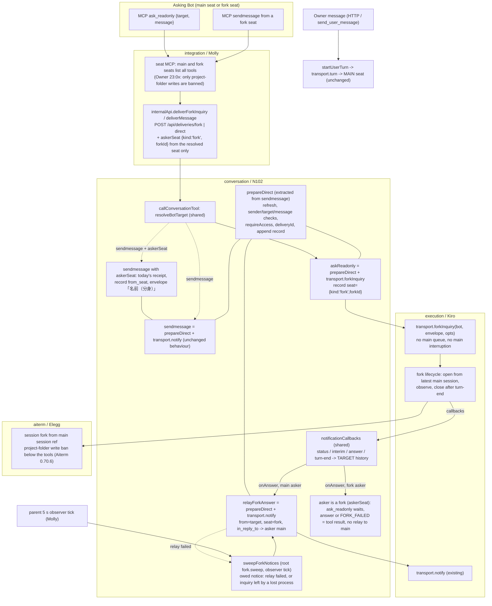
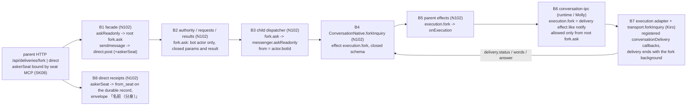
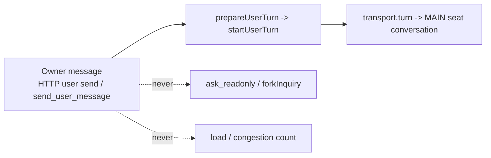

# Read-only fork inquiry (`ask_readonly`)

Owner of this page: N102 (conversation). [Module contract](README.md) / [overall data flow](../../data-flow.md#proposed-read-only-fork-inquiry) / [function map](../../feature-map.md).

Status: design adopted on main fd61b8e5 (#949). The conversation part is implemented against the contracts below. Execution (`transport.forkInquiry`), Aiterm fork/profile, fork-seat MCP listing, client labels, work-graph and Throughline parts belong to their owners and are not in this module's code. Binding source: the Owner-agreed spec `/srv/bellteam/bots/bot-7b140b27/docs/fork-ask-design-20261110.md` (items 1–10) and Root's request of 2026-11-10 JST. Spec item 9 (receipt now, answer later as a message) supersedes the "answer as the tool result" wording in item 6. Nothing here replaces an agreed mechanism. Gaps the spec left open were ruled by Root on 2026-11-10 JST after the line-by-line review; see [Root rulings](#root-rulings-2026-11-10-jst).

Base read for this design: `main` 814ac22f — `src/messenger.mjs` (`sendmessage`, `notificationCallbacks`, `startUserTurn`), `src/mcp-conversation-tools.mjs`, `src/mcp-tools.mjs` (`runBellTeamTool`), `src/seat-mcp.mjs` (`internalApi`), `src/http-delivery-api.mjs`, `src/work-graph/projection.mjs`.

## Function map



One code path, three uses: `prepareDirect` is the body of today's `sendmessage` from `bots.refresh` up to `append(record)`, moved out as-is. `sendmessage` keeps its exact behaviour, errors and return. `askReadonly` and `relayForkAnswer` call the same function. The dispatch differs: `transport.notify` for main or `transport.forkInquiry` for a fork. No copy of resolution, validation, access, record or callback code (spec item 7).

## Data flow

```mermaid
sequenceDiagram
  participant A as Asker main seat
  participant M as seat MCP (Molly)
  participant C as conversation (N102)
  participant X as execution (Kiro)
  participant N as Aiterm (Elegg)
  participant F as Fork seat (read-only)
  participant H as Target direct JSONL / history
  A->>M: ask_readonly {target, message}
  M->>C: POST /api/deliveries/fork {from, target, message, executionSource}
  C->>H: append inquiry record (delivery running, seat fork, fork_id)
  C->>X: forkInquiry(targetBot, envelope, {forkId, deliveryId, callbacks})
  X-->>C: accepted {delivery:'running'}
  C-->>M: receipt {delivery:'running', delivery_id, fork_id, from, target, seat:'fork'}
  M-->>A: tool result = receipt (immediately)
  X->>N: fork(main session ref, read-only profile)
  N->>F: launch forked session, first input = fork inquiry envelope (last reply is relayed; no sendmessage)
  F-->>X: interim / answer / turn-end
  X-->>C: onStatus / onInterim / onAnswer / onTurnEnd
  C->>H: interim words + answer under same delivery_id, seat fork
  C->>H: relay record target -> asker (seat fork, in_reply_to)
  C->>X: notify(askerBot, fork-answer envelope)
  X->>A: answer arrives as a message
  Note over C,A: on failed/stopped after receipt: one FORK_FAILED message to A on the same relay path
  Note over C,A: relay failed, or the process holding the fork was lost: the next fork.sweep relays the owed notice once (see Owed notice)
  Note over M,A: asker is a fork seat (askerSeat): the tool call stays open and its result is the answer or FORK_FAILED; no relay record or notify to A's main
  X->>N: close fork seat
```

| Edge | Data | Owner / state |
| --- | --- | --- |
| Asker → seat MCP | `{target, message}` | Molly: authenticates the seat; main and fork seats list every tool |
| seat MCP → conversation | `{from, target, message, executionSource, askerSeat?}` over the existing internal HTTP, `/api/deliveries/fork` and `/api/deliveries/direct` | Molly: `askerSeat:{kind:'fork', forkId}` only from the resolved fork seat (execution registry or fork credential), never from tool arguments; absent for main seats. N102 handler in `http-delivery-api.mjs` |
| conversation → direct JSONL | `bellteam.direct-message.v1` with optional `seat:{kind:'fork',fork_id}`; later interim/answer rows under the same `delivery_id`; relay row with `in_reply_to` | N102, `ConversationWriter` (sole writer, unchanged) |
| conversation → execution | `forkInquiry(bot, envelope, {forkId, deliveryId, executionSource, onStatus, onInterim, onAnswer, onTurnEnd})` | Kiro: fork lifecycle, never the main dispatch queue |
| execution → Aiterm | `agent_launch {fork_from:{session_id, fork_id}}` (Aiterm 0.70.6) | Elegg: native fork and project-folder write ban |
| conversation → asker | relay via existing `transport.notify(askerBot, …)` into the asker's own seat | Kiro, existing path |
| target history → main seat | records and summaries the main reads on demand (`list_messages`, Throughline summaries); no notify, no injected full text | N102 records, Rivalin (Throughline) session labelling |

## Module child boundary (production defect 2026-11-11)

First live `ask_readonly` (Root seat, 2026-11-11 09:07 JST) returned a bare `INTERNAL_ERROR`. In the normal assembly the messenger runs in the conversation module child; the parent reaches it only through the conversation facade (root methods), and the child reaches execution only through `ConversationNative` (effects) and the parent channel. #954 added `askReadonly` to the in-process messenger only: the facade had no `askReadonly` (`messenger.askReadonly is not a function` in the parent), there was no root method, `ConversationNative` had no `forkInquiry`, and no effect carried a fork to execution. The same boundary dropped `askerSeat` from a fork's `sendmessage` (the closed `direct.post` and durable-receipt inputs reject the key). The edges below close that gap with the existing delivery mechanism; no new queue, lease, retry or guard.



| Edge | Contract | Owner |
| --- | --- | --- |
| B1 | `messenger.askReadonly({from, target, message, askerSeat?})` invokes root `fork.ask` with exactly those keys; `sendmessage` passes `askerSeat` on `direct.post` when present. `executionSource` stays in the parent context as for `direct.post` | N102 `src/conversation-facade.mjs` |
| B2 | `fork.ask` is allowed for actor `bot` only. Params exact `{from:id, target:id, message:text}` + optional `askerSeat:{kind:'fork', forkId:identity}`; `direct.post` gains the same optional `askerSeat`. Result exact `{delivery:'running'|'steered'|'answered', delivery_id, fork_id, from, target, seat:'fork'}` + `answer:text` only with `answered` | N102 `src/conversation/{authority,requests,results}.mjs` |
| B3 | `fork.ask` → `messenger.askReadonly(params)`; a bot actor may only ask as itself (same rule as `direct.post`) | N102 `src/conversation/dispatcher.mjs` |
| B4 | `ConversationNative.forkInquiry(bot, envelope, {forkId, queue, onStatus, onInterim, onAnswer})` registers the delivery like `notify` and invokes effect `execution.fork` `{deliveryId, target, forkId:identity, message:text, queue, kinds}`; `queue` is the direct shape (`groupId = deliveryId`, `target`, `contextId = target`); `kinds ⊆ {delivery.status, delivery.words, delivery.answer}` (no `turn.end`, no `user.complete`, no images, no `recoveryId`). Result `{delivery:'running'}` + optional `forkId` equal to the param | N102 `src/conversation/{native,effects}.mjs` |
| B5 | `execution.fork` goes to `onExecution` with the other execution effects | N102 `src/conversation-parent-effects.mjs` |
| B6 | `execution.fork` is a delivery effect: same `register` (delivery lease with the child's `kinds`, release ACK) and same dependent binding as `execution.notify`; allowed only from root `fork.ask`. `execution.notify` is also allowed under root `fork.ask`: the answer relay to a main asker is issued from the fork's `delivery.answer`/`delivery.status` callback | Molly `src/conversation-ipc.mjs` |
| B7 | `execution.fork` → same check / `assertDelivery` / `assertCurrentLease` / fresh member as `notify`, then `transport.forkInquiry(bot, message, {forkId, deliveryId, queue, conversationDelivery, membersLease, admissionCheck, executionSource?})`. Callbacks come from the registered `conversationDelivery` (status/words/answer); the delivery completes when the fork's background ends (after close). A refusal before accept keeps its `code`/`status` (`FORK_UNAVAILABLE` 503, `FORK_INVALID` 400/409, launch errors) so the asker gets the typed error, never `INTERNAL_ERROR` | Kiro `src/conversation-execution-effects.mjs`, `src/aiterm-transport.mjs` |
| B4r | The child writes through effect `direct.log.append`; `validateDirectLogRecord` accepts the optional fork fields: `seat` / `from_seat` `{kind:'fork', fork_id}` and `in_reply_to` on direct messages, `seat` on interim words | N102 `src/direct-log-record.mjs` |
| B8 | `captureReceipt('direct.post')` accepts `askerSeat`; `DurableMessageReceipts` stores `from_seat:{kind:'fork', fork_id}` on the receipt record; dispatch builds the 「（分身）」 envelope from the saved `from_seat` | N102 `src/direct-receipt-assembly.mjs`, `src/durable-message-receipts.mjs` |

Conversation side, same diff: a fork's empty answer relays `FORK_FAILED: NO_ANSWER` on the `delivered` status (the transport reports the answer before `delivered`), so the fork registers no `turn.end` and never enters the child's turn-end report path. `FORK_TARGET_USER` is typed (400). `fork.ask` has no durable receipt and the fork is never replayed. The asker's ONE notice is still owed after a lost relay or a lost process: see [Owed notice](#owed-notice-production-defect-2026-11-11).

## Owed notice (production defect 2026-11-11)

Two production forks ended with nothing reaching the asker. Trony -> Molly `cb93d74d` (06:16Z) saved its answer row, but no relay row exists; the relay error went only to the child's stderr. Emma -> Mast `a20edaeb` (06:45Z) was still `running` when the body was swapped (06:49Z). The fork died, and no status, answer or failure ever arrived. Root cause: the asker's notice lived only in the memory of the process running the fork's callbacks. Any loss (relay error, child exit, module exchange, body restart) ended the inquiry silently. Ruling (Trony 2026-11-11): a fork that ends without an answer or a failure reaching the asker is a defect.

The relay row (`in_reply_to = inquiry delivery_id`) is the durable "notice issued" mark. An inquiry with a main asker (no `from_seat`) and no relay row owes ONE notice. Its later delivery is the ordinary message path's (same as any `sendmessage`).

| Step | Contract | Owner |
| --- | --- | --- |
| live | `askReadonly` holds the inquiry in `forkNotices.live` until its relay settles (a fork asker: until its answer resolves). A refusal before accept is the tool error and owes nothing | N102 `messenger.mjs` |
| outcome row | A post-accept `failed`/`stopped` first appends its notice text as the fork's interim row (`kind:'error'`, `seat` fork, `group_id` = inquiry), then its failed/stopped status, then relays. A loss after the outcome row (status still `running`) or after the status both leave the row, and the sweep prefers it. The answer row plays the same part for an answer. A refusal before accept writes no such row (it is the tool error) | N102 `messenger.mjs` |
| relay failed | Only a relay refused before its handover is owed again. The admission check (captured at the relay start and run again after `prepareDirect`'s awaits, right before the append), access and Bot lookup all run before the relay row is written, so every refusal leaves no relay row and stays owed across a restart too (the scan finds none); no admission check runs after the row. The text (answer or `FORK_FAILED: …`) moves to `forkNotices.owed`; stderr keeps the error. Once `transport.notify` was called the relay row is the issued notice, whatever its outcome (an unknown result is never resent, like any message); stderr keeps the error | N102 |
| sweep | Root `fork.sweep` (actor `observer`, params `{}`, result `{relayed, owed}`) runs `messenger.sweepForkNotices()`. The first sweep of a child process scans the direct log once and adds every inquiry without a relay row that this process does not hold live: saved answer row (`seat` fork, `kind:'answer'`) -> that answer (blank -> `FORK_FAILED: NO_ANSWER`); saved failure row (`seat` fork, `kind:'error'`) -> its text; status `delivered` -> `FORK_FAILED: NO_ANSWER`; `running`/`steered` -> `FORK_FAILED: INTERRUPTED` (its process is gone). The same scan settles every inquiry row (main or fork asker) still `running`/`steered` that this process does not hold live: status `delivered` if it has an answer row, else `failed` (stored like a live fork failure); see [Inquiry row and fork input](#inquiry-row-and-fork-input-lab-defect-2026-11-12). Each owed notice keeps `asked_at` (inquiry row `at`) and `answered_at` (outcome row `at`; none for NO_ANSWER/INTERRUPTED). Then each owed notice is claimed (removed from `owed` before its relay, so an overlapping sweep never relays it again) and goes through `relayForkAnswer` once. A sweep relay is late by definition, so its text starts with one line `FORK_LATE: asked <JST>, answered <JST|never>, relayed <age> later. It shows the target's state at that time, not now.` and then the original text. A live relay has no such line. A refusal before handover (see relay failed) puts it back for the next sweep. `SENDER_NOT_FOUND`/`BOT_NOT_FOUND` (Bot deleted) drop it | N102 `messenger.mjs`, `conversation/{authority,requests,results,dispatcher}.mjs`, facade `sweepForks` |
| effects | `execution.notify` is allowed under root `fork.sweep` (the relay), with the same delivery registration as under `fork.ask` | N102 `src/conversation-ipc.mjs` |
| trigger | The parent calls `facade.sweepForks()` on the existing 5 s conversation tick, in flight at most once, guarded on the root result (not its completion, which lasts as long as the relayed delivery). It never blocks `observation.poll`. A refusal with outcome `not_accepted` (older child) is silent; any other failure writes stderr `{code:'FORK_SWEEP_FAILED', reason}` once per reason change (a success resets it), and the next tick retries. Stop waits for the sweep in flight | Molly `src/application-services.mjs` `createForkSweepTick` |

Every post-accept outcome (answer, failure, delivered, or none: interrupted) is durable before its relay, so no window loses the notice (Trony 2026-11-11: no documented limit).

Late and duplicate notices (production 2026-11-12 06:49 JST, from Trony): the first sweep after the swap relayed four answers saved 9-15 h earlier (relays lost by the pre-owed child) with nothing saying so; they read as current. Every one went out twice: the sweep iterated a snapshot of `owed` while an overlapping sweep was still relaying, and a relay that failed after its handover was kept owed. Nothing was re-asked: each text is the saved answer row. Fix: the `FORK_LATE` line, the claim before relay, and no resend after handover (rows above).


## Live relay members lease (production defect 2026-11-12)

Every live answer relay in production failed before its relay row (02:16Z, 06:16Z, 11:3xZ, 22:54:20Z); the owed sweep delivered it about 5 s later with a `FORK_LATE` line. The child's `relay error` stderr line reaches no readable log (Trony, docker logs 2026-11-12).

Cause (code path, N102): the relay runs inside the fork's `delivery.answer` callback. A callback record reuses its root's options (`conversation-ipc` `attach`/`enriched`), so its effects carry the `fork.ask` root's `operationContext.membersLease`. `conversation-assembly` `invoke` tracks that members lease only on the root channel completion, which resolves with the root result (`conversation-channel` `finish`): the receipt returned the lease at 22:54:16Z. The conversation lease stays alive through the registered fork delivery; the members lease does not. So `members.profiles.read` (`prepareDirect` → `bots.refresh`) → `services.bots.refresh(operationContext)` → `members-facade` `withLease({lease})` → `assertLease` throws, before the relay row. `execution.notify` → `member(id, context.operationContext)` would fail the same way. The sweep works because its own root is still running while it relays. `execution.report` from `turn.end` already re-enters members with a fresh lease for exactly this reason.

| Effect issued from a fork callback (`rootMethod` `fork.ask`, callback record) | Contract | Owner |
| --- | --- | --- |
| `members.profiles.read` | Never use the root's members lease after the root result. Read profiles with no `membersLease`, so the members read pin applies (`profiles.read` is a read-pin method) | Molly `src/conversation-parent-effects.mjs` |
| `execution.assertAccess` | Unchanged: its `check()` uses the conversation lease (kept by the delivery), the root's `admissionCheck` and `aiControl` | — |
| `execution.notify` | Re-enter members with a fresh lease, the same as `execution.report`: `transport.membersAdmission.withLease(membersLease => deliver({ membersLease }))` | Kiro `src/conversation-execution-effects.mjs` |

The conversation child (`messenger.mjs`) is unchanged. No new method, field or guard. Proof (each owner, scoped): a `fork.ask` root whose result has returned, then a `delivery.answer` callback relays once through `members.profiles.read` + `execution.notify` and writes one relay row with no `FORK_LATE` line. Done when a live production `ask_readonly` answer arrives without `FORK_LATE`.

## Inquiry row and fork input (lab defect 2026-11-12)

Centi lab, train 22a8e92d (Trony, `bot-8bc1fb5d` docs/train-22a8-lab-20261112.md): Neon `ask_readonly` -> rapi fork `ce2542ab`. Neon got two peer messages: the fork's own `sendmessage` with the answer (`from_seat` fork, 02:53:55Z), then the live relay of the fork's last text, a closing remark about that send ("配信はqueued…"). Neon's inquiry row stayed `running`; the lab body was restarted at 02:54:15Z.

Causes (N102):
1. The fork's first input was the plain peer envelope 「X」からあなたへ…, the same as a `sendmessage`. A seat answers a peer by `sendmessage` (common rule), and the fork may message peers (Root ruling below), so it did; the relay then sent its last text as a second message.
2. The inquiry row's final status comes only from the live `delivered`/`failed`/`stopped` callback. A process lost after the relay (or after the answer row) leaves the row `running` for good: the sweep relays an owed notice but never settled the row.

| Item | Contract | Owner |
| --- | --- | --- |
| fork input | `forkInquiryEnvelope(asker, message, {fork})` replaces `directEnvelope` for `transport.forkInquiry`. It says this is a read-only inquiry from 「<名前>」 (「（分身）」 for a fork asker), that the fork's last reply is delivered to the asker as is, and that it must not send its answer with `sendmessage` or another tool. Relays, owed notices and the fork's own `sendmessage` keep `directEnvelope` | N102 `messenger.mjs` |
| row settle | The first sweep scan of a process settles inquiry rows as in the sweep row above. A row this process holds live is left to its callbacks | N102 `messenger.mjs` `unsettledForkInquiries` |

No new method, field or guard; SK04 and the relay are unchanged (a fork may still message others).

## New MCP tool contract (N102)

Separate tool. `sendmessage` gets no flag and no change of meaning (spec items 6, 9).

| Field | Contract |
| --- | --- |
| name | `ask_readonly` |
| description (ja, shown to AIs) | 「宛先Botへ読み取り専用の質問を送る。宛先の本体は中断されず、作業の待ち行列にも入らない。本体の最新状態から作った分身が、本体の作業を待たずにすぐ答える。分身の制限：プロジェクトフォルダ内の一切の書き込みを禁止。ファイルの書き込みのほか、プロジェクトフォルダ内にSQLなどがあればそれも更新も含めて禁止。それ以外は全て許可する。作業が必要ならsendmessageを使う。受付をすぐ返し、回答はメッセージで届く。分身の席から呼んだ時は、回答を待って道具の結果で返す。runningは受付済みなので再送しない。」 |
| inputSchema | `{target: string(minLength 1) — Bot name or Bot ID, message: string(minLength 1)}`, both required. No `image` (not in the spec; Root ruling 3) |
| annotations | `readOnlyHint: false` for the tool itself (it creates a fork and a record); the fork's own tool set is the read-only one |
| result | Same shape as `sendmessage`, plus the label: `{delivery:'running', delivery_id, fork_id, from, target, seat:'fork'}`. Returned once the fork is accepted, not after the answer. Asker is a fork seat (`askerSeat`, Root ruling (a)): the call waits within the asking fork's lifetime and returns `{delivery:'answered', answer, delivery_id, fork_id, from, target, seat:'fork'}`; `answer` is the peer fork's answer or `FORK_FAILED: <reason>`. No relay to the asker's main, no new wait limit (spec item 9) |
| errors | The existing `sendmessage` codes from `prepareDirect`: `SENDER_NOT_FOUND`, `BOT_NOT_FOUND`, `MESSAGE_REQUIRED`, access and admission errors. New: `FORK_TARGET_USER` (target=user, the Owner is not forked; use sendmessage), `FORK_UNAVAILABLE{reason:'readonly_unenforceable'}` from execution when a read-only fork cannot be launched with enforcement (see guard below). No fallback into the main queue |
| answer message | Delivered to the asker as a direct message from the target Bot with `seat:{kind:'fork',fork_id}` and `in_reply_to: delivery_id`. Envelope: 「「<名前>（分身）」からあなたへ次のメッセージが届いています。」 + answer text |
| failure after receipt | ONE message to the asker on the same relay path: 「「<名前>（分身）」からあなたへ次のメッセージが届いています。」 + `FORK_FAILED: <reason>` (status failed/stopped and the reason execution passed). The delivery row keeps its own failed/stopped status. Root ruling 2: one result, failure included |
| concurrency | No limit in conversation or the tool; each call gets its own `fork_id` (spec item 10). Account limits surface as execution failures |

Guard check (common rule guards.*): `FORK_UNAVAILABLE` protects against a fork that could write (named protection: overwriting existing state / requests to other Bots). Self-exit: the asker is told to use `sendmessage`, and the same call succeeds once the harness launch profile is enforceable. It never queues the work itself (spec item 4). It is the only fork guard: incomplete remote display is not a protection and does not refuse a fork (Root change, guards.named-protection).

## Owner messages (spec item 8, Owner 2026-11-10 21:2x JST)



- The Owner path (`enqueueUserTurn`/`startUserTurn`/`transport.turn`) is not touched. `ask_readonly` rejects `target:'user'`. Its caller is always an authenticated Bot seat, so the Owner cannot reach a fork through it.
- No load or congestion counter is introduced. The only existing per-Bot request count is 相関図 edges from `queue.read`; `src/work-graph/projection.mjs:17` already drops rows whose `from` is not a known Bot, so `from:'user'` rows never become edges. This stays a contract: any future congestion view counts Bot-to-Bot rows only and never Owner rows.
- Fork rows are labelled (`seat:'fork'`) so they are not counted as main-seat load either.

## Messages sent by a fork seat (Root ruling 2026-11-10 JST)

A fork may message peers (Owner 23:0x). It is disposable and cannot receive a later message.

| Call from a fork seat | Behaviour |
| --- | --- |
| `ask_readonly` | (a) waits for the peer fork's answer and returns it (or `FORK_FAILED`) as the tool result; nothing is relayed to the asker's main seat |
| `sendmessage` | (b) today's receipt. A later reply goes to the asker's main seat as an ordinary message. The record carries `from_seat:{kind:'fork', fork_id}` and the envelope reads 「<名前>（分身）」, so the peer and main know a fork asked. History items pass `from_seat` through |

`askerSeat` is accepted only on the internal delivery body that Molly's seat MCP builds from the resolved seat. It is never a tool argument (the tool schemas reject extra keys).

Wait limit: conversation adds none. Codex and Grok seats register the BellTeam and call-bridge MCP with `tool_timeout_sec = 2592000` (30 days, `src/harness-config.mjs`), so the CLI does not cut the asking fork's wait (it was 120 s before). Claude seats keep the CLI's own MCP tool timeout.

## Read-only enforcement (spec item 3; launch, not instructions)

The restriction is the Owner's sentence, verbatim (「厳密にこれに従え」): 「プロジェクトフォルダ内の一切の書き込みを禁止。ファイルの書き込みのほか、プロジェクトフォルダ内にSQLなどがあればそれも更新も含めて禁止。それ以外は全て許可する。」 Only writes inside the Bot's project folder are banned (files, git, databases stored there such as SQLite, by any route: native tools, commands, MCP tools whose server writes there). Everything else is allowed: all tools, MCP servers, commands, web, messages to peers, and writes outside the project folder. Enforcement is by the OS/harness below the tools, not by instruction; the envelope text is not part of enforcement.

| Layer | Owner | Contract |
| --- | --- | --- |
| Native tools and process tree | Elegg (Aiterm 0.70.6) | `agent_launch {agent:'claude-code'|'codex-cli', prompt, fork_from:{session_id:<main Aiterm seat>, fork_id?}, session_name?, terminal/remote? as the main}` forks the main's latest saved conversation with the main's tools and MCP, in the main's cwd. Every write inside that cwd is refused for the whole process tree (file tools, shell redirect, git, sqlite, anything): Linux Landlock, macOS sandbox-exec. Claude: `--resume <main> --fork-session`; Codex: `codex fork`. Receipt `fork_of {session_id, vendor_session_id, write_ban {path, method}}`; seat env `THROUGHLINE_SESSION_KIND=fork`, `THROUGHLINE_PARENT_SESSION_ID`, `THROUGHLINE_FORK_ID`. Refusals create no seat: `FORK_UNSUPPORTED`, `FORK_INVALID`, `FORK_SOURCE_UNAVAILABLE`, `READONLY_UNENFORCEABLE` (Windows), `REMOTE_AITERM_TOO_OLD`. A resumed fork keeps the ban; close with `pty_close` after the answer |
| BellTeam MCP | Molly (common listing/dispatch, #963) | Canonical: [remote-seat-ingress SK04/SK07/SK08](../integration/remote-seat-ingress.md#seat-kind-fork-seats-sk01-sk08). `tools/list` = every tool (no `readOnlyHint` listing). `tools/call` refuses the project-folder writers (any Bot's folder) with `FORK_PROJECT_WRITE_REFUSED: <name>`; read tools that touch the project folder read a temporary copy. `sendmessage`, `ask_readonly` and call-bridge are allowed. Internal HTTP resolves a fork as its Bot on every method, and `POST /api/deliveries/direct|fork` carries `askerSeat` from the resolved seat only (SK08). Conversation's `readOnlyHint` marks stay as plain MCP hints |
| The answer | N102 | The fork's final answer reaches conversation through the existing `onAnswer` callback, and conversation relays it to the asker (or, for a fork asker, returns it as the tool result) |
| CLI transcript | Elegg / Rivalin | The forked session file written by the CLI itself is the record of the fork conversation, labelled fork by the seat env above. It is not a user-visible effect |

Execution (Kiro) maps an Aiterm launch refusal to `FORK_UNAVAILABLE{reason}`; `READONLY_UNENFORCEABLE` becomes `FORK_UNAVAILABLE{reason:'readonly_unenforceable'}`. N102 does not narrow the spec or replace it with instructions; the asker is told to use `sendmessage`.

## Fork lifecycle (execution public contract, Kiro)

Canonical: [execution fork port](../execution/fork.md) (#975). Failure after accept arrives as `onStatus('failed', {code:'FORK_FAILED', reason})`; conversation relays `FORK_FAILED: <reason>` (falls back to `code`).

| Step | Contract |
| --- | --- |
| open | `transport.forkInquiry(bot, envelope, opts)`: resolve the target's **main** session ref at call time (latest persisted state, including the running turn as far as the CLI has written it), ask Aiterm for a read-only fork, send `envelope` as its first input. Must not enter, reorder or wait on the main dispatch queue; must not steer or interrupt the main seat |
| accept | Resolve with `{delivery:'running', forkId}` once the fork accepted its input; reject with `FORK_UNAVAILABLE{reason}` or existing launch errors |
| observe | `onStatus/onInterim/onAnswer` (the `notify` callbacks without turn-end). Conversation reuses `notificationCallbacks` for status/interim/answer. A fork registers no turn-end: its report request would be sent to the main seat and interrupt it (spec item 2); conversation relays `FORK_FAILED: NO_ANSWER` on `delivered` when no answer came. In the module child these arrive over the registered delivery ([child boundary](#module-child-boundary-production-defect-2026-11-11)) |
| close | After turn-end (or failure) close the fork seat. No resume, no follow-up turn, no requeue |
| read | Optional `seat:{kind:'fork',forkId}` on `queueItems()` rows for running forks, so `queue.read` (Molly) and 相関図 (Black) can label them. Rows without `seat` are main |
| remote | Launches like a local fork. Until Elegg 0.70.5 relay fix + Kiro #946 are live, its in-turn words are missing exactly like a remote main seat's today; the final answer (or `FORK_FAILED`) still arrives. No refusal for this (Root change) |

## Records and display (spec items 5/6)

- Inquiry, interim words, answer and relay are rows in the target's existing direct JSONL. Interim words and the answer already go to the target's timeline in today's `notificationCallbacks` (`appendInterimWords(botId=target)`). New optional fields only: `seat:{kind:'fork',fork_id}` on the inquiry, the relay and the fork's interim/answer rows, and `in_reply_to` on the relay row. History items (`messageItem`/`interimItem`/`peerItem` in `conversation-store.mjs`) pass `seat` through unchanged; `in_reply_to` stays in the saved record only. Rows without `seat` are main. Clients that do not know the field ignore it (unknown keys are ignored by Apple Codable, Web and Windows, as established for `messageAuthor`).
- Web (Admi) and Apple (Rapi) show the label 「分身」 on rows with `seat.kind='fork'` in the target's chat, and the fork in 相関図 from the `seat` field. Work-graph projection is Black's (part owner confirmed, Root ruling 4).
- The main seat is not notified and gets no full fork text in its turn. It reads records (`list_messages`) and summaries. Throughline (Rivalin, part owner confirmed by Root ruling 4) must label forked CLI sessions as fork and must not inject one as the main seat's "previous session" short-term memory; it may contribute summaries. Summary policy for short-term memory is Biscuit's.

## Refactor plan for reuse (spec item 7)

| Code | Change |
| --- | --- |
| `messenger.mjs` | Extract `prepareDirect(input, opts, label) -> {check, bot, deliveryId, from, target, message, images, label} or {userTurn}` and `notifyDirect(prepared, opts)` from `sendmessage` unchanged; `label` is a third parameter and never read from the input body. `sendmessage` = `prepareDirect` + `notifyDirect`. Add `askReadonly` (= `prepareDirect` with `seat` + `transport.forkInquiry` + `notificationCallbacks` with `onAnswer` calling relay, and a failed/stopped `onStatus` or rejected launch after receipt calling relay once with `FORK_FAILED`) and `relayForkAnswer` (= `prepareDirect` from target to asker + `notifyDirect`). The relay waits until the receipt settles and is awaited inside the answer/status callback, so in the module child it runs within that callback's context lifetime (a relay issued after the callback ACK is refused by the channel; Molly #1003 real-channel test). Answer and failure callbacks come only after accept (a launch refusal is thrown), so the wait cannot hold the callback; a rejected launch resolves it as not accepted, so only the tool error is returned. `directEnvelope` gains the fork name suffix. `askReadonly` with `askerSeat` returns the answer instead of relaying it; `sendmessage` with `askerSeat` adds the `from_seat` label (Root ruling (a)/(b)) |
| `mcp-conversation-tools.mjs` | Add the tool entry. Its handler reuses `resolveBotTarget` and the injected-delivery pattern (`deliverForkInquiry ?? messenger.askReadonly`) |
| `http-delivery-api.mjs` | `POST /api/deliveries/fork` beside `/direct`, same body and auth |
| `seat-mcp.mjs` `internalApi` (Molly) | `deliverForkInquiry` beside `deliverMessage` |
| `module.json` | `provides` gains `fork-inquiry`. `uses` gains execution `fork` in the same diff as Kiro's port, because the generated map accepts only existing ports |

## Spec traceability

| Spec (source item / Root point) | Where it is met |
| --- | --- |
| Separate tool, name/description say read-only, uninterrupting, fast (6 / 1) | Tool contract: `ask_readonly`, description |
| Fork of the main seat's latest state; main not interrupted, no main queue (2 / 2) | Lifecycle `open`; Owner diagram unchanged main path |
| Only no-change actions; only effect = reply; launch-enforced (3 / 3) | Read-only enforcement table; relay via `onAnswer` |
| Work needed → answer "use sendmessage"; no self-queueing (4 / 4) | Tool description; no write tool in fork; `FORK_UNAVAILABLE` never falls back |
| Receipt now, answer as a message (9 / 5) | Result = receipt; relay to asker via `transport.notify` |
| Whole fork conversation in target chat/history, labelled; main reads summaries (5 / 6) | Records and display |
| No concurrency limit (10 / 7) | Tool contract `concurrency` |
| Owner messages always main, never forked, never load (8 / 8) | Owner messages section and diagram |
| Reuse sendmessage code by refactor (7 / 9) | Refactor plan: `prepareDirect`, shared callbacks, shared resolution |
| Remote in-turn words need Elegg 0.70.5 + Kiro #946 (open point) | Lifecycle `remote`: launches now, words appear once those are live |

## Root rulings (2026-11-10 JST)

Root checked the design line by line against spec items 1–10 and accepted it with one change and five rulings. They are applied above.

- Change: no `FORK_UNAVAILABLE{remote_words_pending}`. Remote forks launch like local ones. `readonly_unenforceable` stays.
- 1. Reply = relay through conversation; the fork has no write tool.
- 2. Failure = relay ONE `FORK_FAILED` message with the reason to the asker.
- 3. No image input.
- 4. Black (work-graph projection) and Rivalin (Throughline fork-session labelling) are part owners.
- 5. Read-only web search/fetch is allowed in the fork; Bash stays out.

- Fork-sent messages (2026-11-10 JST, after the Owner's write-ban contract): adopt (a) `ask_readonly` from a fork waits and returns the answer as its tool result, and (b) `sendmessage` from a fork keeps its receipt, replies go to main, labelled 「<名前>（分身）」. `askerSeat` comes from the seat registry/credential only; the fork lists all tools.

Part owners receive their contract after this design is on `main`. Elegg starts after his current three jobs (CI off the Owner's Mac, `_meta` relay fix, 0.70.5).
