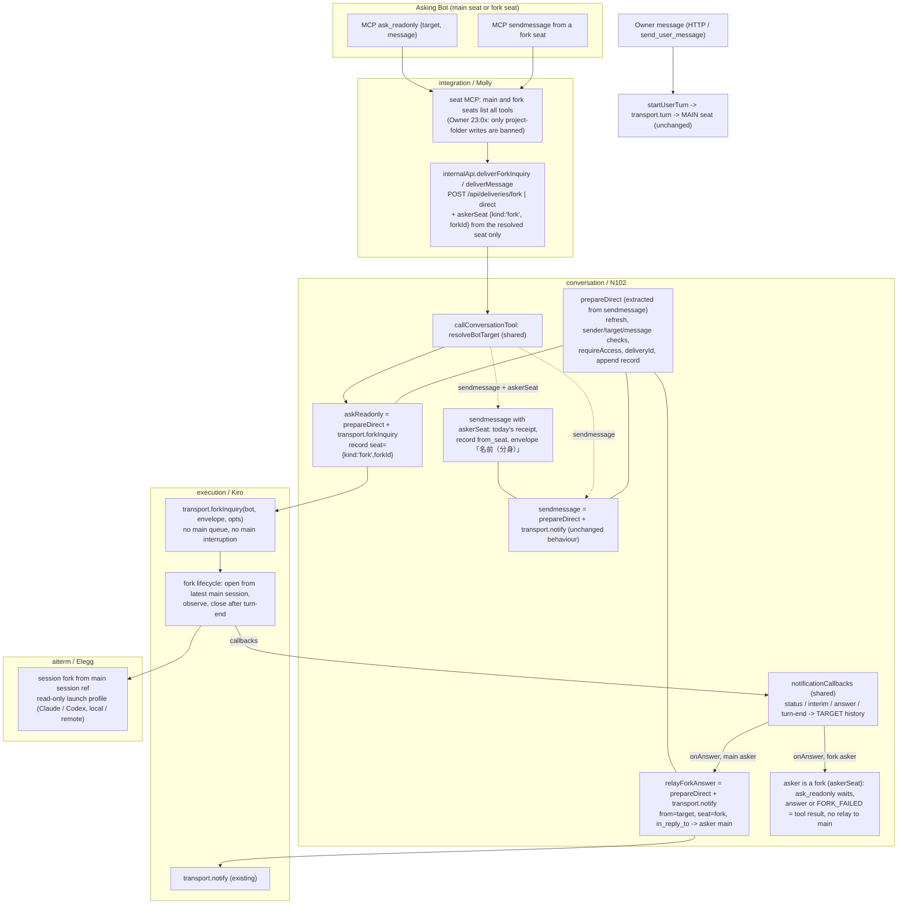
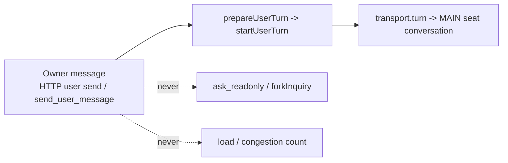

# Read-only fork inquiry (`ask_readonly`)

Owner of this page: N102 (conversation). [Module contract](README.md) / [overall data flow](../../data-flow.md#proposed-read-only-fork-inquiry) / [function map](../../feature-map.md).

Status: design adopted on main fd61b8e5 (#949). The conversation part is implemented against the contracts below. Execution (`transport.forkInquiry`), Aiterm fork/profile, fork-seat MCP listing, client labels, work-graph and Throughline parts belong to their owners and are not in this module's code. Binding source: the Owner-agreed spec `/srv/bellteam/bots/bot-7b140b27/docs/fork-ask-design-20261110.md` (items 1–10) and Root's request of 2026-11-10 JST. Spec item 9 (receipt now, answer later as a message) supersedes the "answer as the tool result" wording in item 6. Nothing here replaces an agreed mechanism. Gaps the spec left open were ruled by Root on 2026-11-10 JST after the line-by-line review; see [Root rulings](#root-rulings-2026-11-10-jst).

Base read for this design: `main` 814ac22f — `src/messenger.mjs` (`sendmessage`, `notificationCallbacks`, `startUserTurn`), `src/mcp-conversation-tools.mjs`, `src/mcp-tools.mjs` (`runBellTeamTool`), `src/seat-mcp.mjs` (`internalApi`), `src/http-delivery-api.mjs`, `src/work-graph/projection.mjs`.

## Function map



One code path, three uses: `prepareDirect` is the body of today's `sendmessage` from `bots.refresh` up to `append(record)`, moved out as-is. `sendmessage` keeps its exact behaviour, errors and return. `askReadonly` and `relayForkAnswer` call the same function. The dispatch differs: `transport.notify` for main or `transport.forkInquiry` for a fork. No copy of resolution, validation, access, record or callback code (spec item 7).

## Data flow

```mermaid
sequenceDiagram
  participant A as Asker main seat
  participant M as seat MCP (Molly)
  participant C as conversation (N102)
  participant X as execution (Kiro)
  participant N as Aiterm (Elegg)
  participant F as Fork seat (read-only)
  participant H as Target direct JSONL / history
  A->>M: ask_readonly {target, message}
  M->>C: POST /api/deliveries/fork {from, target, message, executionSource}
  C->>H: append inquiry record (delivery running, seat fork, fork_id)
  C->>X: forkInquiry(targetBot, envelope, {forkId, deliveryId, callbacks})
  X-->>C: accepted {delivery:'running'}
  C-->>M: receipt {delivery:'running', delivery_id, fork_id, from, target, seat:'fork'}
  M-->>A: tool result = receipt (immediately)
  X->>N: fork(main session ref, read-only profile)
  N->>F: launch forked session, first input = envelope
  F-->>X: interim / answer / turn-end
  X-->>C: onStatus / onInterim / onAnswer / onTurnEnd
  C->>H: interim words + answer under same delivery_id, seat fork
  C->>H: relay record target -> asker (seat fork, in_reply_to)
  C->>X: notify(askerBot, fork-answer envelope)
  X->>A: answer arrives as a message
  Note over C,A: on failed/stopped after receipt: one FORK_FAILED message to A on the same relay path
  Note over M,A: asker is a fork seat (askerSeat): the tool call stays open and its result is the answer or FORK_FAILED; no relay record or notify to A's main
  X->>N: close fork seat
```

| Edge | Data | Owner / state |
| --- | --- | --- |
| Asker → seat MCP | `{target, message}` | Molly: authenticates the seat; main and fork seats list every tool |
| seat MCP → conversation | `{from, target, message, executionSource, askerSeat?}` over the existing internal HTTP, `/api/deliveries/fork` and `/api/deliveries/direct` | Molly: `askerSeat:{kind:'fork', forkId}` only from the resolved fork seat (execution registry or fork credential), never from tool arguments; absent for main seats. N102 handler in `http-delivery-api.mjs` |
| conversation → direct JSONL | `bellteam.direct-message.v1` with optional `seat:{kind:'fork',fork_id}`; later interim/answer rows under the same `delivery_id`; relay row with `in_reply_to` | N102, `ConversationWriter` (sole writer, unchanged) |
| conversation → execution | `forkInquiry(bot, envelope, {forkId, deliveryId, executionSource, onStatus, onInterim, onAnswer, onTurnEnd})` | Kiro: fork lifecycle, never the main dispatch queue |
| execution → Aiterm | main session ref + read-only launch profile | Elegg: native fork and enforcement |
| conversation → asker | relay via existing `transport.notify(askerBot, …)` into the asker's own seat | Kiro, existing path |
| target history → main seat | records and summaries the main reads on demand (`list_messages`, Throughline summaries); no notify, no injected full text | N102 records, Rivalin (Throughline) session labelling |

## New MCP tool contract (N102)

Separate tool. `sendmessage` gets no flag and no change of meaning (spec items 6, 9).

| Field | Contract |
| --- | --- |
| name | `ask_readonly` |
| description (ja, shown to AIs) | 「宛先Botへ読み取り専用の質問を送る。宛先の本体は中断されず、作業の待ち行列にも入らない。本体の最新状態から作った分身が、本体の作業を待たずにすぐ答える。分身の制限：プロジェクトフォルダ内の一切の書き込みを禁止。ファイルの書き込みのほか、プロジェクトフォルダ内にSQLなどがあればそれも更新も含めて禁止。それ以外は全て許可する。作業が必要ならsendmessageを使う。受付をすぐ返し、回答はメッセージで届く。分身の席から呼んだ時は、回答を待って道具の結果で返す。runningは受付済みなので再送しない。」 |
| inputSchema | `{target: string(minLength 1) — Bot name or Bot ID, message: string(minLength 1)}`, both required. No `image` (not in the spec; Root ruling 3) |
| annotations | `readOnlyHint: false` for the tool itself (it creates a fork and a record); the fork's own tool set is the read-only one |
| result | Same shape as `sendmessage`, plus the label: `{delivery:'running', delivery_id, fork_id, from, target, seat:'fork'}`. Returned once the fork is accepted, not after the answer. Asker is a fork seat (`askerSeat`, Root ruling (a)): the call waits within the asking fork's lifetime and returns `{delivery:'answered', answer, delivery_id, fork_id, from, target, seat:'fork'}`; `answer` is the peer fork's answer or `FORK_FAILED: <reason>`. No relay to the asker's main, no new wait limit (spec item 9) |
| errors | The existing `sendmessage` codes from `prepareDirect`: `SENDER_NOT_FOUND`, `BOT_NOT_FOUND`, `MESSAGE_REQUIRED`, access and admission errors. New: `FORK_TARGET_USER` (target=user, the Owner is not forked; use sendmessage), `FORK_UNAVAILABLE{reason:'readonly_unenforceable'}` from execution when a read-only fork cannot be launched with enforcement (see guard below). No fallback into the main queue |
| answer message | Delivered to the asker as a direct message from the target Bot with `seat:{kind:'fork',fork_id}` and `in_reply_to: delivery_id`. Envelope: 「「<名前>（分身）」からあなたへ次のメッセージが届いています。」 + answer text |
| failure after receipt | ONE message to the asker on the same relay path: 「「<名前>（分身）」からあなたへ次のメッセージが届いています。」 + `FORK_FAILED: <reason>` (status failed/stopped and the reason execution passed). The delivery row keeps its own failed/stopped status. Root ruling 2: one result, failure included |
| concurrency | No limit in conversation or the tool; each call gets its own `fork_id` (spec item 10). Account limits surface as execution failures |

Guard check (common rule guards.*): `FORK_UNAVAILABLE` protects against a fork that could write (named protection: overwriting existing state / requests to other Bots). Self-exit: the asker is told to use `sendmessage`, and the same call succeeds once the harness launch profile is enforceable. It never queues the work itself (spec item 4). It is the only fork guard: incomplete remote display is not a protection and does not refuse a fork (Root change, guards.named-protection).

## Owner messages (spec item 8, Owner 2026-11-10 21:2x JST)



- The Owner path (`enqueueUserTurn`/`startUserTurn`/`transport.turn`) is not touched. `ask_readonly` rejects `target:'user'`. Its caller is always an authenticated Bot seat, so the Owner cannot reach a fork through it.
- No load or congestion counter is introduced. The only existing per-Bot request count is 相関図 edges from `queue.read`; `src/work-graph/projection.mjs:17` already drops rows whose `from` is not a known Bot, so `from:'user'` rows never become edges. This stays a contract: any future congestion view counts Bot-to-Bot rows only and never Owner rows.
- Fork rows are labelled (`seat:'fork'`) so they are not counted as main-seat load either.

## Messages sent by a fork seat (Root ruling 2026-11-10 JST)

A fork may message peers (Owner 23:0x). It is disposable and cannot receive a later message.

| Call from a fork seat | Behaviour |
| --- | --- |
| `ask_readonly` | (a) waits for the peer fork's answer and returns it (or `FORK_FAILED`) as the tool result; nothing is relayed to the asker's main seat |
| `sendmessage` | (b) today's receipt. A later reply goes to the asker's main seat as an ordinary message. The record carries `from_seat:{kind:'fork', fork_id}` and the envelope reads 「<名前>（分身）」, so the peer and main know a fork asked. History items pass `from_seat` through |

`askerSeat` is accepted only on the internal delivery body that Molly's seat MCP builds from the resolved seat. It is never a tool argument (the tool schemas reject extra keys).

Known limit: conversation adds no wait limit, but a Codex seat's existing BellTeam MCP `tool_timeout_sec = 120` (`src/harness-config.mjs`) ends the asking fork's wait after 120 s. A later answer is still saved in the target's history and is not relayed to main. Claude seats keep the CLI's own MCP tool timeout.

## Read-only enforcement (spec item 3; launch, not instructions)

**HOLD (Root, 2026-11-10 JST):** the enforcement method below and `FORK_UNAVAILABLE{readonly_unenforceable}` are on hold for Elegg's method. The fork tool listing is no longer held: the fork lists every tool (Root ruling, below). The restriction is the Owner's sentence, verbatim (「厳密にこれに従え」): 「プロジェクトフォルダ内の一切の書き込みを禁止。ファイルの書き込みのほか、プロジェクトフォルダ内にSQLなどがあればそれも更新も含めて禁止。それ以外は全て許可する。」 Binding spec reading (Owner 23:0x/23:1x JST): only writes inside the Bot's project folder are banned (files, git, databases stored there such as SQLite, by any route: native tools, commands, MCP tools whose server writes there). Everything else is allowed: all tools, MCP servers, commands, web and messages to peers, and writes outside the project folder. Enforcement is by the OS/harness below the tools, not by instruction. Elegg measures the method, Molly lists the BellTeam MCP tools that write into the project folder, and Root brings the method to the Owner. Do not implement against the table below until that ruling replaces it. Receipt, fork lifecycle, answer relay and labels continue.

The fork is launched with a profile in which the forbidden effects do not exist as tools. The envelope text is not part of enforcement.

| Layer | Owner | Required capability |
| --- | --- | --- |
| Native tools | Elegg (Aiterm launch) | Claude: read tools only (Read, Grep, Glob, WebSearch, WebFetch); no Bash, Edit/Write/NotebookEdit, Agent/Task, Skill. Codex: read-only sandbox, approval never, no shell/exec tool; its read-only web search is allowed. Web reads change nothing and are allowed (Root ruling 5, Owner 「変えない行動は全部許す」); Bash stays out because it cannot be enforced read-only. Local and remote use the same profile. Only the BellTeam seat MCP in fork mode is configured; other MCP servers (Approval Box, Aiterm, call-bridge, …) are absent |
| BellTeam MCP | Molly (common listing/dispatch, #963) | Canonical: [remote-seat-ingress SK04/SK07/SK08](../integration/remote-seat-ingress.md#seat-kind-fork-seats-sk01-sk08). `tools/list` = every tool (no `readOnlyHint` listing). `tools/call` refuses the project-folder writers (any Bot's folder) with `FORK_PROJECT_WRITE_REFUSED: <name>`; read tools that touch the project folder read a temporary copy. `sendmessage`, `ask_readonly` and call-bridge are allowed. Internal HTTP resolves a fork as its Bot on every method, and `POST /api/deliveries/direct|fork` carries `askerSeat` from the resolved seat only (SK08). Conversation's `readOnlyHint` marks stay as plain MCP hints |
| The one allowed effect | N102 | The fork does not send the reply itself. Its final answer reaches conversation through the existing `onAnswer` callback, and conversation relays it to the asker. The fork therefore needs no write tool at all |
| CLI transcript | Elegg / Rivalin | The forked session file written by the CLI itself is the record of the fork conversation, labelled fork (below). It is not a user-visible effect |

If a harness cannot launch with this profile (for example Codex without a way to remove process start), execution returns `FORK_UNAVAILABLE{reason:'readonly_unenforceable'}` for that harness. N102 does not narrow the spec or replace it with instructions. The decision goes back to Root/Owner.

## Fork lifecycle (execution public contract, Kiro)

| Step | Contract |
| --- | --- |
| open | `transport.forkInquiry(bot, envelope, opts)`: resolve the target's **main** session ref at call time (latest persisted state, including the running turn as far as the CLI has written it), ask Aiterm for a read-only fork, send `envelope` as its first input. Must not enter, reorder or wait on the main dispatch queue; must not steer or interrupt the main seat |
| accept | Resolve with `{delivery:'running', forkId}` once the fork accepted its input; reject with `FORK_UNAVAILABLE{reason}` or existing launch errors |
| observe | Same callback set as `notify` (`onStatus/onInterim/onAnswer/onTurnEnd`). Conversation reuses `notificationCallbacks` for status/interim/answer. A fork's `onTurnEnd` does not go to TurnReports: its report request would be sent to the main seat and interrupt it (spec item 2); conversation uses turn-end only to relay `FORK_FAILED: NO_ANSWER` when no answer came |
| close | After turn-end (or failure) close the fork seat. No resume, no follow-up turn, no requeue |
| read | Optional `seat:{kind:'fork',forkId}` on `queueItems()` rows for running forks, so `queue.read` (Molly) and 相関図 (Black) can label them. Rows without `seat` are main |
| remote | Launches like a local fork. Until Elegg 0.70.5 relay fix + Kiro #946 are live, its in-turn words are missing exactly like a remote main seat's today; the final answer (or `FORK_FAILED`) still arrives. No refusal for this (Root change) |

## Records and display (spec items 5/6)

- Inquiry, interim words, answer and relay are rows in the target's existing direct JSONL. Interim words and the answer already go to the target's timeline in today's `notificationCallbacks` (`appendInterimWords(botId=target)`). New optional fields only: `seat:{kind:'fork',fork_id}` on the inquiry, the relay and the fork's interim/answer rows, and `in_reply_to` on the relay row. History items (`messageItem`/`interimItem`/`peerItem` in `conversation-store.mjs`) pass `seat` through unchanged; `in_reply_to` stays in the saved record only. Rows without `seat` are main. Clients that do not know the field ignore it (unknown keys are ignored by Apple Codable, Web and Windows, as established for `messageAuthor`).
- Web (Admi) and Apple (Rapi) show the label 「分身」 on rows with `seat.kind='fork'` in the target's chat, and the fork in 相関図 from the `seat` field. Work-graph projection is Black's (part owner confirmed, Root ruling 4).
- The main seat is not notified and gets no full fork text in its turn. It reads records (`list_messages`) and summaries. Throughline (Rivalin, part owner confirmed by Root ruling 4) must label forked CLI sessions as fork and must not inject one as the main seat's "previous session" short-term memory; it may contribute summaries. Summary policy for short-term memory is Biscuit's.

## Refactor plan for reuse (spec item 7)

| Code | Change |
| --- | --- |
| `messenger.mjs` | Extract `prepareDirect(input, opts, label) -> {check, bot, deliveryId, from, target, message, images, label} or {userTurn}` and `notifyDirect(prepared, opts)` from `sendmessage` unchanged; `label` is a third parameter and never read from the input body. `sendmessage` = `prepareDirect` + `notifyDirect`. Add `askReadonly` (= `prepareDirect` with `seat` + `transport.forkInquiry` + `notificationCallbacks` with `onAnswer` calling relay, and a failed/stopped `onStatus` or rejected launch after receipt calling relay once with `FORK_FAILED`) and `relayForkAnswer` (= `prepareDirect` from target to asker + `notifyDirect`). The relay waits until the receipt settles and is never awaited inside execution callbacks; a rejected launch resolves it as not accepted, so only the tool error is returned. `directEnvelope` gains the fork name suffix. `askReadonly` with `askerSeat` returns the answer instead of relaying it; `sendmessage` with `askerSeat` adds the `from_seat` label (Root ruling (a)/(b)) |
| `mcp-conversation-tools.mjs` | Add the tool entry. Its handler reuses `resolveBotTarget` and the injected-delivery pattern (`deliverForkInquiry ?? messenger.askReadonly`) |
| `http-delivery-api.mjs` | `POST /api/deliveries/fork` beside `/direct`, same body and auth |
| `seat-mcp.mjs` `internalApi` (Molly) | `deliverForkInquiry` beside `deliverMessage` |
| `module.json` | `provides` gains `fork-inquiry`. `uses` gains execution `fork` in the same diff as Kiro's port, because the generated map accepts only existing ports |

## Spec traceability

| Spec (source item / Root point) | Where it is met |
| --- | --- |
| Separate tool, name/description say read-only, uninterrupting, fast (6 / 1) | Tool contract: `ask_readonly`, description |
| Fork of the main seat's latest state; main not interrupted, no main queue (2 / 2) | Lifecycle `open`; Owner diagram unchanged main path |
| Only no-change actions; only effect = reply; launch-enforced (3 / 3) | Read-only enforcement table; relay via `onAnswer` |
| Work needed → answer "use sendmessage"; no self-queueing (4 / 4) | Tool description; no write tool in fork; `FORK_UNAVAILABLE` never falls back |
| Receipt now, answer as a message (9 / 5) | Result = receipt; relay to asker via `transport.notify` |
| Whole fork conversation in target chat/history, labelled; main reads summaries (5 / 6) | Records and display |
| No concurrency limit (10 / 7) | Tool contract `concurrency` |
| Owner messages always main, never forked, never load (8 / 8) | Owner messages section and diagram |
| Reuse sendmessage code by refactor (7 / 9) | Refactor plan: `prepareDirect`, shared callbacks, shared resolution |
| Remote in-turn words need Elegg 0.70.5 + Kiro #946 (open point) | Lifecycle `remote`: launches now, words appear once those are live |

## Root rulings (2026-11-10 JST)

Root checked the design line by line against spec items 1–10 and accepted it with one change and five rulings. They are applied above.

- Change: no `FORK_UNAVAILABLE{remote_words_pending}`. Remote forks launch like local ones. `readonly_unenforceable` stays.
- 1. Reply = relay through conversation; the fork has no write tool.
- 2. Failure = relay ONE `FORK_FAILED` message with the reason to the asker.
- 3. No image input.
- 4. Black (work-graph projection) and Rivalin (Throughline fork-session labelling) are part owners.
- 5. Read-only web search/fetch is allowed in the fork; Bash stays out.

- Fork-sent messages (2026-11-10 JST, after the Owner's write-ban contract): adopt (a) `ask_readonly` from a fork waits and returns the answer as its tool result, and (b) `sendmessage` from a fork keeps its receipt, replies go to main, labelled 「<名前>（分身）」. `askerSeat` comes from the seat registry/credential only; the fork lists all tools.

Part owners receive their contract after this design is on `main`. Elegg starts after his current three jobs (CI off the Owner's Mac, `_meta` relay fix, 0.70.5).
