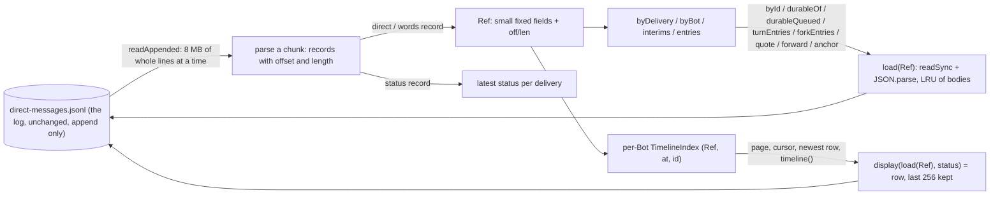

# The direct-message store holds an index, the file is the log (mem-conversation-store)

Connects to [log-append](log-append.md) (who writes the log), [durable-receipt](durable-receipt.md) (what is dispatched from it) and [flow](flow.md). Owner: conversation / history (N102).

## Why

Production 2026-11-26 10:47 JST (heap snapshot of the conversation module, Z202): JS heap 405 MB, 316 MB of it strings, all of it the parsed `logs/direct-messages.jsonl` (309 MB). `ConversationStore.snapshot()` kept every record, and `entries()` kept a second list of them with the status applied. Message bodies were 214 MB (7,838 copies of one auto-run notice, 1,196 of a BugHub notice, the Bot role text re-sent per message); 2.5 M short strings (timestamps, Bot ids, schema names) were 102 MB. The parent body holds the same store (`DurableMessageReceipts` creates one for `onLogCorruption` / `machineRow`, and its `timelineView` serves the Owner reads), so the body carries a second copy of the same size. The log only grows.

## What stays in memory, what is read from the file

| Kept (per record, one `Ref`) | Read from the file when asked |
| --- | --- |
| `schema`, `id` (delivery id, or the words id), `at`, `from`, `target`, `bot`, `stream`, `durable`, first `delivery`, `interest` (fork inquiry or relay), byte `off` and `len`. Repeated strings (ids, schema, state) are one string each. | the body of a record: `message`, `text`, identities, image / file assets, tracking, `origin`, ... |
| the latest status per delivery: `delivery`, `delivery_error`, `delivery_tracking`, `steered` (a status record is not kept as a row) | |
| the maps `byDelivery` (id → Refs), `byBot` (Bot → Refs), `interims` (Bot + words id → Ref) | |
| per Bot a `TimelineIndex` of Refs: key, `at`, `id` only | the row drawn from a Ref (`display`): the page, a cursor row, the newest row. The last 256 rows drawn per Bot stay; a status change drops the row's drawn copy (`touch`) |
| | a body is read with `readSync` on one descriptor per file generation; the last 2048 parsed bodies are kept (LRU) |

A body that no longer matches its Ref (`delivery_id` / `id` or `at` differ, short read) is `MESSAGE_LOG_INVALID` for that request. The next `snapshot()` sees the replaced or shortened file (inode, size, mtime/ctime as before) and rebuilds the index from the new file. The old descriptor is closed a minute after its state is dropped, so a request that still holds the old state can finish.

## Reads and who uses them

| Method | Returns | Used by |
| --- | --- | --- |
| `timelineView(botId)` / `timelineViews(ids)` | a lazy `TimelineIndex`: `length`, `at(i)`, `indexOfId`, `get(key)` read the row from the file on demand | history page (`conversationHistoryPage`), recent, the parent's Owner reads |
| `timeline(botId)` | every row of the Bot in log order, drawn for this call and not kept | the MCP list tool, the user-rules update (a whole-history call; its cost is the Bot's history, not resident memory) |
| `byId(deliveryId)` | the direct rows of one delivery id with status | fork refusal settle, resume / close of a delivery, `runSaved` |
| `durableOf(deliveryId)`, `durableQueued()` | the durable rows of one id; every durable row still `queued` (status read from the map, only those bodies loaded). Both refuse with `MESSAGE_LOG_INVALID` while a bad line was found, as `durableReceipts()` did, and never read the unterminated preview | `runSaved`, `pending` |
| `turnEntries(botId, from, to)` | the Bot's rows whose `at` is in the range (index scan, bodies of the matches only) | turn reports |
| `forkEntries()` | rows flagged `interest` | the first fork sweep of a process |
| `records()`, `entries()`, `durableReceipts()` | the whole log with bodies, for this call only | tests and tools; no per-message production path calls them |

No public input, output, message id, status or ordering changes. The one visible change is cost: a page returns rows by reading them, so an `after` cursor that spans thousands of rows reads that many records (about 30 microseconds each, from the page cache) instead of copying cached items.

## Chunked first read

`readAppended` read `size - offset` bytes into one buffer (309 MB at the first read). It now reads 8 MB at a time, cuts at the last LF, applies the whole lines, and goes on; a line longer than the chunk makes the chunk double. The unterminated tail is the preview as before (display only, never execution authority); `changed` is raised once for the whole read.

## Measured (store-bench, synthetic 631 MB log of 331 k records)

| | main | this change |
| --- | --- | --- |
| heapUsed after the first full snapshot and gc | 520 MB | 100 MB |
| rss | 679 MB | 278 MB |
| first snapshot | 1.46 s | 1.32 s |
| 100 newest rows of a Bot | 0.1 ms | 1.0 ms |
| `pending()` | 48 ms | 11 ms |

The production log is half that size, so the module's 405 MB heap should fall to about 50 MB; the same file change applies to the parent body's store.

## Self-exit of the guard

The only refusals are the ones that already existed (`MESSAGE_LOG_INVALID` from a bad line, and now from a body that moved). Each leaves by itself on the next `snapshot()`: a replaced / shortened file resets the index; an unchanged file with a bad line keeps refusing durable dispatch, as before.
