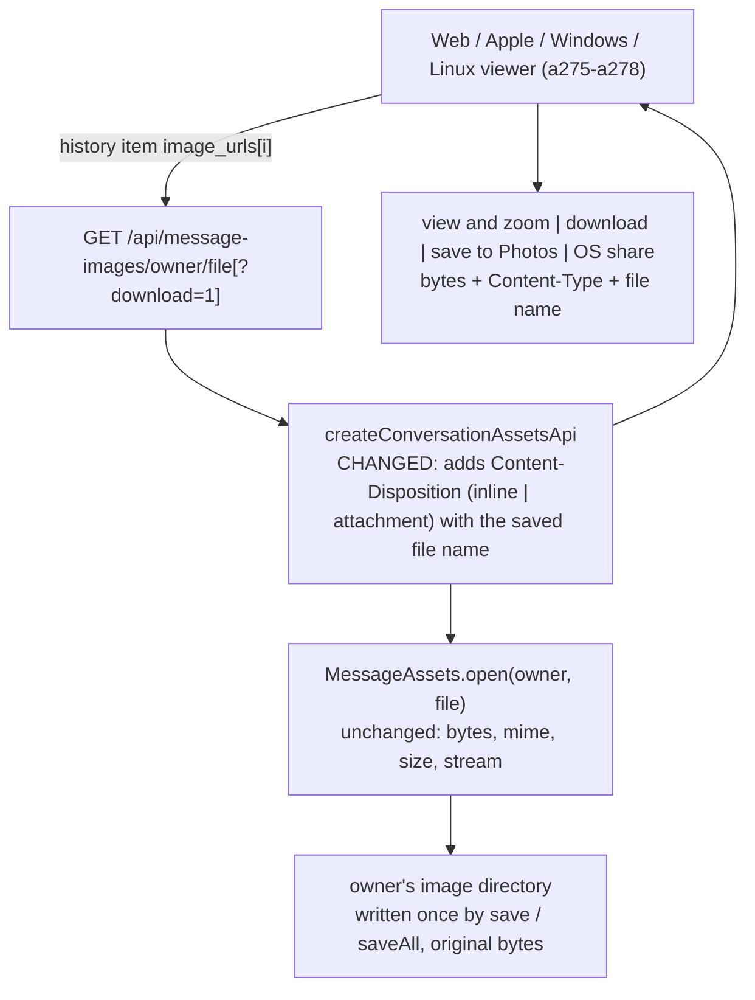
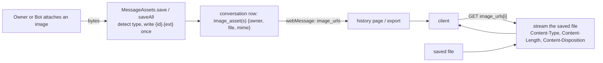

# Conversation images at original size (viewer, download, save, share)

Owner of this page: N102 (conversation). [Module contract](README.md) / [function map](../../feature-map.md) / [delivery (saved images)](delivery.md).

Status: contract and diagrams for chart task `a274-n102-image-original`. Owner 2026-11-16 22:0x JST (「いいよ」): images in conversations, posted by Bots or by the Owner, open full screen, zoom freely, and can be downloaded, saved (iPhone Photos) and shared through the OS share sheet. Clients (`a275`–`a278`) build the viewer from this page. Base read: `main` f8467a44 — `src/message-assets.mjs` (`save`, `saveAll`, `open`), `src/http-messages.mjs` (`webMessage`), `src/http-conversation-api.mjs` (`createConversationAssetsApi`).

## Answer

Nothing new is stored or computed. The conversation has never made thumbnails: `MessageAssets.save` writes the sender's bytes unchanged (type detected from the bytes, extension from the type) and the one URL a history item carries serves exactly those bytes. A client that wants the original opens that URL. What a viewer, a download and a share sheet still lacked is a **file name**; this change adds it as a response header only.

## Contract

### What a history item gives (unchanged)

For an item with `image: true` (direct conversation or room, sent by the Owner or a Bot):

| Item field | Meaning |
| --- | --- |
| `image_urls[i]` | path of the i-th image, `/api/message-images/{owner}/{file}`; the original bytes |
| `image_url` | the same as `image_urls[0]` (old clients) |
| `image_count` | number of images when the sender attached more than one |

`{file}` is `{id}.{ext}` with `ext` one of `png`, `jpg`, `webp`, `gif`. It is unique and never changes for that image.

### The image request

`GET /api/message-images/{owner}/{file}` (Owner session, as today).

| Aspect | Rule |
| --- | --- |
| Body | the original bytes, never resized, re-encoded or stripped |
| `Content-Type` | the detected type: `image/png`, `image/jpeg`, `image/webp` or `image/gif`. This is the type to use for save and share |
| `Content-Length` | exact size in bytes |
| `Content-Disposition` | **new, additive.** `inline; filename="{file}"` by default; `attachment; filename="{file}"` when the query has `download=1`. `{file}` is the saved name, ASCII only, so it needs no encoding |
| `Cache-Control` | `private, max-age=31536000, immutable` (unchanged); a viewer may keep the bytes |
| Errors | unknown owner/file → 404 `IMAGE_ASSET_NOT_FOUND`, as today |

Clients use, for save and share: the bytes from this URL, the type from `Content-Type`, and the name from `Content-Disposition` or equivalently the last path segment of the URL. A client may rename the file for the share sheet (for example by date) but must keep the extension that matches `Content-Type`.

### Out of scope here

Image dimensions are not in history; a viewer reads them from the decoded image. Zoom, gestures, full-screen chrome, the Photos permission prompt and the share sheet are client work (`a275`–`a278`). Files that are not images (documents, audio) are not stored by the conversation today; the general file case belongs to the forward and share-in contract (`a279`).

### Compatibility

Additive. The URL, the item fields, the body and the existing headers are unchanged; clients that ignore `Content-Disposition` behave as before. `?download=1` on an old server is ignored and returns the inline response, so a client must not depend on the browser saving instead of showing; native clients write the bytes themselves.

## Function map

## Data flow

The saved file is the single copy; the response is a read-only stream of it. No state is added.

## Failure handling

| Situation | Result |
| --- | --- |
| client disconnects mid-stream | the source FileHandle is closed by the existing pipeline (unchanged) |
| file or owner unknown | 404 `IMAGE_ASSET_NOT_FOUND` (unchanged) |
| `download` has any value other than `1` | treated as absent (inline) |

No guard is added.

## Implementation and check

Source: `createConversationAssetsApi` (one header). Check: `test/http-conversation-assets.test.mjs` asserts the header for the inline and the `download=1` request. Release order: any order; the header is ignored by clients that do not read it and a client that needs the name can take it from the URL.
