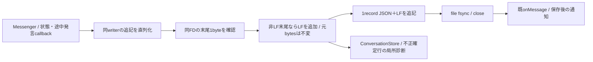

# 直接会話ログの追記境界

[会話の保存責任](README.md#保存と実行結果の変換)と[全体図](../../feature-map.md)に接続する。Owner指定のクラッシュ恒久修理はモリーが親/writerを持ち、読取固有部品はN102が持つ。

公開I/Oは既`append(record) -> Promise<void>`のまま。保存前のJSON化失敗・末尾読取失敗・write/fsync/close失敗はrejectし、onMessageへ到達しない。通知の同期throwは既保存を取り消さずrejectする。どの失敗も次の追記queueを永久拒否にしない。同writer以外の第二writerは生成せず、module交換の既writer lockを維持する。

既JSONLは切詰め・上書き・NUL除去しない。完全JSONだがLF無しの末尾はLFで確定し、途中JSON/NULの末尾もそのまま独立行にする。前後の有効記録を維持し、不正記録を有効なJSONへ推測変換しない。確定不正行の扱いと本文を含まない診断は読取側の契約で定める。HTTP/MCPの入力schema・既message ID・配送結論・通知の宛先は変えない。fsyncは保存済みと通知する前の永続化を要求し、停電時のストレージ機器の保証までは代替しない。

通常親のcreateConversationServicesはonLogCorruptionを同Diagnostics.recordへ接続する。固定MESSAGE_LOG_INVALID/codeと物理line/offset/length/reasonだけを保存し、本文/自由例外は渡さない。診断の拒否はStoreが同固定DTOのstderrへ退避し、有効履歴の取得を止めない。子processでも既定stderr診断は保持する。
