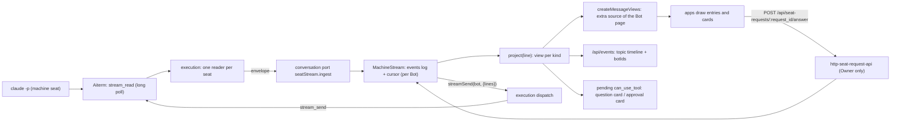
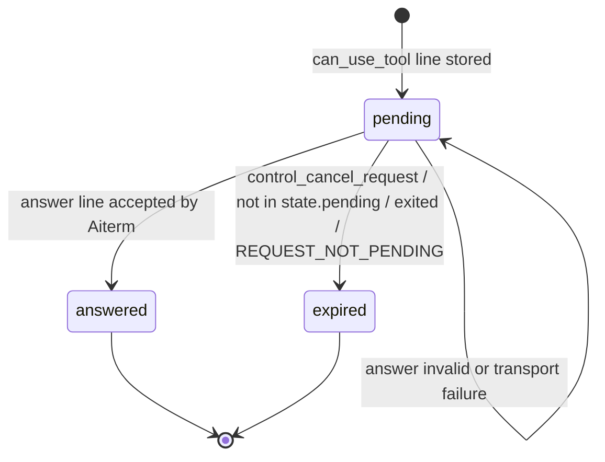

# machine-stream — a machine seat's stream-json as the chat log (a471-stream-contract, a471-askuser-n102)

Owner: N102 (conversation). Agreed with Elegg (Aiterm, `stream_read` / `stream_send`, aiterm-mcp `docs/architecture/claude-machine-stream.md`) and Kiro (execution relay, his earlier per-delivery `machine-question` design is replaced by this seat-level contract). [Module contract](README.md) / [overall map](../../feature-map.md).

Owner ruling 13 (2026-11-20 20:0x JST): the machine seat's stream-json output is passed through unchanged; the log display module (conversation) interprets every kind. Nobody guesses from a screen. A fork seat has no Owner: no reader, no events, no card (Aiterm denies a fork's question at once).

## Parts

| Part | Does | Does not |
| --- | --- | --- |
| Aiterm (Elegg) | Per launch: `stream_read` gives claude's stdout lines byte for byte; `stream_send` writes allowed input lines unchanged | interpret, reformat, name a question shape |
| execution (Kiro) | One reader per machine seat (long poll) from launch until the seat closes; hands envelopes to conversation; forwards `streamSend` lines unchanged | interpret, store events, build answers |
| conversation (N102) | Keeps the cursor, stores every line, projects every kind into a chat-log entry, streams the change, builds the Owner's answer lines | read Aiterm or the seat itself |
| apps (Web, Apple, Windows, Linux) | Draw the entries and the card, post the answer | parse the raw line |

## Function diagram



| Function | Input / output | Responsibility |
| --- | --- | --- |
| `seatStream.cursor(botId)` | to `null` or `{session, launch_id, cursor}` | Where conversation has stored up to. Execution reads on from it after a body or module restart |
| `seatStream.ingest(envelope)` | to `{status:"stored", cursor}` or `{status:"resync", cursor}` | Store the lines, advance the cursor, project, notify. Rules below |
| `MachineStream.project(line)` | raw line to entry view | The one place that knows event kinds. Unknown kinds become the `unknown` view |
| `MachineStream.answer(requestId, body)` | Owner route to `streamSend` | Validate against the stored request, build the `control_response` line, send, mark answered after Aiterm accepted |
| `streamSend(bot, {lines})` | execution dispatch (screenApproval IPC form) | Owner-only caller. Execution forwards to `stream_send` and returns Aiterm's result or error as is. An old module answers `EXECUTION_REQUEST_INVALID` (503) |

## Envelope (execution to conversation)

```json
{ "botId": "bot-xxxxxxxx",
  "session": "<Aiterm session_id>",
  "launch_id": "<Aiterm launch_id>",
  "cursor_from": null,
  "cursor_after": "<launch_id>:<offset>",
  "lines": ["{\"type\":\"system\",...}", "..."],
  "state": { "state": "idle|busy|blocked|starting|exited", "reason": null,
             "pending": [ { "request_id": "...", "subtype": "can_use_tool", "tool_name": "AskUserQuestion" } ] } }
```

- `lines` are `stream_read`'s lines exactly as received (JSON text, not parsed objects). `cursor_from` is the cursor execution passed to `stream_read` (`null` = start of the launch); `cursor_after` is what it returned. Both are opaque: conversation only compares them for equality.
- Gap and restart rules of `ingest`:
  - stored cursor = `cursor_from` (or nothing is stored and `cursor_from` is `null`): store, return `stored`.
  - a different `launch_id` with `cursor_from: null`: a new launch (resume, wake, or `STREAM_CURSOR_STALE`); a new segment starts, return `stored`.
  - anything else (a replay, a gap, a stale cursor): store nothing, return `resync` with the stored cursor (`null` if none). Execution reads again from that cursor; if Aiterm says `STREAM_CURSOR_STALE` it reads from the start of the current launch with `cursor_from: null`.
- `state` only closes cards: a stored open request whose `request_id` is not in `state.pending` is closed (`expired`); `exited` closes every open request of that seat.

## Storage and cursor (atomic by structure)

`state/machine-stream/<botId>.jsonl`, one record per line, appended with one write per envelope:
`{ seq, at, session, launch_id, cursor_after, line }` — `seq` counts per Bot from 1; `line` is the raw line string unchanged; only the last record of an envelope has `cursor_after` (the others `null`). The stored cursor is the last record that has one. On load a trailing run of records without `cursor_after` (a torn write) is cut off, so the cursor and the events never disagree. Open requests are derived from the log, not stored twice.

## Input lines (conversation to Aiterm, through `streamSend`)

| Input | Line conversation builds | When |
| --- | --- | --- |
| AskUserQuestion answer | `{"type":"control_response","response":{"subtype":"success","request_id":"<id>","response":{"behavior":"allow","updatedInput":{"questions":<the request's input.questions unchanged>,"answers":{"<question text>":"<label>"}}}}}` | Owner answers the card. `multiSelect`: labels joined with `", "`. Other: the free text as the value |
| Tool approval answer | `... "response":{"behavior":"allow","updatedInput":<the request's input>}` or `{"behavior":"deny","message":"..."}` | Owner presses the button of an approval card |
| user message, steer, interrupt, config | stay on the existing tools (`pty_send`, `agent_stop`, `agent_configure`) | unchanged |

If Aiterm answers `STREAM_REQUEST_NOT_PENDING`, the card becomes `expired` (the seat no longer waits).

## Entry in the chat log

History row (what apps read in `items` of the Bot page and the full timeline):

```json
{ "id": "me-<seq>", "kind": "machine_event", "direction": "incoming", "at": "...",
  "message": "<one line for a plain-text app>", "sender": {"id": "bot-…", "name": "…"},
  "machine_event": { "seq": 42, "launch_id": "…", "type": "assistant", "subtype": null,
                     "view": "words|tool_use|tool_result|system|hook|result|rate_limit|approval|question|control|unknown",
                     "title": "short label", "text": "<=2000 chars", "truncated": false,
                     "tool": { "id": "…", "name": "Bash", "summary": "<=200 chars" },
                     "request": { "request_id": "…", "status": "pending|answered|expired",
                                  "questions": [ { "header": null, "question": "…", "multiSelect": false, "allowOther": true,
                                                   "options": [ { "index": 1, "label": "…", "description": null } ] } ],
                                  "answers": [ { "indexes": [1], "other": null } ] } } }
```

- Large content is cut in the row (`truncated: true`); the full raw line is `GET /api/bots/:id/machine-events/:seq` returning `{seq, line}` (the stored line as is).
- `view` by kind (apps draw by `view`, never by parsing `line`):

| Stream line | view | text / extra |
| --- | --- | --- |
| `assistant` text block | `words` | the text. The same words also arrive as interim/answer rows by the existing path: the row carries `shown_elsewhere: true` and apps hide it by default |
| `assistant` `thinking` block | `words` with `title: "thinking"` | collapsed |
| `assistant` `tool_use` block | `tool_use` | `tool` |
| `user` with `tool_result` | `tool_result` | text of the result, cut |
| `user` text (replayed input, hook-injected) | `words` with `title: "input"` | `shown_elsewhere: true` when BellTeam saved the same message |
| `system` `init`, `api_retry`, `compact_boundary`, `status`, other subtypes | `system` | subtype in `title`, fields of interest in `text` |
| `system` `hook_started` / `hook_response` | `hook` | hook name, outcome |
| `result` | `result` | subtype, turns, cost/usage line |
| `rate_limit_event` | `rate_limit` | reset time |
| `control_request` `can_use_tool` AskUserQuestion | `question` | `request` with questions; buttons for one choice, checks for `multiSelect`, free text for Other |
| `control_request` `can_use_tool` other tool | `approval` | `tool`, `request.status`; approve / deny while `pending` |
| `control_cancel_request`, `control_response` | `control` | closes the request |
| `stream_event` | `control` | not shown by default (partial messages are off) |
| anything else, or a line that is not JSON | `unknown` | `title`: type or `not-json`, `text`: the line cut. Never dropped |

- Cards: one entry per request; its `request.status` changes in place (the entry keeps its `id`/`seq` and `at`), so apps redraw from the page they re-read. The Bot page `items` use the existing paging (`before`/`after`); machine events are one more source merged by `at`.
- SSE: `/api/events` change event `{topics:["timeline"], botIds:[botId], roomIds:[]}` per stored envelope and per request status change, no body. A pending card also pushes through `notifications.question`.
- Machine events and cards belong to the Bot's direct log (`roomId` null), also when the turn started from a room.

## Answer route

`POST /api/seat-requests/:request_id/answer`, Owner only (Bot port 403), body at most 64 KiB.

```json
{ "answers": [ { "indexes": [2], "other": null } ] }
```

For an approval card the body is `{ "decision": "allow" | "deny" }`.

| Result | Meaning |
| --- | --- |
| 200 `{ "request": <request above> }` | Aiterm accepted the answer; `answered` |
| 400 `SEAT_REQUEST_ANSWER_INVALID` | does not match the request (count, index not in options, several indexes without `multiSelect`, `other` without `allowOther`, empty) |
| 404 `SEAT_REQUEST_NOT_FOUND` | no such request |
| 409 `SEAT_REQUEST_CLOSED` | already `answered` or `expired` |
| 409 `REQUEST_NOT_PENDING` | Aiterm no longer waits for it (`STREAM_REQUEST_NOT_PENDING`); the request becomes `expired`, the response carries it |
| 503 `SEAT_REQUEST_UNAVAILABLE` | old execution module (`EXECUTION_REQUEST_INVALID`) |
| other Aiterm errors | request stays `pending`; the Owner may try again |

## State and exit



The held request is Claude Code's own; BellTeam adds no timer and no refusal. `pending` always leaves by the Owner, by the seat (cancel, interrupt, turn end, exit) or by the answer attempt itself (`REQUEST_NOT_PENDING`).

## Data ownership

| Datum | Owner | Lifetime |
| --- | --- | --- |
| claude's stdout lines | Aiterm stream file, per launch | until the launch's files are removed by Aiterm |
| stored events, cursor, requests | conversation, `state/machine-stream/<botId>.jsonl` | kept like the chat log |
| last read position of the live reader | execution memory | until the seat closes; after a restart execution asks `seatStream.cursor` |

## Not changed

Direct and room message routes, the existing interim/answer/status rows, reply, `owner_question` and `secret_request` cards, every existing SSE topic and terminal seats stay as they are. A machine seat's turn end, answer text and steer receipts stay on the existing tools; the stream is additive for the chat log.

## Answers to Aiterm's open points

1. Long poll with `wait_ms` is enough; no push.
2. Yes: run with `--replay-user-messages`. Conversation stores them in order (steer and hook input appear with their `uuid`); BellTeam's own saved messages are not shown twice (`shown_elsewhere`).
3. `--include-partial-messages` stays off. Interim words come from the existing path; if the chat later needs token streaming, the `stream_event` view already exists.
4. No `ack_cursor` now: the file lives for the launch. Elegg may add it when a launch's file grows too large to keep; conversation would then ack after the batch is stored.
5. Yes: questions, multiSelect, Other and answers live in the line contents; Aiterm defines no shape.
