# machine-stream — a machine seat's stream-json as the chat log (a471-stream-contract, a471-askuser-n102)

Owner: N102 (conversation). Agreed with Elegg (Aiterm, `stream_read` / `stream_send`, aiterm-mcp `docs/architecture/claude-machine-stream.md`) and Kiro (execution relay, his earlier per-delivery `machine-question` design is replaced by this seat-level contract). [Module contract](README.md) / [overall map](../../feature-map.md).

Owner ruling 13 (2026-11-20 20:0x JST): the machine seat's stream-json output is passed through unchanged; the log display module (conversation) interprets every kind. Nobody guesses from a screen. A fork seat has no Owner: no reader, no events, no card (Aiterm denies a fork's question at once).

## Parts

| Part | Does | Does not |
| --- | --- | --- |
| Aiterm (Elegg) | Per launch: `stream_read` gives claude's stdout lines byte for byte; `stream_send` writes allowed input lines unchanged | interpret, reformat, name a question shape |
| execution (Kiro) | One reader per machine seat (long poll) from launch until the seat closes; hands envelopes to conversation; forwards `streamSend` lines unchanged | interpret, store events, build answers |
| conversation (N102) | Keeps the cursor, stores every line, projects every kind into a chat-log entry, streams the change, builds the Owner's answer lines | read Aiterm or the seat itself |
| apps (Web, Apple, Windows, Linux) | Draw the entries and the card, post the answer | parse the raw line |

## Function diagram

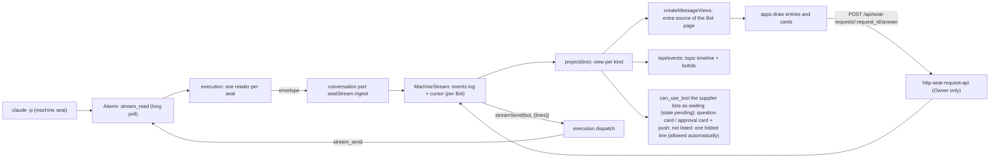

| Function | Input / output | Responsibility |
| --- | --- | --- |
| `seatStream.cursor(botId)` | to `null` or `{session, launch_id, cursor}` | Where conversation has stored up to. Execution reads on from it after a body or module restart |
| `seatStream.ingest(envelope)` | to `{status:"stored", cursor}` or `{status:"resync", cursor}` | Store the lines, advance the cursor, project, notify. Rules below |
| `MachineStream.project(line)` | raw line to entry view | The one place that knows event kinds. Unknown kinds become the `unknown` view |
| `MachineStream.answer(requestId, body)` | Owner route to `streamSend` | Validate against the stored request, build the `control_response` line, send, mark answered after Aiterm accepted |
| `streamSend(bot, {lines})` | execution dispatch (screenApproval IPC form) | Owner-only caller. Execution forwards to `stream_send` and returns Aiterm's result or error as is. An old module answers `EXECUTION_REQUEST_INVALID` (503) |

## Envelope (execution to conversation)

```json
{ "botId": "bot-xxxxxxxx",
  "session": "<Aiterm session_id>",
  "launch_id": "<Aiterm launch_id>",
  "cursor_from": null,
  "cursor_after": "<launch_id>:<offset>",
  "lines": ["{\"type\":\"system\",...}", "..."],
  "state": { "state": "idle|busy|blocked|starting|exited", "reason": null,
             "pending": [ { "request_id": "...", "subtype": "can_use_tool", "tool_name": "AskUserQuestion" } ] } }
```

- `lines` are `stream_read`'s lines exactly as received (JSON text, not parsed objects). `cursor_from` is the cursor execution passed to `stream_read` (`null` = start of the launch); `cursor_after` is what it returned. Both are opaque: conversation only compares them for equality.
- Gap and restart rules of `ingest`:
  - stored cursor = `cursor_from` (or nothing is stored and `cursor_from` is `null`): store, return `stored`.
  - a different `launch_id` with `cursor_from: null`: a new launch (resume, wake, or `STREAM_CURSOR_STALE`); a new segment starts, return `stored`.
  - anything else (a replay, a gap, a stale cursor): store nothing, return `resync` with the stored cursor (`null` if none). Execution reads again from that cursor; if Aiterm says `STREAM_CURSOR_STALE` it reads from the start of the current launch with `cursor_from: null`.
- `state` only closes cards: a stored open request whose `request_id` is not in `state.pending` is closed (`expired`); `exited` closes every open request of that seat. A request whose answer is in flight (`MachineStream.busy`, between `streamSend` and the `answered` record) is never closed by `state`: the seat leaves its question as soon as it takes the answer, so the next envelope no longer lists it, and the answer attempt itself decides its end.

## Storage and cursor (atomic by structure)

`state/machine-stream/<botId>.jsonl`, one record per line, appended with one write per envelope:
`{ seq, at, session, launch_id, cursor_after, line }` — `seq` counts per Bot from 1; `line` is the raw line string unchanged; only the last record of an envelope has `cursor_after` (the others `null`). The stored cursor is the last record that has one. On load a trailing run of records without `cursor_after` (a torn write) is cut off, so the cursor and the events never disagree. Open requests are derived from the log, not stored twice.

## Input lines (conversation to Aiterm, through `streamSend`)

| Input | Line conversation builds | When |
| --- | --- | --- |
| AskUserQuestion answer | `{"type":"control_response","response":{"subtype":"success","request_id":"<id>","response":{"behavior":"allow","updatedInput":{"questions":<the request's input.questions unchanged>,"answers":{"<question text>":"<label>"}}}}}` | Owner answers the card. `multiSelect`: labels joined with `", "`. Other: the free text as the value |
| Tool approval answer | `... "response":{"behavior":"allow","updatedInput":<the request's input>}` or `{"behavior":"deny","message":"..."}` | Owner presses the button of an approval card |
| user message, steer, interrupt, config | stay on the existing tools (`pty_send`, `agent_stop`, `agent_configure`) | unchanged |

If Aiterm answers `STREAM_REQUEST_NOT_PENDING`, the card becomes `expired` (the seat no longer waits).

Every write to a Bot's log (an `ingest` envelope, the `answered` record of `answer`, the `expired` records of `expire`) runs on that Bot's one chain, so `seq` is assigned and written in one order; `answer` takes `seq` only when its turn on the chain comes.

## Entry in the chat log

History row (what apps read in `items` of the Bot page and the full timeline):

```json
{ "id": "me-<seq>", "kind": "machine_event", "direction": "incoming", "at": "...",
  "message": "<one line for a plain-text app>", "sender": {"id": "bot-…", "name": "…"},
  "machine_event": { "seq": 42, "launch_id": "…", "type": "assistant", "subtype": null,
                     "view": "words|thinking|tool_use|tool_result|system|hook|result|rate_limit|approval|question|control|unknown",
                     "display": "show|fold", "fold_group": "<only when folded; the table's group for the view, default the view>", "title": "short label", "text": "<=20000 chars", "truncated": false,
                     "tool": { "id": "…", "name": "Bash", "summary": "<=200 chars" },
                     "request": { "request_id": "…", "status": "pending|answered|expired",
                                  "questions": [ { "header": null, "question": "…", "multiSelect": false, "allowOther": true,
                                                   "options": [ { "index": 1, "label": "…", "description": null } ] } ],
                                  "answers": [ { "indexes": [1], "other": null } ] } } }
```

- Large content is cut in the row (`truncated: true`); the full raw line is `GET /api/bots/:id/machine-events/:seq` returning `{seq, line}` (the stored line as is).
- `view` by kind (apps draw by `view`, never by parsing `line`):

| Stream line | view | text / extra |
| --- | --- | --- |
| `assistant` text block | `words` | the text. The same words also arrive as interim/answer rows by the existing path: the row carries `shown_elsewhere: true` (a hint only: the default table shows it too, see below). The last one of a finished turn also carries `bubble: true` (see Turn answer bubble) |
| `assistant` `thinking` block | `thinking` with `title: "thinking"` (`thinking (no text)` when empty) | shown open when it has text, folded when empty |
| `assistant` `tool_use` block | `tool_use` | `tool` |
| `user` with `tool_result` | `tool_result` | text of the result, cut |
| `user` text (replayed input, hook-injected) | `words` with `title: "input"` | `shown_elsewhere: true` when BellTeam saved the same message |
| `system` `init`, `api_retry`, `compact_boundary`, `status`, other subtypes | `system` | subtype in `title`, fields of interest in `text` |
| `system` `hook_started` / `hook_response` | `hook` | hook name, outcome |
| `result` | `result` | subtype, turns, cost/usage line |
| `rate_limit_event` | `rate_limit` | reset time |
| `control_request` `can_use_tool` AskUserQuestion | `question` | `request` with questions; buttons for one choice, checks for `multiSelect`, free text for Other |
| `control_request` `can_use_tool` other tool | `approval` | `tool` (`tool.summary` is the plain summary, see Tool summary), `request.status`; approve / deny while `pending`. Only when the supplier lists it as waiting; otherwise see Requests the seat answers itself |
| `control_cancel_request`, `control_response` | `control` | closes the request |
| `stream_event` | `control` | not shown by default (partial messages are off) |
| anything else, or a line that is not JSON | `unknown` | `title`: type or `not-json`, `text`: the line cut. Never dropped |

- Display rule (show / fold) is **separate from the data**: every line is stored; `project` adds `machine_event.display` (`show|fold`) at read time from one rule table, `src/machine-display-rules.json` (key = `view`, optional refinements `title` / `is_error`; optional `fold_group`: view -> group name for the folded entries of that view). Changing the table changes what every app shows without touching stored events and without an app release. **There is no `hide` (Owner policy 2026-11-20 21:0x JST: 「畳むのはオッケー。消すのはダメ」): a table may show or fold a kind, never remove it, and a table value other than `fold` is read as `show`. So every stored kind is always in the Bot page and the full timeline.** **Fold view (all four apps draw it the same way)**: a `fold` entry is one collapsed line, not hidden. A tool call (its `tool_use` and `tool_result` entries, same `tool.id`) is folded into one closed line, see Tool calls fold; nothing is moved out of its place in time to do it. A tap or click opens it to the full `text` and closes it again; when `truncated` is true the opened view offers the whole raw line from `GET /api/bots/:id/machine-events/:seq`. A `fold` entry is not drawn as a separate row of the timeline; if its `tool_use` is not in the loaded page (paged away), the app draws the folded line alone at its own position. The open/closed state is the app's and is not stored. A pending question/approval card is always `show`.
- Default table (Tronie's, set 2026-11-20 21:0x JST for the Owner's first live try; to be tuned with the Owner after he has seen it live). Owner words: 「要約とかいいからさ、出してみようぜ」, 「ツールの結果は畳んで良い」, 「君が畳んだ方がいいと思うものは畳んでみて」. The rule table is `src/machine-display-rules.json`; the refinements match `view` plus `empty` / `is_error` / `title` / `status`.

| Shown open (`show`) | Folded to one openable line (`fold`) |
| --- | --- |
| the seat's words (assistant text, interim and final); thinking with text | tool use and tool result (one closed line per tool call, runs of calls one line; see Tool calls fold) |
| AskUserQuestion, plan approval and tool approval cards (always) | empty thinking, titled `thinking (no text)` |
| failures: `system` entries with an error (api_error, auth), `result` with `is_error` | `system` `init` (`start: <model>, <n> tools`); `hook_started` / `hook_response`; `api_retry`; `command_lifecycle`; other `system` subtypes |
| usage limit rejected (`rate_limit` with status `rejected`) | `rate_limit` `allowed` / `allowed_warning` |
| turn stopped or aborted (`result` that is not a normal end) | `result` on a normal end (`done: <time>`) |
| | config replies and `control_cancel_request` (the card closes; one line) and other `control` lines |
| | replayed user messages (`words` titled `input`: they duplicate a bubble BellTeam already shows) |
| | unknown kinds (the kind name is the title) |

Messages sent to the seat (Owner, Bots, schedules) are already shown by the existing bubbles; the stream's replay of them is the folded `input` line. Folded entries carry `fold_group` (the group the table gives their `view`; default the view itself): an app **may** merge consecutive folded entries of the same `fold_group` into one line (for example `hooks ×4`); opening that line opens its members. Entries with a different `fold_group`, and every `show` entry, break a group. **Background rows share one group**: the default table gives `hook`, `rate_limit`, `system`, `control`, `result` and `unknown` the one group `background`, so the hook lines of a tool use (`hook_started`, `hook_response`) and the `rate_limit` / `control` lines that arrive between them are one run, one closed line "background ×n" the Owner can open; at the end of a turn the folded `result` (`done: 2.5s`), an unknown kind such as `command_lifecycle` (its raw JSON stays inside the fold) and the `Stop` hook join the same run instead of leaving three lines (Owner 2026-11-21 01:43 JST via Tronie, a471-tune-tail; Owner 2026-11-21 01:14 JST: 「Hook の表示は畳んでくれ」; before, each `rate_limit` line cut the run of `hook` lines into several). The grouping is made here, by the table, so the four apps draw it the same way and no app changes; a `show` entry (a card, words, an error) still breaks the run. Thinking text: Claude Code's `-p` stream carries it empty by default; Aiterm's host sends `set_max_thinking_tokens {thinking_display:"summarized"}` after initialize, so the stream carries the vendor's first-person summary (1-3 sentences), not raw thinking (Elegg, measured 2026-11-20, Opus 5.5 / Sonnet 5.5 / Fable 5.2). The row `text` is cut at 20000 characters (`truncated: true`); the raw line is always available by `seq`.
- Cards: one entry per request; its `request.status` changes in place (the entry keeps its `id`/`seq` and `at`), so apps redraw from the page they re-read. The Bot page `items` use the existing paging (`before`/`after`); machine events are one more source merged by `at`.
- SSE: `/api/events` change event `{topics:["timeline"], botIds:[botId], roomIds:[]}` per stored envelope and per request status change, no body. A card that waits for the Owner (and only that) pushes through `notifications.question`; a request the seat answers itself never pushes.
- Machine events and cards belong to the Bot's direct log (`roomId` null), also when the turn started from a room.

- History page compatibility: the machine entries are one more card source of the Bot page (`history.page` `cards` is 2 or 3 long), added only when the Bot has machine entries, so a body with an older conversation module keeps working until a machine seat exists.
- Answer format verified by Elegg on the stream path (Claude Code 2.1.328): `updatedInput` = the request's input unchanged plus `answers`; single = the label, multi-select = labels joined `, `, Other = the free text; a second answer to the same `request_id` gets `STREAM_REQUEST_NOT_PENDING`.

## Answer route

`POST /api/seat-requests/:request_id/answer`, Owner only (Bot port 403), body at most 64 KiB.

```json
{ "answers": [ { "indexes": [2], "other": null } ] }
```

For an approval card the body is `{ "decision": "allow" | "deny" }`.

| Result | Meaning |
| --- | --- |
| 200 `{ "request": <request above> }` | Aiterm accepted the answer; `answered` |
| 400 `SEAT_REQUEST_ANSWER_INVALID` | does not match the request (count, index not in options, several indexes without `multiSelect`, `other` without `allowOther`, empty) |
| 404 `SEAT_REQUEST_NOT_FOUND` | no such request |
| 409 `SEAT_REQUEST_CLOSED` | already `answered` or `expired` |
| 409 `REQUEST_NOT_PENDING` | Aiterm no longer waits for it (`STREAM_REQUEST_NOT_PENDING`); the request becomes `expired`, the response carries it |
| 503 `SEAT_REQUEST_UNAVAILABLE` | old execution module (`EXECUTION_REQUEST_INVALID`) |
| other Aiterm errors | request stays `pending`; the Owner may try again |

## State and exit

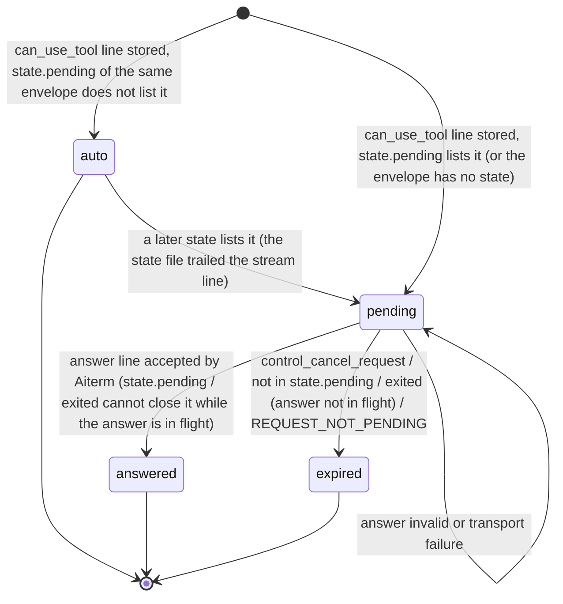

The held request is Claude Code's own; BellTeam adds no timer and no refusal. `pending` always leaves by the Owner, by the seat (cancel, interrupt, turn end, exit) or by the answer attempt itself (`REQUEST_NOT_PENDING`).

## Requests the seat answers itself, and the tool summary (a471-auto-approval-noise)

Owner 2026-11-21 15:47 JST (Pepper's chat, plan mode): 「この類の通知めっちゃくる。自動で許可するなら通知いらねーよな」「あとから見て可読性が最悪」. Ruling (Tronie, all clients the same): (1) a request the seat side answers automatically never pushes and never becomes an Owner card; it stays in the timeline only as a folded background line saying it was allowed automatically, with the tool and its summary. Only a request that really waits for the Owner pushes and draws a card. (2) Every approval card, and that folded line, shows the tool name and a readable summary (the command or file), never the raw JSON.

- **How conversation knows, with no timer.** Aiterm's host answers some `can_use_tool` itself (plan mode: every tool but AskUserQuestion; ExitPlanMode; a fork's question) and never lists such a request in `state.pending`; a request that waits for a person is listed. So an envelope's request line that `state.pending` of the same envelope does not list was answered by the seat. The line record carries `auto: [request_id]` (persisted, so a restart draws the same), the request is `auto`, nothing is pushed, and the entry is drawn as `view: control`, `display: fold`, `fold_group: background`, `title: "<tool> allowed automatically"`, `text` = the plain summary (the label is `<title>: <summary>`). It has no `request` block, so no app draws a card for it; apps change nothing. An `auto` request is closed for answering (`SEAT_REQUEST_CLOSED`).
- **When the state trails the line.** Aiterm writes the stream line first and `pending` a moment later (separate writes), so a real request can be read together with a state that does not list it yet. Aiterm (Elegg, a471e-pending-before-request-line, 0.70.89) will write `pending` before the line, so a line that is read is always covered. Until then conversation does not lose the request: a later state that lists an `auto` request writes the local record `listed`, the request becomes `pending` (card with `request`) and the push goes out then. Nothing waits on a timer.
- No state in the envelope (or no `pending` array): the request waits, as before. A seat that exited (`state: exited`) expires its unanswered requests as before.
- **Tool summary.** `tool.summary` of a `tool_use` and of an approval entry is one plain line: the first present of `command`, `file_path`, `notebook_path`, `pattern` (`<pattern> in <path>` when `path` is given), `path`, `url`, `query`, `skill`, `description`, `prompt`, `plan` of the tool's input, cut to 200 characters; with none of them the compact JSON, as before. It is computed at read time, so history already stored reads the same way. Apps already draw `tool.summary`.

## Data ownership

| Datum | Owner | Lifetime |
| --- | --- | --- |
| claude's stdout lines | Aiterm stream file, per launch | until the launch's files are removed by Aiterm |
| stored events, cursor, requests | conversation, `state/machine-stream/<botId>.jsonl` | kept like the chat log |
| last read position of the live reader | execution memory | until the seat closes; after a restart execution asks `seatStream.cursor` |

## Tool calls fold (a471-tune-tools) and the order rule

Owner 2026-11-21 06:4x JST: 「ツールは1行に畳んで。連続したツールは2件の様に畳んで。」 and, right after: 「時系列をくずすな。」 (the same rule covers the answer bubble above).

- **Order rule (all folds).** Folding never moves an entry out of its place in time. Every entry keeps its position by `at` and `seq`; a fold line stands at the place of its first member, and its members stay inside it in their own order. A fold only joins entries that are next to each other in the timeline. An app **must not** pull an entry (for example a `tool_result`) up to sit under another one. The earlier rule "a tool_result is drawn directly under its tool_use" is withdrawn.
- **One call is one closed line; calls in a row are one closed line with a count.** The default table folds `tool_use` (it was `show`). From a `tool_use` entry on, every following folded entry (its `tool_result`, hooks, `rate_limit`, `system`, `control`, the end-of-turn `result`, `unknown`) belongs to the same **tool run** until the first entry that is `show` (words, thinking with text, a card, an error), or until the turn's `result` entry (which closes the run and is its last member). The hook lines that sit between two tools therefore do not split them. The body decides this at read time from the stored lines (it needs only the entries before, so a later entry never changes an earlier one).
- **What the entry carries.** Entries of a tool run have `fold_group: "tools"` (the table's `fold_group.tool_use`) and `fold_count`: `1` on a `tool_use` entry, `0` on the other members. Entries outside a tool run keep the table's `fold_group` and have no `fold_count` (it counts `1`).
- **The line an app draws for a run of one `fold_group`** (the app still only merges neighbours of the same group): let `n` be the sum of `fold_count` (`1` when absent) of its members. `n > 1`: the label is `<fold_group> ×<n>`, for example `tools ×2` (`background ×9` as before). `n = 1`: when the run is one entry, the entry's own line; otherwise the `message` of the member with `fold_count: 1` (the tool name). `n = 0` (a tool run cut by a bubble the body does not see): `<fold_group> ×<members>`. Opened, the line lists its members in order, each as a closed line that opens to its text (for `tool_use` the `tool.summary`).
- Tool rows still sit in the Bot list preview only when shown; since `tool_use` is folded the preview follows words and thinking.

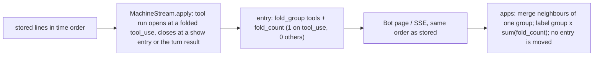

## Turn answer bubble (a471-tune-answer)

Owner 2026-11-21 06:4x JST, on seeing the answer once as plain written text and once more as a bubble: 「これを出さない。その上で、今吹き出しになっていない最後の発言を吹き出しにする。」 So the answer shows once, and it is the seat's own last words.

- **The duplicate is not drawn.** The turn's answer row that execution saves from the turn result (`user.complete`, labelled `stream: true`) is not on the Bot page or the full timeline. This is the rule above; nothing new is added for it. If the old words path is still live (no `displayFromStream`), the chat shows both as before; execution's flag decides, conversation adds no second rule.
- **The last words become the bubble.** A `words` entry (not the replayed `input`, not empty) carries `bubble: true` when it is the last `words` entry of its turn and that turn has ended. A turn is the entries up to a `result` line; the `result` line ends it. Earlier `words` entries of the same turn stay plain written lines (the seat's talk between tool uses). Nothing moves: the bubble is the same entry in the same place, only marked. Until the `result` arrives no entry has `bubble`; when it arrives the last words entry is replaced in place (same `id`, `seq`, `at`), and the page and SSE change event redraw it, like a card whose `request.status` changes. A turn with no words has no bubble. The mark is made here, at read time from the stored lines; stored events never change, and a restart rebuilds the same marks.
- **The mark is made early (a471-final-not-bubble).** Owner 2026-11-21 17:57 JST, iPhone, Nayuta: the answer was plain text with raw `**` and 11 folded rows after it. Cause: the mark was made only at `result`, but a Claude Code seat runs its `Stop` hooks between the last words and the `result` (4 `hook_started`, the responses, `command_lifecycle`, then `result`: 11 rows). The clients re-read only the newest 10 rows on a change event (iOS `refreshPage`, Web `TIMELINE_REFRESH_PAGE`), so the in-place change of a row 12th from the end never reached the open chat (a reopen reads 1000 rows and showed it). So the mark is also made at the first `Stop` hook line (`system` `hook_started` with `hook_name: Stop`), the moment the seat has finished speaking: that line sits right after the words, in the same read batch or the next one, so the words entry is first drawn with `bubble: true` or changes at most a few rows behind the newest. The `result` stays the closing mark for a seat without `Stop` hooks. Both marks take the same remembered last words and clear it, so one turn marks it once. If a `Stop` hook sends the seat on, its next words are remembered again and marked at the next `Stop` or `result`; the earlier bubble stays. **Rule for every in-place change: it must sit within the newest 10 rows of the moment it is made**; a later rule that changes an older row has to say how the clients get it.
- **Apps** draw a `words` entry with `bubble: true` as an ordinary incoming message bubble (the same look and the same Markdown rendering as a saved message, so `**` is never shown raw), and every other `words` entry as plain written text, as now. The app does not decide which words are last; it reads `bubble`. An app that already draws exactly this changes nothing.
- The Bot list preview (`recent`) is unchanged: the latest `display: show` entry.

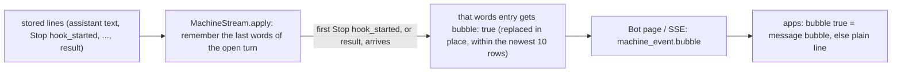

## Reminder answer bubble (a471-tune-reminder)

Owner 2026-11-21 10:2x JST, on the mid-turn line a seat wrote because Claude Code asked it to say what it is doing: 「ではこれを吹き出しにしろ」. Claude Code injects `silent_turn_reminder` ("The user hasn't heard from you in a while — say in a few words what you're doing") after a quiet stretch, and the seat's next words are an update meant for the Owner.

- **The marker is supplied, not guessed.** Claude Code's `-p` stream does not carry the reminder: it is an `attachment` record of the transcript only (measured 2026-11-21: the answering text has `stop_reason` null in the stream and no record of its own). The supplier, Aiterm (Elegg), adds one stream line `{"type":"system","subtype":"silent_turn_reminder"}` when it sees that attachment, **before** the lines of the answer. Order matters: a marker that arrives after the words it belongs to marks nothing.
- **The next words become the bubble at once.** The first `words` entry (not the replayed `input`, not empty) after the marker carries `bubble: true` from the moment it is stored, without waiting for the turn's `result`. Only that one: the seat's later words stay plain until the existing last-words rule applies. A `result` line clears a marker nobody answered, so it never leaks into the next turn. Nothing moves; the marker line itself is a folded `system` entry in the `background` group, like every other system line.
- **Apps change nothing**: they already draw `bubble: true` as a message bubble. Mark is made here at read time from the stored lines; a restart rebuilds it.

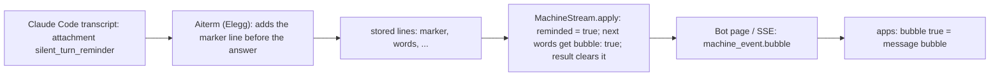

## Thinking is drawn as a bubble (a471-thinking-bubble)

Owner 2026-11-21 11:5x JST: 「Thinkingも吹き出しにして」. Today a thinking row is plain slanted text outside a bubble on Web, Windows and Linux. Same spec on all clients (Web, iPhone/Mac, Windows, Linux, Android); the Mac app is the visual reference. Only what the clients need is fixed here:

- **Which rows.** Every shown row with `view: "thinking"` (it has text; display `show`). A `thinking (no text)` row stays folded as now. No other view changes: plain written lines (`words` without `bubble`), tools and cards keep their drawing.
- **Look.** The row is drawn in the same incoming bubble container the app uses for the seat's answer bubble (`words` with `bubble: true`): same shape, colour, width, alignment, sender and time rules. Inside, the whole `machine_event.text` as in the thinking-full rule, lighter and slanted as now, so a thinking bubble cannot be mistaken for the answer. One bubble per row (no merging of rows). Order and time stay those of the row.
- **Actions: copy only.** A thinking bubble has copy (the whole text, and the selected part when the Owner selects text). It has no reply, quote-reply or forward: those stay on the answer bubbles (`bubble: true`, see the reply section), because a thinking row is the seat's working note, not a message to the Owner. The body already accepts a thinking row id for `reply_to` and `forward`, so widening later changes only the clients' gate.
- **Nothing else.** No new field, no body change, no change to the list preview, fold groups or the turn report check.

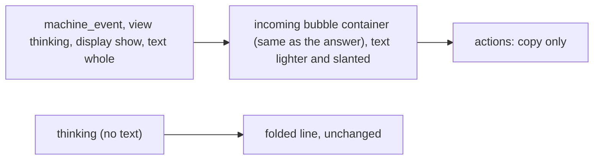

## Reply, forward, quote and copy of a bubble (a471-reply-forward-broken)

Owner 2026-11-21 10:3x JST: 「返信機能とか、転送機能とか、引用して返信とか、使えなくなってる。」 Cause found 2026-11-21 (not the read outage): a machine seat's answer is now the stream bubble (`machine_event` with `bubble: true`), and every client gates reply / forward / quote / copy on `kind` being `message`, `interim` or `schedule` (Web draws the bubble with `id: undefined`; iOS `isQuotable`, Windows/Linux `Timeline.IsQuotable` / `IsForwardable`). A `machine_event` row is none of those, so the Bot's answers lost the actions. The body already accepts the row: `reply_to` and `forward.message_id` take its id `me-<seq>-<part>` (source kind `bot`), `quoteSource` / `forwardSource` read its whole `machine_event.text` through `machine.rowSource`, and `reply_quote` locates the selected text in it. Nothing changes in the body or in the wire.

- **Client rule (same on all four).** A `machine_event` row with `bubble: true` is a message bubble, so it gets the same actions as a saved message bubble: reply, quote of a selected part, forward, copy. The id sent is the row's own `id` (`me-<seq>-<part>`; it stays the same when the row is replaced in place by the bubble mark). The text for the selected part, for copy and for the forward comment is the whole `machine_event.text` (the row's `message` is only the first line). A quote of a bubble in a reply scrolls to the row by that id.
- **Plain written lines stay without actions** (words not marked `bubble`, thinking, tool lines, cards): they are the seat's talk between tool uses, not messages. Widening this later changes only the clients' gate.
- A bubble not yet marked (turn still open) has no actions; when the mark arrives the row is replaced in place and gets them.

- **Both stores read the row (a471-reply-bubble-not-found, found 2026-11-21 12:0x JST on Tronie's seat).** The Owner's direct send is saved by the parent's durable receipts, whose conversation store had no `machineRow`, so a reply to or forward of `me-<seq>-<part>` came out as 「元の発言は見つかりませんでした」 (only the conversation child's store read the stream). The parent now hands its receipts store the same `machine.rowSource` read (`MachineStream.rowSource`), so reply, quote-reply and forward of a seat bubble resolve the speaker, time and text on the parent path too.

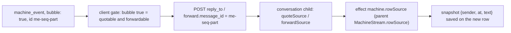

## One-line labels never carry raw JSON (a471-raw-lifecycle-row)

Seen 2026-11-21 12:35 JST on production Web (Z147) and in Anis's Windows 0.6.8 shot: a folded row labelled `command_lifecycle: {"type":"command_lifecycle","command_uuid":"...","state":"queued",...}` showed raw JSON to the Owner. Cause: the label (`message`) of a row is its title plus the first 120 characters of its text, and an `unknown` view keeps the whole raw line as its text. Rule: an `unknown` row of a JSON line has the label `<type>` or `<type>: <state>` (the first of the line's `state`, `phase` or `subtype`), a plain word, never JSON; the raw line stays in `machine_event.text` (shown when the Owner opens the folded line) and by `seq`. A line that is not JSON keeps `not-json: <its first characters>`. A `rate_limit` row (Centi's Z149 lab found it still showed JSON; a471-raw-ratelimit-row) has the label `rate limit: <status>` only; its info JSON (reset time and the like) stays in `machine_event.text`. The display table is unchanged (`unknown` is still folded into the `background` group). Body only; no client change, since the clients draw `message` as served.

## Thinking is always shown whole (a471-thinking-full)

Owner 2026-11-21 10:2x JST chose 「ア：いつも全部出す」 (「あと、thinkingの内容も貴重だよね」): every thinking row of a machine seat shows its whole text, always, on all four apps. His iPhone screenshot showed thinking cut after about 150 characters (「Then I'll get back to K」, 「with t」) with no way to open it, while the stream line carries the whole summary (939 characters in `bot-7b140b27.jsonl` seq 907).

**Cause (found 2026-11-21).** The body gives a thinking block `view: "thinking"`, not `view: "words"` with `title: "thinking"` as this document said. Web (`machine-event.js`: `view === 'thinking'` draws `text`), Windows (`MachineCards.cs`: draws `text` for `thinking`) and Linux (a shown row with `text` is drawn as a message) draw the whole `text`. iOS/Mac draws the whole `text` only for `view == "words"` (`MachineEventView.shown`) and `isThinking` is `view == "words" && title == "thinking"`, so a `thinking` row falls to the one-line label: the row's `message` (title plus the first 120 characters of the first line) with `lineLimit(3)`. Nothing is cut in the body: `text` is whole up to the 20 000-character row cut (`truncated: true`); the one-line `message` is only a summary for lists and folded lines.

**Rule (all four, one spec).**

- A shown row with `view: "thinking"` draws its whole `machine_event.text`, wrapped, never `message` and never a line limit, lighter and slanted as now. The Owner can select it. Where a row is quoted, copied or forwarded its whole `text` is used (see the reply section).
- iOS/Mac: `isThinking` is `view == "thinking"` (the old `words`+`title` test may stay as an alias), and `MachineEventView.shown` draws `text` for `words` and `thinking`. Web, Windows and Linux already draw `text`; their task is to check on a long thinking row (about 1 000 characters, several lines) that no line limit, ellipsis or max height cuts it, and to fix it if one does.
- Folded rows keep their one-line `message` with the open action; an empty `thinking (no text)` stays folded. This rule does not change which rows are shown.
- The body changes nothing and the wire stays as is. Thinking summaries are 1–3 sentences, far below the 20 000-character cut.

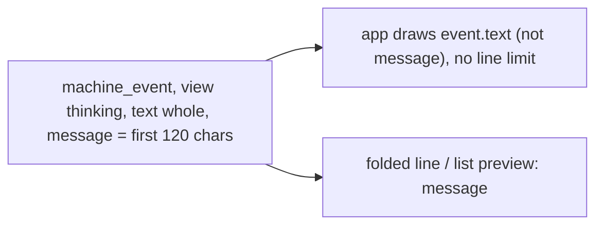

## History pages of a long stream (a471-page-request-bound, a471-page-size-scrollback)

Owner 2026-11-21 10:4x–10:5x JST: scrolling back through a machine seat's log must keep up (「一回で読むログを多くしないとダメだよ。1000とか。あと、足りなくなってから読むのもダメだよ。過去ログにスクロールする動きを見て先読みしなきゃダメ。」, then 「1000はやりすぎか？ちとわからんがね。」). A machine seat writes thinking, tool and hook rows, so a page of 20 covers little time. Two parts, one contract, the same on all four apps.

**Measured.** N102 on the real page code with synthetic rows, and Tronie on production (read-only, 2026-11-21 10:46 JST; `state/machine-stream/bot-7b140b27.jsonl`: 2930 lines, 2.88 MB, line mean 983 B, p50 448 B, p95 2787 B, p99 8493 B, max 455 KB; all 13 seats: 24 240 lines, mean 1.10 KB, p50 449 B, p95 2.7 KB, p99 12.5 KB, max 767 KB; the worst 500-line window is 1.99 MB raw). The lines are the raw stream; a row's `text` is cut at 20 000 characters (`truncated: true`), so a row is at most about 20 KB however long its line is.

| Fact | Value |
| --- | --- |
| One row as the apps get it | typically 0.3 KB (tool/words) to 1.3 KB (thinking summary of 939 characters); at most about 20 KB |
| Time to build one page in the body and child | 0.3–5 ms at 800–10 000 stream rows; 42–85 ms at 100 000 stream rows. It does not depend on `limit`; it depends on how many card ids the child is handed (the 100 000-row case hands it 5 MB) |
| Size of one page | 100 rows about 30–130 KB, 500 rows about 150–650 KB typical (production mean 1.1 KB per line, so about 550 KB for 500), worst seen 2 MB raw; text compresses 4–6 times, so the worst page is about 0.4 MB on the wire |

A page carries every row whole (no per-page byte cap and no further cut): the outliers are rare single rows, and the 20 000-character row cut already bounds them.

**Decision.**

- **Server cap of `limit`: 200 → 1000** (`pageItems` and `timelinePage`). The default for a request without `limit` stays 10 (old apps). Nothing else about the page changes: newest first, `before` / `after`, `has_more`, `remaining_before`.
- **Page sizes the apps ask for: `limit=1000` for the first page and for every older page** (Owner 2026-11-21 13:4x JST: 「最新ログが、100ってのもバカみたいに少ない。もう一回で読むのは1000とかにしろよ。」; before it was 100 and 500). 1000 is the server cap. Measured on `bot-7b140b27` after Z145: `limit=1000` = 601 KB, 0.25 s, the same time as 500 (the time does not depend on `limit`); a row is about 0.6 KB. The first page is the same size as the older ones, so a long-running seat's first screen is filled at once (the Fill rule below reads further older pages only while the drawn content does not fill one screen, and then when the Owner scrolls up). The size is one constant each in an app; the Owner may lower or raise it, and it can never exceed the cap without a body change.
- **Older pages are read when the user scrolls up; the newest row is the anchor (Owner and Tronie ruling 2026-11-21: 「過去ログは上にスクロールしたら読むもの」, the newest row is the anchor, the list is laid out from the bottom; Web a471-open-newest-web, #2164).** The open shows the newest page and reads no older page in the background, except when the drawn rows do not fill one screen (a short conversation). Rule (the same in all four): while the Owner scrolls up, keep at least `max(1 screen, 2 seconds of the current upward scroll speed)` of drawn height above the top of the view (judged by what is drawn, as in the Fill rule below, never by the number of rows held; it was 3 screens before this ruling); when less is left and `has_more` is true and no older page is on its way, ask for the next one. One older request at a time; when a page arrives, check the rule again at once (a fast scroll chains pages). It stops when `has_more` is false. A failed page is tried again on the next scroll movement, not in a loop. The list is laid out from the bottom (the newest row is the reference, scroll offset 0 = newest), so an older page added above the view never moves the view: no scroll command and no height compensation is needed, and an app that cannot lay out from the bottom keeps the anchor row in place by its own means. A page is never inserted during a scroll animation of the app's own making.
- **Page request bound (body, no app change needed).** The page read no longer hands the child every card of every extra source. The parent hands only the cards that can fall inside the page: for the newest page the last `limit` cards of each source; for `before=<id>` the last `limit` cards at or before the cursor time; for `after=<id>` the cards at or after the cursor time. The cursor time is the `at` of the cursor row. The parent knows it when the cursor is a card id; for a saved message the app sends it as the new optional query value `before_at` / `after_at` (the `at` of the row it already holds). With no hint (an old app, an unknown id) the parent falls back to handing every card, as today; the read waits for the large-body slot (PR #2079), so it never fails for that. The child gets, next to `cards`, `skipped`: per source the count of older cards the parent left out, and adds it to `remaining_before` and to the has-more test. Indexes in the child's answer refer to the cards the parent sent; the parent maps them back to its own rows, so nothing else changes. The request is now at most `limit` cards per source plus counts, however long the stream grows.

- **A page counts rows, not drawn items (decision N102 after Tronie's production measurement, Z145 live 2026-11-21 11:40 JST).** Measured on `bot-7b140b27` (3 runs each, all fast): `limit` 20 = 9 KB 0.26–0.41 s, 100 = 72 KB 0.23–0.26 s, 500 = 288 KB 0.24–0.28 s, 500 with `before` and `before_at` = 316 KB 0.33–0.42 s, the same without `before_at` 0.29–0.33 s; before Z145 a page took 5.3 s (20) and 9.4 s (200). One fact came with it: the newest 500 rows of a busy machine seat cover only about 7 minutes, because thinking, tool, hook and background rows each count as one row, and the apps then fold tools and background into single lines, so 500 rows draw far fewer items. `limit` stays a count of rows. The body and child cannot count drawn items: the fold groups are merged by each app when it draws, and the child holds only card ids and times. A page is cheap (time does not grow with `limit` at these sizes, size is about 0.6 KB a row), so a long look back is reached by more pages read as the Owner scrolls up, not by a different unit. What the Owner sees is decided by the fill rule below, which counts what is drawn.
- **Fill rule (all four apps).** What is checked is what is drawn, never the number of rows held. At the open the app reads older pages (one at a time, `limit=1000`) only until the drawn content fills one screen, or `has_more` is false; it does not read ahead beyond that. After that, scrolling up decides: the app keeps reading older pages (one at a time, `limit=1000`) while the drawn height above the view is below the margin of the Prefetch rule above (`max(1 screen, 2 seconds of upward scroll speed)`), or until `has_more` is false. A page that arrives and draws almost nothing (all folded) does not end the loop while the margin is short. Pages stay 1000 (first and older) and the refresh check stays 10.

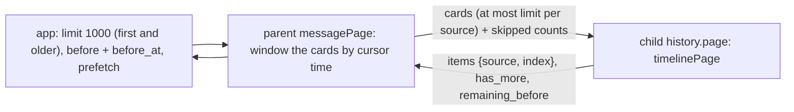

## The turn report check sees the stream (a471-silent-turn-check-misfires)

Tronie 2026-11-21 (seat on machine mode since Z142): after every turn that ended with a final answer, BellTeam sent 「直前のターンでは、オーナーの会話画面に何も残りませんでした」 and the seat had to say it all again, so the Owner read each answer twice. Cause: `TurnReports.check` (`src/turn-reports.mjs`) looks for what the turn left on the Owner's screen only in the saved records (`bellteam.interim-word.v1` of the Bot and direct messages from the Bot to the Owner). A machine seat's words and its closing bubble are stream rows (`machine_event`, `view: "words"`), not saved records, so the check found nothing and asked for a report every time. Fix: the body hands the check the seat's stream rows (`MachineStream.timeline`); a shown `words` row inside the turn window counts as left on the screen: a row with `bubble: true` is the final message, the others are progress notes. Thinking, tools and folded rows do not count. A turn that left no saved record and no such row is still asked for a report. Nothing else changes: not the wire, not the clients, not the content check (Jev), which now also reads the bubble text.

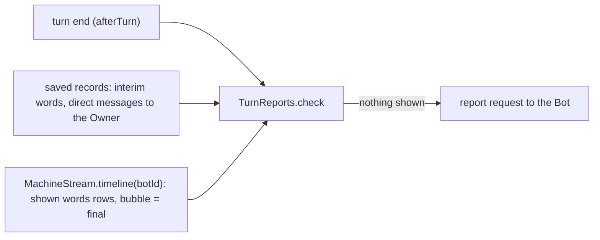

## Not changed

Direct and room message routes, the existing interim/answer/status rows, reply, `owner_question` and `secret_request` cards, every existing SSE topic and terminal seats stay as they are. A machine seat's turn end, answer text and steer receipts stay on the existing tools; the stream is additive for the chat log.

## Display source for a machine seat: the stream only (a471-chat-from-stream)

Owner 2026-11-20 21:1x JST: 「ツールを使ってチャットに表示するのではなく、機械のデータをログモジュール側が解釈して表示する。全てのデータに種別がついてるはず。」 For a machine seat the chat shows the seat's words, tool use, thinking and everything else from the stream rows above, interpreted by type here. The words that Aiterm's tools used to carry (`pty_observe` words between tool calls, the transcript, Throughline) are not a display source any more, so the same words no longer reach the chat twice. Terminal seats (Codex, Grok, Cursor, and a Claude seat launched the old way) keep today's path unchanged. "Machine seat" is execution's fact: the seat's own launch record says `machine: true`; conversation holds no second copy of it.

### What changes, per part

| Part | Before (machine seat) | After |
| --- | --- | --- |
| execution (Kiro) | relays words from `followInterim` as `delivery.words` (kinds interim, answer), and tells SelfTurns what it showed | does **not** relay `delivery.words` of kind interim or answer for a machine seat's own turns. Still relays: `delivery.status`, `turn.end`, `user.complete`, `delivery.words` of kind `error`, everything for a fork seat. `user.complete` gains one optional field `stream: true` (the turn ran on a machine seat). `shown.read` reports a machine seat's self-started turn answers as already shown |
| conversation, direct | `recordUserReply` saves the final answer as a message row and the page draws it | still saves it (it is the turn's result for the HTTP caller, export, the `reply_id`, push and the Bot list preview), labelled `stream: true` when `user.complete` says so; the **Bot page and the full timeline do not draw a `stream: true` row** (the stream's words row is the one drawn). It stays in the log, in `recent`/list previews, in export and in notifications |
| conversation, notified turns | the final answer of a turn started by a notification became an `interim-word` row of kind `answer` | nothing is written for a machine seat (the stream shows it) |
| conversation, relay to an asking Bot, a fork or a room | the answer text comes from the turn result | unchanged: mechanics, not display. Execution may read the answer from the stream's `result.result` instead of the transcript; that is its choice and does not change this contract |
| conversation, reply and forward of one shown row | `reply_to` / forward names a saved message id | a `machine_event` row `words` (and `tool_use`, `thinking`, any shown row) is quotable and forwardable: `reply_to` and `forward.id` accept its id `me-<seq>-<part>`; the snapshot is `{id, sender, at, text}` taken from that row (text cut as in reply.md). The saved snapshot never re-reads the stream |
| apps | draw the old words rows and the stream rows | draw the stream rows only for a machine seat (nothing to hide: the old rows are not in the page) |

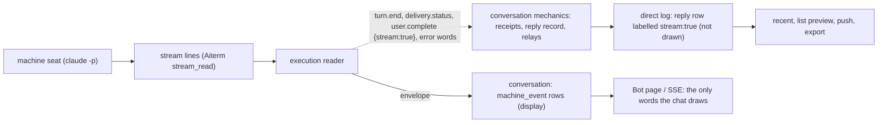

### Capability and compatibility (agreed with Kiro, PR #2030)

- The capability comes from conversation: the port `seatStream` carries `displayFromStream: true`, set only for an engine whose loader declares `supportsSeatStreamDisplay` (an older engine rejects unknown port keys). Only when it is true does execution (a) stop relaying `delivery.words` of kind interim / answer and the display `onAnswer` for a machine seat's own turns (kind `error` words, `delivery.status`, `turn.end`, `user.complete`, the transcript answer relay to asking Bots / forks / rooms stay), (b) add `stream: true` to `user.complete` params, (c) add `stream: true` to the `execution.shown.read` result of a machine seat's self-started turn. With an old conversation (no flag) nothing changes: the old words path, no new field. So the duplicate disappears exactly when both parts are live, never half-way.
- Conversation accepts the optional `stream: true` in `user.complete` (callbacks) and in the `execution.shown.read` result (effects). `SelfTurns` skips writing the answer when `shown.stream` is true and still consumes the shown words. The saved final-answer row gets `stream: true` and is left out of the Bot page, the full timeline and the list preview index (it stays in the log, export, the HTTP turn result and push). The Bot list preview (`GET /api/bots` `recent`) is served by the body for every app: for a machine seat it is the latest machine row the chat draws open (`display: show`, never a folded row), presented as `{kind: "message", direction: "incoming", message, image: false, at}`; with no such row it stays the latest ordinary row (a471-preview-from-stream).
- The Owner's direct turn (durable receipts -> transport.turn, no conversation delivery) has no user.complete: execution tells the same fact by calling the turn option onStreamReply() before the completion resolves, under the same displays() condition; the receipts then label the saved answer row stream:true.
- Quote and forward: `ConversationStore.quoteSource / forwardSource` resolve a `me-<seq>-<part>` id through the parent effect `machine.rowSource` (`{botId, rowId}` to `{source: {sender, at, text} | null}`).
- A seat with no running reader (fork, TUI fallback, `STREAM_UNSUPPORTED`, exited) keeps today's path: execution relays words as before and does not set `stream`. No timer, no refusal: the rule follows the reader turn by turn.

## Answers to Aiterm's open points

1. Long poll with `wait_ms` is enough; no push.
2. Yes: run with `--replay-user-messages`. Conversation stores them in order (steer and hook input appear with their `uuid`); BellTeam's own saved messages are not shown twice (`shown_elsewhere`).
3. `--include-partial-messages` stays off. Interim words come from the existing path; if the chat later needs token streaming, the `stream_event` view already exists.
4. No `ack_cursor` now: the file lives for the launch. Elegg may add it when a launch's file grows too large to keep; conversation would then ack after the batch is stored.
5. Yes: questions, multiSelect, Other and answers live in the line contents; Aiterm defines no shape.
