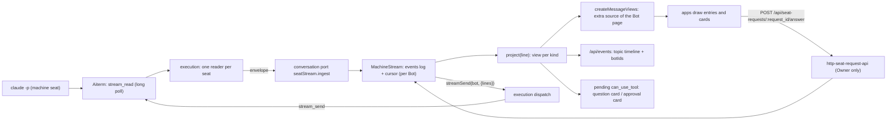
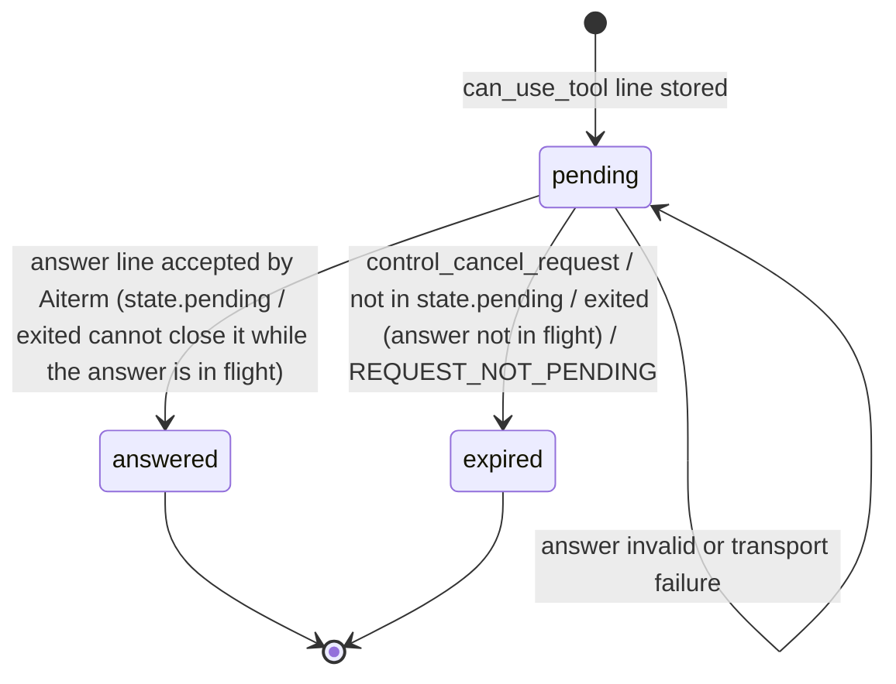
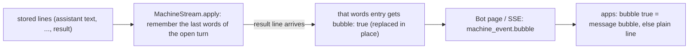
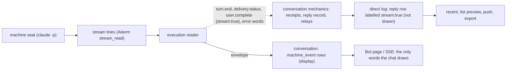

# machine-stream — a machine seat's stream-json as the chat log (a471-stream-contract, a471-askuser-n102)

Owner: N102 (conversation). Agreed with Elegg (Aiterm, `stream_read` / `stream_send`, aiterm-mcp `docs/architecture/claude-machine-stream.md`) and Kiro (execution relay, his earlier per-delivery `machine-question` design is replaced by this seat-level contract). [Module contract](README.md) / [overall map](../../feature-map.md).

Owner ruling 13 (2026-11-20 20:0x JST): the machine seat's stream-json output is passed through unchanged; the log display module (conversation) interprets every kind. Nobody guesses from a screen. A fork seat has no Owner: no reader, no events, no card (Aiterm denies a fork's question at once).

## Parts

| Part | Does | Does not |
| --- | --- | --- |
| Aiterm (Elegg) | Per launch: `stream_read` gives claude's stdout lines byte for byte; `stream_send` writes allowed input lines unchanged | interpret, reformat, name a question shape |
| execution (Kiro) | One reader per machine seat (long poll) from launch until the seat closes; hands envelopes to conversation; forwards `streamSend` lines unchanged | interpret, store events, build answers |
| conversation (N102) | Keeps the cursor, stores every line, projects every kind into a chat-log entry, streams the change, builds the Owner's answer lines | read Aiterm or the seat itself |
| apps (Web, Apple, Windows, Linux) | Draw the entries and the card, post the answer | parse the raw line |

## Function diagram



| Function | Input / output | Responsibility |
| --- | --- | --- |
| `seatStream.cursor(botId)` | to `null` or `{session, launch_id, cursor}` | Where conversation has stored up to. Execution reads on from it after a body or module restart |
| `seatStream.ingest(envelope)` | to `{status:"stored", cursor}` or `{status:"resync", cursor}` | Store the lines, advance the cursor, project, notify. Rules below |
| `MachineStream.project(line)` | raw line to entry view | The one place that knows event kinds. Unknown kinds become the `unknown` view |
| `MachineStream.answer(requestId, body)` | Owner route to `streamSend` | Validate against the stored request, build the `control_response` line, send, mark answered after Aiterm accepted |
| `streamSend(bot, {lines})` | execution dispatch (screenApproval IPC form) | Owner-only caller. Execution forwards to `stream_send` and returns Aiterm's result or error as is. An old module answers `EXECUTION_REQUEST_INVALID` (503) |

## Envelope (execution to conversation)

```json
{ "botId": "bot-xxxxxxxx",
  "session": "<Aiterm session_id>",
  "launch_id": "<Aiterm launch_id>",
  "cursor_from": null,
  "cursor_after": "<launch_id>:<offset>",
  "lines": ["{\"type\":\"system\",...}", "..."],
  "state": { "state": "idle|busy|blocked|starting|exited", "reason": null,
             "pending": [ { "request_id": "...", "subtype": "can_use_tool", "tool_name": "AskUserQuestion" } ] } }
```

- `lines` are `stream_read`'s lines exactly as received (JSON text, not parsed objects). `cursor_from` is the cursor execution passed to `stream_read` (`null` = start of the launch); `cursor_after` is what it returned. Both are opaque: conversation only compares them for equality.
- Gap and restart rules of `ingest`:
  - stored cursor = `cursor_from` (or nothing is stored and `cursor_from` is `null`): store, return `stored`.
  - a different `launch_id` with `cursor_from: null`: a new launch (resume, wake, or `STREAM_CURSOR_STALE`); a new segment starts, return `stored`.
  - anything else (a replay, a gap, a stale cursor): store nothing, return `resync` with the stored cursor (`null` if none). Execution reads again from that cursor; if Aiterm says `STREAM_CURSOR_STALE` it reads from the start of the current launch with `cursor_from: null`.
- `state` only closes cards: a stored open request whose `request_id` is not in `state.pending` is closed (`expired`); `exited` closes every open request of that seat. A request whose answer is in flight (`MachineStream.busy`, between `streamSend` and the `answered` record) is never closed by `state`: the seat leaves its question as soon as it takes the answer, so the next envelope no longer lists it, and the answer attempt itself decides its end.

## Storage and cursor (atomic by structure)

`state/machine-stream/<botId>.jsonl`, one record per line, appended with one write per envelope:
`{ seq, at, session, launch_id, cursor_after, line }` — `seq` counts per Bot from 1; `line` is the raw line string unchanged; only the last record of an envelope has `cursor_after` (the others `null`). The stored cursor is the last record that has one. On load a trailing run of records without `cursor_after` (a torn write) is cut off, so the cursor and the events never disagree. Open requests are derived from the log, not stored twice.

## Input lines (conversation to Aiterm, through `streamSend`)

| Input | Line conversation builds | When |
| --- | --- | --- |
| AskUserQuestion answer | `{"type":"control_response","response":{"subtype":"success","request_id":"<id>","response":{"behavior":"allow","updatedInput":{"questions":<the request's input.questions unchanged>,"answers":{"<question text>":"<label>"}}}}}` | Owner answers the card. `multiSelect`: labels joined with `", "`. Other: the free text as the value |
| Tool approval answer | `... "response":{"behavior":"allow","updatedInput":<the request's input>}` or `{"behavior":"deny","message":"..."}` | Owner presses the button of an approval card |
| user message, steer, interrupt, config | stay on the existing tools (`pty_send`, `agent_stop`, `agent_configure`) | unchanged |

If Aiterm answers `STREAM_REQUEST_NOT_PENDING`, the card becomes `expired` (the seat no longer waits).

Every write to a Bot's log (an `ingest` envelope, the `answered` record of `answer`, the `expired` records of `expire`) runs on that Bot's one chain, so `seq` is assigned and written in one order; `answer` takes `seq` only when its turn on the chain comes.

## Entry in the chat log

History row (what apps read in `items` of the Bot page and the full timeline):

```json
{ "id": "me-<seq>", "kind": "machine_event", "direction": "incoming", "at": "...",
  "message": "<one line for a plain-text app>", "sender": {"id": "bot-…", "name": "…"},
  "machine_event": { "seq": 42, "launch_id": "…", "type": "assistant", "subtype": null,
                     "view": "words|tool_use|tool_result|system|hook|result|rate_limit|approval|question|control|unknown",
                     "display": "show|fold", "fold_group": "<only when folded; the table's group for the view, default the view>", "title": "short label", "text": "<=20000 chars", "truncated": false,
                     "tool": { "id": "…", "name": "Bash", "summary": "<=200 chars" },
                     "request": { "request_id": "…", "status": "pending|answered|expired",
                                  "questions": [ { "header": null, "question": "…", "multiSelect": false, "allowOther": true,
                                                   "options": [ { "index": 1, "label": "…", "description": null } ] } ],
                                  "answers": [ { "indexes": [1], "other": null } ] } } }
```

- Large content is cut in the row (`truncated: true`); the full raw line is `GET /api/bots/:id/machine-events/:seq` returning `{seq, line}` (the stored line as is).
- `view` by kind (apps draw by `view`, never by parsing `line`):

| Stream line | view | text / extra |
| --- | --- | --- |
| `assistant` text block | `words` | the text. The same words also arrive as interim/answer rows by the existing path: the row carries `shown_elsewhere: true` (a hint only: the default table shows it too, see below). The last one of a finished turn also carries `bubble: true` (see Turn answer bubble) |
| `assistant` `thinking` block | `words` with `title: "thinking"` | collapsed |
| `assistant` `tool_use` block | `tool_use` | `tool` |
| `user` with `tool_result` | `tool_result` | text of the result, cut |
| `user` text (replayed input, hook-injected) | `words` with `title: "input"` | `shown_elsewhere: true` when BellTeam saved the same message |
| `system` `init`, `api_retry`, `compact_boundary`, `status`, other subtypes | `system` | subtype in `title`, fields of interest in `text` |
| `system` `hook_started` / `hook_response` | `hook` | hook name, outcome |
| `result` | `result` | subtype, turns, cost/usage line |
| `rate_limit_event` | `rate_limit` | reset time |
| `control_request` `can_use_tool` AskUserQuestion | `question` | `request` with questions; buttons for one choice, checks for `multiSelect`, free text for Other |
| `control_request` `can_use_tool` other tool | `approval` | `tool`, `request.status`; approve / deny while `pending` |
| `control_cancel_request`, `control_response` | `control` | closes the request |
| `stream_event` | `control` | not shown by default (partial messages are off) |
| anything else, or a line that is not JSON | `unknown` | `title`: type or `not-json`, `text`: the line cut. Never dropped |

- Display rule (show / fold) is **separate from the data**: every line is stored; `project` adds `machine_event.display` (`show|fold`) at read time from one rule table, `src/machine-display-rules.json` (key = `view`, optional refinements `title` / `is_error`; optional `fold_group`: view -> group name for the folded entries of that view). Changing the table changes what every app shows without touching stored events and without an app release. **There is no `hide` (Owner policy 2026-11-20 21:0x JST: 「畳むのはオッケー。消すのはダメ」): a table may show or fold a kind, never remove it, and a table value other than `fold` is read as `show`. So every stored kind is always in the Bot page and the full timeline.** **Fold view (all four apps draw it the same way)**: a `fold` entry is one collapsed line, not hidden. The `tool_use` entry stays `show` (tool name and `tool.summary`); its `tool_result` entry (same `tool.id`) is drawn directly under it as one collapsed line (`message`: title and the first line of the result), closed by default. A tap or click opens it to the full `text` and closes it again; when `truncated` is true the opened view offers the whole raw line from `GET /api/bots/:id/machine-events/:seq`. A `fold` entry is not drawn as a separate row of the timeline; if its `tool_use` is not in the loaded page (paged away), the app draws the folded line alone at its own position. The open/closed state is the app's and is not stored. A pending question/approval card is always `show`.
- Default table (Tronie's, set 2026-11-20 21:0x JST for the Owner's first live try; to be tuned with the Owner after he has seen it live). Owner words: 「要約とかいいからさ、出してみようぜ」, 「ツールの結果は畳んで良い」, 「君が畳んだ方がいいと思うものは畳んでみて」. The rule table is `src/machine-display-rules.json`; the refinements match `view` plus `empty` / `is_error` / `title` / `status`.

| Shown open (`show`) | Folded to one openable line (`fold`) |
| --- | --- |
| the seat's words (assistant text, interim and final); thinking with text | tool result (under its tool-use line; the tool-use line itself is shown) |
| AskUserQuestion, plan approval and tool approval cards (always) | empty thinking, titled `thinking (no text)` |
| failures: `system` entries with an error (api_error, auth), `result` with `is_error` | `system` `init` (`start: <model>, <n> tools`); `hook_started` / `hook_response`; `api_retry`; `command_lifecycle`; other `system` subtypes |
| usage limit rejected (`rate_limit` with status `rejected`) | `rate_limit` `allowed` / `allowed_warning` |
| turn stopped or aborted (`result` that is not a normal end) | `result` on a normal end (`done: <time>`) |
| the tool-use line | config replies and `control_cancel_request` (the card closes; one line) and other `control` lines |
| | replayed user messages (`words` titled `input`: they duplicate a bubble BellTeam already shows) |
| | unknown kinds (the kind name is the title) |

Messages sent to the seat (Owner, Bots, schedules) are already shown by the existing bubbles; the stream's replay of them is the folded `input` line. Folded entries carry `fold_group` (the group the table gives their `view`; default the view itself): an app **may** merge consecutive folded entries of the same `fold_group` into one line (for example `hooks ×4`); opening that line opens its members. Entries with a different `fold_group`, and every `show` entry, break a group. **Background rows share one group**: the default table gives `hook`, `rate_limit`, `system`, `control`, `result` and `unknown` the one group `background`, so the hook lines of a tool use (`hook_started`, `hook_response`) and the `rate_limit` / `control` lines that arrive between them are one run, one closed line "background ×n" the Owner can open; at the end of a turn the folded `result` (`done: 2.5s`), an unknown kind such as `command_lifecycle` (its raw JSON stays inside the fold) and the `Stop` hook join the same run instead of leaving three lines (Owner 2026-11-21 01:43 JST via Tronie, a471-tune-tail; Owner 2026-11-21 01:14 JST: 「Hook の表示は畳んでくれ」; before, each `rate_limit` line cut the run of `hook` lines into several). The grouping is made here, by the table, so the four apps draw it the same way and no app changes; a `show` entry (a card, words, an error) still breaks the run. Thinking text: Claude Code's `-p` stream carries it empty by default; Aiterm's host sends `set_max_thinking_tokens {thinking_display:"summarized"}` after initialize, so the stream carries the vendor's first-person summary (1-3 sentences), not raw thinking (Elegg, measured 2026-11-20, Opus 5.5 / Sonnet 5.5 / Fable 5.2). The row `text` is cut at 20000 characters (`truncated: true`); the raw line is always available by `seq`.
- Cards: one entry per request; its `request.status` changes in place (the entry keeps its `id`/`seq` and `at`), so apps redraw from the page they re-read. The Bot page `items` use the existing paging (`before`/`after`); machine events are one more source merged by `at`.
- SSE: `/api/events` change event `{topics:["timeline"], botIds:[botId], roomIds:[]}` per stored envelope and per request status change, no body. A pending card also pushes through `notifications.question`.
- Machine events and cards belong to the Bot's direct log (`roomId` null), also when the turn started from a room.

- History page compatibility: the machine entries are one more card source of the Bot page (`history.page` `cards` is 2 or 3 long), added only when the Bot has machine entries, so a body with an older conversation module keeps working until a machine seat exists.
- Answer format verified by Elegg on the stream path (Claude Code 2.1.328): `updatedInput` = the request's input unchanged plus `answers`; single = the label, multi-select = labels joined `, `, Other = the free text; a second answer to the same `request_id` gets `STREAM_REQUEST_NOT_PENDING`.

## Answer route

`POST /api/seat-requests/:request_id/answer`, Owner only (Bot port 403), body at most 64 KiB.

```json
{ "answers": [ { "indexes": [2], "other": null } ] }
```

For an approval card the body is `{ "decision": "allow" | "deny" }`.

| Result | Meaning |
| --- | --- |
| 200 `{ "request": <request above> }` | Aiterm accepted the answer; `answered` |
| 400 `SEAT_REQUEST_ANSWER_INVALID` | does not match the request (count, index not in options, several indexes without `multiSelect`, `other` without `allowOther`, empty) |
| 404 `SEAT_REQUEST_NOT_FOUND` | no such request |
| 409 `SEAT_REQUEST_CLOSED` | already `answered` or `expired` |
| 409 `REQUEST_NOT_PENDING` | Aiterm no longer waits for it (`STREAM_REQUEST_NOT_PENDING`); the request becomes `expired`, the response carries it |
| 503 `SEAT_REQUEST_UNAVAILABLE` | old execution module (`EXECUTION_REQUEST_INVALID`) |
| other Aiterm errors | request stays `pending`; the Owner may try again |

## State and exit



The held request is Claude Code's own; BellTeam adds no timer and no refusal. `pending` always leaves by the Owner, by the seat (cancel, interrupt, turn end, exit) or by the answer attempt itself (`REQUEST_NOT_PENDING`).

## Data ownership

| Datum | Owner | Lifetime |
| --- | --- | --- |
| claude's stdout lines | Aiterm stream file, per launch | until the launch's files are removed by Aiterm |
| stored events, cursor, requests | conversation, `state/machine-stream/<botId>.jsonl` | kept like the chat log |
| last read position of the live reader | execution memory | until the seat closes; after a restart execution asks `seatStream.cursor` |

## Turn answer bubble (a471-tune-answer)

Owner 2026-11-21 06:4x JST, on seeing the answer once as plain written text and once more as a bubble: 「これを出さない。その上で、今吹き出しになっていない最後の発言を吹き出しにする。」 So the answer shows once, and it is the seat's own last words.

- **The duplicate is not drawn.** The turn's answer row that execution saves from the turn result (`user.complete`, labelled `stream: true`) is not on the Bot page or the full timeline. This is the rule above; nothing new is added for it. If the old words path is still live (no `displayFromStream`), the chat shows both as before; execution's flag decides, conversation adds no second rule.
- **The last words become the bubble.** A `words` entry (not the replayed `input`, not empty) carries `bubble: true` when it is the last `words` entry of its turn and that turn has ended. A turn is the entries up to a `result` line; the `result` line ends it. Earlier `words` entries of the same turn stay plain written lines (the seat's talk between tool uses). Until the `result` arrives no entry has `bubble`; when it arrives the last words entry is replaced in place (same `id`, `seq`, `at`), and the page and SSE change event redraw it, like a card whose `request.status` changes. A turn with no words has no bubble. The mark is made here, at read time from the stored lines; stored events never change, and a restart rebuilds the same marks.
- **Apps** draw a `words` entry with `bubble: true` as an ordinary incoming message bubble (the same look and the same Markdown rendering as a saved message, so `**` is never shown raw), and every other `words` entry as plain written text, as now. The app does not decide which words are last; it reads `bubble`. An app that already draws exactly this changes nothing.
- The Bot list preview (`recent`) is unchanged: the latest `display: show` entry.



## Not changed

Direct and room message routes, the existing interim/answer/status rows, reply, `owner_question` and `secret_request` cards, every existing SSE topic and terminal seats stay as they are. A machine seat's turn end, answer text and steer receipts stay on the existing tools; the stream is additive for the chat log.

## Display source for a machine seat: the stream only (a471-chat-from-stream)

Owner 2026-11-20 21:1x JST: 「ツールを使ってチャットに表示するのではなく、機械のデータをログモジュール側が解釈して表示する。全てのデータに種別がついてるはず。」 For a machine seat the chat shows the seat's words, tool use, thinking and everything else from the stream rows above, interpreted by type here. The words that Aiterm's tools used to carry (`pty_observe` words between tool calls, the transcript, Throughline) are not a display source any more, so the same words no longer reach the chat twice. Terminal seats (Codex, Grok, Cursor, and a Claude seat launched the old way) keep today's path unchanged. "Machine seat" is execution's fact: the seat's own launch record says `machine: true`; conversation holds no second copy of it.

### What changes, per part

| Part | Before (machine seat) | After |
| --- | --- | --- |
| execution (Kiro) | relays words from `followInterim` as `delivery.words` (kinds interim, answer), and tells SelfTurns what it showed | does **not** relay `delivery.words` of kind interim or answer for a machine seat's own turns. Still relays: `delivery.status`, `turn.end`, `user.complete`, `delivery.words` of kind `error`, everything for a fork seat. `user.complete` gains one optional field `stream: true` (the turn ran on a machine seat). `shown.read` reports a machine seat's self-started turn answers as already shown |
| conversation, direct | `recordUserReply` saves the final answer as a message row and the page draws it | still saves it (it is the turn's result for the HTTP caller, export, the `reply_id`, push and the Bot list preview), labelled `stream: true` when `user.complete` says so; the **Bot page and the full timeline do not draw a `stream: true` row** (the stream's words row is the one drawn). It stays in the log, in `recent`/list previews, in export and in notifications |
| conversation, notified turns | the final answer of a turn started by a notification became an `interim-word` row of kind `answer` | nothing is written for a machine seat (the stream shows it) |
| conversation, relay to an asking Bot, a fork or a room | the answer text comes from the turn result | unchanged: mechanics, not display. Execution may read the answer from the stream's `result.result` instead of the transcript; that is its choice and does not change this contract |
| conversation, reply and forward of one shown row | `reply_to` / forward names a saved message id | a `machine_event` row `words` (and `tool_use`, `thinking`, any shown row) is quotable and forwardable: `reply_to` and `forward.id` accept its id `me-<seq>-<part>`; the snapshot is `{id, sender, at, text}` taken from that row (text cut as in reply.md). The saved snapshot never re-reads the stream |
| apps | draw the old words rows and the stream rows | draw the stream rows only for a machine seat (nothing to hide: the old rows are not in the page) |



### Capability and compatibility (agreed with Kiro, PR #2030)

- The capability comes from conversation: the port `seatStream` carries `displayFromStream: true`, set only for an engine whose loader declares `supportsSeatStreamDisplay` (an older engine rejects unknown port keys). Only when it is true does execution (a) stop relaying `delivery.words` of kind interim / answer and the display `onAnswer` for a machine seat's own turns (kind `error` words, `delivery.status`, `turn.end`, `user.complete`, the transcript answer relay to asking Bots / forks / rooms stay), (b) add `stream: true` to `user.complete` params, (c) add `stream: true` to the `execution.shown.read` result of a machine seat's self-started turn. With an old conversation (no flag) nothing changes: the old words path, no new field. So the duplicate disappears exactly when both parts are live, never half-way.
- Conversation accepts the optional `stream: true` in `user.complete` (callbacks) and in the `execution.shown.read` result (effects). `SelfTurns` skips writing the answer when `shown.stream` is true and still consumes the shown words. The saved final-answer row gets `stream: true` and is left out of the Bot page, the full timeline and the list preview index (it stays in the log, export, the HTTP turn result and push). The Bot list preview (`GET /api/bots` `recent`) is served by the body for every app: for a machine seat it is the latest machine row the chat draws open (`display: show`, never a folded row), presented as `{kind: "message", direction: "incoming", message, image: false, at}`; with no such row it stays the latest ordinary row (a471-preview-from-stream).
- Quote and forward: `ConversationStore.quoteSource / forwardSource` resolve a `me-<seq>-<part>` id through the parent effect `machine.rowSource` (`{botId, rowId}` to `{source: {sender, at, text} | null}`).
- A seat with no running reader (fork, TUI fallback, `STREAM_UNSUPPORTED`, exited) keeps today's path: execution relays words as before and does not set `stream`. No timer, no refusal: the rule follows the reader turn by turn.

## Answers to Aiterm's open points

1. Long poll with `wait_ms` is enough; no push.
2. Yes: run with `--replay-user-messages`. Conversation stores them in order (steer and hook input appear with their `uuid`); BellTeam's own saved messages are not shown twice (`shown_elsewhere`).
3. `--include-partial-messages` stays off. Interim words come from the existing path; if the chat later needs token streaming, the `stream_event` view already exists.
4. No `ack_cursor` now: the file lives for the launch. Elegg may add it when a launch's file grows too large to keep; conversation would then ack after the batch is stored.
5. Yes: questions, multiSelect, Other and answers live in the line contents; Aiterm defines no shape.
