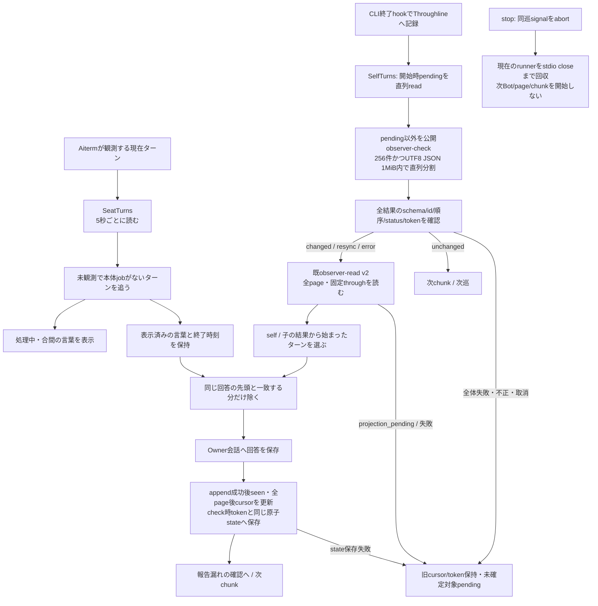
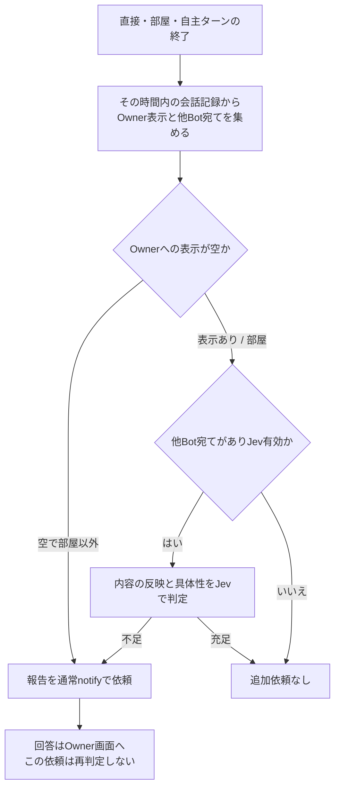

# observation — 会話・履歴

[担当と公開契約](README.md) / [全体図](../../feature-map.md)。章を旧詳細図から移管した。

## nativeの現在と、保存された回答

| 状態所有 | 関数と契約 | 失敗後の状態 |
| --- | --- | --- |
| SeatTurnsのtimer/running/supported | `start/poll/stop → transport.watchSeatTurns`。未対応返却ならpoll終了 | RPC失敗はlog後に次poll。未対応を故障と混ぜない |
| SeatActivityのwatches/followedTurns/shownWords | `watchSeatTurns/watchTurn/beginWatch/endWatch`。取得前後の停止世代一致、idle、未追跡turnのみ開始 | nullは未知なので既watch継続。idle/別turn確認でend。wait異常は安全な途中経過またはstderrへ。回答はここで取得しない |
| SelfTurnsのcursor/seen/lastCompletedAt | `poll/follow/accept/save`。project/checkTokenと独立read cursor、source_sha256直近500件を所有 | 開始時pendingを先行readし同巡checkから除外。初回/旧stateのproject不明/同IDのproject変更はresetし過去本文を再表示しない |
| Throughlineのページ | `readObserverTurns`。wire v2、after/through cursor、page token | projection_pendingは読み残しとして次poll、errorはそのBotをlog。他Bot処理は続行 |
| 古いcursor | `resync` | 最後に読んだ時刻より新しい分を受ける。返る直近会話/100件の範囲外を復元したとは言わない |
| 重複表示 | `withoutShownWords` | 既表示語が全て同順のprefix、同ターンとみなす60秒内、残文ありの時だけ除く。不一致なら全回答を保持 |
| 回答保存 | `appendAnswer → messenger.appendInterimWords` | append成功後だけseen/表示済み語を更新。全page/append成功後のcursorとcheck時tokenを原子保存し、失敗では旧cursor/tokenとpendingを保持。append済みseenは保持するが再起動をまたぐexactly-onceは保証しない |

公開checkはthroughline.observer_check_request.v1/result.v1、request順の結果全体を検証してから処理する。N0は起動0。unchangedは旧確認値と一致する時だけreadを省略する。check失効/errorでread cursorを消さず、resync_requiredはread成功後にcheck確認値だけnullへ戻す。errorのnullを新確認値として採用しない。check/read間の追加完了に対し、readが先まで進んでも採用するのはcheck時のtokenだけ。先行成功chunkは後続失敗で撤回しない。

全対象のid一意/UTF8 bytes・絶対project/after bytesを検証し、件数と符号化後bytesの両方で分割する。単一項目超過は明示失敗、切捨て/空chunkなし。失敗時の例外本文/任意path/stdioを画面へ流さず固定分類だけをlogへ出す。

checkは共通rootの既runnerをbase環境で使い、readは各projectの既接続を使う。stdinはJSON+EOF、AbortSignalはoptions、合計16MiB既上限/nonzero拒否/stdio close後回収はruntime契約を保持。停止後に次の起動をしない。runtimeの旧signature窓口除去は担当差分と同時結合する。製品契約/内部図はThroughline担当の正本へ辿り、正式package/公開/本番の成立は固定開発候補の受領とは分ける。

この二つは観測元も責任も違う。新しい共通poll managerを作る理由にはならない。Throughline内部やAiterm内部のターン判定は、公開返却との境界で留める。

## 報告が不足した時だけ、通常通知へ戻す

`TurnReports.afterTurn`は配送の終了を待たせないcallbackから呼ぶ。`turnView`は保存時間の幅で直接発言と途中経過を集める。部屋でsilentを守った場合を「表示なし」にしない。Jevのoutcome/substanceは0..1検証後、それぞれ0.35/0.5を使う。判定失敗はlogだけで依頼を送らない。`requestReport`はonTurnEndを渡さず、同じ報告要求の無限連鎖を作らない。追加notify自体も通常の全体停止/入力制御を通る。
