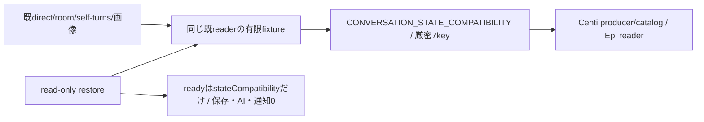

# 会話processの業務境界（実装工程）

N102が会話の閉DTO・writer/reader・Room/画像保存・観測/回答所有/背景報告を所有する。Root横断契約v1はbot-7b140b27/docs/conversation-update-contract-20261103.md（133222cf）が正本。機構/親FD/gateはruntime、native/lifetime信用資料はexecution、認証/facade/両入場/組立てはintegration。既図は[README](README.md)から辿り、全体図を複製しない。

現実装baseはmain6d21419b96f289b1a9f61d707c40c5cbfce12177。初回入力afdc/8ccaとは別。Root読取4e01の15source中14は同bytes、application-servicesだけが共通moduleCatalogを同Host clientへ接続した差分であり、会話内部15sourceの意味を既採用と混同しない。

## 先着供給：状態互換と既reader

`src/conversation/state-compatibility.mjs`のCONVERSATION_STATE_COMPATIBILITYとassertConversationStateCompatibilityが唯一の公開export。配列順/値と7keyをexactにし余剰・不足・未知を拒否、writerが出すschema集合と既readerが受ける記録を混同しない。既reader本体をこの先着差分では変更せず、direct unknown schema拒否とRoom unknown object保持、完全JSON未改行preview、不完全tailのdirect保留/Room例外、bad batch未反映、optional metadataとstatus/trackingを人工fixtureへ固定する。原本test/fixtures/conversation-reader-v1.json、直接test/conversation-reader-contract.test.mjs。

## 接続と未完範囲

子factoryはcreateConversationDispatcher({root,effect,event,diagnostic,...})、validateRequest/Result・validateCallback/Result・dispatch/dispatchCallback/control/disconnectを専用channelへ合わせる予定。control/dispatch/callbackは(method,params,context)、ready {stateCompatibility}、initialize {generation,mode:'bootstrap'|'restore',bots:検証済表示snapshot}。wirebase generation/operationIdと親の認証projection/登録済callbackだけをcontextへ、外部bodyの同形fieldで権限を作らない。history AsyncIterable/chunk/credit/stream機構はEpi所有。

閉DTO/writer/restore/追跡の残実装はこの図を拡張して同差分で行う。初版は全callback/SeatTurnWatch/非await afterTurnと元turn一回派生reportの実終端まで旧子を保持する。新世代回答移譲0。親stableRoom/asset gate/FD保持、60秒busy/旧resume/新子0/AIabort0/再送0をRoot正本どおり接続する。先着互換exportの成功を子交換/唯一writer移管/本番成功へ補完しない。

## callback保存の閉DTO

親normalizerはsrc/conversation/callbacks.mjs。元Errorのmessage/stack/cause/任意keyをwireへ写さず、停止判定に必要なBOT_STOPPED/AI_GLOBAL_PAUSED又は固定failure codeと既安全mcp_error/native_launch、HTTP status/known outcomeだけを残す。これはroot業務Errorの公開意味を変える正規化ではなく、登録済みdelivery callbackの保存用射影。親は元Error/実receiptを保持する。

callback kindはdelivery.status/words/answer/user.complete/turn.endだけ。paramsへdeliveryId/target/世代/lease/任意recordを入れない。別の親登録contextがgeneration/operationId/deliveryId/target/callbackKindを束縛して旧子へ渡す。plain validatorは型の正しさだけで本人性を作らず、channel/Kiroが実登録を確認する。ACK {applied:true}は当該保存/finish/reportの実終端後だけ。turn.endのcheck/一回派生report待ちはRoot保守drainの対象で、通常native accepted/完了返却をその待ちへ置換しない。
