# 会話processの業務境界（実装工程）

2026-11-06: 直接JSONL writerは[親安定の耐久受領](durable-receipt.md)へ移し、子の全直接appendは同親effectへ通す。旧子の世代/authority/実終端検査と子emitは保持。Room/SelfTurns writerと旧native参照の所有は変えない。

N102が会話の閉DTO・writer/reader・Room/画像保存・観測/回答所有/背景報告を所有する。Root横断契約v1はbot-7b140b27/docs/conversation-update-contract-20261103.md（133222cf）が正本。機構/親FD/gateはruntime、native/lifetime信用資料はexecution、認証/facade/両入場/組立てはintegration。既図は[README](README.md)から辿り、全体図を複製しない。

現実装baseはmain6d21419b96f289b1a9f61d707c40c5cbfce12177。初回入力afdc/8ccaとは別。Root読取4e01の15source中14は同bytes、application-servicesだけが共通moduleCatalogを同Host clientへ接続した差分であり、会話内部15sourceの意味を既採用と混同しない。

## 先着供給：状態互換と既reader

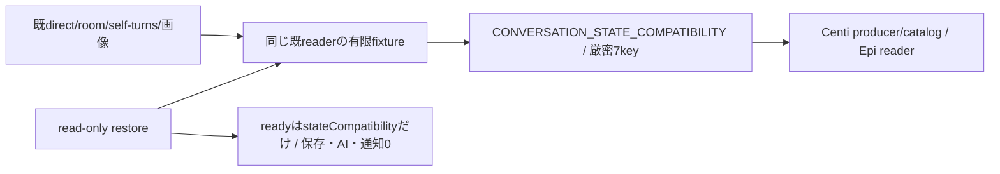

`src/conversation/state-compatibility.mjs`のCONVERSATION_STATE_COMPATIBILITYとassertConversationStateCompatibilityが唯一の公開export。配列順/値と7keyをexactにし余剰・不足・未知を拒否、writerが出すschema集合と既readerが受ける記録を混同しない。既reader本体をこの先着差分では変更せず、direct unknown schema拒否とRoom unknown object保持、完全JSON未改行preview、不完全tailのdirect保留/Room例外、bad batch未反映、optional metadataとstatus/trackingを人工fixtureへ固定する。原本test/fixtures/conversation-reader-v1.json、直接test/conversation-reader-contract.test.mjs。

## 接続と未完範囲

子factoryはcreateConversationDispatcher({root,effect,event,diagnostic,...})、validateRequest/Result・validateCallback/Result・dispatch/dispatchCallback/control/disconnectを専用channelへ合わせる予定。control/dispatch/callbackは(method,params,context)、ready {stateCompatibility}、initialize {generation,mode:'bootstrap'|'restore',bots:検証済表示snapshot}。wirebase generation/operationIdと親の認証projection/登録済callbackだけをcontextへ、外部bodyの同形fieldで権限を作らない。history AsyncIterable/chunk/credit/stream機構はEpi所有。

閉DTO/writer/restore/追跡の残実装はこの図を拡張して同差分で行う。初版は全callback/SeatTurnWatch/非await afterTurnと元turn一回派生reportの実終端まで旧子を保持する。新世代回答移譲0。親stableRoom/asset gate/FD保持、60秒busy/旧resume/新子0/AIabort0/再送0をRoot正本どおり接続する。先着互換exportの成功を子交換/唯一writer移管/本番成功へ補完しない。

## 異常終了したwriterと旧実行参照の分離

2026-11-04 Qの採用契約。正常交換の全体drainは維持し、異常終了後の新規会話の先行復帰だけを扱う。以下はruntime/executionの世代分離と実追跡の実装を必要とし、既active0 recoverや観測ログの追加だけで成立したとは扱わない。

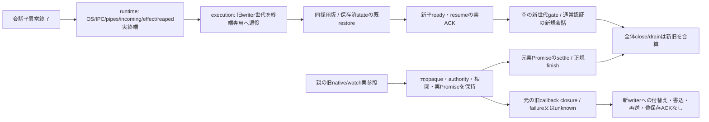

会話のcallbackは元generation/operation/delivery/targetへ束縛した旧channel closureに残す。旧子が失ったoptions/state/userSavedを新子の通常initializeやreconcile handleから復元したとは扱わない。旧callbackの実失敗は元failure/unknownへ返し、永久pendingや偽`{applied:true}`で代用しない。既保存ACK済みの内容は保持するが、旧回答/status/reportの新writerへの保存回復は本契約に含めない。旧保存の追加保証が必要なら、限定継続capability・writer state再構成・元commit/unknownの重複防止・実保存ACKを別に定める。

新子は既表示snapshotと保存済stateを同採用版で復元し、唯一writerのready/resume ACK後だけ新規入場を開く。旧実参照の正当な後始末は元gateへ届き、旧callback/failed/waiterが新世代へ作用しない。新entry/claimNative/report/sourceを旧参照から作らない。admission/moduleOperationsのidentityと元operation実終端までのcapturedAuthorityを保持する。世代分離を同Botの実占有解放や旧入力の再発行に使わない。

親channelの新request・reverse effectのlive検査とwrapperの継続入場は`assertCurrentLease`を使う。旧opaqueの実completion登録・正規finishに使う`assertLease`とは分ける。旧callbackは既binding検査で元503/CONVERSATION_PROTOCOL_UNCONFIRMED/outcome_unknownへ拒否し、新writer dispatchやapplied ACKに進めない。runtimeはwriter実barrier後に`recoverFailedGeneration(ticket,previousGeneration,nextGeneration)`で旧世代を退役し、閉じた新currentを採用する。会話のinitialize/restore/ready/resumeの既DTOは変えない。

runtimeのwriter終端と親native/watchの実終端は別である。executionは元receipt/jobの実追跡をcallback await前に一回登録し、旧callback失敗だけで実追跡を解除しない。会話は旧callback保存失敗をnative完了へ変換しない。全体closeと正常交換drainは新旧実参照のglobal active0/unconfirmed条件を維持する。接続の正本は[runtime再生成](../runtime/module-process.md)と[execution lifetime](../execution/conversation-lifetimes.md)。

userTurnは返すPromiseへ同期`.accepted`を持つ。nativeの既受付後にそのPromiseだけが終端し、runtimeはroot slotを解放できる。元Promiseは既prepared/knownReplyIds/claimedReplyIdsと最終保存を同旧子で持ち、受付成功を回答保存成功にしない。enqueueUserTurnは同経路のacceptedだけを既返却形で返す。acceptedを持たない既低層transportでは実completionまでslotを解放しない。dispatcherもasyncラッパーでこのpropertyを落とさず、背景報告の親参照と実completionはroot slotから別に追跡する。

## M 元deliveryの保存原本一件照合

`facade.store.deliveryAnchor(input,options)`はprivate root `history.deliveryAnchor`へ通常のcapturedAuthority/実completionで接続する。閉入力と非null返値は`{deliveryId,target,context,contextId}`、contextはdirect又はroom。認証済bot actorだけに許しtarget=actor.botId、fresh memberと既Room認可を確認する。directはcontextId=target、roomは元roomIdを使う。元M capture/job/receiptの対応検証はexecution所有で、このreadがnative採用を証明することはない。

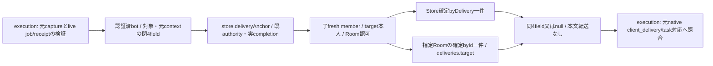

通常表示snapshotの改行前previewは保存証明にしない。更新後の確定read stateで原direct-message又はroom-messageを一件だけ選び、重複原ID・不正行・target/context不一致・元行無しはnull又は既安全errorでM作用0とする。directの破損行を表示readerがskipした場合もanchor readは未確認としてnull。Roomの同IDは複数targetへ配送されるためrouting.respondersでなく原deliveries.targetを照合する。全Room走査/全timeline転送/status又はinterim行/本文や時刻の一致は代用しない。

元RPC残budgetかつ最大5秒の一回capture+read期限はexecution consumerで管理し、caller期限で会話の実completion/leaseを偽settleしない。遅着readは別responseへ使わない。新writer/native発行/旧入力再送/新HTTP窓口は追加しない。

## callback保存の閉DTO

親normalizerはsrc/conversation/callbacks.mjs。元Errorのmessage/stack/cause/任意keyをwireへ写さず、停止判定に必要なBOT_STOPPED/AI_GLOBAL_PAUSED又は固定failure codeと既安全mcp_error/native_launch、HTTP status/known outcomeだけを残す。分身のFORK_FAILEDだけは英数字と_の符号に限るreason（例 readonly_unenforceable）も残し、自由文は親に留める（[fork-inquiry B7](fork-inquiry.md#module-child-boundary-production-defect-2026-11-11)）。これはroot業務Errorの公開意味を変える正規化ではなく、登録済みdelivery callbackの保存用射影。親は元Error/実receiptを保持する。

callback kindはdelivery.status/words/answer/user.complete/turn.endだけ。paramsへdeliveryId/target/世代/lease/任意recordを入れない。別の親登録contextがgeneration/operationId/deliveryId/target/callbackKindを束縛して旧子へ渡す。plain validatorは型の正しさだけで本人性を作らず、channel/Kiroが実登録を確認する。ACK {applied:true}は当該保存/finish/reportの実終端後だけ。turn.endのcheck/一回派生report待ちはRoot保守drainの対象で、通常native accepted/完了返却をその待ちへ置換しない。

## 親actorと閉root matrix

src/conversation/authority.mjsが7種actorと許可root methodの一正本。owner、bot(botId)、scheduler、bridge、onboarding(botId)、usage(source secret/question,botId)、observerだけ。rootにはreport/system actorを追加しない。parent authentication/registered ingressがactorを捕捉し、wire actorの型検証だけで本人性を作らない。seatSession/launch/実executionSourceと両予約context={membersLease,conversationLease}は親closureに残す。作用前両予約はMolly同moduleOperations、子業務paramsのlease自己申告0。

assets.openは公開facade上の親FD helper専用で、child root集合とは分ける。子にNode FD/streamを返す口にしない。Root matrixは各kindの許可methodの上限であり、MCPの既操作資格・fresh Room代表/所属・登録済みcaller限定の検査を省略しない。member.removeFromRoomsはmembers既削除の内部callerからだけ捕捉し、一般Bot JSONのmethod指定を許可にしない。

`src/conversation/requests.mjs`がprivate正規化後の全root payloadとcontrol/callback contextを閉検証する。root contextは親捕捉exact `{generation,operationId,actor,continuation}`、callbackはKiro登録exact `{generation,operationId,deliveryId,target,callbackKind}`、controlは`{generation,operationId:null}`。continuationは親assertLease後のepoch差からだけ作り、型検証をlive leaseの証明へ代用しない。initializeはgeneration一致/mode/bootstrap又はrestore/表示snapshotのid一意を確認し、台帳未供給nullやproject/資格等の余剰fieldを拒否する。ready effect0。

root payloadは各methodの固定キーだけ。public MCP/HTTPのimage/images、room/roomId、任意target名/default/recordUser等の既公開表現は親facadeで明示的に射影し、private DTOをそのまま外部APIの新引数制限として使わない。Room/scheduleの意味検証は同既writer、添付の実25MiB/MIME検出は同既reader、body予算はchannel/既入口が保持する。閉DTOで履歴件数/添付枚数/文字列サイズの新しい任意上限を足さない。payload validatorは作用や本文I/Oをせず、result/effect/dispatcherの後続結合と区別する。

## read-only restore

RoomRegistry.restoreは既rooms directory/room.jsonとschedule.jsonを読み、既Room正規化とschedule定義の検証だけを行う。initializeのmkdir/chmodと欠測schedule作成を呼ばない。SelfTurns.restoreは既bellteam.self-turns.v1のcursor/seen/lastCompletedAtを読み、欠測だけ空の初回状態とし、存在する破損/未知schemaを空へ丸めない。通常initializeの既挙動は維持する。

restoreConversationStateは検証済Bot Mapを必須としRoom/self stateと同じStoreを組み立てる。履歴readerは既Contractのまま遅延読取、readyへ履歴を転送せず、外部effect/画像gate/readObserver/Jev/報告/通知/予定発行0。strict restoreの有限fixtureは全ファイルbytes/mode/mtime不変、外部callback未発行、欠測/破損の差と通常bootstrapだけの作成を確認する。

署名前probeの最小入力正本は`src/conversation/probe-fixture.json`。検証済み表示snapshot用botsと固定相対path三ファイルだけを持つ。隔離state rootへの配置はprobe準備工程で行い、各files値をJSON.stringify(value)+LF、directory0700/file0600で保存する。restore自体は配置しない。room一件/所属bot一件/空schedule/初回self cursor nullを既readerで読み、欠測direct/room履歴は空として読む。generationはruntimeが発行する値をinitializeへ与え、modeはrestore、botsは当該snapshot。引数0の固定probe/helperがこの入力を同app内へ配置する責任はruntime/配布にあり、fixture成功を未供給dispatcher/channelのready成功へ補完しない。実予定/Jev/observer/通知0、履歴/画像ファイル生成0、全fileとdirectoryのbytes/mode/mtime不変を新直接fixtureで束縛する。

## routing資格のepoch

親usage.routing.readは当該判定のときだけ呼ぶ。src/conversation/routing.mjsは返却enabled/epoch/apiKeyを閉検証し、routing.changedより古いreadが遅着したら資格を破棄して発行0、retry0。資格は当該runのcapabilityだけに保持し、changed/終了で参照を落とす。fetch直前も同epoch/enabledを確認する。getter/診断/ACKにAPI keyを反射せず、control ACKはapplied/epochだけ。Jev HTTPS/model/質問/閾値/応答検証は既会話版が持つ。設定更新は閉business root待ちにせずEpi control経由、readyではread/外部HTTP0。

## 子画像writerと親gate

MessageAssetsのchild用saveAdmissionはbeginSave(owner)→wireLeaseId、endSave(wireLeaseId)→終端要請ACK。同dispatcher contextをclosureに保持し、private assets.beginSave {owner}→{leaseId} / assets.endSave {leaseId}→{requested:true}へ接続する案。実親leaseとactual completionは親adapter/channelだけが持つ。beginはreadImage前、saveAllは一leaseで全batch write/closeまで保持する。finallyのend失敗で書込失敗を隠さず両方を保持し、ACKを実write終端証明にしない。

child用readImageの第3内部引数へ当該saveのwireleaseIdを渡し、runtime.image.readのleaseIdと同operationを親が照合する。並行save同士で共有の「現在lease」を置かず、各batch closureが保持する。従来readImage(image,maxBytes)の低層実装は第3引数を使わず既意味を維持し、返すasset metadataや履歴へwireleaseを保存しない。

child用instanceではreadRemovalStates/prepare/cancel/openを使わず親専用として拒否する。親gateとFDの複製0。通常旧constructorは公開契約内の旧親実装を維持し、Mollyが新writer採用時だけ親旧writerを廃止する。

## 固定effectと背景完了

private effect/返値の閉schema正本は`src/conversation/effects.mjs`。members.profiles.readは親fresh ACK/revision採用後の表示5fieldのみ、usageの3effectはMika本人factoryへ、席画像/observer/room-contextはruntime既口へ、native/背景派生はKiroの同親gateへ接続する。ready context operationId:nullからのeffectは全拒否。型検証とは別に親は同捕捉operationとopaque/live context、root method、登録済source、画像leaseを照合し、任意RPC/path/資格proxyにしない。

execution.notify/turnはdeliveryId/target/message/images/queue/kinds。親はqueue.groupId=deliveryIdを固定してnative前registerDelivery、claimNativeはtransport内で一回だけ。turnの返値delivery=running/steeredはacceptedだけ、user.complete保存と最終replyは別のcallback/実lifetime。reportはsourceDeliveryId/target/deliveryId/reason/message/queue/kindsから同operationのdeliveryFor→一回deriveReport→notifyReport。report queue/context/targetは親も固定し、turn.end/user.completeの再帰を拒否する。

execution.forkはroot `fork.ask`（bot actorのみ）からだけ出るdelivery effect。deliveryId/target/forkId/message/queue/kinds（status/words/answerの部分集合、turn.end/user.complete/画像/recoveryIdなし）、返値はdelivery=running（任意forkIdは同値）。親はnotifyと同じregisterDelivery/release ACKで扱う。正本は[fork-inquiry B1–B8](fork-inquiry.md#module-child-boundary-production-defect-2026-11-11)。

非await hookは子pendingへ同期登録し、execution.background.beginの親runBackground参照取得ACK前に元root/user.complete最後を落とさない。endはrequestedだけで実deferredをresolveしない。channelの`trackBackground(backgroundId,context,actualPromise)`へ実check/report/finally end ACKまでのPromiseを結び、channelが別のbackground-complete制御/同source/endRequested/実effect終端を確認してから親deferredとcompletion ACKを確定する。登録はvoidで、実Promiseへcompletion ACK待ちを入れ循環させない。quiesceはchannel側completion ACKも待つ。turn.end invokeは既背景windowを持つのでbegin/trackを重ねない。SelfTurnsだけobserver poll/親許可Bot snapshot限定のexecution.observation.sourceから非native sourceを取得し、native同turn因果証明とは区別する。

子の`ConversationBackground.start(source,context,operation)`はPromiseと同期`.started`を返す。source取得もpending登録後に始め、親begin ACK→channel track登録→実check/report開始の順。dispatcherは同operationの`awaitStarted(context)`だけ待ってから元root/user.complete保存ACKを返し、他operationや報告の実完走待ちへ広げない。child drainは実Promiseを、channel drainは別のcompletion ACKを追う。checkとfinally end両失敗はAggregateErrorで保持する。親observer sourceのfinishは親register callerがbegin参照取得後又は未使用sourceのroot実終端で一回だけ行い、native deliveryのtransport finishを重ねない。

runtime.image.readはimage/wireleaseIdから親の同operation gateを照合し既SeatRuntime.readImage固定25MiB、任意maxBytes0。runtime.room.contextは親固定roomsRootを補い既room-contextを呼ぶ。observerは正式同配布採用main a960の公開check/readへ結合し旧signature/changedを戻さない。子表示snapshotへprojectを渡さず、pollの親snapshotはbotId/不透明scope/実projectのJSON byte幅だけを返す。同pollの親context identityへ実Botのid/projectを捕捉し、check/readの前後で現在Botのid/projectを値で照合する（名簿投影は読むたびに複製を返すので、object identityは比べない）。wire返値は既consumerが読むstatus/cursor/page/turn本文だけへ正規化し、全文/opaque cursor/既statusを保つ。

history.listMessages/listRoomMessagesは同snapshotのAsyncIterable JSON値そのものを返し、runtimeだけが専用history streamへencodeする。export/full timeline窓口は保持する。history.recentは指定Botの末尾1件を`{message: 行|null}`で返す。history.recentBatchは`{botIds}`を受け、既Store.timelineViewsの一snapshotから入力順（重複も保持）の`{botId,message: 行|null}`列をhistory streamへ返す。親は専用recentViewsで既TimelineIndexへ戻し、timelineViews全件の契約を縮退しない。元Promiseの実completionと同actor/optionsを待つ。

Owner裁定2026-11-04によりhistory.pageを子wire rootへ移す。入力は`{kind:'bots'|'rooms',id,query:{limit,before,after},cards}`。query値はURLの元文字列又はnull、cardsは同snapshot/同順序の各`{id,at}`列でBotはsecret/questionの2列、Roomはsecretの1列。子はfresh members/Room資格と既Store/Room索引を使い、既timelinePageで履歴/カードを合成して1ページをhistory streamの1要素で返す。itemsは履歴`{source:0,item:行}`又はカード`{source:1|2,index:元列位置}`。親が捕捉した同じカード本文へ戻し、既webMessage/ownerSecretGuideを適用する。カード本文/secret値/親authorityを子へ送らない。同時刻順、重複ID先頭、未知cursor、after既知の全後続、fractional limit、has_more/remaining_beforeは既algorithmそのもの。history.page/recent/recentBatchはowner/botの既読取ceilingだけに許可し、export/assets.openは親窓口に残す。専用history streamと元実completion/資源寿命はlist2と同じ。親facadeはdecode直後にresults.mjsのvalidateConversationPageRows(rows,cards)/validateConversationRecentRows(rows,botIds)を呼ぶ。前者はarray長1/閉page/閉参照/カードsource・index範囲、後者は要求と同件数・順序・IDと閉rowを確認し、不正はCONVERSATION_RESULT_INVALIDで拒否する。

## root result・回復handle・quiesce

`src/conversation/results.mjs`が各wire root/controlの返値を閉検証する。Room/assetは固定形、既schedule原本の将来optional dataとhistory既readerの行意味は保持し、外側resultへ権限fieldを追加しない。history返値は専用AsyncIterableだけ。user.turn最終保存結果とacceptedは別schemaの時点を持つ。

execution.assertAccessは親の同opaque/live operationに保持した元admitWork checkと現在assertEnabledを検証する。pause→resumeで元epochを捨てた新admitへ置換しない。非AIのtarget=user等へ新停止拒否を足さない。observer表示回収には元AIadmitを作らず、親捕捉observation.pollの背景だけ現在assertEnabledを検証し、親由来AI_GLOBAL_PAUSEDをcontent判定のenabled=falseへ扱う。他の相関/資格/unknownはfalse成功に丸めない。missing-reportとnative派生は別の通常準備/停止/資格を維持する。

execution.reconcileは既親二層照合の実executionを同generation/operation/bot/delivery/完全targetへ束縛したrecoveryIdだけ返す。execution.notifyの同handleはnative前一回消費し、unknownでも再reconcile/再送にしない。execution.closeLaunchは親既transportの完了receiptを捕捉してclosureIdだけ返す。子rootはclosureIdとdelivery_id/from/targetの表示metadata、親facadeは同捕捉operationと完全targetへ照合した元receiptを既公開closedへ戻す。子JSONからnative証拠を作らず、親handleをcaller timeoutで早期破棄しない。

quiesceは新poll/新rootを直ちに閉じ、自身の実pendingを待ってから最終{quiesced:true}だけ返す。channelと親Kiro drainは並列に同じ親60秒を使い、quiesceへ5秒を掛けない。resumeは独立controlでepochを進め古いquiesce完了を無効にし、子は業務をabortしない。親はresume ACKだけ5秒、旧kill0/new0。exitは子とchannel両quiesced/全実pending0を条件とし、exit ACK送信完了後のOScloseはruntime所有。

## 実dispatcher factoryと保存終端

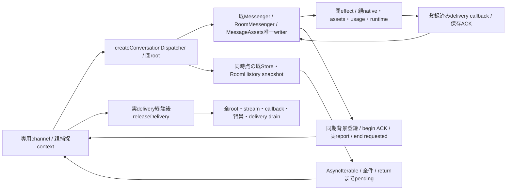

`src/conversation/dispatcher.mjs`のcreateConversationDispatcher({root,effect,event,trackBackground,diagnostic,fetcher})が既writer/Room予定・資格/画像save/回答claim/報告/観測を組み立てる。返却はvalidateRequest/dispatch/validateCallback/dispatchCallback/control/releaseDelivery/disconnect。initializeは表示snapshot必須、restore時の書込/effect/eventは0。bootstrapだけ既Room/SelfTurns初期化を行い、timerは子に作らず親のobservation.pollを唯一入口にする。resume後に新rootを受ける。channelで先に受付済みのdispatchと登録callbackはquiesce開始後も終端まで続け、古いquiesceはresume epochで成功ACKを失う。

子のConversationStoreは`onCorruption: report => diagnostic(report)`を注入し、確定不正行の固定診断を既diagnostic portへ渡す。親runtimeが捨てるstderrへ診断を依存させず、親の同Diagnostics保存へ接続する。Storeの確定行除外/検証/byte・line/preview契約は[履歴読取図](flow.md#破損した直接履歴の読取)のまま。

user.turnのdispatch Promiseには同期accepted Promiseを保ち、user.postは受付だけ返す。両方とも最終保存Promiseは子pendingに残る。user.completeは同delivery登録と一回性を検証し、最終保存と同operationの背景begin取得までACKしない。native.releaseDeliveryは親が実終端を証明して送る4field bindingだけを受け、callback処理中や不一致を拒否する。delivered/status/acceptedだけで登録を消さない。native/親gate/OS処理の所有は移さない。

history list2は既readerが作った一回のarray snapshotをAsyncIteratorへ渡し、後続appendを混ぜない。文字列全件再生成/件数制限0。未読streamもpendingへ入り、終端又はiterator.return/throwで解放する。direct確定不正行の局所除外と診断は[現行履歴読取契約](flow.md#破損した直接履歴の読取)に従い、Roomのbatch検証と各未改行tailの既判定は保つ。親はこのstreamを一回集成してusageカードと既paginationを適用する。

effectへ`execution.shown.read {botId}`→null又は`{shownId,words,endedAt}`、`execution.shown.consume {botId,shownId}`→`{applied:boolean}`を追加する。observer捕捉rootだけ許し、親が既shownInSelfTurnの実参照へ不透明shownIdを束縛する。子は回答append成功後にだけ同shownを消費し、親の新しい表示語を古いhandleで消さない。これは既表示語除去の接続で、observer cursorや確認値の新方式へ切替えない。

eventは`{type:'changed',topics,all,botIds,roomIds}`だけで、本文/資格/任意recordを送らない。direct保存、Roomの初回/経過/callback保存、予定/定義更新後に送る。direct statusの当事者不明はall:trueで既履歴再照合へ。usage通知は従来どおり保存後の非transactional処理で、失敗を診断の固定codeへ送り記録を戻さない。親がeventを既SSE/安定facadeへ接続する。子dependent(event,changed)は同attempt.completionをdispatcherの保存ACK待ちへ返す。元callerの通常60秒期限は別途拒否を観測し、実ACKのresolve/rejectを置き換えない。effect返却・context/source/hold・ACK5秒・creditは変更しない。

## 会話固有channel/entryの所有変更

diagnosticは既channelの子送信/親受信で同じ固定unionを検証し、MESSAGE_LOG_INVALIDだけexact {code,line,offset,length,reason}（lineは1以上、offset/lengthは0以上のsafe整数、reasonはnul/syntax/schema）を許す。CONVERSATION_OBSERVATION_FAILEDはexact {code,reason}（reasonは`^[A-Z][A-Z0-9_]{0,99}$`の固定分類）を許し、旧子のcode-onlyも受ける。他はcode-onlyを維持して本文/自由例外/stderrを転送せず親onDiagnosticへ渡す。親portがreasonを保存するかは本体のDiagnostics登録（Molly）が持つ。

Root21:55分担により会話固有parent/child adapterと薄いentryはN102が所有。Epiの共通module-streams、input budget、background/delivery-release、C/locks/controllerをそのまま使用し複製しない。同lease/correlationで複数の順次・同時rootを許し、各RPCの数値封筒idと親captured method/authorityを個別に保持する。

### 呼び出し封筒idの順序（2026-11-11 部屋投稿で会話子が落ちた欠陥）

封筒idは送り手ごとの奇偶（親は奇数、子は偶数）で増える。旧`call()`はidを同期で取り、call封筒はparams長の計測`await encodedLength(params)`の後に送っていた。計測のtick数はparamsのJSON部品数で増えるので、同じmacrotaskで出た二つの呼び出しは大きさ順に出ることがある。部屋の18席fan-outでは、一つのAiterm stdio chunkが二席の応答を同時に解決する。すると親→子のcallback（delivery.words×3の後にdelivery.words×1、またはdelivery.status running）が逆順に届き、子の受け手`id > incoming`がCONVERSATION_IPC_INVALIDで経路を落としていた（Molly再現、608a7bae）。

| 側 | 契約 |
| --- | --- |
| 送り手 | 各call封筒は、直前に発行した呼び出しの封筒が送られるまで待つ。発行順＝送信順。計測は待たずに先に進める |
| 受け手 | 正しい奇偶で、未受理で、受理済み最大idから2048未満下までのidを受ける。同じidの再受理、奇偶違い、窓より下は従来どおりCONVERSATION_IPC_INVALID。受理済みidの記録は窓の外を捨てる（上限つき） |
| 混在 | 旧送り手（修正前の本体の親）と新受け手（会話moduleの子）は逆順でも落ちない。会話moduleだけの公開で直る。送り手の修正は本体builtinと次の本体列車で入る |

子quiesceの`Promise.all(callbacks())`は診断呼び出しの拒否を待つが、失敗にはしない。診断は観測だけで、旧親が新しい診断形（例: {code,reason}）を拒否しても、交換を止める保護は無い（98486a1cと同じ理由）。reverse effect/eventの封筒sourceは元RPC id、wire root/callback context自体は既4/5fieldのまま。同operationIdだけで別methodの権限へ広げない。

親optionsのconversationLease/capturedAuthority/operationContext/admissionCheckは同identityで親に保持し、onEffectへconversationDeliveryを加える。native前registerDelivery/delivery-release、report derive、observer source、背景runBackground/deferredとACKをadapterが結合し、transportのclaimNative/finishは重ねない。root64のslotはuser.turnの実acceptedで解放、元RPC completion/保存参照は完走まで残す。historyは別streamをawait onChunk(Buffer)へ送る。独立control capabilityをdata credit待ちにせず、切断/期限で実completionをresolveしない。

親channelのdrainIncomingは受信済effect/event/controlとhistory onChunkの実処理終端だけを待つ。切断ではbyte readerを閉じるが、既発行の親作用や投影commitが戻るまで同Promiseを保持する。outgoing RPCのreaped待ちcompletionは含めない。controllerは旧OS/IPC/pipe終端→drainIncoming→reaped→次子restore/readyの順でつなぎ、切断やcaller期限を作用完了へ置換しない。

stream本文はcallのaccepted/返値metadataのresult-readyを受けてから送る。実advanced IPCがmetadataとopenを同じbatchへ渡す場合にも登録前の本文を落とさない。通常stream4とroot64は別に待機し、callback/continuation枠を保持する。control返値は独立control capabilityの閉DTOとして返し、本文creditを待たない。

返値metadata（`result`）を送った応答側は、同operationへ`error`を送らない。result-ready待ちに独自期限は無く、終わるのは相手のresult-ready到着かchannel失敗（切断・stream失敗）だけ。遅いが生きている相手へ期限切れの`error`を重ねると、相手は`result`済みoperationへの`error`をIPC_INVALIDとして切断し、子はexit 0で終わる（I-5 2026-11-08 14:30:41、09:14も同型の可能性）。callerの通常60秒期限とcall側のaccepted ACK5秒は従来どおり。

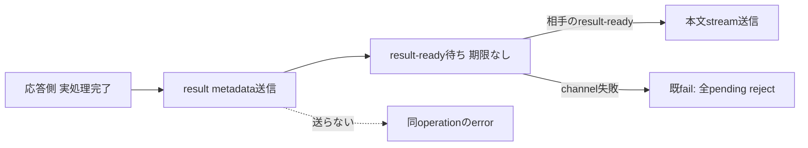

## 正式public observerと既保存の合成

### accepted AIとcaller期限

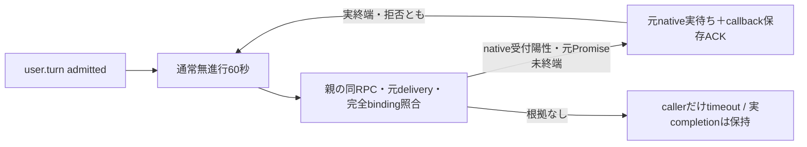

親requestは同RPC recordと未派生deliveryのgeneration/operationId/deliveryId/targetを元gateの`getNativeContinuation`へ渡す。admitted済みuser.turnのcaller期限に限り、その公開口が返す元native実completion Promiseの同identityを待ち、実終端後に通常60秒を再開する。登録/claimだけ・別RPC/別世代/別target・unknown・lease全体activeは継続根拠にしない。hookは親closureだけでwireやcaller optionsへ公開せず、channelに第二native状態を作らない。native Promiseのrejectは成功に変換せず期限再開だけを行う。通常callの無進行60秒、ACK5秒、stream credit、control/drain60秒と元RPC実completion/資源保持は変更しない。

`createConversationObserverParentEffects({snapshot,current,check,read})`は親だけの窓口。snapshot(context)→既同operationから実Bot配列、current(botId,context)→現在実Bot、check/readは既public CLI runnerのclosureを注入する。親channelは同rootの非native effect contextを同identityで保持し、factoryはWeakMapで同poll/generationへ実Botのid/projectを値で束縛する。子は実path/CLI引数を指定できない。runtime.observer.snapshot {}→{projects:[{botId,scope,projectBytes}]}、check {projects:[{id,scope,after}]}→既公開check結果、read {botId,scope,afterCursor?,throughCursor?,pageToken?}→既v2消費fieldだけ。

scopeはprojectのSHA256不透明値で、記録元やcursor/tokenの新方式ではない。旧state.projectの実pathは同hashで照合してcursor/token/seenを保持し、完読時だけ不透明scopeへ束縛する。通常親SelfTurnsもraw/opaque両projectを照合できる。同schema v1内のproject関連付けでありready中の保存/修理は0。新scope不一致は既project変更と同じ初回snapshot扱い。JSON path幅はBuffer.byteLength(JSON.stringify(projectPath),'utf8')を使い、子が既256/1MiBと同じchunkを組み立てる。

main381のsingleflight、pendingを先にreadして同巡checkから除外、chunk全結果検証後の逐次read/save、先行chunk保存の維持、token/cursor/projectの失敗巻戻し、stopで実runner終端まで待つ意味を維持する。dispatcher quiesceは既pollをabortせず実終端まで待つ。shownは親readをawaitし、append成功後だけopaque shownIdをconsumeする。背景begin ACK/実completionは0040500の同source追跡を保持する。全chunk先行走査/旧mtime fallback/別pollのscope借用/任意project proxyは0。

## 共通controllerへの固有wrapperと固定probe

親の同exchangeMutexを同identityで共通createModuleProcessへ転送し交換を直列化する。

Epiの正式handoffにより新conversation-process.mjsとprobe-conversation-runtime.mjsはN102所有。共通module-process/installed reader/C/locks/配置はEpi、同source署名資材/人工root準備はCenti、親assemblyと公開facadeはMollyのまま。createConversationProcessは同親admission/authorizeActor/onEffect/onEvent/onDiagnosticを固有ParentChannelへ渡し、共通createModuleProcessのclose/drain/世代交換へ接続する。readBotsは各初回/restoreで親の固定表示snapshotを返すclosure、initializeParamsはgeneration/mode/botsだけを子へ送る。canContinueは同lease/generationを公開assertで照合する。通過したPromise/options identityは保ち、controller未受付user.turnにも拒否accepted/completionを補う。

quiesce制御は第三timeout省略時だけ0で、controllerの明示残時間は尊重する。caller期限は実completionを解放せず、共通controllerが残60秒を実待機全体へ適用する。新wrapperのreadyはprotocol1と実state互換7値を検証、固定source/catalogの検証はruntime公開prepareModuleRelease('conversation',...)へ委ねる。

無引数probeはrootによる固定C起動だけを許し、子UID/GID1001/env空/advanced IPC。Centi/Epiが事前配置した作者probe-fixtureの表示snapshotでrestore→ready→resume→quiesce→exit→既OS/IPC/pipe closeを確認する。作用effect/eventは拒否、実SDK/席0、人工state配置や本番root変更をprobe自身で行わない。失敗はprobe子を回収し実closeまで待つ。成功はbellteam.conversation.runtime-probe.v1/互換7値/childClosed/externalEffects0だけを返す。

## 会話固有の親effects adapter

モリー00:39 JSTの正式移管により、`src/conversation-parent-effects.mjs`の`createConversationParentEffects({getServices,observerEffects,onExecution})`はN102が所有する。親共通の組立て・HTTP/MCP・ledger・旧writer撤去はモリー、gate/画像read/FDの機構はエピネル、native claim/finishは実transportの既所有を維持する。

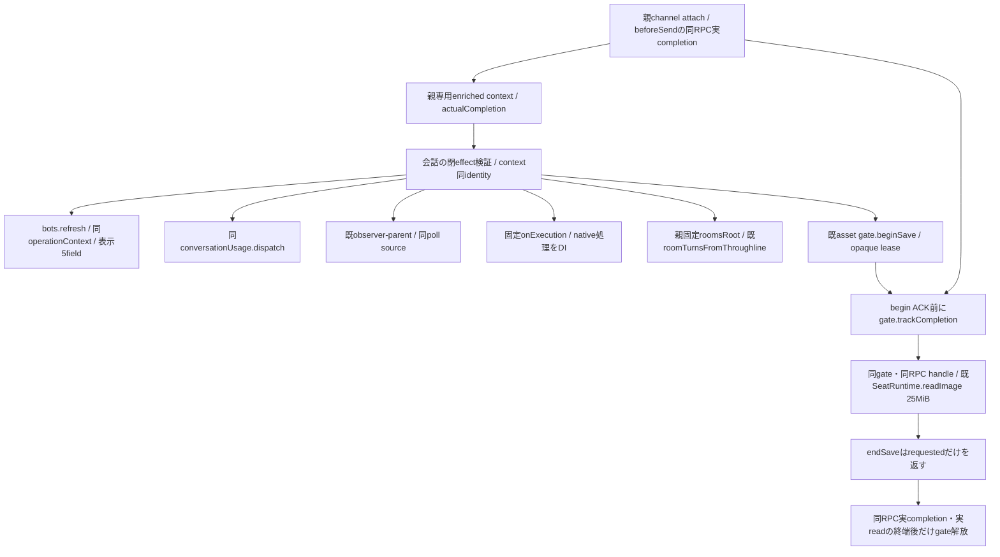

親`getServices()`は`bots`、`conversationUsage`、`conversationAssetGate`、`conversationCompletion(context)`、`seatRuntime`、`roomsRoot`を同実体で供給する。membersはfresh ACK後の同期表示snapshotからid/name/displayName/position/roleだけを射影する。usage/observer/onExecutionへは元enriched contextをそのまま渡す。任意methodやroomのprojectPath/CLI/envは閉DTOで拒否し、roomのprojectPathには親固定roomsRootだけを補う。実room-context runnerとその失敗意味は既公開helperが持つ。

channelのattachは送信試行前に受け取った実`completion`をrecord.actualCompletionへ保存し、同Promiseを親enriched context.actualCompletionへ渡す。wire root4field/callback5fieldは変更しない。共通assemblyのconversationCompletionはその親fieldをPromise検査して返し、欠測はbegin作用前に拒否する。同leaseの別RPC、caller返却Promise、end ACK、新deferredへ代用しない。

画像wire handleは同enriched context identityへ束縛し、その時点のgate/runtimeを保持する。clone/別RPC/別generationはlookup後の実gate assert前にも拒否する。readの実Promiseも実read開始前にgateへ登録する。endSaveの実終端PromiseはACKでawaitせず、成功終端後にhandleを破棄する。子がendSaveを送れなかった場合も同RPC実completionのsettleだけを契機に終了要請し、切断や期限から成功resolveを作らない。gateの実pending/削除drain/OS終端契約は変更しない。

直接試験は`test/conversation-parent-effects.test.mjs`と`test/conversation-ipc.test.mjs`の親保存接点。fresh射影・閉委譲・同context・元Promise identity・begin ACK前追跡・end requested中の未終端保持・別source handle拒否を確認する。親全assembly/HTTP/MCP/実C/native/署名/本番の成立は別工程である。

## 既callerの親facadeと表示callback

モリー11/4 01:15頃の正式移管により、`createConversationFacade({getController,context})`はN102所有。rooms/assets/messenger/roomMessenger/store/selfTurnsの既callerを固定methodへ正規化する。getControllerは各RPCで取得し、元optionsを同identityでcontext(method,options)へ渡す。返る親captured optionsはRPCごとのmutable objectで、履歴だけonChunkを付け、その同objectをcontrollerへ渡す。親lease/operationContext/authorityや元accepted/completionをcloneしない。結果の射影が不要な送信は元Promiseをそのまま返し、射影時もaccepted/completionを元実体へ結ぶ。

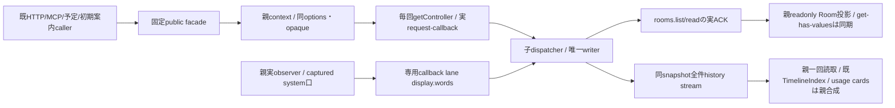

Roomのget/has/values/keys/entries/require/sizeは同期の表示投影だけ。refresh/readの成功後に更新し、部屋定義とmemberIds配列はreadonlyとする。新規認可には使わず、HTTP/MCP/予定は同親contextでfreshを待ち、子も既資格を検査する。削除成功後は当該投影を除き、members removeBot後は全投影を失効させ次freshへ。履歴list2をonChunkで一回集成し既JSON reader/TimelineIndexへ渡し、件数/本文の新上限や二回目のJSON生成を足さない。複数BotのtimelineViewsは各既rootのsnapshotで、全Bot同一瞬間の新transaction保証を作らない。

| 固定口 | 親の捕捉・入力・終端 |
| --- | --- |
| `display.words` | 親context DIがobserver actorのsystem opaqueを捕捉。専用callback laneのみ、root requestは拒否。`{botId,groupId,words}`を閉検証し、delivery登録不要で子appendInterimWordsへ。wordsは既text/kind/atだけ。Owner/Bot bodyや偽deliveryで権限を作らない。同RPC実completionは保存と親event終端後にだけ完了 |
| `user.post/user.turn`の`recordUser:false` | 親のonboarding actorだけを許可しtargetは同botId。Owner/Bot/usageの自己申告falseは拒否、公開HTTP bodyから新権限を増やさない。true/省略は既意味。同期acceptedと元実completionを保持し、初期案内のユーザー記録を省く |

assets.open/prepareBotAssetRemoval/cancelBotAssetRemovalは親同gate/FDへモリーが合成する。selfTurns.start/stopのpoll timerとstore/rooms.watchの親event寿命、共有application-services/runtime/HTTP/MCP/ledgerと旧writer撤去もモリー所有。facadeには第二writer/タイマー/任意methodを追加しない。既callback5種へのdisplay偽登録やsystem actorの追加は行わず、7actorのobserver捕捉に固定callback権限だけを足す。

## 交換前後の業務state検査helper（test-only）

`test/helpers/conversation-preservation.mjs:createConversationPreservationFixture({root,appRoot})`は既probe-fixtureのBot/Room/selfTurnsを再利用し、人工rootの固定stateだけを作る。writer/RoomRegistry公開口で前後の有効direct行とRoom履歴を保存し、その間に147NULを含む不正な一確定行を置く。非空cursor/seen/checkToken/lastCompletedAtとBot表示seedを持たせる。seedPathは既1001 private state内の`state/conversation-fixture-seed.json`で、固定6file fingerprintも同相対pathを使う。外側がroot1000:1000/0711とlogs/rooms/stateのprivate領域1001を準備し、helperは保護root直下へ書き込まず既fileも上書きしない。

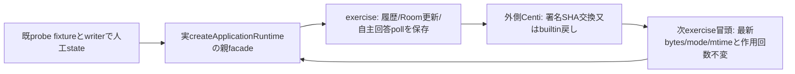

外側は実runtimeを作り、会話processの既onEffectに`fixture.wrapEffects(original)`を注入する。fixtureはobserver snapshot/check/readの既閉3effectだけを人工読取へ置き換える。手動pollは既moduleOperations.reserveの同opaqueを既options.operationContextへ渡して識別し、実保存cursor/checkTokenの旧値を要求して空deltaの新cursor/tokenを返す。runtime.startの初回/5秒timerによる背景pollは同保存tokenのunchangedを返し、CLI/新turn/保存変更0で通す。手動が既running背景巡へ合流した時は同実completion後に最大3回まで再試行する。他effectはnative/背景開始を含め元のparams/context同identityで既親へ委譲する。状態保持exercise中はnative数0を検査するが、後続の同root寿命検査をwrapperで拒否しない。外側はselfTurns.start等を差し替えず通常runtime.startを呼べる。

外側が交換した後の`fixture.exercise({runtime,label,versionId})`は、公開controllerの選択が期待値であること、保存した最新stateのbytes/mode/mtimeと通常業務逆effect/native回数が交換前と一致することを先に検証する。背景の無変更poll回数は別に記録し、増えても許容する。その後同親のowner/bot/observer文脈で履歴/Room/表示callback/selfTurns.pollを使い、新追記・Room名・cursor/tokenを保存して次段の基準にする。有効前後履歴と各段追記は重複せず、不正行の元bytesも保持する。Bot表示/Room履歴/予定/seen/最終完了値を各段で確認し、completion実Promiseも待つ。seedはconstructorの一回await時に作り、返るseedPath/botsを外側bootstrapへ使う。snapshot()/counts()/receiptsも返し、外側の原本保存へ使える。

helperはroot生成元/署名/C/UID1001/交換/cleanupを所有せず、controller.replaceを呼ばない。新wire/schema/業務APIも増やさない。直接試験は実default runtime.start/親assembly/facade/子IPCを使い、固定Cと署名descriptorだけを既人工child/metadataへ代替する。実5秒背景巡を保留して手動が合流する反例でも、再試行後にcursorを一回だけ進める。作者unitの代替SHA成功を署名実物の成功へ読み替えず、最終親の同bytesでの実署名交換結果はCentiが返す。

## T：reportだけの確定未発行結果

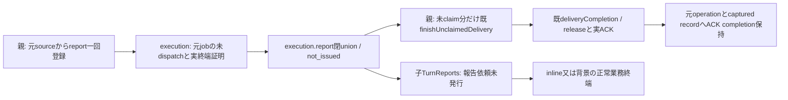

execution.reportの返値だけに既 `{delivery:'running'|'steered'}` 又はexact `{report:'unavailable',reason:'not_issued'}` を許す。親のnative実証は[execution正本](../execution/conversation-lifetimes.md#t-report専用の確定した未発行結果)を使い、同report opaque/target/groupId/sourceを変えず転送する。notify/turnはこの分岐を受けず、code/status/effect/receipt無しを未発行証明へ変えない。

親channelは正常unionも閉validator通過後、register済みdeliveryへ既finishUnclaimedDeliveryを適用する。未claimのみを正規finishし、nativeClaimed/既finish済みはtransportの実finishを重ねない。release ACKは元operationの実参照とrecord holdに残し、DTOでresolve/削除しない。子は同binding/active callback無しを検査してrelease ACKを返す。ACKをdelivery自身のpendingへ入れる自己待ちは作らない。

TurnReports.requestReportは未発行結果をそのまま返し、reason/recipients/groupIdの報告依頼済み結果へ進めない。inline/background双方のreports.checkは通常業務結果として終端する。報告保存/native受付/元要求成功/release済みを意味しない。一般background/lifetime/wireは変更せず、保存・相関・ACK未確認/切断・旧世代・dispatch開始後の失敗は既rejectを維持する。元pty_send条件反例や自然事故の原因解決は本差分に含まない。

## T：protocol-failed生存writer専用退役

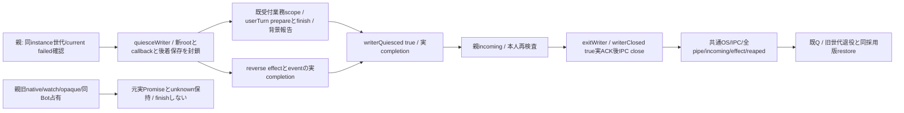

Owner承認Root `protocol-failed-writer-retirement-proposal-20261105.md` の会話固有契約。親私有controller.retireProtocolFailedWriter({generation})は同親mutex/同instance/current failedを確認する。子controlは同generation envelope＋params{}だけ、quiesceWriter→exact{writerQuiesced:true}、exitWriter→exact{writerClosed:true}。通常quiesce/exitの全native/registry/context drainを流用しない。exitWriterはwriter封鎖と実writer pending0の再検査後のみACKし、channelは正規ACK送信後だけIPCを閉じる。私有kill/failed解除/偽保存ACKは無い。

dispatcherは非native rootとcallbackの既受付scope、背景報告、userTurn.prepareUserTurn/finishUserTurnの保存を追跡し、userTurnのnative待ちだけを分離する。seal後の新root/callbackは拒否。既受付scopeと同operation内の継続だけ実終端まで許し、scope0後は旧結果の新規保存もeffectも拒否する。seal後は既受付保存scopeからも新nativeのturn/notify/reportやreconcile/closeLaunchを発行しない。保存完了に付随する既背景begin/end等の追跡だけは同scopeで終端まで処理する。store/Room/画像/self cursorの書込はこれらの業務scopeを通る。bootstrap/restoreは通常initializeの既順序で、退役controlはinitialize済み世代にしか使えない。

reverse effectは呼出結果とpeerの実completionを両方追跡する。caller deadlineのrejectでは保留参照を落とさない。eventも実completionまで追跡し、既受付save/effectが終端しなければwriter ACKを出さない。失敗が実終端しても保存成功には変えず、元failure/unknownを保持する。新controlが既failed解除や報告成功の代用になることは無い。

未保存の旧native回答/status/reportの保存と新writerへの移送は保証しない。旧callbackは同子封鎖後に拒否され、親の元native/watch/opaque/receipt/job/同Bot占有はKiroの実追跡に残る。親incoming/effect/reapedをnative物理終了へ変換しない。ACK不明/実completion未確定は停止せずunknown/unavailableを保持する。通常drain/close/交換と既Q異常終了回復は従来契約のまま。

## 子終了理由の有限記録（T原因の不足計測）

子peerは最初の終了理由を一回だけstderrへ一行のexact `{code:'CONVERSATION_CHILD_EXIT_ORIGIN',origin,failureCode}`として記録する。originはpeer_failure/parent_disconnect/exit_control/exit_writer_controlのみ。failureCodeはCONVERSATION_接頭辞のIPC_INVALID/IPC_DISCONNECTED/IPC_TIMEOUT/IPC_ACK_TIMEOUT/IPC_SEND_FAILED/CHILD_EXITED/BACKGROUND_UNCONFIRMED/DELIVERY_RELEASE_UNCONFIRMED/PROTOCOL_UNCONFIRMEDかnull。自由例外、本文、生世代は渡さない。親peerは記録しない。

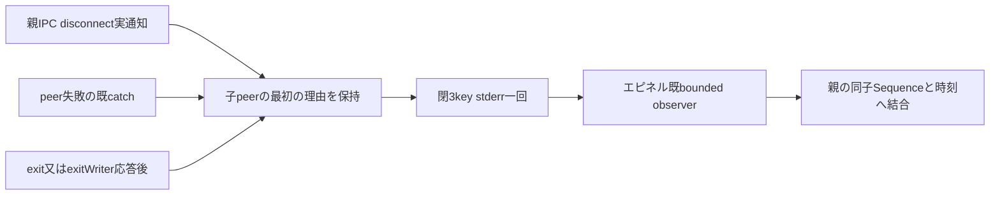

親からのdisconnect通知は共有stream listenerより前に子peerが登録して記録する。自身のpeer失敗は既disconnect前、正常exitは既close前に記録し、後着通知で上書きしない。sink例外は隔離し、既error/Promise/barrier/保存ACK/再生成順を変えない。これはJS接点に到達した理由だけで、突然のOS終了や過去事故原因を網羅しない。親observer/別MODULE_CHILD_EXIT_ORIGIN consoleと共通待機計測はruntime担当、既v1 child-exit DTOは不変。

## V-3 共有背景要約の一件限定入力

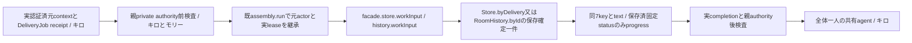

private readInput(input,authority)のinputは閉7key botId/sessionId/launchId/inputRevision/deliveryId/context/contextId。authorityは元enriched本人contextと同期assertCurrentで親だけが保持する。モリーは前後assert→既run(original actor,read,original parent)→実result/completion待ち。失効/終端/交換/退役はnull又は型付き拒否からmissingとし、新leaseで救済しない。通常owner/bot/schedulerの許可された元rootだけを親captureで採用し、usage secret/question/onboarding/observer/bridge/report/recoveryを構造除外する。private closureをwireへ渡さない。

子は閉7keyと保存原本の一意性・宛先/会話・現Bot/Room所属を検査。返却はnull又は同7key＋text/progressの閉9key。textは元本文4000Unicodeまで、progressは同配送の保存済running/steered/delivered/failed/stopped又は空文字（1000上限内）。interim/自由error・画像/任意file/他履歴は返さない。未確定末尾/重複/欠測/壊れた索引は本文を返さない。親がsession/launch/inputRevisionの本人性と実状態を所有し、readerがnative turnを作らない。既deliveryAnchorのbot本人制約は無変更。

新一般HTTP/MCP窓口・履歴全件転送・書込・新AI起動なし。既署名inventory内のファイルだけを変更し、新runtimeファイルは増やさない。通常本文に混入した未知の秘密を検出保証する分類器ではなく、専用secret入力経路を親captureで除外する契約。

## 実子終了後のcallback終端

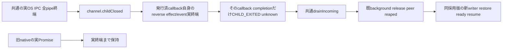

親私有childClosed():Promise<void>は実OS/IPC/全pipe終了を共通controllerが証明した後、incoming段階のdrainIncomingより前に呼ぶ。発行済callbackだけを選び、各record.effectsのdirect reverse effect/eventが実終端してからそのcompletionをCHILD_EXITED/unknownで拒否する。保存成功を作らず、元resultの失敗を保持する。root incomingがcallbackを待つため、rootのeffectsを待ち集合へ混ぜない。callback各件は並列に終端し、他callbackがroot側で待つ循環も作らない。

root/control/背景ACK/delivery release/旧nativeはこの口で解放しない。既reapedと元実Promiseの終端を維持し、保存effectが未終端ならchildClosedも未終端。新wire/新deadline/新診断stageなし。共通は既incoming waiting後に本口をawaitし、drainIncoming→reaped→lostを続ける。直接試験はtest/conversation-ipc.test.mjsのchildClosed一件の当接点だけ、共通OS順序と実子閉の合成はruntime所有者へ渡す。

## Protocol v1 reverse-error compatibility (2026-11-07)

The parent sends error envelopes with exactly `code,outcome,status` to retained conversation children. All parent failure paths (execution, acceptance, capacity and input budget) use this projection. An operation failure must reject that operation while preserving the channel for subsequent requests. Child-to-parent errors retain the existing sanitized optional failure fields. Delivery-history details continue through the registered `delivery.status` callback, whose exact original delivery/target binding and persistence precede execution acceptance rejection. Error envelopes do not substitute for callback persistence. No new protocol version, capability, gate or retry is introduced.

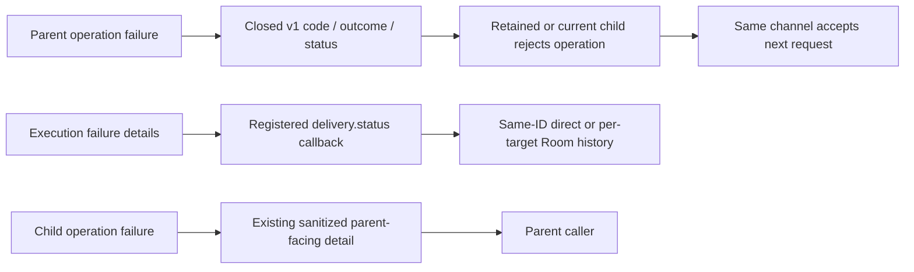

The retained91d9/current-parent1015 source counterexample proves an incompatible error envelope, not the original production five-second exit trigger; no original reverse operation/error was captured. Runtime lifecycle/gate changes remain runtime-owned.
