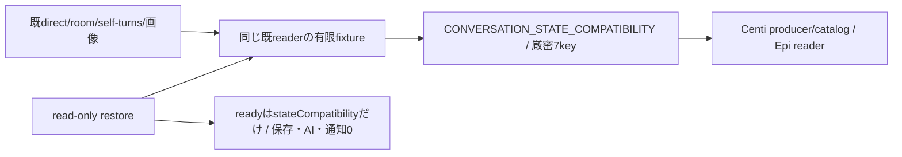
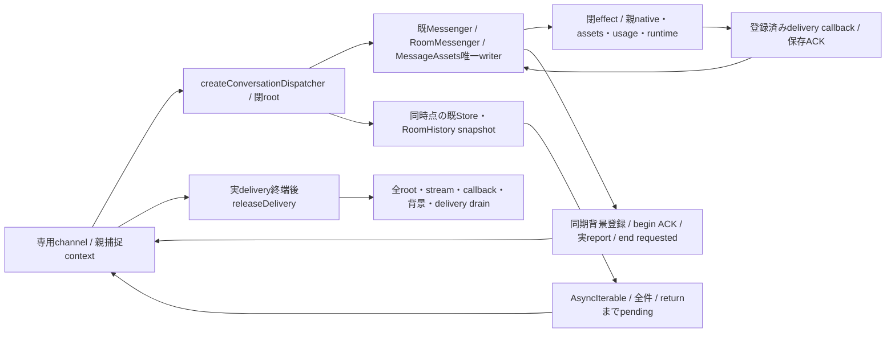
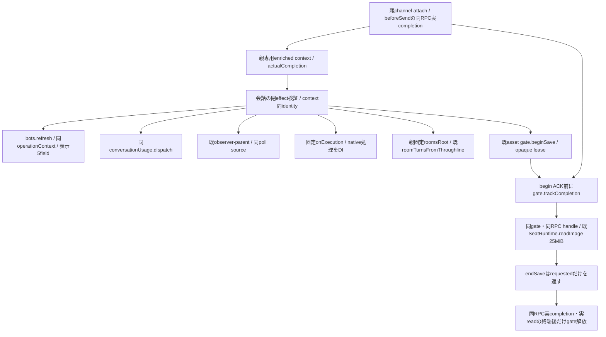
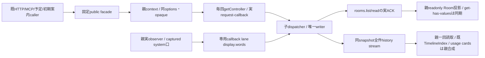

# 会話processの業務境界（実装工程）

N102が会話の閉DTO・writer/reader・Room/画像保存・観測/回答所有/背景報告を所有する。Root横断契約v1はbot-7b140b27/docs/conversation-update-contract-20261103.md（133222cf）が正本。機構/親FD/gateはruntime、native/lifetime信用資料はexecution、認証/facade/両入場/組立てはintegration。既図は[README](README.md)から辿り、全体図を複製しない。

現実装baseはmain6d21419b96f289b1a9f61d707c40c5cbfce12177。初回入力afdc/8ccaとは別。Root読取4e01の15source中14は同bytes、application-servicesだけが共通moduleCatalogを同Host clientへ接続した差分であり、会話内部15sourceの意味を既採用と混同しない。

## 先着供給：状態互換と既reader

`src/conversation/state-compatibility.mjs`のCONVERSATION_STATE_COMPATIBILITYとassertConversationStateCompatibilityが唯一の公開export。配列順/値と7keyをexactにし余剰・不足・未知を拒否、writerが出すschema集合と既readerが受ける記録を混同しない。既reader本体をこの先着差分では変更せず、direct unknown schema拒否とRoom unknown object保持、完全JSON未改行preview、不完全tailのdirect保留/Room例外、bad batch未反映、optional metadataとstatus/trackingを人工fixtureへ固定する。原本test/fixtures/conversation-reader-v1.json、直接test/conversation-reader-contract.test.mjs。

## 接続と未完範囲

子factoryはcreateConversationDispatcher({root,effect,event,diagnostic,...})、validateRequest/Result・validateCallback/Result・dispatch/dispatchCallback/control/disconnectを専用channelへ合わせる予定。control/dispatch/callbackは(method,params,context)、ready {stateCompatibility}、initialize {generation,mode:'bootstrap'|'restore',bots:検証済表示snapshot}。wirebase generation/operationIdと親の認証projection/登録済callbackだけをcontextへ、外部bodyの同形fieldで権限を作らない。history AsyncIterable/chunk/credit/stream機構はEpi所有。

閉DTO/writer/restore/追跡の残実装はこの図を拡張して同差分で行う。初版は全callback/SeatTurnWatch/非await afterTurnと元turn一回派生reportの実終端まで旧子を保持する。新世代回答移譲0。親stableRoom/asset gate/FD保持、60秒busy/旧resume/新子0/AIabort0/再送0をRoot正本どおり接続する。先着互換exportの成功を子交換/唯一writer移管/本番成功へ補完しない。

userTurnは返すPromiseへ同期`.accepted`を持つ。nativeの既受付後にそのPromiseだけが終端し、runtimeはroot slotを解放できる。元Promiseは既prepared/knownReplyIds/claimedReplyIdsと最終保存を同旧子で持ち、受付成功を回答保存成功にしない。enqueueUserTurnは同経路のacceptedだけを既返却形で返す。acceptedを持たない既低層transportでは実completionまでslotを解放しない。dispatcherもasyncラッパーでこのpropertyを落とさず、背景報告の親参照と実completionはroot slotから別に追跡する。

## callback保存の閉DTO

親normalizerはsrc/conversation/callbacks.mjs。元Errorのmessage/stack/cause/任意keyをwireへ写さず、停止判定に必要なBOT_STOPPED/AI_GLOBAL_PAUSED又は固定failure codeと既安全mcp_error/native_launch、HTTP status/known outcomeだけを残す。これはroot業務Errorの公開意味を変える正規化ではなく、登録済みdelivery callbackの保存用射影。親は元Error/実receiptを保持する。

callback kindはdelivery.status/words/answer/user.complete/turn.endだけ。paramsへdeliveryId/target/世代/lease/任意recordを入れない。別の親登録contextがgeneration/operationId/deliveryId/target/callbackKindを束縛して旧子へ渡す。plain validatorは型の正しさだけで本人性を作らず、channel/Kiroが実登録を確認する。ACK {applied:true}は当該保存/finish/reportの実終端後だけ。turn.endのcheck/一回派生report待ちはRoot保守drainの対象で、通常native accepted/完了返却をその待ちへ置換しない。

## 親actorと閉root matrix

src/conversation/authority.mjsが7種actorと許可root methodの一正本。owner、bot(botId)、scheduler、bridge、onboarding(botId)、usage(source secret/question,botId)、observerだけ。rootにはreport/system actorを追加しない。parent authentication/registered ingressがactorを捕捉し、wire actorの型検証だけで本人性を作らない。seatSession/launch/実executionSourceと両予約context={membersLease,conversationLease}は親closureに残す。作用前両予約はMolly同moduleOperations、子業務paramsのlease自己申告0。

assets.openは公開facade上の親FD helper専用で、child root集合とは分ける。子にNode FD/streamを返す口にしない。Root matrixは各kindの許可methodの上限であり、MCPの既操作資格・fresh Room代表/所属・登録済みcaller限定の検査を省略しない。member.removeFromRoomsはmembers既削除の内部callerからだけ捕捉し、一般Bot JSONのmethod指定を許可にしない。

`src/conversation/requests.mjs`がprivate正規化後の全root payloadとcontrol/callback contextを閉検証する。root contextは親捕捉exact `{generation,operationId,actor,continuation}`、callbackはKiro登録exact `{generation,operationId,deliveryId,target,callbackKind}`、controlは`{generation,operationId:null}`。continuationは親assertLease後のepoch差からだけ作り、型検証をlive leaseの証明へ代用しない。initializeはgeneration一致/mode/bootstrap又はrestore/表示snapshotのid一意を確認し、台帳未供給nullやproject/資格等の余剰fieldを拒否する。ready effect0。

root payloadは各methodの固定キーだけ。public MCP/HTTPのimage/images、room/roomId、任意target名/default/recordUser等の既公開表現は親facadeで明示的に射影し、private DTOをそのまま外部APIの新引数制限として使わない。Room/scheduleの意味検証は同既writer、添付の実25MiB/MIME検出は同既reader、body予算はchannel/既入口が保持する。閉DTOで履歴件数/添付枚数/文字列サイズの新しい任意上限を足さない。payload validatorは作用や本文I/Oをせず、result/effect/dispatcherの後続結合と区別する。

## read-only restore

RoomRegistry.restoreは既rooms directory/room.jsonとschedule.jsonを読み、既Room正規化とschedule定義の検証だけを行う。initializeのmkdir/chmodと欠測schedule作成を呼ばない。SelfTurns.restoreは既bellteam.self-turns.v1のcursor/seen/lastCompletedAtを読み、欠測だけ空の初回状態とし、存在する破損/未知schemaを空へ丸めない。通常initializeの既挙動は維持する。

restoreConversationStateは検証済Bot Mapを必須としRoom/self stateと同じStoreを組み立てる。履歴readerは既Contractのまま遅延読取、readyへ履歴を転送せず、外部effect/画像gate/readObserver/Jev/報告/通知/予定発行0。strict restoreの有限fixtureは全ファイルbytes/mode/mtime不変、外部callback未発行、欠測/破損の差と通常bootstrapだけの作成を確認する。

署名前probeの最小入力正本は`src/conversation/probe-fixture.json`。検証済み表示snapshot用botsと固定相対path三ファイルだけを持つ。隔離state rootへの配置はprobe準備工程で行い、各files値をJSON.stringify(value)+LF、directory0700/file0600で保存する。restore自体は配置しない。room一件/所属bot一件/空schedule/初回self cursor nullを既readerで読み、欠測direct/room履歴は空として読む。generationはruntimeが発行する値をinitializeへ与え、modeはrestore、botsは当該snapshot。引数0の固定probe/helperがこの入力を同app内へ配置する責任はruntime/配布にあり、fixture成功を未供給dispatcher/channelのready成功へ補完しない。実予定/Jev/observer/通知0、履歴/画像ファイル生成0、全fileとdirectoryのbytes/mode/mtime不変を新直接fixtureで束縛する。

## routing資格のepoch

親usage.routing.readは当該判定のときだけ呼ぶ。src/conversation/routing.mjsは返却enabled/epoch/apiKeyを閉検証し、routing.changedより古いreadが遅着したら資格を破棄して発行0、retry0。資格は当該runのcapabilityだけに保持し、changed/終了で参照を落とす。fetch直前も同epoch/enabledを確認する。getter/診断/ACKにAPI keyを反射せず、control ACKはapplied/epochだけ。Jev HTTPS/model/質問/閾値/応答検証は既会話版が持つ。設定更新は閉business root待ちにせずEpi control経由、readyではread/外部HTTP0。

## 子画像writerと親gate

MessageAssetsのchild用saveAdmissionはbeginSave(owner)→wireLeaseId、endSave(wireLeaseId)→終端要請ACK。同dispatcher contextをclosureに保持し、private assets.beginSave {owner}→{leaseId} / assets.endSave {leaseId}→{requested:true}へ接続する案。実親leaseとactual completionは親adapter/channelだけが持つ。beginはreadImage前、saveAllは一leaseで全batch write/closeまで保持する。finallyのend失敗で書込失敗を隠さず両方を保持し、ACKを実write終端証明にしない。

child用readImageの第3内部引数へ当該saveのwireleaseIdを渡し、runtime.image.readのleaseIdと同operationを親が照合する。並行save同士で共有の「現在lease」を置かず、各batch closureが保持する。従来readImage(image,maxBytes)の低層実装は第3引数を使わず既意味を維持し、返すasset metadataや履歴へwireleaseを保存しない。

child用instanceではreadRemovalStates/prepare/cancel/openを使わず親専用として拒否する。親gateとFDの複製0。通常旧constructorは公開契約内の旧親実装を維持し、Mollyが新writer採用時だけ親旧writerを廃止する。

## 固定effectと背景完了

private effect/返値の閉schema正本は`src/conversation/effects.mjs`。members.profiles.readは親fresh ACK/revision採用後の表示5fieldのみ、usageの3effectはMika本人factoryへ、席画像/observer/room-contextはruntime既口へ、native/背景派生はKiroの同親gateへ接続する。ready context operationId:nullからのeffectは全拒否。型検証とは別に親は同捕捉operationとopaque/live context、root method、登録済source、画像leaseを照合し、任意RPC/path/資格proxyにしない。

execution.notify/turnはdeliveryId/target/message/images/queue/kinds。親はqueue.groupId=deliveryIdを固定してnative前registerDelivery、claimNativeはtransport内で一回だけ。turnの返値delivery=running/steeredはacceptedだけ、user.complete保存と最終replyは別のcallback/実lifetime。reportはsourceDeliveryId/target/deliveryId/reason/message/queue/kindsから同operationのdeliveryFor→一回deriveReport→notifyReport。report queue/context/targetは親も固定し、turn.end/user.completeの再帰を拒否する。

非await hookは子pendingへ同期登録し、execution.background.beginの親runBackground参照取得ACK前に元root/user.complete最後を落とさない。endはrequestedだけで実deferredをresolveしない。channelの`trackBackground(backgroundId,context,actualPromise)`へ実check/report/finally end ACKまでのPromiseを結び、channelが別のbackground-complete制御/同source/endRequested/実effect終端を確認してから親deferredとcompletion ACKを確定する。登録はvoidで、実Promiseへcompletion ACK待ちを入れ循環させない。quiesceはchannel側completion ACKも待つ。turn.end invokeは既背景windowを持つのでbegin/trackを重ねない。SelfTurnsだけobserver poll/親許可Bot snapshot限定のexecution.observation.sourceから非native sourceを取得し、native同turn因果証明とは区別する。

子の`ConversationBackground.start(source,context,operation)`はPromiseと同期`.started`を返す。source取得もpending登録後に始め、親begin ACK→channel track登録→実check/report開始の順。dispatcherは同operationの`awaitStarted(context)`だけ待ってから元root/user.complete保存ACKを返し、他operationや報告の実完走待ちへ広げない。child drainは実Promiseを、channel drainは別のcompletion ACKを追う。checkとfinally end両失敗はAggregateErrorで保持する。親observer sourceのfinishは親register callerがbegin参照取得後又は未使用sourceのroot実終端で一回だけ行い、native deliveryのtransport finishを重ねない。

runtime.image.readはimage/wireleaseIdから親の同operation gateを照合し既SeatRuntime.readImage固定25MiB、任意maxBytes0。runtime.room.contextは親固定roomsRootを補い既room-contextを呼ぶ。observerは正式同配布採用main a960の公開check/readへ結合し旧signature/changedを戻さない。子表示snapshotへprojectを渡さず、pollの親snapshotはbotId/不透明scope/実projectのJSON byte幅だけを返す。同pollの親context identityへ実Bot object/projectを捕捉し、check/readの前後で現在object/projectを照合する。wire返値は既consumerが読むstatus/cursor/page/turn本文だけへ正規化し、全文/opaque cursor/既statusを保つ。

history.listMessages/listRoomMessagesは同snapshotのAsyncIterable JSON値そのものを返し、runtimeだけが専用streamへencodeする。親onChunk(Buffer)はawaitで消費し一回既array/indexへ集成、usage cardsを合成してから既timelinePage/recentTimeline/fullTimelineを呼ぶ。子baseだけの先行pageや件数limit追加0、第二全件JSON文字列0。history.page/recent/exportは親facadeで既公開結果を組み立てる接点としてCONVERSATION_PARENT_METHODSへ分類し、actor ceilingは維持する。子wire root集合とprivate request/resultはlist2だけで、同public操作を子の先行pageへ置換しない。

## root result・回復handle・quiesce

`src/conversation/results.mjs`が各wire root/controlの返値を閉検証する。Room/assetは固定形、既schedule原本の将来optional dataとhistory既readerの行意味は保持し、外側resultへ権限fieldを追加しない。history返値は専用AsyncIterableだけ。user.turn最終保存結果とacceptedは別schemaの時点を持つ。

execution.assertAccessは親の同opaque/live operationに保持した元admitWork checkと現在assertEnabledを検証する。pause→resumeで元epochを捨てた新admitへ置換しない。非AIのtarget=user等へ新停止拒否を足さない。observer表示回収には元AIadmitを作らず、親捕捉observation.pollの背景だけ現在assertEnabledを検証し、親由来AI_GLOBAL_PAUSEDをcontent判定のenabled=falseへ扱う。他の相関/資格/unknownはfalse成功に丸めない。missing-reportとnative派生は別の通常準備/停止/資格を維持する。

execution.reconcileは既親二層照合の実executionを同generation/operation/bot/delivery/完全targetへ束縛したrecoveryIdだけ返す。execution.notifyの同handleはnative前一回消費し、unknownでも再reconcile/再送にしない。execution.closeLaunchは親既transportの完了receiptを捕捉してclosureIdだけ返す。子rootはclosureIdとdelivery_id/from/targetの表示metadata、親facadeは同捕捉operationと完全targetへ照合した元receiptを既公開closedへ戻す。子JSONからnative証拠を作らず、親handleをcaller timeoutで早期破棄しない。

quiesceは新poll/新rootを直ちに閉じ、自身の実pendingを待ってから最終{quiesced:true}だけ返す。channelと親Kiro drainは並列に同じ親60秒を使い、quiesceへ5秒を掛けない。resumeは独立controlでepochを進め古いquiesce完了を無効にし、子は業務をabortしない。親はresume ACKだけ5秒、旧kill0/new0。exitは子とchannel両quiesced/全実pending0を条件とし、exit ACK送信完了後のOScloseはruntime所有。

## 実dispatcher factoryと保存終端

`src/conversation/dispatcher.mjs`のcreateConversationDispatcher({root,effect,event,trackBackground,diagnostic,fetcher})が既writer/Room予定・資格/画像save/回答claim/報告/観測を組み立てる。返却はvalidateRequest/dispatch/validateCallback/dispatchCallback/control/releaseDelivery/disconnect。initializeは表示snapshot必須、restore時の書込/effect/eventは0。bootstrapだけ既Room/SelfTurns初期化を行い、timerは子に作らず親のobservation.pollを唯一入口にする。resume後に新rootを受ける。channelで先に受付済みのdispatchと登録callbackはquiesce開始後も終端まで続け、古いquiesceはresume epochで成功ACKを失う。

子のConversationStoreは`onCorruption: report => diagnostic(report)`を注入し、確定不正行の固定診断を既diagnostic portへ渡す。親runtimeが捨てるstderrへ診断を依存させず、親の同Diagnostics保存へ接続する。Storeの確定行除外/検証/byte・line/preview契約は[履歴読取図](flow.md#破損した直接履歴の読取)のまま。

user.turnのdispatch Promiseには同期accepted Promiseを保ち、user.postは受付だけ返す。両方とも最終保存Promiseは子pendingに残る。user.completeは同delivery登録と一回性を検証し、最終保存と同operationの背景begin取得までACKしない。native.releaseDeliveryは親が実終端を証明して送る4field bindingだけを受け、callback処理中や不一致を拒否する。delivered/status/acceptedだけで登録を消さない。native/親gate/OS処理の所有は移さない。

history list2は既readerが作った一回のarray snapshotをAsyncIteratorへ渡し、後続appendを混ぜない。文字列全件再生成/件数制限0。未読streamもpendingへ入り、終端又はiterator.return/throwで解放する。元readerのbad batch/partial tail判定は変更しない。親はこのstreamを一回集成してusageカードと既paginationを適用する。

effectへ`execution.shown.read {botId}`→null又は`{shownId,words,endedAt}`、`execution.shown.consume {botId,shownId}`→`{applied:boolean}`を追加する。observer捕捉rootだけ許し、親が既shownInSelfTurnの実参照へ不透明shownIdを束縛する。子は回答append成功後にだけ同shownを消費し、親の新しい表示語を古いhandleで消さない。これは既表示語除去の接続で、observer cursorや確認値の新方式へ切替えない。

eventは`{type:'changed',topics,all,botIds,roomIds}`だけで、本文/資格/任意recordを送らない。direct保存、Roomの初回/経過/callback保存、予定/定義更新後に送る。direct statusの当事者不明はall:trueで既履歴再照合へ。usage通知は従来どおり保存後の非transactional処理で、失敗を診断の固定codeへ送り記録を戻さない。親がeventを既SSE/安定facadeへ接続する。

## 会話固有channel/entryの所有変更

diagnosticは既channelの子送信/親受信で同じ固定unionを検証し、MESSAGE_LOG_INVALIDだけexact {code,line,offset,length,reason}（lineは1以上、offset/lengthは0以上のsafe整数、reasonはnul/syntax/schema）を許し、他はcode-onlyを維持して本文/自由例外/stderrを転送せず親onDiagnosticへ渡す。

Root21:55分担により会話固有parent/child adapterと薄いentryはN102が所有。Epiの共通module-streams、input budget、background/delivery-release、C/locks/controllerをそのまま使用し複製しない。同lease/correlationで複数の順次・同時rootを許し、各RPCの数値封筒idと親captured method/authorityを個別に保持する。reverse effect/eventの封筒sourceは元RPC id、wire root/callback context自体は既4/5fieldのまま。同operationIdだけで別methodの権限へ広げない。

親optionsのconversationLease/capturedAuthority/operationContext/admissionCheckは同identityで親に保持し、onEffectへconversationDeliveryを加える。native前registerDelivery/delivery-release、report derive、observer source、背景runBackground/deferredとACKをadapterが結合し、transportのclaimNative/finishは重ねない。root8のslotはuser.turnの実acceptedで解放、元RPC completion/保存参照は完走まで残す。historyは別streamをawait onChunk(Buffer)へ送る。独立control capabilityをdata credit待ちにせず、切断/期限で実completionをresolveしない。

親channelのdrainIncomingは受信済effect/event/controlとhistory onChunkの実処理終端だけを待つ。切断ではbyte readerを閉じるが、既発行の親作用や投影commitが戻るまで同Promiseを保持する。outgoing RPCのreaped待ちcompletionは含めない。controllerは旧OS/IPC/pipe終端→drainIncoming→reaped→次子restore/readyの順でつなぎ、切断やcaller期限を作用完了へ置換しない。

stream本文はcallのaccepted/返値metadataのresult-readyを受けてから送る。実advanced IPCがmetadataとopenを同じbatchへ渡す場合にも登録前の本文を落とさない。通常stream4とroot8は別に待機し、callback/continuation枠を保持する。control返値は独立control capabilityの閉DTOとして返し、本文creditを待たない。

## 正式public observerと既保存の合成

`createConversationObserverParentEffects({snapshot,current,check,read})`は親だけの窓口。snapshot(context)→既同operationから実Bot配列、current(botId,context)→現在実Bot、check/readは既public CLI runnerのclosureを注入する。親channelは同rootの非native effect contextを同identityで保持し、factoryはWeakMapで同poll/generationへ実object/projectを束縛する。子は実path/CLI引数を指定できない。runtime.observer.snapshot {}→{projects:[{botId,scope,projectBytes}]}、check {projects:[{id,scope,after}]}→既公開check結果、read {botId,scope,afterCursor?,throughCursor?,pageToken?}→既v2消費fieldだけ。

scopeはprojectのSHA256不透明値で、記録元やcursor/tokenの新方式ではない。旧state.projectの実pathは同hashで照合してcursor/token/seenを保持し、完読時だけ不透明scopeへ束縛する。通常親SelfTurnsもraw/opaque両projectを照合できる。同schema v1内のproject関連付けでありready中の保存/修理は0。新scope不一致は既project変更と同じ初回snapshot扱い。JSON path幅はBuffer.byteLength(JSON.stringify(projectPath),'utf8')を使い、子が既256/1MiBと同じchunkを組み立てる。

main381のsingleflight、pendingを先にreadして同巡checkから除外、chunk全結果検証後の逐次read/save、先行chunk保存の維持、token/cursor/projectの失敗巻戻し、stopで実runner終端まで待つ意味を維持する。dispatcher quiesceは既pollをabortせず実終端まで待つ。shownは親readをawaitし、append成功後だけopaque shownIdをconsumeする。背景begin ACK/実completionは0040500の同source追跡を保持する。全chunk先行走査/旧mtime fallback/別pollのscope借用/任意project proxyは0。

## 共通controllerへの固有wrapperと固定probe

親の同exchangeMutexを同identityで共通createModuleProcessへ転送し交換を直列化する。

Epiの正式handoffにより新conversation-process.mjsとprobe-conversation-runtime.mjsはN102所有。共通module-process/installed reader/C/locks/配置はEpi、同source署名資材/人工root準備はCenti、親assemblyと公開facadeはMollyのまま。createConversationProcessは同親admission/authorizeActor/onEffect/onEvent/onDiagnosticを固有ParentChannelへ渡し、共通createModuleProcessのclose/drain/世代交換へ接続する。readBotsは各初回/restoreで親の固定表示snapshotを返すclosure、initializeParamsはgeneration/mode/botsだけを子へ送る。canContinueは同lease/generationを公開assertで照合する。通過したPromise/options identityは保ち、controller未受付user.turnにも拒否accepted/completionを補う。

quiesce制御は第三timeout省略時だけ0で、controllerの明示残時間は尊重する。caller期限は実completionを解放せず、共通controllerが残60秒を実待機全体へ適用する。新wrapperのreadyはprotocol1と実state互換7値を検証、固定source/catalogの検証はruntime公開prepareModuleRelease('conversation',...)へ委ねる。

無引数probeはrootによる固定C起動だけを許し、子UID/GID1001/env空/advanced IPC。Centi/Epiが事前配置した作者probe-fixtureの表示snapshotでrestore→ready→resume→quiesce→exit→既OS/IPC/pipe closeを確認する。作用effect/eventは拒否、実SDK/席0、人工state配置や本番root変更をprobe自身で行わない。失敗はprobe子を回収し実closeまで待つ。成功はbellteam.conversation.runtime-probe.v1/互換7値/childClosed/externalEffects0だけを返す。

## 会話固有の親effects adapter

モリー00:39 JSTの正式移管により、`src/conversation-parent-effects.mjs`の`createConversationParentEffects({getServices,observerEffects,onExecution})`はN102が所有する。親共通の組立て・HTTP/MCP・ledger・旧writer撤去はモリー、gate/画像read/FDの機構はエピネル、native claim/finishは実transportの既所有を維持する。

親`getServices()`は`bots`、`conversationUsage`、`conversationAssetGate`、`conversationCompletion(context)`、`seatRuntime`、`roomsRoot`を同実体で供給する。membersはfresh ACK後の同期表示snapshotからid/name/displayName/position/roleだけを射影する。usage/observer/onExecutionへは元enriched contextをそのまま渡す。任意methodやroomのprojectPath/CLI/envは閉DTOで拒否し、roomのprojectPathには親固定roomsRootだけを補う。実room-context runnerとその失敗意味は既公開helperが持つ。

channelのattachは送信試行前に受け取った実`completion`をrecord.actualCompletionへ保存し、同Promiseを親enriched context.actualCompletionへ渡す。wire root4field/callback5fieldは変更しない。共通assemblyのconversationCompletionはその親fieldをPromise検査して返し、欠測はbegin作用前に拒否する。同leaseの別RPC、caller返却Promise、end ACK、新deferredへ代用しない。

画像wire handleは同enriched context identityへ束縛し、その時点のgate/runtimeを保持する。clone/別RPC/別generationはlookup後の実gate assert前にも拒否する。readの実Promiseも実read開始前にgateへ登録する。endSaveの実終端PromiseはACKでawaitせず、成功終端後にhandleを破棄する。子がendSaveを送れなかった場合も同RPC実completionのsettleだけを契機に終了要請し、切断や期限から成功resolveを作らない。gateの実pending/削除drain/OS終端契約は変更しない。

直接試験は`test/conversation-parent-effects.test.mjs`と`test/conversation-ipc.test.mjs`の親保存接点。fresh射影・閉委譲・同context・元Promise identity・begin ACK前追跡・end requested中の未終端保持・別source handle拒否を確認する。親全assembly/HTTP/MCP/実C/native/署名/本番の成立は別工程である。

## 既callerの親facadeと表示callback

モリー11/4 01:15頃の正式移管により、`createConversationFacade({getController,context})`はN102所有。rooms/assets/messenger/roomMessenger/store/selfTurnsの既callerを固定methodへ正規化する。getControllerは各RPCで取得し、元optionsを同identityでcontext(method,options)へ渡す。返る親captured optionsはRPCごとのmutable objectで、履歴だけonChunkを付け、その同objectをcontrollerへ渡す。親lease/operationContext/authorityや元accepted/completionをcloneしない。結果の射影が不要な送信は元Promiseをそのまま返し、射影時もaccepted/completionを元実体へ結ぶ。

Roomのget/has/values/keys/entries/require/sizeは同期の表示投影だけ。refresh/readの成功後に更新し、部屋定義とmemberIds配列はreadonlyとする。新規認可には使わず、HTTP/MCP/予定は同親contextでfreshを待ち、子も既資格を検査する。削除成功後は当該投影を除き、members removeBot後は全投影を失効させ次freshへ。履歴list2をonChunkで一回集成し既JSON reader/TimelineIndexへ渡し、件数/本文の新上限や二回目のJSON生成を足さない。複数BotのtimelineViewsは各既rootのsnapshotで、全Bot同一瞬間の新transaction保証を作らない。

| 固定口 | 親の捕捉・入力・終端 |
| --- | --- |
| `display.words` | 親context DIがobserver actorのsystem opaqueを捕捉。専用callback laneのみ、root requestは拒否。`{botId,groupId,words}`を閉検証し、delivery登録不要で子appendInterimWordsへ。wordsは既text/kind/atだけ。Owner/Bot bodyや偽deliveryで権限を作らない。同RPC実completionは保存と親event終端後にだけ完了 |
| `user.post/user.turn`の`recordUser:false` | 親のonboarding actorだけを許可しtargetは同botId。Owner/Bot/usageの自己申告falseは拒否、公開HTTP bodyから新権限を増やさない。true/省略は既意味。同期acceptedと元実completionを保持し、初期案内のユーザー記録を省く |

assets.open/prepareBotAssetRemoval/cancelBotAssetRemovalは親同gate/FDへモリーが合成する。selfTurns.start/stopのpoll timerとstore/rooms.watchの親event寿命、共有application-services/runtime/HTTP/MCP/ledgerと旧writer撤去もモリー所有。facadeには第二writer/タイマー/任意methodを追加しない。既callback5種へのdisplay偽登録やsystem actorの追加は行わず、7actorのobserver捕捉に固定callback権限だけを足す。
