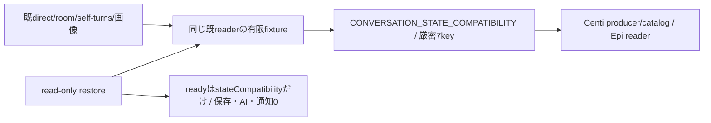

# 会話processの業務境界（実装工程）

N102が会話の閉DTO・writer/reader・Room/画像保存・観測/回答所有/背景報告を所有する。Root横断契約v1はbot-7b140b27/docs/conversation-update-contract-20261103.md（133222cf）が正本。機構/親FD/gateはruntime、native/lifetime信用資料はexecution、認証/facade/両入場/組立てはintegration。既図は[README](README.md)から辿り、全体図を複製しない。

現実装baseはmain6d21419b96f289b1a9f61d707c40c5cbfce12177。初回入力afdc/8ccaとは別。Root読取4e01の15source中14は同bytes、application-servicesだけが共通moduleCatalogを同Host clientへ接続した差分であり、会話内部15sourceの意味を既採用と混同しない。

## 先着供給：状態互換と既reader

`src/conversation/state-compatibility.mjs`のCONVERSATION_STATE_COMPATIBILITYとassertConversationStateCompatibilityが唯一の公開export。配列順/値と7keyをexactにし余剰・不足・未知を拒否、writerが出すschema集合と既readerが受ける記録を混同しない。既reader本体をこの先着差分では変更せず、direct unknown schema拒否とRoom unknown object保持、完全JSON未改行preview、不完全tailのdirect保留/Room例外、bad batch未反映、optional metadataとstatus/trackingを人工fixtureへ固定する。原本test/fixtures/conversation-reader-v1.json、直接test/conversation-reader-contract.test.mjs。

## 接続と未完範囲

子factoryはcreateConversationDispatcher({root,effect,event,diagnostic,...})、validateRequest/Result・validateCallback/Result・dispatch/dispatchCallback/control/disconnectを専用channelへ合わせる予定。control/dispatch/callbackは(method,params,context)、ready {stateCompatibility}、initialize {generation,mode:'bootstrap'|'restore',bots:検証済表示snapshot}。wirebase generation/operationIdと親の認証projection/登録済callbackだけをcontextへ、外部bodyの同形fieldで権限を作らない。history AsyncIterable/chunk/credit/stream機構はEpi所有。

閉DTO/writer/restore/追跡の残実装はこの図を拡張して同差分で行う。初版は全callback/SeatTurnWatch/非await afterTurnと元turn一回派生reportの実終端まで旧子を保持する。新世代回答移譲0。親stableRoom/asset gate/FD保持、60秒busy/旧resume/新子0/AIabort0/再送0をRoot正本どおり接続する。先着互換exportの成功を子交換/唯一writer移管/本番成功へ補完しない。

userTurnは返すPromiseへ同期`.accepted`を持つ。nativeの既受付後にそのPromiseだけが終端し、runtimeはroot slotを解放できる。元Promiseは既prepared/knownReplyIds/claimedReplyIdsと最終保存を同旧子で持ち、受付成功を回答保存成功にしない。enqueueUserTurnは同経路のacceptedだけを既返却形で返す。acceptedを持たない既低層transportでは実completionまでslotを解放しない。dispatcherもasyncラッパーでこのpropertyを落とさず、背景報告の親参照と実completionはroot slotから別に追跡する。

## callback保存の閉DTO

親normalizerはsrc/conversation/callbacks.mjs。元Errorのmessage/stack/cause/任意keyをwireへ写さず、停止判定に必要なBOT_STOPPED/AI_GLOBAL_PAUSED又は固定failure codeと既安全mcp_error/native_launch、HTTP status/known outcomeだけを残す。これはroot業務Errorの公開意味を変える正規化ではなく、登録済みdelivery callbackの保存用射影。親は元Error/実receiptを保持する。

callback kindはdelivery.status/words/answer/user.complete/turn.endだけ。paramsへdeliveryId/target/世代/lease/任意recordを入れない。別の親登録contextがgeneration/operationId/deliveryId/target/callbackKindを束縛して旧子へ渡す。plain validatorは型の正しさだけで本人性を作らず、channel/Kiroが実登録を確認する。ACK {applied:true}は当該保存/finish/reportの実終端後だけ。turn.endのcheck/一回派生report待ちはRoot保守drainの対象で、通常native accepted/完了返却をその待ちへ置換しない。

## 親actorと閉root matrix

src/conversation/authority.mjsが7種actorと許可root methodの一正本。owner、bot(botId)、scheduler、bridge、onboarding(botId)、usage(source secret/question,botId)、observerだけ。rootにはreport/system actorを追加しない。parent authentication/registered ingressがactorを捕捉し、wire actorの型検証だけで本人性を作らない。seatSession/launch/実executionSourceと両予約context={membersLease,conversationLease}は親closureに残す。作用前両予約はMolly同moduleOperations、子業務paramsのlease自己申告0。

assets.openは公開facade上の親FD helper専用で、child root集合とは分ける。子にNode FD/streamを返す口にしない。Root matrixは各kindの許可methodの上限であり、MCPの既操作資格・fresh Room代表/所属・登録済みcaller限定の検査を省略しない。member.removeFromRoomsはmembers既削除の内部callerからだけ捕捉し、一般Bot JSONのmethod指定を許可にしない。

`src/conversation/requests.mjs`がprivate正規化後の全root payloadとcontrol/callback contextを閉検証する。root contextは親捕捉exact `{generation,operationId,actor,continuation}`、callbackはKiro登録exact `{generation,operationId,deliveryId,target,callbackKind}`、controlは`{generation,operationId:null}`。continuationは親assertLease後のepoch差からだけ作り、型検証をlive leaseの証明へ代用しない。initializeはgeneration一致/mode/bootstrap又はrestore/表示snapshotのid一意を確認し、台帳未供給nullやproject/資格等の余剰fieldを拒否する。ready effect0。

root payloadは各methodの固定キーだけ。public MCP/HTTPのimage/images、room/roomId、任意target名/default/recordUser等の既公開表現は親facadeで明示的に射影し、private DTOをそのまま外部APIの新引数制限として使わない。Room/scheduleの意味検証は同既writer、添付の実25MiB/MIME検出は同既reader、body予算はchannel/既入口が保持する。閉DTOで履歴件数/添付枚数/文字列サイズの新しい任意上限を足さない。payload validatorは作用や本文I/Oをせず、result/effect/dispatcherの後続結合と区別する。

## read-only restore

RoomRegistry.restoreは既rooms directory/room.jsonとschedule.jsonを読み、既Room正規化とschedule定義の検証だけを行う。initializeのmkdir/chmodと欠測schedule作成を呼ばない。SelfTurns.restoreは既bellteam.self-turns.v1のcursor/seen/lastCompletedAtを読み、欠測だけ空の初回状態とし、存在する破損/未知schemaを空へ丸めない。通常initializeの既挙動は維持する。

restoreConversationStateは検証済Bot Mapを必須としRoom/self stateと同じStoreを組み立てる。履歴readerは既Contractのまま遅延読取、readyへ履歴を転送せず、外部effect/画像gate/readObserver/Jev/報告/通知/予定発行0。strict restoreの有限fixtureは全ファイルbytes/mode/mtime不変、外部callback未発行、欠測/破損の差と通常bootstrapだけの作成を確認する。

署名前probeの最小入力正本は`src/conversation/probe-fixture.json`。検証済み表示snapshot用botsと固定相対path三ファイルだけを持つ。隔離state rootへの配置はprobe準備工程で行い、各files値をJSON.stringify(value)+LF、directory0700/file0600で保存する。restore自体は配置しない。room一件/所属bot一件/空schedule/初回self cursor nullを既readerで読み、欠測direct/room履歴は空として読む。generationはruntimeが発行する値をinitializeへ与え、modeはrestore、botsは当該snapshot。引数0の固定probe/helperがこの入力を同app内へ配置する責任はruntime/配布にあり、fixture成功を未供給dispatcher/channelのready成功へ補完しない。実予定/Jev/observer/通知0、履歴/画像ファイル生成0、全fileとdirectoryのbytes/mode/mtime不変を新直接fixtureで束縛する。

## routing資格のepoch

親usage.routing.readは当該判定のときだけ呼ぶ。src/conversation/routing.mjsは返却enabled/epoch/apiKeyを閉検証し、routing.changedより古いreadが遅着したら資格を破棄して発行0、retry0。資格は当該runのcapabilityだけに保持し、changed/終了で参照を落とす。fetch直前も同epoch/enabledを確認する。getter/診断/ACKにAPI keyを反射せず、control ACKはapplied/epochだけ。Jev HTTPS/model/質問/閾値/応答検証は既会話版が持つ。設定更新は閉business root待ちにせずEpi control経由、readyではread/外部HTTP0。

## 子画像writerと親gate

MessageAssetsのchild用saveAdmissionはbeginSave(owner)→wireLeaseId、endSave(wireLeaseId)→終端要請ACK。同dispatcher contextをclosureに保持し、private assets.beginSave {owner}→{leaseId} / assets.endSave {leaseId}→{requested:true}へ接続する案。実親leaseとactual completionは親adapter/channelだけが持つ。beginはreadImage前、saveAllは一leaseで全batch write/closeまで保持する。finallyのend失敗で書込失敗を隠さず両方を保持し、ACKを実write終端証明にしない。

child用readImageの第3内部引数へ当該saveのwireleaseIdを渡し、runtime.image.readのleaseIdと同operationを親が照合する。並行save同士で共有の「現在lease」を置かず、各batch closureが保持する。従来readImage(image,maxBytes)の低層実装は第3引数を使わず既意味を維持し、返すasset metadataや履歴へwireleaseを保存しない。

child用instanceではreadRemovalStates/prepare/cancel/openを使わず親専用として拒否する。親gateとFDの複製0。通常旧constructorは公開契約内の旧親実装を維持し、Mollyが新writer採用時だけ親旧writerを廃止する。

## 固定effectと背景完了

private effect/返値の閉schema正本は`src/conversation/effects.mjs`。members.profiles.readは親fresh ACK/revision採用後の表示5fieldのみ、usageの3effectはMika本人factoryへ、席画像/observer/room-contextはruntime既口へ、native/背景派生はKiroの同親gateへ接続する。ready context operationId:nullからのeffectは全拒否。型検証とは別に親は同捕捉operationとopaque/live context、root method、登録済source、画像leaseを照合し、任意RPC/path/資格proxyにしない。

execution.notify/turnはdeliveryId/target/message/images/queue/kinds。親はqueue.groupId=deliveryIdを固定してnative前registerDelivery、claimNativeはtransport内で一回だけ。turnの返値delivery=running/steeredはacceptedだけ、user.complete保存と最終replyは別のcallback/実lifetime。reportはsourceDeliveryId/target/deliveryId/reason/message/queue/kindsから同operationのdeliveryFor→一回deriveReport→notifyReport。report queue/context/targetは親も固定し、turn.end/user.completeの再帰を拒否する。

非await hookは子pendingへ同期登録し、execution.background.beginの親runBackground参照取得ACK前に元root/user.complete最後を落とさない。endはrequestedだけで実deferredをresolveしない。channelの`trackBackground(backgroundId,context,actualPromise)`へ実check/report/finally end ACKまでのPromiseを結び、channelが別のbackground-complete制御/同source/endRequested/実effect終端を確認してから親deferredとcompletion ACKを確定する。登録はvoidで、実Promiseへcompletion ACK待ちを入れ循環させない。quiesceはchannel側completion ACKも待つ。turn.end invokeは既背景windowを持つのでbegin/trackを重ねない。SelfTurnsだけobserver poll/親許可Bot snapshot限定のexecution.observation.sourceから非native sourceを取得し、native同turn因果証明とは区別する。

子の`ConversationBackground.start(source,context,operation)`はPromiseと同期`.started`を返す。source取得もpending登録後に始め、親begin ACK→channel track登録→実check/report開始の順。dispatcherは同operationの`awaitStarted(context)`だけ待ってから元root/user.complete保存ACKを返し、他operationや報告の実完走待ちへ広げない。child drainは実Promiseを、channel drainは別のcompletion ACKを追う。checkとfinally end両失敗はAggregateErrorで保持する。親observer sourceのfinishは親register callerがbegin参照取得後又は未使用sourceのroot実終端で一回だけ行い、native deliveryのtransport finishを重ねない。

runtime.image.readはimage/wireleaseIdから親の同operation gateを照合し既SeatRuntime.readImage固定25MiB、任意maxBytes0。runtime.room.contextは親固定roomsRootを補い既room-contextを呼ぶ。observer.changedは親で一度構築した既signature closureを維持し、observer.readは親freshBotのprojectへ既observer-read v2を呼ぶ。子snapshotへprojectを渡さない。wire返値は既consumerが読むstatus/cursor/page/turn本文だけへ正規化し、全文/opaque cursor/既statusを保つ。Throughline381 consumerは混ぜない。

history.listMessages/listRoomMessagesは同snapshotのAsyncIterable JSON値そのものを返し、runtimeだけが専用streamへencodeする。親onChunk(Buffer)はawaitで消費し一回既array/indexへ集成、usage cardsを合成してから既timelinePage/recentTimeline/fullTimelineを呼ぶ。子baseだけの先行pageや件数limit追加0、第二全件JSON文字列0。history.page/recent/exportは親facadeで既公開結果を組み立てる接点として、後続dispatcherでwire rootとの区分を固定する。
