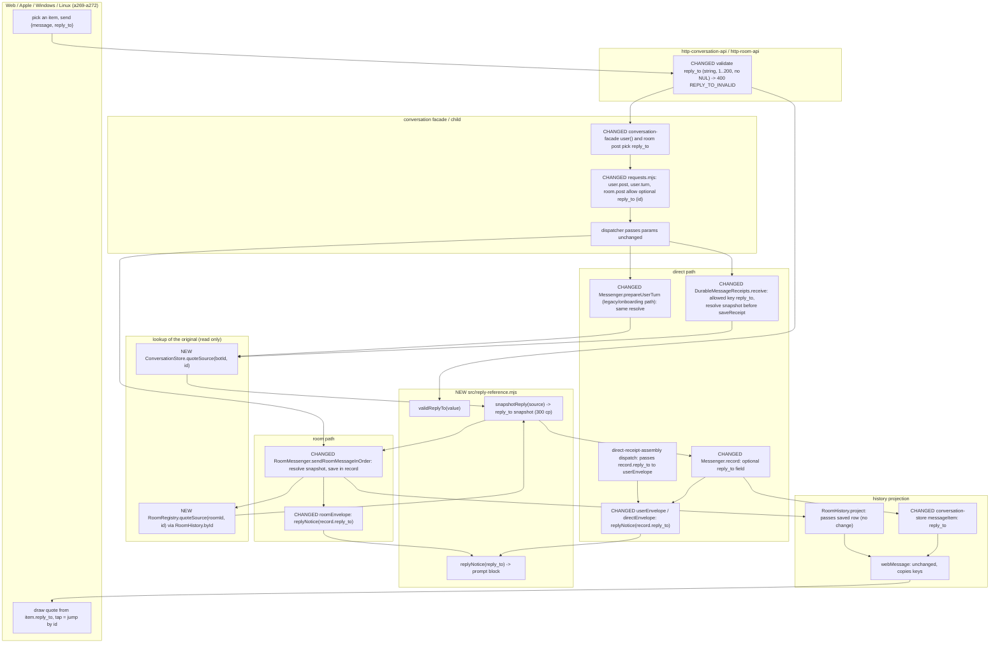
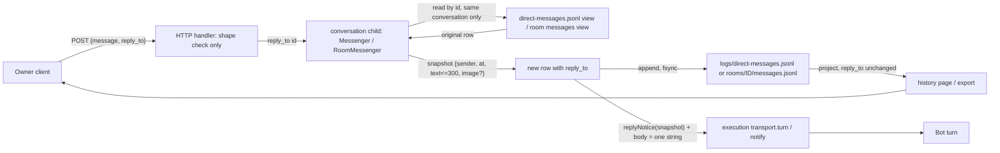

# Reply to a chosen message (`reply_to`)

Owner of this page: N102 (conversation). [Module contract](README.md) / [function map](../../feature-map.md) / [delivery](delivery.md) / [rooms](rooms.md) / [history display](flow.md).

Status: contract and diagrams for chart task `a264-n102-reply-contract`. Source is written by `a265-n102-reply-impl` from this page; clients (`a269`–`a272`) and the lab/ship tasks start from it. Nothing below is implemented yet.

Origin: Owner 2026-11-16 JST (「そうだそれだ。計画立てて実装してくれ。」): pick one message in a conversation and reply to it, like LINE or Slack. The sent reply shows the original as a small quote, tapping the quote jumps to the original, and the Bot is told which message the reply is about, so it cannot mistake the topic after the conversation has moved on.

Base read: `main` a1a98ae9 — `src/messenger.mjs` (`prepareUserTurn`, `userEnvelope`, `directEnvelope`, `record`), `src/durable-message-receipts.mjs` (`receive`, `enqueueUserTurn`), `src/direct-receipt-assembly.mjs` (`dispatch`), `src/room-messenger.mjs` (`sendRoomMessageInOrder`, `roomEnvelope`), `src/conversation-store.mjs` (`messageItem`, `interimItem`), `src/room-history.mjs` (`project`), `src/conversation/{requests,dispatcher}.mjs`, `src/conversation-facade.mjs`, `src/http-conversation-api.mjs`, `src/http-room-api.mjs`, `src/direct-log-record.mjs`.

## Scope

- In: the Owner's direct conversation with a Bot, and rooms. One reply names exactly one earlier message of the same conversation.
- Out (v1, additive later): a Bot replying to a message through `sendmessage` / `sendroommessage` (those tools keep their closed input); replying to a Bot↔Bot `peer` row, a secret/question card, or a call row; quote chains (a quote never shows the original's own quote); editing or deleting a sent reply; an `around=<id>` page query (see [Jump](#jump-to-the-original)).
- The prompt text is assembled here (`userEnvelope`, `directEnvelope`, `roomEnvelope`) and handed to execution as one opaque string. Execution (`transport.turn` / `notify`) and the queue items are unchanged, so no agreement with Kiro is needed. The queue item `message` stays the reply's own text.

## Names (do not mix)

| Name | Meaning | Change |
| --- | --- | --- |
| `reply_to` | NEW. The message this one replies to. Request body, saved record, history item. | added |
| `in_reply_to` | Direct record only: a fork answer relayed for an `ask_readonly` delivery ([fork-inquiry](fork-inquiry.md)). Never projected to clients. | none |
| `responseTo` | Room post only: the idempotency key of a responder's `respond_to_room` answer ([rooms](rooms.md)). | none |
| `reply_id` (result of a turn) | The id of the Bot's saved final answer. | none |

## Contract

### Request

`POST /api/bots/{botId}/messages` and `POST /api/rooms/{roomId}/messages` accept one optional field next to `message` / `images` / `targets`:

```json
{ "message": "それは違います", "reply_to": "<id of the original item>" }
```

- `reply_to` is the `id` of an item the client received from `GET .../messages` of the same conversation (direct: `delivery_id` / interim id; room: message `id`).
- Valid: a non-empty string of at most 200 characters without NUL. Anything else (number, array, empty string, too long) → HTTP 400 `REPLY_TO_INVALID`, nothing saved, nothing delivered.
- An id that is valid but cannot be used is **not** an error: see [Original not available](#original-not-available).
- The response is the existing acceptance object; it gains no field. A client shows its own pending quote until the history item arrives.
- Only the Owner's posts carry it. `sendmessage`, `sendroommessage`, `ask_readonly`, call bridge and scheduler posts neither accept nor save it.

### What can be quoted

| Conversation | Quotable originals | Not quotable |
| --- | --- | --- |
| Direct (Owner ↔ Bot) | rows shown as `kind: "message"` (the Owner's sends, the Bot's sends to the Owner, a saved final answer) and `kind: "interim"` (the Bot's in-turn words) | `peer` rows, secret/question cards |
| Room | any room message of that room (`bellteam.room-message.v1`, kind `message` or `schedule`) | status/routing rows, cards |

A row of another conversation, an unknown id and a quotable id whose row cannot be read all count as [not available](#original-not-available).

### Saved record (additive)

`reply_to` is saved once, on the new row, as a snapshot taken when the reply is accepted. It is never rewritten, so the quote and the prompt always agree and survive a restart or a held/requeued delivery.

```text
reply_to := { id, available: true,  sender: {id, name}, at, text, truncated?, image? }
          | { id, available: false }
```

| Field | Rule |
| --- | --- |
| `id` | the requested id, unchanged |
| `available` | `true` only when the original was found in this conversation at acceptance |
| `sender` | `{id, name}` of the original's sender (`user` for the Owner; the Bot or room member otherwise) |
| `at` | the original's own timestamp (ISO, as saved) |
| `text` | the original's text, CRLF→LF, cut to at most 300 Unicode code points |
| `truncated` | `true` only when `text` was cut (clients add the ellipsis) |
| `image` | `true` when the original carried images (an image-only original has `text: ""`) |

- Direct rows: `bellteam.direct-message.v1` gains optional `reply_to` (`validateDirectLogRecord` allows it). Room rows: `bellteam.room-message.v1` gains optional `reply_to`. A row without the field is exactly today's row.
- `bellteam.delivery-status.v1`, interim words and routing/delivery status rows never carry it.

### History (read)

Every place that projects the saved row to a client returns the field unchanged and untouched by later events: the history page (`GET /api/bots/{id}/messages`, `GET /api/rooms/{id}/messages`) and the export built from the same projection. SSE payloads stay topic + target ids only.

- Direct: `messageItem` (`kind: "message"`, direction `outgoing`) adds `reply_to`. Rows that cannot carry it (`interim`, `peer`, answers) are unchanged.
- Room: `RoomHistory.project` already returns the saved row, so `reply_to` passes through.
- An item without `reply_to` has no key. Clients treat a missing key as "not a reply".

### Original not available

The reply is accepted and delivered like any message; only the quote degrades.

| Cause | Saved | Client shows | Bot is told |
| --- | --- | --- | --- |
| id unknown, other conversation, not quotable, or the read failed | `{ id, available: false }` | 「元のメッセージを表示できません」, not tappable | it is a reply to an earlier message that could not be found (with the id) |

Nothing about the other conversation (existence, text, sender) is returned or saved.

### Jump to the original

The quote carries `id`. A client scrolls to the item with that `id` when it is loaded; otherwise it loads older items with the existing `before` cursor until the id appears or `has_more` is false, and then shows 「元のメッセージは見つかりません」. shortcut: no server-side jump query in v1, upgrade to `around=<id>&limit=N` when long conversations make the paging visible.

### What the Bot reads

Existing text is unchanged when `reply_to` is absent. When present, this block is inserted between the "from" line and the message text, in both envelopes.

Direct (`userEnvelope` → `directEnvelope`):

```text
「オーナー」からあなたへ次のメッセージが届いています。

これは次の発言への返信です。
返信先: 「N102」 2026-11-16 21:20 JST（メッセージID: <id>）
> 元の発言の1行目
> 2行目…

<message>
```

Room (`roomEnvelope`, same block after the `「sender」からあなたへ…` line; the `silent` suffix is unchanged):

```text
メッセージID: <this message id>
「オーナー」からあなたへ次のメッセージが届いています。

これは次の発言への返信です。
返信先: 「<sender>」 <JST time>（メッセージID: <id>）
> <quoted text>

<message>
```

- Time is JST `YYYY-MM-DD HH:mm JST` (the helper `jst` already in `messenger.mjs`). The Owner is written 「オーナー」 like the existing envelopes.
- Every quoted line starts with `> `; when `truncated`, the last line ends with `…`; an empty text with `image: true` is `> （画像）`.
- Not available: `これは過去の発言への返信ですが、元の発言は見つかりませんでした（メッセージID: <id>）。` and no quote.
- The block is built only from the saved snapshot, never from a fresh read, so a re-dispatch after a restart or `BOT_UPDATE_HOLD` sends the same text.

### Compatibility

- Additive. Released clients ignore the unknown key and show the reply as a normal message. A new client against an older server sends a field the server ignores; the history never gains `reply_to`, so the client shows no quote.
- No existing field, status, schema string or error changes. Rows written before this change have no `reply_to`.
- Release order (for a266/a268). The conversation child appends direct rows through the parent effect `direct.log.append`, and the parent checks every row with `validateDirectLogRecord` (`src/conversation/effects.mjs`), which refuses unknown keys. A child that writes `reply_to` against a parent without the new validator would have its Owner send refused (`DIRECT_LOG_RECORD_INVALID`). So the BODY carrying the validator must be live in the same train as, or before, the CONVERSATION module and the client change. Rolling the BODY back after rows with `reply_to` exist makes the old validator refuse only new appends of such rows; reads of saved rows are unaffected (`ConversationStore` and `RoomHistory` accept unknown keys).

## Function map

New/changed items are marked. Everything else is today's code.



Public surface after the change: the two HTTP POST bodies gain `reply_to`; history items gain `reply_to`; the module exports `reply-reference` helpers. No MCP tool, SSE event, queue item, status or execution port changes.

## Data flow



| Datum | Owner / writer | Readers | Lifetime |
| --- | --- | --- | --- |
| `reply_to` request id | client; HTTP handler checks the shape | Messenger / RoomMessenger | one request; never stored as a bare id without a snapshot |
| `reply_to` snapshot | the Messenger that accepts the reply, once | history projection, envelope builders, re-dispatch after restart | as long as the row; immutable |
| original row | unchanged (append-only log) | `quoteSource` (read only) | untouched |

The snapshot is the only copy of the quoted text. Nothing resolves an id again at read time, so history never joins across rows and an original that disappears (log repair) cannot break a reply.

## Failure handling

| Situation | Result |
| --- | --- |
| `reply_to` not a valid string | 400 `REPLY_TO_INVALID` before anything is saved |
| original not found / other conversation / not quotable / lookup error | message accepted, `reply_to = {id, available:false}`, Bot told the original was not found |
| lookup slower than the send | resolution reads the store snapshot already used for the send; no extra wait is added |
| process stops after save, before dispatch | re-dispatch rebuilds the envelope from the saved row, same text |
| `BOT_UPDATE_HOLD` / queued delivery | unchanged; the saved snapshot is dispatched later |
| parent without the new `validateDirectLogRecord` receives a direct row with `reply_to` | the append is refused as `DIRECT_LOG_RECORD_INVALID`; prevented by the release order in [Compatibility](#compatibility), not by a guard in the child |

No guard is added: no new refusal, lock or timeout. The only refusal is the malformed field, which protects the log from a non-string id.

## For a265 (implementation) and the lab

Touch only: `src/reply-reference.mjs` (new), `src/messenger.mjs` (`prepareUserTurn`, `record`, `userEnvelope`/`directEnvelope`), `src/durable-message-receipts.mjs` (`receive` allowed keys, `enqueueUserTurn`), `src/direct-receipt-assembly.mjs` (`dispatch` envelope call), `src/room-messenger.mjs` (`sendRoomMessageInOrder`, `roomEnvelope`), `src/conversation-store.mjs` (`quoteSource`, `messageItem`), `src/room-registry.mjs` / `room-history.mjs` (`quoteSource`), `src/direct-log-record.mjs` (parent-side validator: optional `reply_to`), `src/conversation/requests.mjs`, `src/conversation-facade.mjs`, `src/http-conversation-api.mjs`, `src/http-room-api.mjs`, plus this module's `module.json` source list. Minimal checks, by the diagrams:

1. direct: replies to an Owner row, a Bot row and an interim row save the snapshot, the envelope contains the block, and the history item has `reply_to`.
2. room: same for a member message and a schedule message.
3. unavailable: unknown id and an id of another Bot's/room's conversation save `{id, available:false}` and expose nothing of the other conversation.
4. invalid `reply_to` → 400 `REPLY_TO_INVALID`, no row, no delivery.
5. text cut at 300 code points (astral characters counted once) sets `truncated`.
6. re-dispatch of a saved queued row yields the same envelope.
7. rows without `reply_to`: existing tests unchanged.

Client rules for `a269`–`a272`: draw the quote only from `item.reply_to`; when `available` is false draw the fixed 「元のメッセージを表示できません」 line; never compute the quote from loaded items; tapping uses `reply_to.id`; send `reply_to` only for a picked item of the open conversation.
