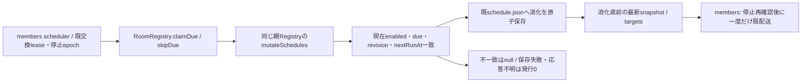

# rooms — 会話・履歴

[担当と公開契約](README.md) / [全体図](../../feature-map.md)。章を旧詳細図から移管した。

## 部屋定義と会話の所有

`RoomRegistry.create/update/normalizeRoom`が名前・目的・メンバー・代表・アバターを検証し、`rooms/<id>/room.json`に保存する。`refresh`はファイルmetadataでcacheを確認し、現在のBot台帳に照らして正規化する。MCPの参加者/代表資格は`room-access.mjs`の公開helperを使う`callConversationTool`が持ち、投稿の資格と参加者snapshotはRoomMessenger側であり、保存の型検証とは別である。

`appendMessage`が`messages.jsonl`のwriter。`messages/messageView`は同じRoomHistoryを使用する。`watch`はroom/schedule/messagesのstat差分をtopicへ変換する。履歴初出・inode置換・縮小・同サイズ書換えは全体通知へ、通常追記は対象roomへ。Macで親名しか来ない時は既存fileのstatで確認し、名前から対象を推定しない。監視で失敗した時も未知の変更を無視せずallを通知する。

## 部屋予定の消化保存

`claimDue({roomId,scheduleId,expectedRevision,expectedNextRunAt,ranAt})`は現在のtupleを照合し、消化保存成功後に消化直前のscheduleを返す。`skipDue`は同じ入力/返却でlastRunAtを保持する。revision無しは0。targets整理がrevisionを変えなくても最新値を返す。有限時刻とrevisionを検証し、無効/未来/競合/消去済み予定はnull、保存失敗は例外。onceを無効にし、反復は評価時刻から次回へ進める。lastRunAtは配送成功ではなく試行消化時刻。保存後喪失の未配送はあり得るが、消化stateから発行権を作り直さない。手動runと既mark窓口は変更しない。別processのRoom writerや永続queueを増やさず、発行/停止epochはmembers/executionが所有する。

Room削除も同じmutation境界を通し、進行claimの保存完了後にdirectoryを消す。削除と保存の競合で部屋directoryを作り直さない。既schedule読取の不正/失敗を無視して削除は進めない。
