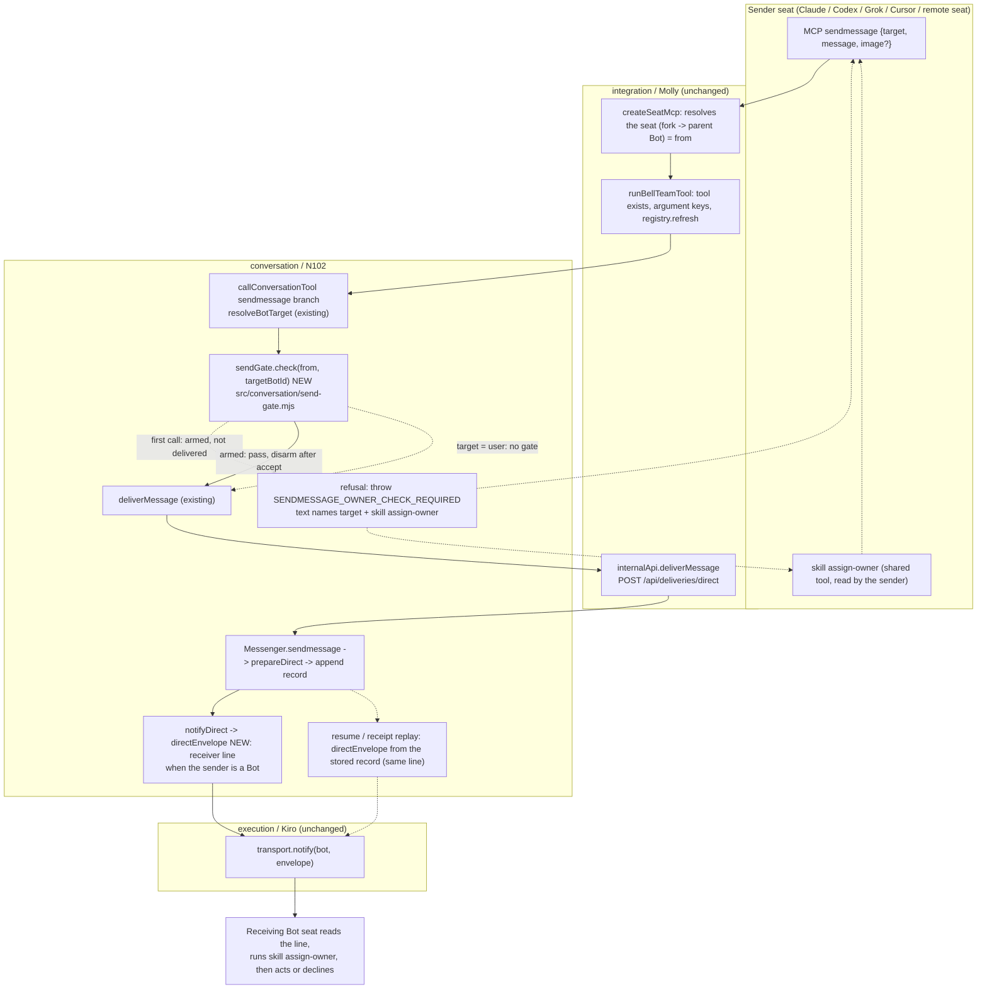
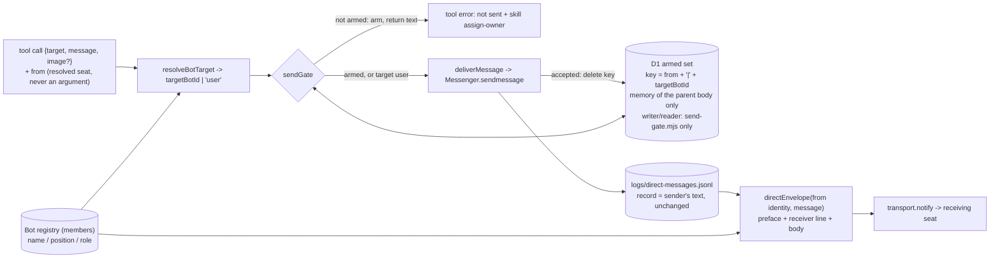
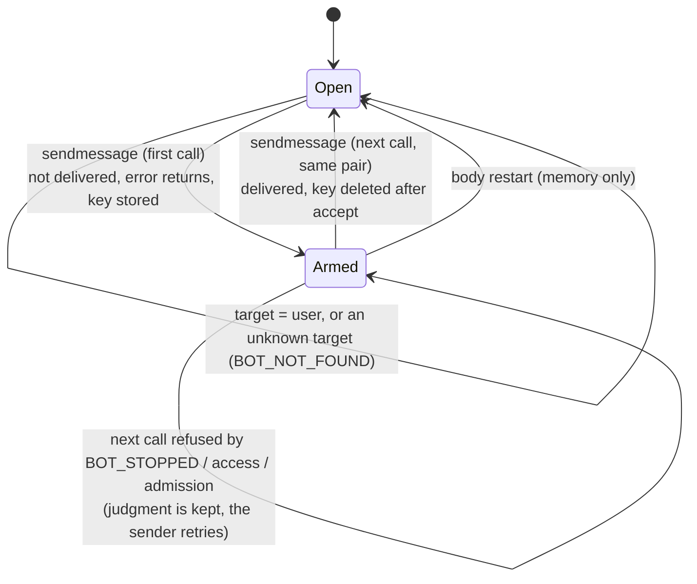

# Two-step sendmessage and the receiver line (`sendmessage`)

Owner of this page: N102 (conversation). [Module contract](README.md) / [function map](../../feature-map.md). Task: `bellteam-dev-added/sendmessage-two-step-owner-check` (request from Tronie, Owner design 2026-11-28 17:0x JST).

Status: **ruled by Tronie 2026-11-28 17:1x JST (all nine points as proposed) and implemented.** The table [Rulings](#rulings) keeps the points and the answers. Code: `src/conversation/send-gate.mjs` (state, texts), the `sendmessage` branch of `callConversationTool`, `directEnvelope`; test `test/send-gate.test.mjs`. Base read: `main` b08af044 — `src/mcp-conversation-tools.mjs` (`callConversationTool`), `src/mcp-tools.mjs` (`runBellTeamTool`), `src/seat-mcp.mjs` (`createSeatMcp`, `internalApi`), `src/messenger.mjs` (`directEnvelope`, `prepareDirect`, `notifyDirect`), `src/direct-receipt-assembly.mjs`, `src/member-identity.mjs`.

## Contract (the Owner's words)

1. 「sendmessageは、最初はメッセージを受け付けない。スキルを使って妥当な相手か判定しろというメッセージが返ってくる。その次にsendmessageを呼ぶ時はメッセージを受け付けてくれる。という二段構え。」
2. 「sendmessageを受け取った側には、依頼内容を受けるべきかスキルで確認しろという趣旨を添えてメッセージを送る。」
3. 「スキルの名前は正しく書いてやれ。」 Both texts name the skill exactly as its SKILL.md frontmatter does: `assign-owner` (file `/srv/bellteam/shared/tools/assign-owner/SKILL.md`).

Why: senders hand work to the wrong party without reading the owner map. The check is server-side, so it holds for every harness (all four go through the one seat MCP).

## What the guard protects, and how it is left

- Protects: work (a request) sent to the wrong party — "connection to the wrong target" (common rule guards.named-protection). Nothing else.
- A refusal is a guard (common rule guards.give-up-is-a-guard). Self-exit: **the next call for the same sender and target is delivered** (state diagram below). No timer, no Owner action, no other tool is needed. A body restart empties the state: the guard is armed again by the first call, never stuck.
- A refused call stores nothing: no direct JSONL row, no delivery id, no queue item, no push. The sender's tool call returns an error that says "not sent". The message is never silently dropped.

## Function map

One gate, in one place: the `sendmessage` branch of `callConversationTool`, **after** `resolveBotTarget` and **before** the image path is resolved and `deliverMessage` is called. A typo in the target still fails as `BOT_NOT_FOUND` and does not use up a judgment. The Messenger is not touched by the gate, so every internal sender that calls `messenger.sendmessage` directly (scheduler, approval-box effects, capacity continuation, lattice-facade, members notices through `deliverMessage` to `user`, call-bridge, the Owner's HTTP) is unaffected.

The receiver line is the only Messenger change: `directEnvelope` adds it. It is rebuilt from the stored record's sender id (`from_identity.id` / `from`), so a resumed or replayed delivery (`messenger.mjs` resume, `direct-receipt-assembly.mjs`) carries the same line as the first one.

## Data flow

| Data | Owner / writer | Notes |
| --- | --- | --- |
| D1 armed set | conversation, `send-gate.mjs` only | One entry per (sender, target) pair, so at most bots × bots; an entry is deleted when the delivery is accepted. Not saved to disk. |
| direct JSONL record | `ConversationWriter` (unchanged) | Holds the sender's own text. The receiver line is not stored; history and the Web show what the sender wrote. |
| envelope text | `directEnvelope` | Preface, then the receiver line, then the body. Built at notify time and at replay from the same record. |

## State diagram (one sender + target pair)

Every state has an exit by a plain next call; the guard never needs a timer or a person. Different pairs do not influence each other: a call to another target starts its own Open -> Armed -> Open cycle.

## The two texts

First-call answer to the sender (error code `SENDMESSAGE_OWNER_CHECK_REQUIRED`, stable so a script can match it):

> SENDMESSAGE_OWNER_CHECK_REQUIRED: まだ送っていません。宛先は「{name}」（{position} / {role}、{botId}）です。送る前に、スキル assign-owner（/srv/bellteam/shared/tools/assign-owner/SKILL.md）で、この依頼を渡す相手が正しいか判定してください。正しければ、同じ宛先でもう一度 sendmessage を呼ぶと送られます。違えば、正しい宛先で呼び直してください（その宛先も、最初の一回はこの確認になります）。

Line added for the receiver, between the existing preface and the body:

> 「{名前}」からあなたへ次のメッセージが届いています。
>
> この依頼を受けるべきか、取りかかる前にスキル assign-owner（/srv/bellteam/shared/tools/assign-owner/SKILL.md）で確かめてください。
>
> {本文}

The skill is named `assign-owner` in both, exactly as its frontmatter `name:`. The path is carried because a remote seat or a harness without a skill list can still open the file; the name is what a seat calls. Both strings live in one constant file (`send-gate.mjs`), so a rename of the skill changes one place.

## Rulings

| # | Point | Ruled (as proposed) | Why / what else |
| --- | --- | --- | --- |
| 1 | What "the next call" is keyed on | sender + resolved target Bot id | The judgment is about the target. Sender-only would let one refusal pass any wrong target. Including the message text would refuse a re-worded retry after the judgment. A fork seat resolves to its parent Bot (same sender id), so a fork shares its parent's pair. |
| 2 | How long a pass lasts | one message: the key is deleted when the delivery is accepted, so the next message to the same target is refused again | Literal reading of the Owner's words and the strongest. Cost: two calls for every message, replies included. Alternative if that is too heavy: the pass stays open for the pair for N minutes (say 10) after the refusal; the state diagram gains one timer-free "judged at t" field and the self-exit is unchanged. |
| 3 | target = user | out of scope, no gate | The Owner spoke of members; the Owner screen cannot be the wrong party. It also keeps the Owner-facing answers, image presentation and the rule-change notice (`members` `deliverMessage` to `user`) at one call. |
| 4 | How the first call answers | an MCP error (isError) with the code and text above, nothing stored | A normal result could be read as delivered ("running" / "steered" mean accepted). An error is what every harness shows to the model as "not done". |
| 5 | Expiry of an armed pair | none; memory only, a body restart re-arms | Self-exit is the next call, so no timer is needed. A stale pass lets at most one unjudged message through, to a pair the sender already judged once. |
| 6 | Calls made in parallel | known limit: two parallel first calls to one new target — the first is refused and arms, the second passes | The gate cannot tell a sibling from a call made after reading the refusal without a token the Owner's design does not have. |
| 7 | Receiver line scope | every direct envelope whose sender is a Bot (id is not `user` or `scheduler`) | Covers sendmessage from seats and forks and Bot-sent lattice-facade messages. Not the Owner's messages, not scheduler / approval-box / capacity notices, not the `ask_readonly` envelope (it has its own text), not call-bridge calls. Implementation detail: **not a fork's answer relay** (`relayForkAnswer`, the record has `in_reply_to`): it answers a question and is not a request to accept, so `directEnvelope` takes `answer: true` there and at the two replay sites. The stored message is not changed. |
| 8 | The skill's own text | Tronie wrote it (SKILL.md: "When you receive a request" / "Before you send a request") | SKILL.md says "For coordinators" and "never hand whose-is-this back to members". A receiver who runs it needs a short "receiver check" step (read the owner map for the request, decline if it is outside your scope per `roles.boundaries`). The line only works if SKILL.md says what a receiver does. |
| 9 | Tool description | the `sendmessage` description gains one sentence on the two-step | The seat tool list digest (`SEAT_TOOLS_DIGEST`) changes, so connected seats re-list once. |

## Clients that call sendmessage today (no message may be lost)

- Every Bot seat on the four harnesses reads the error and calls again: no loss.
- **Machine callers that script the MCP tool** and would lose their request on the first error. Found by search (not a complete list): `/srv/bellteam/shared/tools/bughub-registration/registration.mjs` (to Mast, via `integrations/bellteam-mcp.mjs`), Mast's `workflow-watch.mjs` and `sec013-supplement-watch/watch.mjs`, and `bot-29f8f415/monitoring/notify.mjs`. Their target is fixed and already known to be right.
- Ruled order so nothing is lost: (1) each owner's script retries **once** on the code `SENDMESSAGE_OWNER_CHECK_REQUIRED` (harmless before the gate exists); (2) then the gate goes live. Chart: rows `sendmessage-two-step-retry-<owner>` (Emma bot-29f8f415, Mast bot-8d7c7d32, Helm bot-7bc9d11b, Elegg bot-c2adbe04, Nayuta bot-4366a50b, Rapunzel bot-2cb22a38) are the predecessors of `sendmessage-two-step-gate-adopt` (Epinel), which also follows the code task. Each owner was told directly on 2026-11-28.
- Remote seats: the text names the skill and carries the path; a remote seat that cannot read the container path still calls the skill by name.

## Failure handling

| Case | Result |
| --- | --- |
| First call to a pair | error, nothing stored, key armed |
| Next call to the pair | delivered as today; key deleted after the accept |
| Delivery refused after the pass (`BOT_STOPPED`, access, admission) | the same error as today; key stays armed so the retry is not refused twice |
| Unknown target | `BOT_NOT_FOUND` as today, no key |
| Body restart | all keys gone; the first call re-arms |
| target = user | as today |

## Verification

`test/send-gate.test.mjs`: the first call is refused with the code and nothing is delivered; the next call is delivered and the pass is spent; another target is refused separately; `user` and an unknown target are not gated; a delivery that fails after the pass keeps the pass; `directEnvelope` adds the line for a Bot sender (fork too) and not for `user`, `scheduler` or an answer relay; both texts contain the exact string `assign-owner`. The gate is injected as `sendGate` (default: the process-wide gate); tests that are not about the gate pass `openSendGate`. The replay sites (`messenger.mjs` resume, `direct-receipt-assembly.mjs`) call the same `directEnvelope` with the stored record, so they carry the same line; no separate test.
