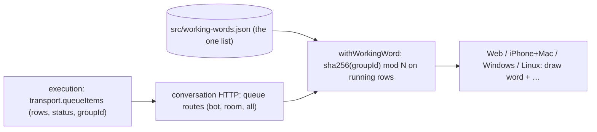

# Working word (a471-spinner-words-n102)

Owner 2026-11-21 09:3x JST: while a seat works, the chat's working indicator shows one Claude Code word with an ellipsis ("Mulling…", "Cerebrating…"), the same on Web, iPhone/Mac, Windows and Linux. One list, one place; no app keeps a copy.

## Contract

- The running row of every queue read carries `workingWord`: one plain word of the list, **without** an ellipsis. Routes: `GET /api/bots/:id/queue`, `GET /api/rooms/:id/queue`, `GET /api/queue`. Rows that are not `running` (queued, failed) have no `workingWord` key; an older server sends none at all.
- The word is chosen by the server from the delivery: `sha256(groupId ?? id)`, first 4 bytes big-endian, modulo the list length. One delivery keeps one word for the whole turn, the next turn picks another by chance, and every app and device reads the same word. An app never chooses or rotates a word.
- The app draws `<workingWord>…` in its existing working indicator (Web: the animated "…" of the queue line / thinking bubble). A missing `workingWord` (older server) keeps today's indicator unchanged. The word is English as Claude Code shows it; it is a label, not a message, and is not saved or sent to the seat.
- The list is `src/working-words.json` (187 words), copied unchanged and in order from Claude Code 2.1.328's spinner list (the array of the CLI bundle, `var b=["Accomplishing",…,"Zigzagging"]`). It is the only copy. A newer Claude Code that adds words is followed by replacing the file (re-extract the array from the installed CLI); no app change is needed because apps keep no list.

| Function | Input -> output | Owner |
| --- | --- | --- |
| `workingWord(key)` | string -> one word of the list, stable per key | `src/working-words.mjs` |
| `withWorkingWord(items)` | queue rows -> same rows, `running` ones with `workingWord` | `src/working-words.mjs`, called by `http-conversation-api.mjs`, `http-room-api.mjs`, `http-delivery-api.mjs` |

Data ownership: the list and the choice are conversation's; nothing is stored, no new request, no new SSE topic (apps already re-read the queue when the working state changes). Failure handling: none needed; the pick is a pure function of the row, and a row without `groupId` falls back to `id`. Execution (`queueItems`) is unchanged. Test: `test/working-words.test.mjs`.
