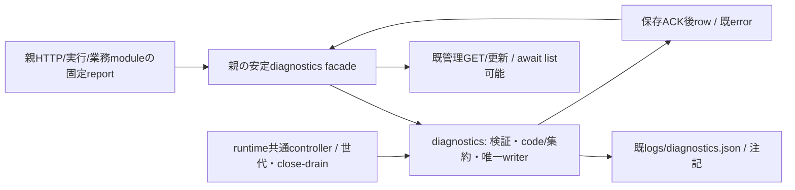
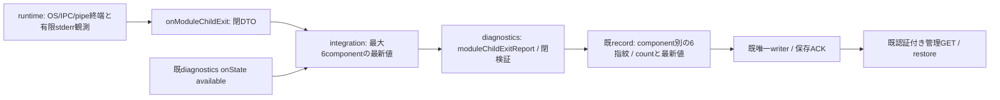

# 診断module

業務内部の責任者はシグナル。Ownerの専任割当による。BugHub中央登録・既案件裁定はフラジャイル、親の安定facade/組立・全module共通ledgerはモリー、診断固有channel/entry/probeはシグナル、共通交換runner/controllerはエピネル、本番はトロニー。Fragileへの一時実装割当は撤回済みで、当該実装は未着手。

接続の正本は[module.json](module.json)、呼出元は[integration](../integration/README.md)、機構は[runtime](../runtime/README.md)。全体図からこの正本へ辿る。

| 公開操作 | 入出力 | 状態/失敗と受渡し |
| --- | --- | --- |
| initialize/restore | 既fileと注記→利用準備 | read-only restoreからresumeまで作用0、既count/open/unknownを再生成しない |
| record | 既report→保存ACK後のrow | 固定code/集約と安全field、返却rowのfingerprint/count/timeを親HTTPも使用 |
| list | status/limit→閉row DTO | 旧class同期互換、親facadeはasync可。管理GETがawaitして結果を保持。巨大resultはruntimeの閉stream契約で運ぶ |
| setStatus/setNote/updateInvestigation | 既指紋/状態/注記→保存後row | 既正本へ同writerで直列保存、不正400/不存在404の既出力を維持 |
| close/drain | 新入場封鎖→先行要求と実保存終端 | timeout/acceptedを保存完了へ置換しない、親facadeとrunnerの実終端を同世代で結ぶ |

本差分で業務factory/閉dispatcherとread-only restore/close-drainを供給する。通常bootstrapが実createDiagnosticsProcessを注入し、親facade・管理API・共通台帳は同controllerを参照する。ローカルclassは従来の同process利用も保つ。raw rows/investigations・任意path/env・親認証secretは子wireへ公開しない。HTTP要求の安全なroute/code射影は親integrationの`diagnostic-request-context`/`http-errors`が担当し、診断業務が親handlerを編集しない。旧SERVER_HTTP_500/新SERVER_HTTP_503とApple原本を含む既code/重大度/集約/unknownを保持し、新source成功を過去事故の原因/回復へ補完しない。

Signalが内部図・source・直接検証を同差分で供給、Signalが固有channel/entry/probeを接続、Epiが共通runner/世代とstreamを供給、Mollyが安定facade/assemblyと共通ledger/adapter・通常mainへ結ぶ。内部の詳細はこの正本へ追記し、親へ複製しない。

内部factory・閉操作・状態/close-drain/restoreは[単体更新の正本](module-update.md)。

## Restart-limit problems

The additive `recordModuleRestartLimit(problem)` intake stores and serves the runtime's `module_restart_limit` observation and explicit recovery using the existing diagnostics writer and GET. Exact DTO, per-module aggregation, state transitions and ownership are canonical in [restart-limit problems](module-restart-limit.md). Restart counting and healthy-window timing remain runtime-owned; restarts continue.

## 子終了の有限診断

runtimeの[子終了観測](../runtime/module-process.md)は既exit/signalと固定codeのconsole出力を持つ。診断へは `onModuleChildExit(dto)` を親が登録し、`moduleChildExitReport(dto)` の閉検証から既record/唯一writer/管理GETへ接続する。観測と6常駐子のcallback転送はEpi、親登録はMollyで、診断だけの差分を接続完了とはしない。

`bellteam.module-child-exit.v1` はcomponent固定6種、signed32bit exitCode又はnull、既11signal又はnull、重複の無い既4stderrCodes、reason（heap_out_of_memory/worker_out_of_memory/unknown）、stderrBytes（非負safe整数）、stderrTruncated（boolean）、stderrTail（最大8件）、任意の `childExitOrigin`（2026-11-08 I-5: exact `{origin, failureCode}`、originは peer_failure/parent_disconnect/exit_control/exit_writer_control、failureCodeはnull又は観測側と同じ閉じた9個（CONVERSATION_IPC_INVALID/IPC_DISCONNECTED/IPC_TIMEOUT/IPC_ACK_TIMEOUT/IPC_SEND_FAILED/CHILD_EXITED/BACKGROUND_UNCONFIRMED/DELIVERY_RELEASE_UNCONFIRMED/PROTOCOL_UNCONFIRMED）。key無し＝origin行を観測していない（旧形と同じ）。親が子のstderrから既に閉じて読んだ値だけで、本文は含まない）だけ。末尾要素は `{kind:'heap_oom'}` 又は `{kind:'gc',beforeMiB,afterMiB,capacityMiB,pauseMs}`、数値は有限・非負・1e9以下、DTOは4096 UTF8 bytes以内。不明key/文字列/過大値は受付前に拒否する。観測時のraw末尾はruntimeの8KiB以内に留め、保存/公開へ渡さない。任意stderr本文の末尾保存全般は対象外のまま明示し、Nodeの認識可能な末尾証拠だけを保持する。SIGKILLからOS OOMを断定しない。

新固定category `SERVER_MODULE_CHILD_EXITED` / module `server` / high を既recordで保存する。集約はcomponent別の最大6指紋だけを加え、既codeと指紋・状態形式を変えない。同componentはcountと最新DTOを更新し、古いstderr履歴を蓄積しない。ログなし/不正JSONや余分fieldを含む新categoryは拒否する。親はdiagnostics停止中の最大6最新値を保持し、復帰ready後に一回flushする。保存ACK済みの同一値だけを削除し、保存結果unknownを再recordしない。タイマー/別writer/永続queue/本文再送を加えず、親消失時の未保存は欠測を維持する。旧事故の終了原因は新観測から補完しない。
