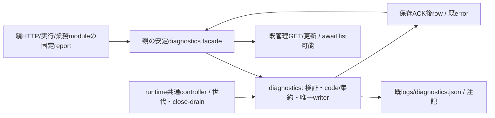

# 診断module

業務内部の責任者はシグナル。Ownerの専任割当による。BugHub中央登録・既案件裁定はフラジャイル、親の安定facade/組立・全module共通ledgerはモリー、診断固有channel/entry/probeはシグナル、共通交換runner/controllerはエピネル、本番はトロニー。Fragileへの一時実装割当は撤回済みで、当該実装は未着手。

接続の正本は[module.json](module.json)、呼出元は[integration](../integration/README.md)、機構は[runtime](../runtime/README.md)。全体図からこの正本へ辿る。

| 公開操作 | 入出力 | 状態/失敗と受渡し |
| --- | --- | --- |
| initialize/restore | 既fileと注記→利用準備 | read-only restoreからresumeまで作用0、既count/open/unknownを再生成しない |
| record | 既report→保存ACK後のrow | 固定code/集約と安全field、返却rowのfingerprint/count/timeを親HTTPも使用 |
| list | status/limit→閉row DTO | 旧class同期互換、親facadeはasync可。管理GETがawaitして結果を保持。巨大resultはruntimeの閉stream契約で運ぶ |
| setStatus/setNote/updateInvestigation | 既指紋/状態/注記→保存後row | 既正本へ同writerで直列保存、不正400/不存在404の既出力を維持 |
| close/drain | 新入場封鎖→先行要求と実保存終端 | timeout/acceptedを保存完了へ置換しない、親facadeとrunnerの実終端を同世代で結ぶ |

本差分で業務factory/閉dispatcherとread-only restore/close-drainを供給する。通常bootstrapが実createDiagnosticsProcessを注入し、親facade・管理API・共通台帳は同controllerを参照する。ローカルclassは従来の同process利用も保つ。raw rows/investigations・任意path/env・親認証secretは子wireへ公開しない。HTTP要求の安全なroute/code射影は親integrationの`diagnostic-request-context`/`http-errors`が担当し、診断業務が親handlerを編集しない。旧SERVER_HTTP_500/新SERVER_HTTP_503とApple原本を含む既code/重大度/集約/unknownを保持し、新source成功を過去事故の原因/回復へ補完しない。

Signalが内部図・source・直接検証を同差分で供給、Signalが固有channel/entry/probeを接続、Epiが共通runner/世代とstreamを供給、Mollyが安定facade/assemblyと共通ledger/adapter・通常mainへ結ぶ。内部の詳細はこの正本へ追記し、親へ複製しない。

内部factory・閉操作・状態/close-drain/restoreは[単体更新の正本](module-update.md)。
