# Restart-limit problems

Signal owns validation, the diagnostics intake/facade/dispatcher method, storage and GET projection. Runtime owns restart attempts, the rolling window, recovery timing and callback delivery. Molly wires the callback to the facade and integrates; Admi renders the problems view in the existing update screen. Root contract: `module-job-ledger-contract-20261107` section 3. Exact producer contract: Epinel's runtime `update-jobs.md` (2026-11-07); the existing runtime connection is [module-process](../runtime/module-process.md).

## Function diagram

| Function | Input -> output | State / failure / owner |
| --- | --- | --- |
| Runtime observation | 5 actual restarts in rolling 1800 seconds -> active DTO | Epinel; one emit until a full healthy window; unlimited restarts continue |
| Runtime recovery | 1800 seconds continuously healthy -> clear DTO | Epinel; no diagnostics timer or inferred recovery |
| Public intake | `recordModuleRestartLimit(problem)` -> saved diagnostic row, or null for a clear with no saved row | Signal; closed validation prevents arbitrary private fields entering storage/GET |
| Serialized persistence | validated input -> stable per-module fingerprint -> existing `logs/diagnostics.json` atomic writer -> ACK | Signal; same pending chain and drain as record. Failed save restores the previous in-memory row and rejects |
| Read | existing list/status filter and authenticated admin GET -> same diagnostic row | Signal; `row.problem` preserves the exact active DTO; no second storage/API |
| Public projection | existing list rows -> `moduleRestartLimitProblems(rows)` -> exact safe problem array | Signal; only fingerprint/status plus validated active DTO fields; no raw diagnostic log/notes/admin key |
| Parent/display | callback -> same facade method; safe projection -> existing GET /api/updates problems[] and update screen | Molly / Admi; existing browser/Owner auth; no new public diagnostics endpoint/store |

## Data-flow diagram

```mermaid
flowchart LR
  Attempts[Runtime: rolling attempts and last exit] --> Active[onModuleRestartLimit active DTO]
  Healthy[Runtime: full healthy window] --> Clear[onModuleRestartLimit clear DTO]
  Active --> Parent[Molly callback wiring]
  Clear --> Parent
  Parent --> Facade[recordModuleRestartLimit]
  Facade --> Protocol[Closed method and DTO validation]
  Protocol --> Dispatcher[Existing diagnostics dispatcher]
  Dispatcher --> Pending[Same pending writer / per-module fingerprint]
  Pending --> File[Existing diagnostics JSON rows]
  File --> Restore[Existing read-only restore]
  Restore --> List[Existing list and authenticated GET]
  Pending --> List
  List --> Projection[Signal moduleRestartLimitProblems: closed fields only]
  Projection --> Snapshot[Molly GET /api/updates problems array]
  Snapshot --> Web[Admi update screen problems display]
```

## Exact input and output

Active input has exactly `{kind:"module_restart_limit",moduleId,count,windowSeconds:1800,lastExit:{code,signal},lastReason}`. `moduleId` is one of `web-gateway`, `notifications`, `members`, `memory`, `usage`, `diagnostics`, `conversation`, `execution`. `count` is a safe integer >=5. `code` is a signed 32-bit integer or null; `signal` is a known OS signal name or null. Both null preserves absence of an observed OS exit. `lastReason` is `process_exit`, `ready_timeout`, `ready_probe_failed`, or `recovery_failed`.

Clear input has exactly `{kind:"module_restart_limit",moduleId,cleared:true}`. No active evidence is invented on clear. Both inputs travel as `{problem}` over the additive closed method `recordModuleRestartLimit`. The public facade takes the DTO directly. Existing methods and storage compatibility values remain unchanged; parent/diagnostics releases must both support the new method before wiring it.

The diagnostic row retains all existing mandatory row fields, category `module_restart_limit`, module `server`, severity `warn`, and `problem` containing the exact latest active DTO. Fingerprint is SHA256 of `module_restart_limit:<moduleId>`; it is independent of count, exit and reason. Same open problem updates the same row without incrementing `occurrence_count`. A new active emit after resolution reopens it and increments that count once. This keeps at most eight aggregate rows across windows. Window detection/deduplication remains runtime-owned; no timestamp/window ID is invented. Existing notes are preserved.

Clear of an open row changes only its status to resolved, retains active evidence and returns the saved row. Repeated clear returns the same resolved row; clear before any active record returns null and writes nothing. GET `status=open` excludes resolved rows; all/resolved reads retain their evidence. The IPC accepts null only as a result of this new method; all actual rows still pass the existing row validator, plus the new structured problem validation.

For the public update snapshot, Molly passes the existing `diagnostics.list('all',1000)` result to exported `moduleRestartLimitProblems(rows)` from `src/diagnostics.mjs`. Output is an array of exactly `{fingerprint,status,kind,moduleId,count,windowSeconds,lastExit:{code,signal},lastReason}` for this category only, including explicit resolved rows. It validates the structured active evidence, fingerprint and status before projecting. It never forwards `diagnostic_log`, investigation/notes or other row fields. `status` is the sole current open/resolved indicator; recovered rows retain their last active evidence unchanged. Molly adds this optional `problems` array to the existing GET `/api/updates` snapshot; it does not expose the admin port/key or add GET `/api/diagnostics`.

## State transitions and direct verification

`absent --active/save ACK--> open`; `open --active/save ACK--> open` (same occurrence); `open --clear/save ACK--> resolved`; `resolved --active/save ACK--> open` (next occurrence); `absent --clear--> absent`; `resolved --clear--> resolved`. A failed save returns an error and retains the previous row; a later valid runtime input can use the existing writer. No new admission guard, restart limit, lock or refusal state is added. Existing quiesce/drain/resume governs this method too.

Minimal tests cover the exact closed inputs/row result, two-module separation, same-open aggregation, clear/reopen and no-op clear, save ACK/failure, restore and authenticated GET through the existing dispatcher/facade. Runtime restart counting, timers and Web internals are inherited from their owners without reruns.
