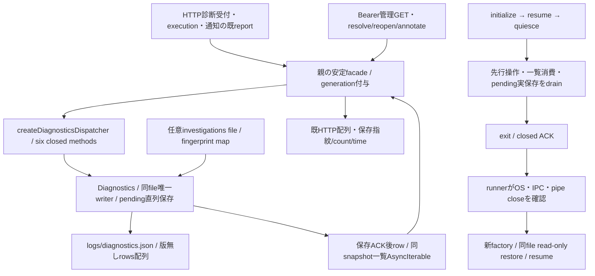

# diagnostics の状態と単体更新

業務内部はシグナル。親facade/通常main組立はモリー、runner/排他/世代交換はエピネル、署名imageはセンチ。全体は[機能図](../../feature-map.md)、既HTTP選択と安全な報告文脈は[integration](../integration/README.md)、子終了/OS確認は[runtime](../runtime/README.md)を参照する。

## 公開入出力

`createDiagnosticsDispatcher({root,investigationsFile})`は`validateRequest(method,params,context)`、`dispatch(method,params,context)`、`control(method,params)`、`disconnect()`を返す。任意file/method/callback/effectは要求DTOへ持ち込まない。contextは`{generation}`だけ。generationは非空・128字以内・空白/NUL無し文字列でinitializeと一致する。

業務操作は`record({report})`、`list({status?,limit?})`、`setStatus({fingerprint,status,note?})`、`setNote({fingerprint,note})`、`updateInvestigation({fingerprint,status?,note?})`。未知keyは拒否する。reportは既code/module/app_version/diagnostic_log/severityだけ。固定code、重大度、集約fingerprint、unknown、count/time、再発open、根拠付きinfoと注記の既意味は維持する。record/変更操作は実保存後rowを返し、保存失敗は成功にせず同writerへ再帰報告しない。

The additive sixth method `recordModuleRestartLimit({problem})` uses the same active-operation tracking, pending writer and drain. Its exact input, row/null result and explicit recovery are defined only in [restart-limit problems](module-restart-limit.md). The previous five methods are unchanged.

listは既all/open/resolved、1〜1000件・既500既定、last_seen降順、本文を省略せず同snapshotのAsyncIterableを返す。recordと注記更新で既snapshotのrowを変更しない。注記は既投影形にだけ添え、設置別investigationsを保存原本へ混ぜない。親は既配列へ戻し、runnerは既256KiB/credit付き逐次JSONを使う。ローカルclassの同期list互換と管理GETのasync facadeを両立する。

## 状態と終了

`DIAGNOSTICS_STATE_COMPATIBILITY`は`{diagnostics:'unversioned-rows-array',investigations:'optional-fingerprint-map'}`。これは実保存形式の宣言で、架空schema番号やrawstate引渡しではない。initializeは`{generation,mode:'bootstrap'|'restore'}`、返却は`{stateCompatibility}`。bootstrapだけ既chmod初期化、restoreは同保存先と任意注記を読むだけでmkdir/chmod/write/mtime変更をしない。initialize完了からresumeまでは業務を受付けない。

quiesce/resume/exitは空object。quiesceはvalidateRequestの新受付を閉じる。runnerで既に受付済みの要求はdispatchでacceptingを再検査せず、generation/DTO/初期化/exitだけを再検査する。同期active登録とquiesced無効化を行い、既操作・list消費・pending保存を実終端まで待って`{quiesced:true}`。resumeは未完quiesceを無効にして`{resumed:true}`。exitはdrain済みだけ`{closed:true}`。disconnectは新受付を閉じ、一覧を閉じ、保存実終端を待つ。制御のtimeoutは取消の証明にしない。60秒drain未完なら旧resume・新子0、OS/IPC/pipe close後だけ新restoreという世代交換はruntime所有。

直接fixtureは閉DTO/generation、保存ACK/drainと未終端resume、失敗保存の非成功、read-only restoreのmode/mtime/bytes、同snapshot/16MiB超一覧の逐次消費、独立factoryと管理GET配列を確認する。実署名/native/配布の成立はこの局所試験だけで宣言しない。

## 固有通信adapterとentry（次差分）

Root許可をEpi経由で受け、業務固有channelと薄entry/probeはSignalが所有する。世代controller/C/lock/reader/root配置はruntime、親facadeはintegrationを維持する。親channelは`ready`、`request(method,params)`、`control(method,params,timeout)`、`reaped()`、`snapshot()`、子channelは実dispatcherへ6操作/制御だけを結ぶ。親の数値idと厳密generationを照合する。ACK5秒/caller期限60秒でcallerが結果未確認になっても`request.completion`とroot8creditを実応答又はOS/IPC/pipeclose後のreapedまで保持する。新root拒否/timeoutを保存取消や再送へ変えない。

list結果は通常rowの一括frameを使わず、同snapshot AsyncIterableを既conversation-streamsへ結ぶ。256KiB chunk/4credit/8stream/別control1MiBを維持し、親で既配列を再構成する。row/調査の文字列のJSON escapeで総量が96MiBを超える場合も省略しないため、既history laneと親readの無追加総量capを使う。最大1000件/本文/調査注記の既業務制限を変えない。共通stream側の同時数/close実終端はruntime所有で合意する。

entryは固定`src/diagnostics-entry.mjs`、実dispatcher一つだけを構築し、親認証/他module/任意コマンドを持たない。固定Cが用意したIPC3/新privateSH4/専用EX5を検証し、initialize ACK後ready、exit ACK後disconnectしてOS終了へ進む。固定version/root/notes接点はruntimeの契約へ合わせる。署名前probeはdisposable固定UID環境でread-only restore→resume→quiesce→exitとOS/IPC/pipecloseを確認し、本番stateや実席へ作用しない。

固有channelの共通依存はruntime作者`f0588a34e4d22b8fbe37761f07990a8a16649988`の`module-ipc.mjs`/`module-streams.mjs`。RPCはstreamed:true、streamはrpcFrames:trueで共存する。切断時に成功metadataだけで実completionを解放せず、body失敗後もreapedを待つ。stream枠拒否時は取得済みの未開始snapshot iteratorをreturnしてwriter drainを妨げない。既管理呼出の任意note/status=undefinedは未指定として受け、必須setNoteのnote=undefinedは拒否する。

固有追加の直接確認はprotocol4件とchannel5件。実IPCの保存/固定404/一覧配列/終了、JSONescapeで96MiB超の無省略history、caller期限後root8保持、stream容量拒否後のdrain、metadata後IPC切断のreaped保持を確認した。最初の共通切断反例失敗はruntime修理後成功へ変更。署名前probeのコードを供給するが、固定C/lockと実UID1001のnative成立はruntime/配布で確認する。

共通controllerとの追加結合は`test/diagnostics-controller.test.mjs`。試験DIで固定Cのspawnだけを同じ実diagnostics fixture子へ差し替え、3つの実OS世代と同stateのbuiltin→release識別→builtin、保存row/count/open/原文・管理注記・設置別調査の維持、notes無書換え、旧OS/IPC/全pipe終端後の新起動を確認する。release識別は同じ試験コードへ付けるため、別bundleの署名/実C/UID1001/imageをこの確認で代用しない。共通controllerの固定版と参照を結んで通常assemblyへ渡す。

管理GET/更新の交換中受付停止は固定DIAGNOSTICS_NOT_ACCEPTING/NOT_ACCEPTED/UNAVAILABLEだけをHTTP503 `{error:'DIAGNOSTICS_UNAVAILABLE'}`へ返す。既Bearer401/入力400/不存在404と一般例外・保存不明500は維持し、任意の例外codeやmessageを公開しない。
