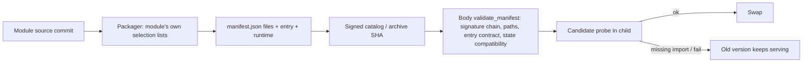

# 商用配布

責任者：モリー（2026-11-08 Owner裁定：本体・部品の入れ替え・image定義を含む）。センチは製品試験だけを持つ。

配布構成・候補build・image/source受入・公開版発行とpromotion。設置/移行の実装はモリー、本番実行はトロニー。

接続の正本は[module.json](module.json)。全体の[機能図](../../feature-map.md)と[担当・変更手順](../../module-ownership.md)から、呼出元と依存先を辿る。

## 現行図と移管工程

- [distribution-details.md](../../distribution-details.md)
- [H1 offline保存更新の配布入力](h1-offline.md)
- [Web受付の固定artifactと公式認証](web-gateway-artifact.md)
- [通知の固定artifactと公式認証](notifications-artifact.md)
- [executionの固定factory配布](execution-artifact.md)
- [M native親imageの公開候補と停止条件](m-native-parent.md)
- [usage・diagnosticsの固定配布](business-artifacts.md)
- [memoryの固定archiveとコード専用読取view](memory-artifact.md)
- [membersの固定artifactと公式認証](members-artifact.md)
- [conversationの固定artifactと公式認証](conversation-artifact.md)
- [正式Update catalogの信頼境界](update-catalog.md)
- [Runtime closure publication](runtime-artifact.md)

上の既存詳細図は現行実装の読取資料。複数担当が含まれる章は最初の分離で当moduleへ移し、元の章を参照リンクへ置換する。内容を二つの現行図へ複製しない。図とコードの分離完了はまだ宣言していない。

## 最初の成果

公開入出力、所有データ、実装・全caller・関連試験、他担当との接点を図で確定する。自分の内部変更が他担当の内部コードや保存データの直接変更を要求しない形へ分離する。共有入口は登録/呼出だけにして、業務処理を自分のmoduleへ移す。変更した図とコード・限定検証結果を一つの差分にする。

正式Aiterm0.63.6/source258b8aefをDockerfileで明示固定し、diagnostics v2と原要求tracked apply/reconcileのconsumerを同じ通常source/immutable imageへ結合する。既0.63.5 pinは別の履歴で修理入りとは呼ばない。受入は承認済package/version/必要runtime/同native entryの能力と既Web A-B差分接点に限定し、143runtime/旧成功群を全面再走しない。既image構成/同梱CLI契約内の版固定で図接続は不変。CLI argvから通常core scope生成を推測せず、実接続/UID/base/stdioとRootの別世代・認証条件を維持する。

image CIの空の永続領域からのinstaller検査は、GET `/api/settings`のIDをrouting/callBridge/cloudflare/diagnostics/notifications/webPush/onePasswordの7件（onePasswordは#838、2026-11-10）・定義順で照合する。旧5件assertの修理で、全OFF・readonly・image identity等の既検査と製品の入出力・状態・接続・失敗処理は変えない。既image/installer検査契約内のため機能図の接続変更は不要。

設定保存修理の実物確認は `verify-configuration-state-image.yml` で既immutable imageを両nativeへ取得し、既C入口→readonly人工supervisor→runtimeの実UID1001/FD3-4/mount anchor→executionの人工要求publish/read/not-issued保存を有限確認する。製品コードはimageの実bytesを使い、fixture sourceとimage sourceを分けて記録する。既Web fixtureの割当・cleanupを再利用し、0700/0600・readonly・実OS終了・残資材ゼロを確認する。SDK/設定RPC・実席・過去要求回復・再buildを含まず、通常image受入はこの別工程を待たせない。公開入出力や既接続の変更は無い。

**2026-11-08 Owner ruling:** every product and external app built into the body image is installed at its latest version on each body image build (`--pull --no-cache`, no pins); there is no runtime hot update. Base images node:current-trixie, docker:cli and golang:trixie (build stage only); Debian apt (ca-certificates curl git procps tmux sudo python3 python3-pip python3-venv python3-dev build-essential pkg-config, gh from cli.github.com); npm @latest (corepack, @openai/codex, @anthropic-ai/claude-code, throughline, aiterm-mcp); vendor installers, which take latest (grok, agy, rtk, cursor-agent); 1Password CLI `op` at `/usr/local/bin/op` root:root 0755, latest from 1Password's update feed, installed only after its signature matches 1Password's signing key (usage module provider, UID1001, 2026-11-09); mcp-lazy from its main branch HEAD. BellTeam's own library dependencies (package.json/package-lock: MCP SDK, croner, jose, web-push) are part of BellTeam source and are tested with it; they are not separately installed products. The image CI keeps the observer-check contract test and checks only that the Throughline version is semver. History: 正式Throughline 0.16.56/sourcee7f8a701をDockerfileで固定し、observer-check consumerと同じ通常imageへ供給する。既両arch image CIのimmutable image IDをUID1000/network none/read-onlyで起動し、実CLI版と公開 `observer-check --json` の空人工project初回changed→同token unchanged・DB生成無しを保存する。0.16.56は既診断契約を保持し、通常hookの診断ログ回転・状態/完了記録と生成物の保存寿命を修理する。正式registryの392file一致、通常install/status/migrate(schema12)/doctorと失敗exit1保持は製品担当の原本を継承する。元container例外の原因・影響はunknown、repair_success=falseを維持する。これは配布CLI入口と同imageの確認であり、実会話の認証・引継ぎや本番反映の証明ではない。既同梱CLI/候補実物照合契約内のため図接続・状態所有は不変。
通常image push（`publish-server-image.yml`の`paths`）は`scripts/package-server.mjs`が公開packageへ入れる全pathを含む（`test/server-image-paths.test.mjs`が照合）。2026-11-10、#847の`scripts/update_catalog.py`（受付がbody imageの`code_root`から読むcatalog選択）を含む39 pathが漏れており、mergeしてもimageが作られなかった。
usage/diagnosticsの固定入口は[runtime module-start](../runtime/module-start.md)契約で収録する。public packageはmodule-start.cとusage-start.c/diagnostics-start.cを全て含め、Dockerfileで同includeから二つの固定binaryをcompileする。root:root/0755・非setuid、追加sudo規則無し。通常image CIの既原本採取で両binaryのowner/mode/SHA-sizeを記録する。runtimeのIPC3 advanced/privateSH4/moduleEX5・UID1001は本人入口契約であり、配置成功だけでcontroller交換/実native成功にはしない。共通include又は固定wrapper更新も通常image push対象へ含め、専用buildを増やさない。

- [R-resume normal native build input](restart-resume.md): actual0.63.7 pin→ordinary0.63.8 candidate after permitted native publication; temporary bounded author Molly, permanent Centi.

## Module contents are defined by the module's signed manifest (2026-11-08)

Defect: the body installer (`scripts/web_gateway_artifact.py validate_manifest`, inside the body image) checked execution/memory/usage/diagnostics/conversation against closed per-module file sets, so adding or folding a file in a module (#539 `src/aiterm-operation-lease.mjs`) required a body swap. Under guards.named-protection the closed set protected nothing the signature and probe do not already protect, so it is removed, not kept with an exit.

| Check at install (body) | Protection | Kept |
| --- | --- | --- |
| Signed catalog -> archive SHA -> `manifest.json` -> every file's bytes/SHA (`check_archive`) | wrong target, tampering | yes (unchanged) |
| Safe paths, size limits, `node_modules` only as data | escape / secret exposure | yes (unchanged) |
| schema/component/sourceCommit/arch/entry/runtime incl. `stateCompatibility` | data loss, overwriting existing state | yes (unchanged) |
| Entry file + `package.json`/`package-lock.json` (memory: entry only) present | public entry contract | yes |
| Closed per-module file set (EXECUTION_FILES 51 / legacy 47/48/50 layouts, MEMORY/usage exact, diagnostics/conversation allow-lists, members/web-gateway extra required files) | none beyond the rows above; a missing import fails the candidate probe before the swap and the old version keeps serving | removed |

`EXECUTION_FILES`, `BUSINESS_FILES`, `MEMORY_FILES`, `CONVERSATION_FILES` remain only as the packager's selection from the module's own source commit (`module_artifact_package.py`, `package-memory.py`) and its source-side import-closure tests. Changing them is a module-source change and never needs a body swap once the body carrying this validator is installed. This validator ships with the next approved body swap (the Aiterm hot-path swap); until then the installed body still enforces the old closed sets, so a module must stay inside them.

