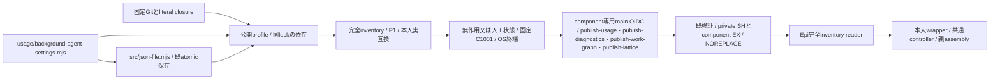
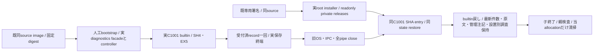
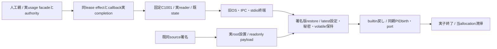
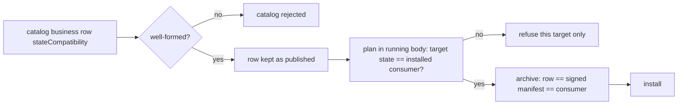

# usage・diagnostics・work-graph・latticeの固定配布

配布センチ。業務はMika/Signal、reader・固定C・controllerは[Epi](../runtime/module-release.md)、親assemblyと通常mainはMolly。既archive/公式OIDC/root設置/catalogの閉集合へusage・diagnostics・work-graph（相関図、業務Black、親Molly）・lattice（Lattice工程表、業務Flora、親Molly）だけを追加する。

usageはentryから到達する固定inventory（設定guideとsubscriptions JSON2、背景agent設定とその依存src/json-file.mjsを含む）とpackage/lock。src/distribution-profile.mjsだけは既public packageと同じ配布版へ置き換える。Node組込のみでnpm実行0。diagnosticsは固定12fileとpackage/lock、SDK/types依存は同Git lockの通常npm ci --omit=devで固定し、他componentのsrcを収録しない。未知srcや任意追加payloadを拒否する。完全inventoryで全Node依存を確認し、私有state/資格/本文/DBは収録しない。

背景agent設定の業務source・唯一writer・閉I/Oはusage所有。配布はBUSINESS_FILES['usage']へ上の2fileだけを追加し、同じ固定sourceのpackage生成と完全inventory検証へ渡す。既6設定の保存形式・互換値や他componentのclosureは変更しない。新backendのsourceと同じ通常候補へ接続し、closureだけを先行配布しない。

work-graphはBUSINESS_FILES['work-graph']の固定closure（entryから到達する全src: entry/dispatcher/ipc/locks/protocol/work-graph/core/projectionと共通module-ipc/locks/streams、package/lock）で、state fileを持たない（stateCompatibility {state:'none'}）。署名前probeはscripts/probe-work-graph-runtime.mjsを使い、人工state/logsだけを準備する。親probeの補助src（notifications-ipcとweb-push-schema）はusage/diagnosticsと同じ一時親directoryに置く。

latticeはBUSINESS_FILES['lattice']の固定closure（entryから到達する全src: entry/dispatcher/ipc/locks/protocol/lattice/core・cli・projectionと共通module-ipc/locks/streams、package/lock）で、state fileを持たない（stateCompatibility {state:'none'}）。body専用のlattice/http-api・mcpは収録しない。package/lockだけは本体rootのものではなく、同source commitの`distribution/lattice/package.json`・`package-lock.json`で置き換えてから同じ`npm ci --omit=dev`を実行し、`@quolu/lattice`とその依存（tree-sitter-wasms・web-tree-sitterの`.wasm`を含む）だけを収録する。本体rootの依存へは足さない。`@quolu/lattice`の版は`todo display source/read`入りの最小版0.85.5に固定する。署名前probeはscripts/probe-lattice-runtime.mjsで、人工state/logsだけを準備し、親probeの補助srcはwork-graphと同じ一時親directoryに置く。

実互換はusage/state-compatibility.mjs、work-graph-protocol.mjs、lattice-protocol.mjs又はdiagnostics-protocol.mjsの本人exportへ一致させ、Node26/P1、catalog stateSchemaとcontainerUpdateはnull。別のstate番号は作らない。署名policyは各専用workflowのrefs/heads/main、repositoryId1404510084、source/signer/archiveを固定。検証前のarchive JavaScript実行は禁止し、信頼済imageのexportと比較する。

既root helperがprivate0750のSH/component EXを取り、署名・同source/platform/互換/完全inventoryを検査しimmutable0555/0444のcomponent/releases/SHAへNOREPLACE公開する。normalのstate/親席/他moduleには触れず、readerやcontrollerの採用は別工程。実Host操作・catalog公開は実施しない。

署名前probeは既membersのroot作業割当/Node固定mount/cleanupを再利用し、usage・diagnostics・work-graph・latticeだけの固定C wrapperを実UID1001/advanced IPCへ接続する。人工state/logsとusage設定leafだけを準備し実資格を使わない。親probeの補助srcは別のroot一時directoryに置き、子/appのarchive closure不足を補完しない。本人の無引数probeでready/initialize/resume/quiesce/exit/OScloseを確認し、成功後だけOIDCへ進む。原stdout/stderrを残し全一時root/Node mountを回収。これはunsigned builtin入口の確認であり別bundleへの交換/本番ではない。

## 診断の同image署名交換fixture

`verify-diagnostics-image.yml`は入力の通常source/既image run/専用署名run/index digestを完全一致させ、既imageをpullするだけの両native検査。image生成・署名再発行・本番操作はしない。`diagnostics-real-boundary.py`は既Web fixtureの有限allocationラベル/元ZIP SHA-size/GET限定retry/自己cleanupを再利用し、同imageのroot installerで署名bundleを配置する。tamper/source不一致は公開前に拒否し、同親の正常動作中もprivate全体EXを拒否する。

guestは通常imageのcreateDiagnosticsFacade/createDiagnosticsProcessを直接使い、spawn観測wrapperは固定Cコマンド/argv/envを検査してそのままNode spawnへ渡す。prepareReleaseのDIや偽署名descriptorは使わない。実1001/C/advanced IPC、child自身のlock検証に加え親からFD4/5のdev/inoとkernel FLOCK/PID、実entry/cwdを確認する。各交換では受付済recordを再送せず保存まで待ち、旧close時の診断file/notes bytes・mode・mtimeが新restore後も一致する。変更は署名世代の最新管理noteと再発countへ残し、戻しでsnapshot巻戻しをしない。

人工親・独立business子と実HTTP gatewayのPID/birth/port/HTTP200を保持し、normal CID/image/mount/readonlyも不変。これは製品wrapper/facadeの実交換検査であり、通常アプリ全bootstrap/公開更新HTTP/module-all ledger/本番の成功とはしない。失敗時は途中status/stdout/stderr/process情報を清掃前に保存する。検査helper・専用workflow・図だけの採用を通常imageの追加build理由にしない。

有限native fixtureの状態出力はphaseを検査工程（ready/b-active/done）、runtimePhaseを実controller snapshot.phaseとして分ける。snapshotの展開で検査工程を上書きせず、親/子の不変条件を確認してから同じatomic renameで公開する。製品snapshotの契約、45秒期限、実交換・署名・cleanup条件は変更しない。

## usageの同image署名交換fixture

`verify-usage-image.yml`は既通常558b/image7629と同source専用署名を固定入力とし、同じ有限allocation/GET/実root installer/自己cleanupへ接続する。Centiの`usage-runtime-guest.mjs`は実固定C1001/advanced IPC/SH4・EX5とkernel PID lockを観測し、prepareReleaseやchildを置換しない。業務境界はMikaの`test/helpers/usage-native-business.mjs:createUsageNativeFixture({root,spawnProcess})`が実wrapper/安定facade/authority/同leaseを持ち、start/replace/verify/close/snapshotを供給する。人工12portsだけを閉じ込め、実認証・AI・通知providerを呼ばない。

外側はstate/owner/settingsの実regular fileをSHA-size/mode/mtimeで検査し、fixture通信・lock・採用recordだけを比較から除く。秘密値は原本へ出さずhashだけを保持。旧close時→新spawn直前→restore後を一致させ、helperの受付済設定callbackを交換drain中に完了する。同Cの3世代・親/別business/HTTP gateway保持、tamper/source公開前拒否とprivate全体EX拒否も既有限手順内で確認する。phaseはfixture工程、runtimePhaseは実controller状態として分離する。製品変更・追加image・再署名・Host操作はしない。人工bootstrap/portでの実component検査であり、通常全bootstrap/public Update ledger/実SDK席の証明にはしない。

## Catalog rows keep their own published state, 2026-11-09 JST

Cause (Trony request, Web777 catalog publisher run 42572426013 at ffb64bea): the preflight `validate_catalog(strict=True)` failed with `UPDATE_MODULE_STATE_INCOMPATIBLE` on the two published `usage` rows (source 30b509d8). Those rows truthfully carry `secretEncoding: utf8-exclusive-0600`, the state of the artifact that is installed now. C5 (next section) moved this source's BUSINESS_STATE['usage'] to `stored-or-private-reference-v1`, and `validate_business_compatibility` required every catalog row to equal the reader's own current source state. So one module's source change rejected the whole catalog, Web included. The same check in an installed body would reject a future catalog that carries the new usage rows. That catalog-wide equality names no protection of its own: the stored state is protected per target at plan time, where the running body's validator (`assertUsageStateCompatibility` etc. in `container-update-host.py` plan) checks the target row against the installed consumer and refuses only that target.

From this change on, the catalog check for usage/diagnostics/work-graph/execution checks only the form of `stateCompatibility`: a nonempty token (at most 128 characters), or an object of 1..32 lowercase-initial alphanumeric keys (at most 64 characters) whose values are tokens, nonnegative integers less than 2^31, or lists of at most 32 tokens. Tokens match `[A-Za-z0-9._:,/+-]{1,128}`. Exact keys, int/None ABI fields and nodeMajor/parentProtocol stay fixed. `validate_business_archive` still requires catalog row == signed archive manifest == the consumer being installed. Catalog bytes and rows are not rewritten.

Impact: `scripts/update_catalog.py:validate_business_compatibility` and `test/business-artifact.test.py`. Callers: `validate_catalog` (publisher preflight and readers through `verify-update-catalog.py`), `validate_business_archive` (archive/consumer equality unchanged). Installed bodies keep the old check until the next body. members/memory/conversation follow the same rule since 2026-11-09 ([update-catalog](update-catalog.md#published-rows-keep-their-own-state-all-compound-components-2026-11-09-jst)).

## C5 secret reference state and child closure (2026-11-09)

Centi authorized these source-contract edits in Mika's C5 diff. `SecretRequests` and the usage process validators import `usage/secret-credentials.mjs`, which imports `usage/onepassword-source.mjs`; BUSINESS_FILES['usage'] includes both files in the child artifact. NativeSecretCredentials is reached only from the parent usage-assembly and stays outside the child artifact.

Private reference sources and opaque credential records extend the state interpretation: BUSINESS_STATE['usage'].secretEncoding and the usage export both become `stored-or-private-reference-v1`. Legacy stored values remain readable by the new code; old usage code cannot interpret a submitted reference record with no value path. Packaging, catalog descriptors and the installed consumer must advertise the same new encoding. Activation requires the compatible next parent/body and its native provider connection; the already signed/published catalog and selections are not rewritten by this source diff. Source adoption is neither publication nor live provider/SSH verification. The detailed data flow and guards are canonical in [usage secret credentials](../usage/secret-credentials.md).

## Owner key settings / revoked state v2

Centi consent extends the usage source contract to `stored-or-private-reference-v2` in the usage export and BUSINESS_STATE together. V2 adds Owner-origin botId:null request scope, durable handle revocation and parent selection tombstones. An old v1 child must not restore this interpretation or resurrect a revoked selection. The existing child closure is reused; native/selection parent code stays outside it. Existing signed v1 descriptors retain their original meaning. Supply/activation still requires the compatible parent/body and matching v2 usage, under unchanged authorization.

## 1Password settings feature in BUSINESS_STATE

The usage export's `settingsFeatures` gained `onePassword` (9f4352e7, Settings 1Password連携), but BUSINESS_STATE['usage'] was not changed with it, so `test/business-artifact.test.py` (the first step of publish-usage.yml) and the packager's MODULE_SOURCE_STATE_INCOMPATIBLE check refused every usage archive from a body that carries it. BUSINESS_STATE['usage'] now lists the same seven features. Bodies whose usage export has seven features read only a seven-feature usage row as compatible; the published six-feature row stays `incompatible` for them. No state file, migration or catalog validator changes.

## Install verification reads one state truth (Mika, 22737f56 usage install)

Cause: production usage install on body 22737f56 (Trony op 7a01dc5f) failed in `verifying` as HOST_UPDATE_EXECUTION_FAILED. Plan/preflight judged the target against the image JS export (`USAGE_STATE_COMPATIBILITY`, which had `onePassword`), but install verification judged the same manifest against the Python literal BUSINESS_STATE['usage'] (which did not), so plan said compatible while install could never pass.

Data flow after this change (install side only):

| Step | Reads state from | Contract |
|---|---|---|
| `module_artifact_verifier.authenticate` (memory/usage/diagnostics/execution/work-graph/lattice) | trusted image `/app/src/<module>.mjs` export, read **before** the archive | `check_archive(..., state=export)`; the manifest's `runtime.stateCompatibility` must equal it exactly; mismatch or bad form -> `<COMPONENT>_IMAGE_STATE_INCOMPATIBLE` |
| `install-web-gateway-release.extract` (same six) | the verifier receipt's manifest state (already matched to the export) | `validate_manifest(..., state=verified)`; never the Python literal |
| `container-update-host.execute_module_installer` | installer exit + last stderr line | non-zero exit -> `Failure(<installer code>)` (e.g. `USAGE_INSTALL_FAILED`), else `HOST_MODULE_INSTALL_FAILED`; no longer the generic HOST_UPDATE_EXECUTION_FAILED |

`validate_manifest` with an explicit `state` now raises `MODULE_STATE_INCOMPATIBLE` on inequality. Members/conversation keep their contract() literals (no JS check at install). Packaging keeps the publish-time literal == source export check (MODULE_SOURCE_STATE_INCOMPATIBLE): a stale literal now fails loudly at publish, never silently at production install. No state file, catalog, migration or privilege changes.
