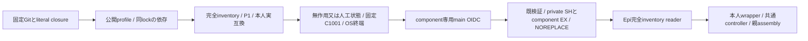
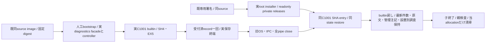

# usage・diagnosticsの固定配布

配布センチ。業務はMika/Signal、reader・固定C・controllerは[Epi](../runtime/module-release.md)、親assemblyと通常mainはMolly。既archive/公式OIDC/root設置/catalogの閉集合へusageとdiagnosticsだけを追加する。

usageはentryから到達する固定30file（設定guideとsubscriptions JSON2を含む）とpackage/lock。src/distribution-profile.mjsだけは既public packageと同じ配布版へ置き換える。Node組込のみでnpm実行0。diagnosticsは固定12fileとpackage/lock、SDK/types依存は同Git lockの通常npm ci --omit=devで固定し、他componentのsrcを収録しない。未知srcや任意追加payloadを拒否する。完全inventoryで全Node依存を確認し、私有state/資格/本文/DBは収録しない。

実互換はusage/state-compatibility.mjs又はdiagnostics-protocol.mjsの本人exportへ一致させ、Node26/P1、catalog stateSchemaとcontainerUpdateはnull。別のstate番号は作らない。署名policyは各専用workflowのrefs/heads/main、repositoryId1404510084、source/signer/archiveを固定。検証前のarchive JavaScript実行は禁止し、信頼済imageのexportと比較する。

既root helperがprivate0750のSH/component EXを取り、署名・同source/platform/互換/完全inventoryを検査しimmutable0555/0444のcomponent/releases/SHAへNOREPLACE公開する。normalのstate/親席/他moduleには触れず、readerやcontrollerの採用は別工程。実Host操作・catalog公開は実施しない。

署名前probeは既membersのroot作業割当/Node固定mount/cleanupを再利用し、usage・diagnosticsだけの固定C wrapperを実UID1001/advanced IPCへ接続する。人工state/logsとusage設定leafだけを準備し実資格を使わない。親probeの補助srcは別のroot一時directoryに置き、子/appのarchive closure不足を補完しない。本人の無引数probeでready/initialize/resume/quiesce/exit/OScloseを確認し、成功後だけOIDCへ進む。原stdout/stderrを残し全一時root/Node mountを回収。これはunsigned builtin入口の確認であり別bundleへの交換/本番ではない。

## 診断の同image署名交換fixture

`verify-diagnostics-image.yml`は入力の通常source/既image run/専用署名run/index digestを完全一致させ、既imageをpullするだけの両native検査。image生成・署名再発行・本番操作はしない。`diagnostics-real-boundary.py`は既Web fixtureの有限allocationラベル/元ZIP SHA-size/GET限定retry/自己cleanupを再利用し、同imageのroot installerで署名bundleを配置する。tamper/source不一致は公開前に拒否し、同親の正常動作中もprivate全体EXを拒否する。

guestは通常imageのcreateDiagnosticsFacade/createDiagnosticsProcessを直接使い、spawn観測wrapperは固定Cコマンド/argv/envを検査してそのままNode spawnへ渡す。prepareReleaseのDIや偽署名descriptorは使わない。実1001/C/advanced IPC、child自身のlock検証に加え親からFD4/5のdev/inoとkernel FLOCK/PID、実entry/cwdを確認する。各交換では受付済recordを再送せず保存まで待ち、旧close時の診断file/notes bytes・mode・mtimeが新restore後も一致する。変更は署名世代の最新管理noteと再発countへ残し、戻しでsnapshot巻戻しをしない。

人工親・独立business子と実HTTP gatewayのPID/birth/port/HTTP200を保持し、normal CID/image/mount/readonlyも不変。これは製品wrapper/facadeの実交換検査であり、通常アプリ全bootstrap/公開更新HTTP/module-all ledger/本番の成功とはしない。失敗時は途中status/stdout/stderr/process情報を清掃前に保存する。検査helper・専用workflow・図だけの採用を通常imageの追加build理由にしない。
