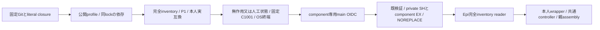

# usage・diagnosticsの固定配布

配布センチ。業務はMika/Signal、reader・固定C・controllerは[Epi](../runtime/module-release.md)、親assemblyと通常mainはMolly。既archive/公式OIDC/root設置/catalogの閉集合へusageとdiagnosticsだけを追加する。

usageはentryから到達する固定30file（設定guideとsubscriptions JSON2を含む）とpackage/lock。src/distribution-profile.mjsだけは既public packageと同じ配布版へ置き換える。Node組込のみでnpm実行0。diagnosticsは固定12fileとpackage/lock、SDK/types依存は同Git lockの通常npm ci --omit=devで固定し、他componentのsrcを収録しない。未知srcや任意追加payloadを拒否する。完全inventoryで全Node依存を確認し、私有state/資格/本文/DBは収録しない。

実互換はusage/state-compatibility.mjs又はdiagnostics-protocol.mjsの本人exportへ一致させ、Node26/P1、catalog stateSchemaとcontainerUpdateはnull。別のstate番号は作らない。署名policyは各専用workflowのrefs/heads/main、repositoryId1404510084、source/signer/archiveを固定。検証前のarchive JavaScript実行は禁止し、信頼済imageのexportと比較する。

既root helperがprivate0750のSH/component EXを取り、署名・同source/platform/互換/完全inventoryを検査しimmutable0555/0444のcomponent/releases/SHAへNOREPLACE公開する。normalのstate/親席/他moduleには触れず、readerやcontrollerの採用は別工程。実Host操作・catalog公開は実施しない。

署名前probeは既membersのroot作業割当/Node固定mount/cleanupを再利用し、usage・diagnosticsだけの固定C wrapperを実UID1001/advanced IPCへ接続する。人工state/logsとusage設定leafだけを準備し実資格を使わない。親probeの補助srcは別のroot一時directoryに置き、子/appのarchive closure不足を補完しない。本人の無引数probeでready/initialize/resume/quiesce/exit/OScloseを確認し、成功後だけOIDCへ進む。原stdout/stderrを残し全一時root/Node mountを回収。これはunsigned builtin入口の確認であり別bundleへの交換/本番ではない。
