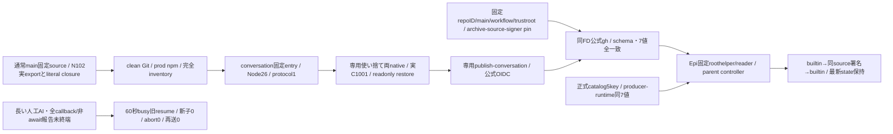

# conversationの固定artifact・公式認証

配布所有センチ。Root conversation-update-contract v1（133222cf）が横断正本。唯一writer/実互換exportはN102、C/channel/controller/FDはEpi、親facade/通常mainはMolly、execution callback lifetimeはKiroが所有する。

component=conversationだけを既固定allowlistへ追加する。entry=payload/src/conversation-entry.mjs、runtime=os linux/arch amd64又はarm64/nodeMajor26/parentProtocol1/stateSchema:null/stateCompatibility。stateCompatibilityはRootのdirectRecordSchemas/roomRecordSchemas/roomSchema/scheduleSchema/selfTurnsSchema/imageMimeTypes/readerContractの厳密7key・値・配列順。N102のsrc/conversation/state-compatibility.mjs CONVERSATION_STATE_COMPATIBILITYとassertを一正本にし、producerは固定source実exportへ全一致assert。配布期待値は固定Root契約を検証するための写像であり、writerの代替schema/実state検証を作らない。verifierはarchive JSを実行しない。

catalogもconversationだけnodeMajor,parentProtocol,stateSchema,containerUpdate,stateCompatibilityの厳密5key、26/1/null/null/実7値。未知/不足/余剰/型変換/部分一致/配列順違い、catalog/archive/consumer/source/platform/digest不一致を拒否。validate_conversation_archive(release,manifest,consumer_state)を公開し、既membersの関数と他4componentの型/意味は保持する。正式catalog producerは既公開asset SHA-size/専用公式署名/完全inventoryと現実exportを照合する。正式catalog/Release発行自体は別条件。

package-conversation.py/verify-conversation.pyは既共通内部処理の固定入口。config/conversation-verification.jsonは既repoID1404510084/main/SLSAv1・専用publish-conversation.yml・既trustrootに固定し、他component署名を流用しない。PR307の固定entry import closure52srcと作者probe-fixture.json、package/lockの55fileをliteral収録し、既clean prod lock依存を加える。notifications-ipcが読むusage/web-push-schemaは子の静的依存なのでpayloadへ収録し、親probeだけへ補わない。子dispatcherはobserver snapshot/check/readを閉parent effectへ固定注入するため、旧既定observer経由のrun-seat-command/runtime-home資材は追加しない。親専用conversation-lifetimesはarchiveへ含めず、署名前probeの別一時rootへ同checkoutから一つだけ補う。子/appへ親sourceを補って欠落を隠さない。秘密/settings/env/実stateをarchiveへ含めない。512MiB/20000file等の既完全inventory/link/越境拒否を保つ。

初回image導入はRoot既停止境界。署名前probeと親probeは同source/appの依存へ束縛し、readonly readyでは外部Jev/資格取得/observer/予定/初期案内/cleanup/migration0。初回は同source builtin/signed/builtinだけ、長い人工AIと遅い最終callback/非await派生報告は旧維持・busy、新子0/AIabort0/本文再送0、短い全終端後だけ交換を実測する。旧子quiesced/実OSexit/stdio close/専用lock解放前に新writerを起動しない。新子失敗は同最新stateへ一回固定旧builtin restore、snapshot巻戻し無し。親Web/SSE/他module/receipt/process保持と専用cleanupまで原本で確認する。生きた回答の世代移譲や長いAI中即時交換を証明したとは記さない。

作者f0fa wrapper/probeと7a73267共通reader/controllerの固定sourceは供給済み。配布schema sourceだけで通常image/署名/OS成立を加算しない。既members最終受入は完了保持、旧成功群再走/通常Root再採否gateを足さない。実vendorAI/席/予定発行/資格発行/Host/本番/正式catalog公開は本差分から実施しない。

## 公開packageと固定imageへの収録

Epi foundation91d1ff94の固定scripts/conversation-start.cとscripts/install-conversation-release.py、配布のverify-conversation.pyとconfig/conversation-verification.jsonをpackage-serverの明示allowlistへ収録する。共有Web roothelper/Python検証器/trustrootは従来の同ファイルを使い、全srcも既収録のまま。public flatten後もhelperのimport先とpolicyの相対位置を維持する。Host root-code-pathsの14entry形は増やさず、既共有fileの最終bytes/hashを既manifest生成で更新する。

Dockerfileは会話Cを固定/usr/local/libexec/bellteam-conversation-startへcompileし、root:root/0755の非setuidにする。UID1001/Node固定/匿名advanced IPC/専用lockの意味はruntime作者Cが所有し、配布側に任意path/UID/envを足さない。公開package有限試験は新4fileのarchive収録と元bytes一致、個人state/資格の非収録、14entry inventoryの整合を確認する。C作者と合成した実public packageも同bytesへ束縛するが、image build/実root起動/署名/native成功を代用しない。entry/probeの完成sourceとN102正規restore fixtureが揃った後に専用署名workflowと実物へ接続する。

## 専用署名前probeと作者restore入力

publish-conversation.ymlは固定main/両native/Node26の専用OIDC workflow。同一checkout SHAからclean prod archiveを生成し、未署名の固定C/UID1001 probeが正常終端した後だけattestする。source/signer/main/repoIDを公式verifierで確認しarchive/bundleと診断原本を保存する。workflowの存在は発行許可/実行成功ではなく、entry/dispatcher/引数0 runtime probeの完成sourceと通常mainへ結合して必要一回だけ発行する。

test/helpers/conversation-artifact-probe.pyは既membersの使い捨てroot/private mount namespace・固定Node/C・独立/tmpの同source親probe・有限KILL/reap/自己回収を再利用する。N102 src/conversation/probe-fixture.json（先着9a7cbb9d）の同archive/同checkout bytes一致を検査し、固定Room定義/空schedule/selfTurnsの3fileをJSON stringify+LF/0600、dir0700で事前配置。表示snapshotは同assetのbots、generationはruntime発行、initialize modeはrestoreでありseedに実予定/資格/画像/履歴を含めない。初回lockも1001/0600で事前作成し、全state file-directoryのbytes/mode/uid/gid/mtimeを起動前後比較する。親probeはpayloadを複製した独立/tmpで実行し、parent lifetimesだけ同checkoutから補う。親probeを署名payloadへ足さず、archiveをinstallationとして公開しない。成功receiptは合意した厳密JSON/実child closeだけを受け取り、Jev/外部effect0は作者runtime probeの実channelへ結合して確認する。

N102 f0fa4652の固定wrapper/無引数probeとEpi7a73267の共通reader/controllerを最終接点とする。probeの成功JSONは上記identity/実互換/childClosedに加えnativeAuth:falseとexternalEffects:0を必須とし、欠測・余剰・型違い・作用発生を拒否する。配布側は作者receiptへの接続だけを直し、親authority/制御・cleanup・state不変条件は変更しない。固定sourceの供給と実C/署名/nativeの成立は分け、後者は同通常mainから検証する。

## 同imageの状態保持・根寿命fixture

`verify-conversation-image.yml`は同sourceの既auto imageと専用署名runを固定して両nativeへpullし、既有限allocation/cleanupを再利用する。通常C/UID1001の人工supervisorから実`createApplicationRuntime`を作り、既bootstrapの通知だけ人工化する。会話の既定C/prepareRelease/loader/controllerと実親facadeは置換しない。既公開createProcessのspawnを観測し、onEffectへ業務helperの固定人工observer三口を渡す。

```mermaid
flowchart LR
  Inputs[同source imageと署名 / 元ZIP SHA-size] --> Plan[公開conversationInstallPlan / 実inspect]
  Plan --> Root[固定roothelper / 改竄と別source拒否]
  Root --> Runtime[実ApplicationRuntime / 会話C1001 / 既定loader]
  Runtime --> State[N102公開helper / builtin-署名-builtinの最新state保持]
  State --> Holds[Kiro実RPCのAI・callback・非awaitreportを保留]
  Holds --> Busy[各60秒busy / 旧resume / 新子0 / abort・再送0]
  Busy --> Done[実operationDoneまで解放]
  Done --> Return[再度署名-builtin / 最新全root不変]
  Return --> Cleanup[実OS-IPC終端 / 親PIDbirth-port保持 / 所属資材回収]
```

状態保持と人工AI追記は同root内で段階を分ける。N102の厳密な履歴・cursor/token・元不正bytes・Room・表示Botの三段検査を先に終え、同helperはobserver口以外を元onEffectへ同params/contextで渡し、後半の根寿命段階も観測する。AIをN102の固定timelineへ混ぜて成功を作らない。三つの保留を実終端まで解放した後に再度往復し、最新AI記録も含む全rootのbytes/mode/uid/gid/mtimeを旧OScloseと新restore間で照合する。全五子世代の正常OS/IPC/pipe終端とprivateSH・会話EX、同親Web/port保持を確認する。背景selfTurnsの初回poll/実5秒timerは無効化せず、人工observerはunchangedで外部CLI/新turn/保存0を返す。

fixtureの公開入力はsource/digest/supply_run/image_run。異source/別workflow/別repo/異arch/改竄は署名設置や作用前に拒否する。実席・実vendorAI・Host・公開catalog・本番反映の証明には広げない。
