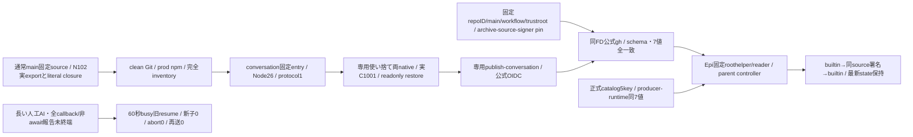

# conversationの固定artifact・公式認証

配布所有センチ。Root conversation-update-contract v1（133222cf）が横断正本。唯一writer/実互換exportはN102、C/channel/controller/FDはEpi、親facade/通常mainはMolly、execution callback lifetimeはKiroが所有する。

component=conversationだけを既固定allowlistへ追加する。entry=payload/src/conversation-entry.mjs、runtime=os linux/arch amd64又はarm64/nodeMajor26/parentProtocol1/stateSchema:null/stateCompatibility。stateCompatibilityはRootのdirectRecordSchemas/roomRecordSchemas/roomSchema/scheduleSchema/selfTurnsSchema/imageMimeTypes/readerContractの厳密7key・値・配列順。N102のsrc/conversation/state-compatibility.mjs CONVERSATION_STATE_COMPATIBILITYとassertを一正本にし、producerは固定source実exportへ全一致assert。配布期待値は固定Root契約を検証するための写像であり、writerの代替schema/実state検証を作らない。verifierはarchive JSを実行しない。

catalogもconversationだけnodeMajor,parentProtocol,stateSchema,containerUpdate,stateCompatibilityの厳密5key、26/1/null/null/実7値。未知/不足/余剰/型変換/部分一致/配列順違い、catalog/archive/consumer/source/platform/digest不一致を拒否。validate_conversation_archive(release,manifest,consumer_state)を公開し、既membersの関数と他4componentの型/意味は保持する。正式catalog producerは既公開asset SHA-size/専用公式署名/完全inventoryと現実exportを照合する。正式catalog/Release発行自体は別条件。

package-conversation.py/verify-conversation.pyは既共通内部処理の固定入口。config/conversation-verification.jsonは既repoID1404510084/main/SLSAv1・専用publish-conversation.yml・既trustrootに固定し、他component署名を流用しない。全src/package-lockとclean prod依存を基本収録し、固定entry接続後の実literal closureと追加static assetを作者sourceへ束縛する。秘密/settings/env/実stateをarchiveへ含めない。512MiB/20000file等の既完全inventory/link/越境拒否を保つ。

初回image導入はRoot既停止境界。署名前probeと親probeは同source/appの依存へ束縛し、readonly readyでは外部Jev/資格取得/observer/予定/初期案内/cleanup/migration0。初回は同source builtin/signed/builtinだけ、長い人工AIと遅い最終callback/非await派生報告は旧維持・busy、新子0/AIabort0/本文再送0、短い全終端後だけ交換を実測する。旧子quiesced/実OSexit/stdio close/専用lock解放前に新writerを起動しない。新子失敗は同最新stateへ一回固定旧builtin restore、snapshot巻戻し無し。親Web/SSE/他module/receipt/process保持と専用cleanupまで原本で確認する。生きた回答の世代移譲や長いAI中即時交換を証明したとは記さない。

作者entry/C/channel/固定probe/共通factoryの実sourceは別担当供給待ち。配布schema sourceだけで通常image/署名/OS成立を加算しない。既members最終受入は完了保持、旧成功群再走/通常Root再採否gateを足さない。実vendorAI/席/予定発行/資格発行/Host/本番/正式catalog公開は本差分から実施しない。

## 公開packageと固定imageへの収録

Epi foundation91d1ff94の固定scripts/conversation-start.cとscripts/install-conversation-release.py、配布のverify-conversation.pyとconfig/conversation-verification.jsonをpackage-serverの明示allowlistへ収録する。共有Web roothelper/Python検証器/trustrootは従来の同ファイルを使い、全srcも既収録のまま。public flatten後もhelperのimport先とpolicyの相対位置を維持する。Host root-code-pathsの14entry形は増やさず、既共有fileの最終bytes/hashを既manifest生成で更新する。

Dockerfileは会話Cを固定/usr/local/libexec/bellteam-conversation-startへcompileし、root:root/0755の非setuidにする。UID1001/Node固定/匿名advanced IPC/専用lockの意味はruntime作者Cが所有し、配布側に任意path/UID/envを足さない。公開package有限試験は新4fileのarchive収録と元bytes一致、個人state/資格の非収録、14entry inventoryの整合を確認する。C作者と合成した実public packageも同bytesへ束縛するが、image build/実root起動/署名/native成功を代用しない。entry/probeの完成sourceとN102正規restore fixtureが揃った後に専用署名workflowと実物へ接続する。
