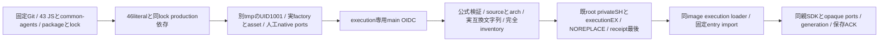

# execution固定factoryの配布

配布はセンチ。engine/generationは[キロ](../execution/host-factory.md)、固定loader/receiptは[エピネル](../runtime/execution-loader.md)、親live ports/採用保存ACKと通常mainはモリー。親controllerを子プロセス型へ作り直さない。

入口はpayload/src/execution-dispatcher.mjs、Node26/Linux/P1、stateCompatibilityは実export文字列bellteam.execution-state.v1のまま。catalog5keyのstateSchema/containerUpdateはnull。package/lockは同Git、SDK依存は通常npm ci --omit=dev。任意src追加や欠測common-agents、別source/platform/互換、改竄は公開前拒否。archive JSは認証中に実行せず、既信頼済imageのexportで照合する。

通常親DIのnative.call/connect/launchOptionsは親AitermClient receiver、waitProcess/handoffContext/write/removeも親application-servicesのclosureに束縛される。run-seat-command/run-seat-aiterm-launchは親/app側URL、run-seat-setupはbootstrapのみでengineから呼ばない。この3sidecarはpayloadに収録せず、private payloadのUID1000公開やfallbackを追加しない。任意custom/test portsの一般保証ではない。親assembly/generation/adoptionは通常imageに置き、engine literalへ増やさない。

署名前probeはrootが独立/tmpへ検査済みunsigned archiveだけを展開し、0555/0444の実payloadをUID1001の別Nodeで読む。実factory initialize→同期projection→quiesce/export/retire→同handoff復元→退役と同bundle reminder assetを有限確認。nativeはpty_list以外拒否する人工port、共有close0、空人工data不変、OSexitとcleanupを記録する。checkout祖先を別UIDへ公開せず、Node pathは固定CI入力のみ。これはunsigned factory/closureの確認であり、実SDK・署名交換・本番は別工程。

署名後は既root installerがprivate全体SH/executionEX、公式OIDC/source/arch/完全inventoryを確認し0555/0444/NOREPLACE・receipt最後で設置する。親loaderが実namespace/互換も照合してgenerationへ返す。実交換検査では旧actual0→export/retire→新restore→onAdopt実ACK→builtin戻しと同SDK/PTY保持を測る。本差分でHost操作・実席・実鍵・catalog公開は行わない。
